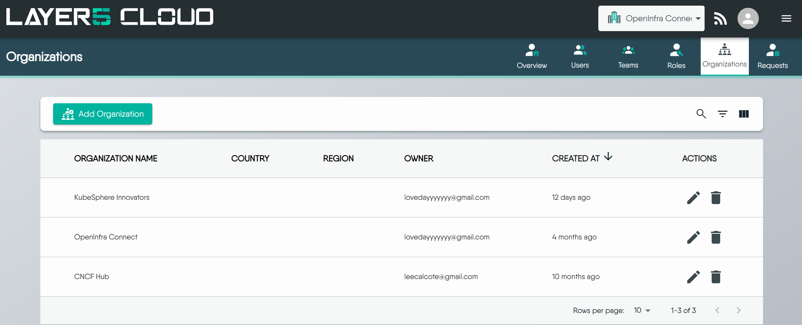
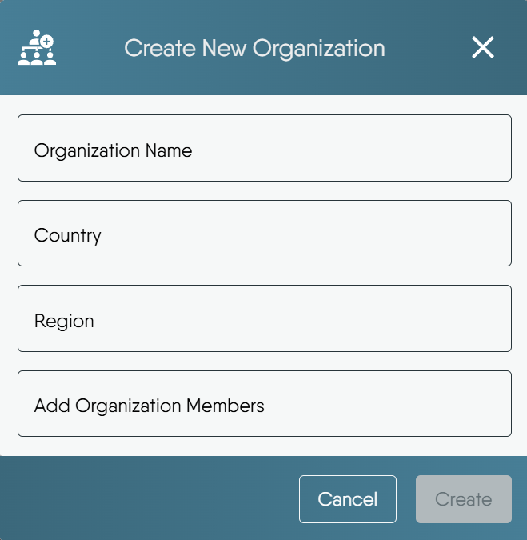
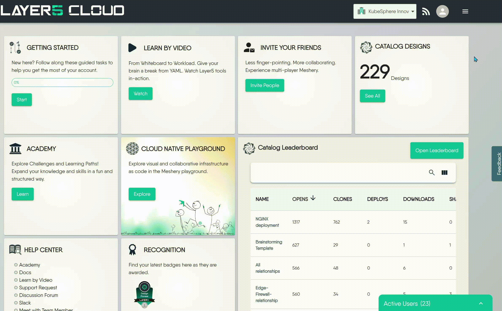
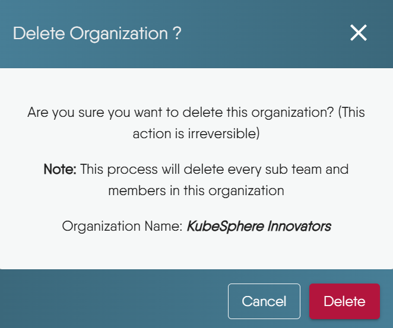

# Manage an Organization

> Create, edit, brand, switch between, and delete organizations in Layer5 Cloud, and learn which role can do each task.

An organization is the tenant boundary in Layer5 Cloud: teams, workspaces, roles, resources, and billing all attach to one. This guide covers the administrator tasks for an organization: create it, edit its branding and sign-in settings, manage its members, move between organizations, and delete it. For what an organization is and how it relates to teams and roles, see [Organizations](/cloud/concepts/identity-and-security/organizations/).

## Who can do what

The Organizations page opens for members who hold **View Org** or **View All Organizations**. Each task needs its own permission, and a few tasks are enforced more tightly than the permission matrix shows.

<table class="feature-tiers-table keys-matrix">
  <caption>Organization permissions</caption>
  <thead>
    <tr>
      <th scope="col">Permission</th>
      <th scope="col">What it allows</th>
      <th scope="col">User</th><th scope="col">Team Admin</th><th scope="col">Workspace Admin</th><th scope="col">Org Admin</th><th scope="col">Provider Admin</th>
    </tr>
  </thead>
  <tbody>
    
    
    
    
    
    
    
    
    
    
    
    
    
    
    
    
    
    
    
    
    
    
    
    
    
    
    
    
    
    
    
    
    
    
    
    
    
    
    
    
    
    
    
    
    
    
    
    
    
    
    
    
    
    
    
    
    
    
    
    
    
    
    
    
    
    
    
    
    
    
    
    
    
    
    
    
    
    
    
    
    
    
    
    
    
    
    
    
    
    
    
    
    
    
    
    
    
    
    
    
    
    
    
    
    
    
    
    
    
    
    
    
    
    
    
    
    
    <tr>
      <th scope="row">View Org</th>
      <td>See only organizations to which you are a member. See all other members within your membership teams.</td>
      
      
      <td class="tier-cell">&#10003;Allowed</td>
      
      
      <td class="tier-cell">&#10003;Allowed</td>
      
      
      <td class="tier-cell">&#10003;Allowed</td>
      
      
      <td class="tier-cell">&#10003;Allowed</td>
      
      
      <td class="tier-cell">&#10003;Allowed</td>
      
    </tr>
    
    
    
    
    
    
    
    
    
    
    
    
    
    
    
    
    
    
    
    
    
    
    
    
    
    
    
    
    
    
    
    
    
    
    
    
    
    
    
    
    
    
    
    
    
    
    
    
    
    
    
    
    
    
    
    
    
    
    
    
    
    
    
    
    
    
    
    
    
    
    
    
    
    
    
    
    
    
    
    
    
    
    
    
    
    
    
    
    
    
    
    
    
    
    
    
    
    
    
    
    
    
    
    
    
    
    
    
    
    
    
    
    
    
    
    
    
    
    
    
    
    
    
    
    
    
    
    
    
    
    
    
    
    
    
    
    
    
    
    
    
    
    
    
    
    
    
    
    
    
    
    
    
    
    
    
    
    
    
    
    
    
    
    
    
    
    
    
    
    
    
    
    
    
    
    
    
    
    
    
    
    
    
    
    
    
    
    
    
    
    
    
    
    
    
    
    
    
    
    
    
    
    
    
    
    
    
    
    
    
    
    
    
    
    
    
    
    
    
    
    
    
    
    
    
    
    
    
    
    
    
    
    <tr>
      <th scope="row">View Organizations</th>
      <td>See all organizations of which you are an administrator. See all members of those organizations.</td>
      
      
      <td class="tier-cell">-Not granted</td>
      
      
      <td class="tier-cell">-Not granted</td>
      
      
      <td class="tier-cell">-Not granted</td>
      
      
      <td class="tier-cell">&#10003;Allowed</td>
      
      
      <td class="tier-cell">&#10003;Allowed</td>
      
    </tr>
    
    
    
    
    
    
    
    
    
    
    
    
    
    
    
    
    
    
    
    
    
    
    
    
    
    
    
    
    
    
    
    
    
    
    
    
    
    
    
    
    
    
    
    
    
    
    
    
    
    
    
    
    
    
    
    
    
    
    
    
    
    
    
    
    
    
    
    
    
    
    
    
    
    
    
    
    
    
    
    
    
    
    
    
    
    
    
    
    
    
    
    
    
    
    
    
    
    
    
    
    
    
    
    
    
    
    
    
    
    
    
    
    
    
    
    
    
    
    
    
    
    
    
    
    
    
    
    
    
    
    
    
    
    
    
    
    
    
    
    
    
    
    
    
    
    
    
    
    
    
    
    
    
    
    
    
    
    
    
    
    
    
    
    
    
    
    
    
    
    
    
    
    
    
    
    
    
    
    
    
    
    
    
    
    
    
    
    
    
    
    
    
    
    
    
    
    
    
    
    
    
    
    
    
    
    
    
    
    
    
    
    
    
    
    
    
    
    
    
    
    
    
    
    
    
    
    
    
    
    
    
    
    <tr>
      <th scope="row">View All Organizations</th>
      <td>See all organizations within a Cloud deployment. See all organizations, teams, and users.</td>
      
      
      <td class="tier-cell">-Not granted</td>
      
      
      <td class="tier-cell">-Not granted</td>
      
      
      <td class="tier-cell">-Not granted</td>
      
      
      <td class="tier-cell">&#10003;Allowed</td>
      
      
      <td class="tier-cell">&#10003;Allowed</td>
      
    </tr>
    
    
    
    
    
    
    
    
    
    
    
    
    
    
    
    
    
    
    
    
    
    
    
    
    
    
    
    
    
    
    
    
    
    
    
    
    
    
    
    
    
    
    
    
    
    
    
    
    
    
    
    
    
    
    
    
    
    
    
    
    
    
    
    
    
    
    
    
    
    
    
    
    
    
    
    
    
    
    
    
    
    
    
    
    
    
    
    
    
    
    
    
    
    
    
    
    
    
    
    
    
    
    
    
    
    
    
    
    
    
    
    
    
    
    
    
    
    
    
    
    
    
    
    
    
    
    
    
    
    
    
    
    
    
    
    
    
    
    
    
    
    
    
    
    
    
    
    
    
    
    
    
    
    
    
    
    
    
    
    
    
    
    
    
    
    
    
    
    
    
    
    
    
    
    
    
    
    
    
    
    
    
    
    
    
    
    
    
    
    
    
    
    
    
    
    
    
    
    
    
    
    
    
    
    
    
    
    
    
    
    
    
    
    
    <tr>
      <th scope="row">Create Organization</th>
      <td>Establish new organization for organizing teams, users, and resource access.</td>
      
      
      <td class="tier-cell">-Not granted</td>
      
      
      <td class="tier-cell">-Not granted</td>
      
      
      <td class="tier-cell">-Not granted</td>
      
      
      <td class="tier-cell">&#10003;Allowed</td>
      
      
      <td class="tier-cell">&#10003;Allowed</td>
      
    </tr>
    
    
    
    
    
    
    
    
    
    
    
    
    
    
    
    
    
    
    
    
    
    
    
    
    
    
    
    
    
    
    
    
    
    
    
    
    
    
    
    
    
    
    
    
    
    
    
    
    
    
    
    
    
    
    
    
    
    
    
    
    
    
    
    
    
    
    
    
    
    
    
    
    
    
    
    
    
    
    
    
    
    
    
    
    
    
    
    
    
    
    
    
    
    
    
    
    
    
    
    
    
    
    
    
    
    
    
    
    
    
    
    
    
    
    
    
    
    
    
    
    
    
    
    
    
    
    
    
    
    
    
    
    
    
    
    
    
    
    
    
    
    
    
    
    
    
    
    
    
    
    
    
    
    
    
    
    
    
    
    
    
    
    
    
    
    
    
    
    
    
    
    
    
    
    
    
    
    
    
    
    
    
    
    
    
    
    
    
    
    
    
    
    
    
    
    
    
    
    
    
    
    
    
    
    
    
    
    
    
    
    
    
    
    
    
    
    
    
    
    
    
    
    
    
    
    
    
    
    
    
    
    
    <tr>
      <th scope="row">Edit Organization</th>
      <td>Edit organiaztions and add teams to it</td>
      
      
      <td class="tier-cell">-Not granted</td>
      
      
      <td class="tier-cell">-Not granted</td>
      
      
      <td class="tier-cell">-Not granted</td>
      
      
      <td class="tier-cell">&#10003;Allowed</td>
      
      
      <td class="tier-cell">&#10003;Allowed</td>
      
    </tr>
    
    
    
    
    
    
    
    
    
    
    
    
    
    
    
    
    
    
    
    
    
    
    
    
    
    
    
    
    
    
    
    
    
    
    
    
    
    
    
    
    
    
    
    
    
    
    
    
    
    
    
    
    
    
    
    
    
    
    
    
    
    
    
    
    
    
    
    
    
    
    
    
    
    
    
    
    
    
    
    
    
    
    
    
    
    
    
    
    
    
    
    
    
    
    
    
    
    
    
    
    
    
    
    
    
    
    
    
    
    
    
    
    
    
    
    
    
    
    
    
    
    
    
    
    
    
    
    
    
    
    
    
    
    
    
    
    
    
    
    
    
    
    
    
    
    
    
    
    
    
    
    
    
    
    
    
    
    
    
    
    
    
    
    
    
    
    
    
    
    
    
    
    
    
    
    
    
    
    
    
    
    
    
    
    
    
    
    
    
    
    
    
    
    
    
    
    
    
    
    
    
    
    
    
    
    
    
    
    
    
    
    
    
    
    
    
    
    
    
    
    
    
    
    
    
    
    
    
    
    
    
    
    <tr>
      <th scope="row">Add User to Organization</th>
      <td>Directly create a new user account within an organization.</td>
      
      
      <td class="tier-cell">-Not granted</td>
      
      
      <td class="tier-cell">-Not granted</td>
      
      
      <td class="tier-cell">-Not granted</td>
      
      
      <td class="tier-cell">&#10003;Allowed</td>
      
      
      <td class="tier-cell">&#10003;Allowed</td>
      
    </tr>
    
    
    
    
    
    
    
    
    
    
    
    
    
    
    
    
    
    
    
    
    
    
    
    
    
    
    
    
    
    
    
    
    
    
    
    
    
    
    
    
    
    
    
    
    
    
    
    
    
    
    
    
    
    
    
    
    
    
    
    
    
    
    
    
    
    
    
    
    
    
    
    
    
    
    
    
    
    
    
    
    
    
    
    
    
    
    
    
    
    
    
    
    
    
    
    
    
    
    
    
    
    
    
    
    
    
    
    
    
    
    
    
    
    
    
    
    
    
    
    
    
    
    
    
    
    
    
    
    
    
    
    
    
    
    
    
    
    
    
    
    
    
    
    
    
    
    
    
    
    
    
    
    
    
    
    
    
    
    
    
    
    
    
    
    
    
    
    
    
    
    
    
    
    
    
    
    
    
    
    
    
    
    
    
    
    
    
    
    
    
    
    
    
    
    
    
    
    
    
    
    
    
    
    
    
    
    
    
    
    
    
    
    
    
    
    
    
    
    
    
    
    
    
    
    
    
    
    
    
    
    
    
    
    
    <tr>
      <th scope="row">Remove User from Organization</th>
      <td>Discontinue user access to organization, teams and resources; cease billing accrual.</td>
      
      
      <td class="tier-cell">-Not granted</td>
      
      
      <td class="tier-cell">-Not granted</td>
      
      
      <td class="tier-cell">-Not granted</td>
      
      
      <td class="tier-cell">&#10003;Allowed</td>
      
      
      <td class="tier-cell">&#10003;Allowed</td>
      
    </tr>
    
    
    
    
    
    
    
    
    
    
    
    
    
    
    
    
    
    
    
    
    
    
    
    
    
    
    
    
    
    
    
    
    
    
    
    
    
    
    
    
    
    
    
    
    
    
    
    
    
    
    
    
    
    
    
    
    
    
    
    
    
    
    
    
    
    
    
    
    
    
    
    
    
    
    
    
    
    
    
    
    
    
    
    
    
    
    
    
    
    
    
    
    
    
    
    
    
    
    
    
    
    
    
    
    
    
    
    
    
    
    
    
    
    
    
    
    
    
    
    
    
    
    
    
    
    
    
    
    
    
    
    
    
    
    
    
    
    
    
    
    
    
    
    
    
    
    
    
    
    
    
    
    
    
    
    
    
    
    
    
    
    
    
    
    
    
    
    
    
    
    
    
    
    
    
    
    
    
    
    
    
    
    
    
    
    
    
    
    
    
    
    
    
    
    
    
    
    
    
    
    
    
    
    
    
    
    
    
    
    
    
    
    
    
    
    
    
    
    
    
    
    
    
    
    
    
    
    
    
    
    
    
    <tr>
      <th scope="row">Promote or Demote User to Org Admin</th>
      <td>Elevate or remove organization level administrative privileges.</td>
      
      
      <td class="tier-cell">-Not granted</td>
      
      
      <td class="tier-cell">-Not granted</td>
      
      
      <td class="tier-cell">-Not granted</td>
      
      
      <td class="tier-cell">&#10003;Allowed</td>
      
      
      <td class="tier-cell">&#10003;Allowed</td>
      
    </tr>
    
    
    
    
    
    
    
    
    
    
    
    
    
    
    
    
    
    
    
    
    
    
    
    
    
    
    
    
    
    
    
    
    
    
    
    
    
    
    
    
    
    
    
    
    
    
    
    
    
    
    
    
    
    
    
    
    
    
    
    
    
    
    
    
    
    
    
    
    
    
    
    
    
    
    
    
    
    
    
    
    
    
    
    
    
    
    
    
    
    
    
    
    
    
    
    
    
    
    
    
    
    
    
    
    
    
    
    
    
    
    
    
    
    
    
    
    
    
    
    
    
    
    
    
    
    
    
    
    
    
    
    
    
    
    
    
    
    
    
    
    
    
    
    
    
    
    
    
    
    
    
    
    
    
    
    
    
    
    
    
    
    
    
    
    
    
    
    
    
    
    
    
    
    
    
    
    
    
    
    
    
    
    
    
    
    
    
    
    
    
    
    
    
    
    
    
    
    
    
    
    
    
    
    
    
    
    
    
    
    
    
    
    
    
    
    
    
    
    
    
    
    
    
    
    
    
    
    
    
    
    
    
    
    
    
    
    
    
    
    
    <tr>
      <th scope="row">Assign Roles to Organization members</th>
      <td>Assign roles to users in an organization</td>
      
      
      <td class="tier-cell">-Not granted</td>
      
      
      <td class="tier-cell">-Not granted</td>
      
      
      <td class="tier-cell">-Not granted</td>
      
      
      <td class="tier-cell">&#10003;Allowed</td>
      
      
      <td class="tier-cell">&#10003;Allowed</td>
      
    </tr>
    
    
    
    
    
    
    
    
    
    
    
    
    
    
    
    
    
    
    
    
    
    
    
    
    
    
    
    
    
    
    
    
    
    
    
    
    
    
    
    
    
    
    
    
    
    
    
    
    
    
    
    
    
    
    
    
    
    
    
    
    
    
    
    
    
    
    
    
    
    
    
    
    
    
    
    
    
    
    
    
    
    
    
    
    
    
    
    
    
    
    
    
    
    
    
    
    
    
    
    
    
    
    
    
    
    
    
    
    
    
    
    
    
    
    
    
    
    
    
    
    
    
    
    
    
    
    
    
    
    
    
    
    
    
    
    
    
    
    
    
    
    
    
    
    
    
    
    
    
    
    
    
    
    
    
    
    
    
    
    
    
    
    
    
    
    
    
    
    
    
    
    
    
    
    
    
    
    
    
    
    
    
    
    
    
    
    
    
    
    
    
    
    
    
    
    
    
    
    
    
    
    
    
    
    
    
    
    
    
    
    
    
    
    
    
    
    
    
    
    
    
    
    
    
    
    
    
    
    <tr>
      <th scope="row">Remove Roles from Organization members</th>
      <td>Remove roles from users in an organization</td>
      
      
      <td class="tier-cell">-Not granted</td>
      
      
      <td class="tier-cell">-Not granted</td>
      
      
      <td class="tier-cell">-Not granted</td>
      
      
      <td class="tier-cell">&#10003;Allowed</td>
      
      
      <td class="tier-cell">&#10003;Allowed</td>
      
    </tr>
    
    
    
    
    
    
    
    
    
    
    
    
    
    
    
    
    
    
    
    
    
    
    
    
    
    
    
    
    
    
    
    
    
    
    
    
    
    
    
    
    
    
    
    
    
    
    
    
    
    
    
    
    
    
    
    
    
    
    
    
    
    
    
    
    
    
    
    
    
    
    
    
    
    
    
    
    
    
    
    
    
    
    
    
    
    
    
    
    
    
    
    
    
    
    
    
    
    
    
    
    
    
    
    
    
    
    
    
  </tbody>
</table>

| Task | Who is admitted |
|---|---|
| Create an organization | Holders of **Create Organization** (Organization Admin and Provider Admin by default) |
| Edit an organization, add or remove its teams, add a member | Organization Admin or Owner of that organization, Provider Admin, or Organization Admin or Owner of its parent |
| Set a domain to a new value | Provider Admin only |
| Clear a domain or keep the stored one | The administrators who can edit the organization |
| Remove a member | Holders of **Remove User from Organization** |
| Delete an organization | Its Owner, a Provider Admin, or Organization Admin or Owner of its parent. An Organization Admin who is not the Owner cannot delete it. |

## Creating an Organization {#creating-an-organization}

Create an organization to give a project, customer, or business unit its own teams, users, and resource access.

### How to create an Organization {#how-to-create-an-organization}

An organization takes these details:

| Field | Required | Notes |
|---|---|---|
| Organization Name | Yes | The form keeps Create disabled until you enter a name. |
| Country | No | Picked from a list. |
| Region | No | A time zone, picked from a list. |
| Members | No | Existing Layer5 Cloud users to add at creation. |

What creation does:

- **You become the Owner.** The creator is recorded as the organization's owner. Ownership cannot be transferred or removed (see [Limits](#limits-today)).
- **Members are added.** The form adds you and any users you picked as members.
- **A default workspace is created.** Every organization starts with one workspace named **My Workspace**, owned by you.
- **The event is recorded.** Layer5 Cloud logs a success or failure event for the creation.

The Add Organization control is disabled when your role lacks **Create Organization**. A new organization does not carry a domain. To give it one, see [Organization Configuration Scenarios](/cloud/guides/organizations/configuration-scenarios/).

## Child Organizations {#child-organizations}

An organization can have child organizations of its own, to any depth. A parent's Organization Administrator or Owner can edit a child's settings and membership, or delete it, without joining the child. Anything inside the child still requires membership in the child. A parent that still has children cannot be deleted. See [Child Organizations](child-organizations/) for details.

## Editing Your Organization {#editing-your-organization}

Editing changes how the organization looks, how its members sign in, and how it is reached.

### What you can edit {#how-to-edit-your-organization}

| Setting | What it controls |
|---|---|
| Name, country, region | The organization's identity in lists and switchers. |
| Domain | The address that routes users to the organization. See [Domain](#domain). |
| Open Org Invitation | The invitation that admits non-members who sign in through the organization. See [Using the Open Organization Invitation Link](#using-the-open-organization-invitation-link). |
| Theme and logos | Colors and four logos shown to members. See [Branding](#branding). |
| Links | Legal, support, and social links on sign-in pages and email footers. |
| Feature carousel | Whether the sign-in pages show the feature carousel. On by default. |
| Teams | Which teams belong to the organization. See [Teams](#teams-in-the-organization). |
| Identity Providers | The OAuth applications that power sign-in. See [below](#configuring-identity-providers-bring-your-own-credentials). |
| Email | The mail server the organization sends through. See [below](#configuring-your-own-mail-server). |

Every successful update is recorded as an event.

### Branding

Branding applies to the signed-in experience and, on an organization with its own domain, to the sign-in, sign-up, and error pages.

- **Theme colors.** Every color must be a hex value (`#rgb`, `#rgba`, `#rrggbb`, or `#rrggbbaa`). Layer5 Cloud rejects any other value with a 400 error that names the color. Resetting the theme also clears the logos.
- **Logos.** Four slots: desktop, mobile, dark desktop, and dark mobile. Each image can be at most 500 KB. A larger file fails the update with `image size exceeds the maximum limit`.
- **Links.** Terms of Service and Privacy Policy accept an `http` or `https` URL, a `mailto:` or `tel:` link, or a root-relative path. Support entries (Discussion Forum URL, Support Email, Slack URL) accept the same forms plus plain text without a colon, such as a bare email address. LinkedIn, X, and YouTube accept an absolute `http` or `https` URL. Layer5 Cloud silently drops a value it considers unsafe, including `javascript:` and `data:` links, instead of rejecting the update. Clearing every link restores the defaults. An organization that publishes any link of its own gets an email footer without the provider's channels for the ones it left empty.

### Domain

The domain field routes users who arrive at that address into the organization. Layer5 Cloud validates a changed domain when you save:

- It is 3 to 253 characters long.
- It is made of dot-separated labels of 1 to 63 ASCII letters, digits, or hyphens. A label cannot start or end with a hyphen. Write internationalized names in Punycode (`xn--`).
- It is a hostname, not an email address, and does not start with `http`, `https`, or `www`.
- It is not one of the provider's reserved hosts, including the canonical Layer5 Cloud address.
- It is unique. No two organizations share a domain, and the check includes deleted organizations (see [Deleting Your Organization](#deleting-your-organization)).

Validation is syntactic. Layer5 Cloud does not look the name up in DNS when you save, so a valid name that does not resolve yet is accepted.

Only a Provider Admin can set a domain to a new value. Any other caller receives a 403 error that says a domain requires a Provider Admin. Clearing the field removes the assignment and is open to the organization's administrators. Domain-to-organization lookups are cached for five minutes, and every organization create, update, and delete clears the affected entry immediately. Changing a domain can break routing for users who rely on the old address, so plan the change with the provider.

### Teams in the organization {#teams-in-the-organization}

Adding a team to an organization maps the team into it, and removing a team ends that mapping only. The team itself is not deleted. Adding a team requires an Organization Admin or Owner of the organization, or a Provider Admin. Removing a team also admits someone who is both Team Admin and Team Owner of that team. Removing a team that does not belong to the organization returns a 404 error.

### Configuring Identity Providers (Bring-Your-Own Credentials) {#configuring-identity-providers-bring-your-own-credentials}

The **Identity Providers** tab controls which OAuth applications power sign-in for your organization. This is most useful when your organization uses a custom domain and you want your own brand, not Layer5's, shown on the Google, GitHub, or OIDC consent screen.

By default, your organization uses Layer5's shared OAuth applications. To override them, add your own provider. There is no separate enable step:

- Use **Add Google**, **Add GitHub**, or **Add OIDC** to register a provider. Each walkthrough displays the exact redirect URI to add to your OAuth application. Saving your first provider switches the organization to its own identity providers automatically.
- Use **Edit** to rotate a provider's credentials, or **Remove** to delete a single provider. Removing your last provider reverts the organization to Layer5's defaults.
- Use **Delete All Identity Providers** to remove every configured provider at once. This deletes the environment that Layer5 Cloud provisioned to hold them, and the organization reverts to Layer5's default identity providers.

Every removal asks you to confirm and explains the consequences before it proceeds.

  <h4 class="alert-heading" style="color: #3772ff;">Who can configure this</h4>
  
      Organization Administrators and Owners can add, rotate, and remove their organization&rsquo;s identity providers themselves. Provider Administrators can additionally manage the identity providers and the other settings of <strong>any</strong> organization, whether or not they are members of it.
  

Switching identity providers does not affect existing user accounts or login history. Users who signed in through a provider you later remove may need to re-authenticate.

### Configuring Your Own Mail Server {#configuring-your-own-mail-server}

The **Email** tab lets your organization send application mail such as invitations and notifications through **its own SMTP server**, from **its own domain**, instead of through Layer5's shared mail server. Nothing about the message then points to a shared provider.

Setup has three steps: register the server and its credentials, prove control of the sending domain by publishing a DNS TXT record, and pass a connection test. Completing them changes nothing on its own. Mail keeps leaving through Layer5's shared server until an administrator turns the server on, which switches routing over. The tab reports delivery health afterwards, and a fallback setting decides what happens to a message your server does not accept.

The full walkthrough, with a worked example for Google Workspace, Microsoft 365, Amazon SES, SendGrid, and Postmark, and a troubleshooting table for every failure the tab reports, is in [Bring Your Own Mail Server](bring-your-own-mail-server/).

  <h4 class="alert-heading" style="color: #3772ff;">Who can configure this</h4>
  
      Organization Administrators and Owners can configure, test, turn on, turn off, and remove their organization&rsquo;s mail server, under the same gate as the Identity Providers tab.
  

## Using the Open Organization Invitation Link {#using-the-open-organization-invitation-link}

An organization can designate one of its invitations as its **open invitation**. The open invitation admits people without a per-person invite, so you can onboard many users at once or run public sign-ups.

You designate it in either of two places: the **Open Org Invitation** setting of the organization, or the **Set as open signup invitation** option on the invitation itself. When both are set, the organization's setting wins as long as it names a live invitation of that organization.

### When to use it {#when-to-use-this-link}

- **Bulk onboarding.** Onboard many users without sending individual emails.
- **Public sign-ups.** Let people sign up openly, for example from a community page.
- **Cross-organizational collaboration.** Make it easy for outside collaborators to join.

### How it works {#how-it-works}

- **On sign-in.** Every time someone signs in through the organization's domain, or through a request that names the organization, Layer5 Cloud accepts the open invitation for them if they are not yet a member. Acceptance adds the organization, team, and role grants that the invitation carries. It never removes anything.
- **New users.** A person without an account is directed to sign up, and the invitation is applied when they first sign in.
- **Existing users.** A person with an account joins with it.
- **Failure.** If acceptance fails, Layer5 Cloud logs the failure and the sign-in still succeeds.
- **Visibility.** The organization record publishes the open invitation's id, and the id is also its invitation code. Treat an open invitation as a shareable link, not a secret.

  <h4 class="alert-heading" style="color: #3772ff;">Inviting users to specific teams</h4>
  
      To place invited users into teams, list the teams on an invitation. See <a href="/cloud/guides/organizations/managing-teams/">Manage Teams</a>. For individual invitations and their expiry, see <a href="/cloud/guides/organizations/inviting-users/">User Invitations</a>.
  

## Managing Members {#managing-members}

Membership decides which organizations a person can enter, and roles inside it decide what they can do there.

- **Add a member.** Adding a member attaches an existing Layer5 Cloud account to the organization. It does not create an account. Adding someone who is already a member changes nothing. The caller must be an Organization Admin or Owner of the organization, a Provider Admin, or an Organization Admin or Owner of its parent.
- **Remove a member.** Removal ends the person's organization membership and their membership in every team of that organization in one step. Their account stays. Removal needs **Remove User from Organization**.
- **The Owner cannot be removed.** An attempt to remove the Owner fails with the error `Organization owner cannot be removed`.
- **Removing someone with no membership** returns a 404 error with `no organization membership to remove`. Repeating a removal is harmless.
- **Assign or remove an organization role.** The caller must be an Organization Admin of that organization, a Provider Admin, or hold **Assign User Roles** in it. The target must be a member of the organization, except when a Provider Admin makes the change. A row the caller may not change is skipped and reported in the response as `unauthorized to assign org roles`, and the rest of the request still applies. Only a Provider Admin can assign provider roles. Promoting or demoting a user to Organization Admin is the same operation.

Every addition and removal is recorded as an event that states what ended.

## Switching Between Organizations {#switching-between-organizations}

Your current organization decides which resources you see, where new resources land, and which permissions apply.

The switcher lists only the organizations you are a member of. Members who hold **View All Organizations**, a Provider Admin by default, can also select **All Organizations**. If you need an organization you are not in, ask its administrator or use an invitation link.

### Order of precedence {#order-of-precedence-for-organization-settings}

Layer5 Cloud decides your organization for each request from these sources, first match wins:

1. **Domain.** If the address you reached maps to an organization, that organization applies. This outranks every selection you make.
2. **`X-Current-Orgid` request header.** API clients set it per request.
3. **Saved preference.** The organization you last selected is stored in your user preferences.
4. **Browser session.** The organization saved in the session cookie.

Layer5 Cloud ignores a header, preference, or session value that names an organization you do not belong to, and runs the request with no organization scope. Holders of **View All Organizations** are exempt and can name any organization. There is no query-string or URL-parameter source. The API request format, including the header name, is in the [API reference](/cloud/reference/api-reference/).

### What changes when you switch {#impact-of-organization-context}

| Area | Behavior |
|---|---|
| Designs, workspaces, environments, connections | Only the selected organization's resources appear. |
| New resources | Created in the selected organization. Resources do not follow you between organizations, so check the selection before you create anything important. |
| Roles and permissions | Scoped to the organization. The same person can hold different roles in different organizations, and administrative rights in one organization grant nothing in another. |
| Team memberships | The memberships and permissions of the selected organization apply. |

For role details, see the [roles concept](/cloud/concepts/identity-and-security/roles/).

## Deleting Your Organization {#deleting-your-organization}

Deleting an organization retires it and every membership in it. The operation has no undo.

### What deletion does {#consequences-of-deletion}

- The organization is marked deleted and no longer appears in any list or switcher.
- Every user membership in the organization ends. User accounts are not deleted.
- Every mapping between the organization and its teams ends. The teams themselves are not removed.
- The organization's domain stops routing. The deleted organization still holds the domain, so no other organization can use it. Clear the domain before you delete if the address needs to be reused.

The request does not delete the organization's workspaces, environments, or designs, and nothing reaches them through the organization afterwards. Layer5 Cloud has no restore operation, so treat the deletion as permanent. The confirmation dialog states that the action is irreversible.

  <h4 class="alert-heading" style="color: #EBC017;">Deletion is permanent</h4>
  
      Once you confirm, the organization and its memberships cannot be restored.
  

### When deletion is refused

| Condition | Result |
|---|---|
| The organization still has child organizations | 409 conflict. Nothing is deleted. Delete the children first, starting with the deepest. |
| It is the last organization you own | 403 with `you can't delete your last organization`. The refusal does not apply when a parent's administrator deletes a child. |
| You are an Organization Admin but not the Owner | Refused. Only the Owner, a Provider Admin, or the parent's administrator can delete. |

### When to delete {#when-not-to-delete}

Delete an organization when it was created for a temporary project or in error, when consolidation made it redundant, or when you must retire it for compliance. Do not delete it when you only need to change memberships, when other users or services still depend on it, or when you are unsure what it holds. Remove members or teams instead.

### How to delete your organization {#how-to-delete-your-organization}

Select the organization, choose Delete, and type the confirmation word the dialog asks for.

## Limits today {#limits-today}

These actions do not exist in Layer5 Cloud today:

- **Transfer ownership.** The creator stays the Owner. No operation reassigns ownership.
- **Leave an organization.** A member cannot leave on their own. An administrator removes a member.
- **Restore a deleted organization.**
- **Move a child organization to a different parent.**

## Related

- [Organizations (concept)](/cloud/concepts/identity-and-security/organizations/)
- [Child Organizations](child-organizations/)
- [Organization Configuration Scenarios](/cloud/guides/organizations/configuration-scenarios/)
- [Roles and Permissions](/cloud/reference/default-permissions/)

