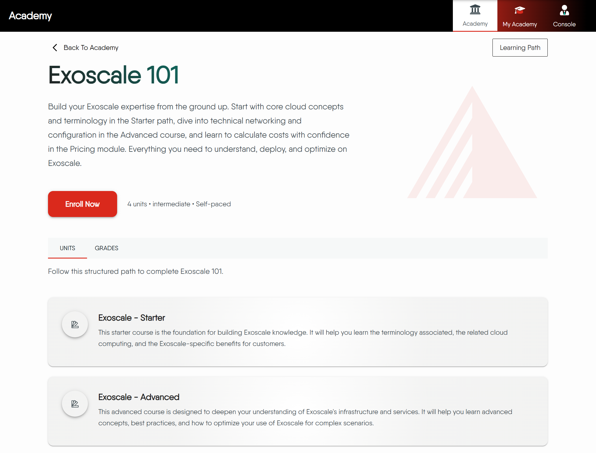
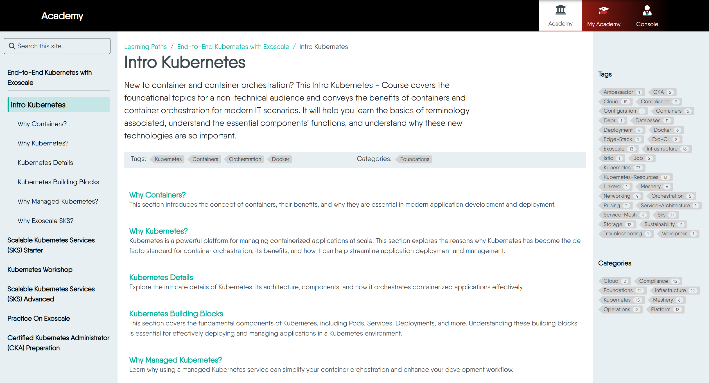
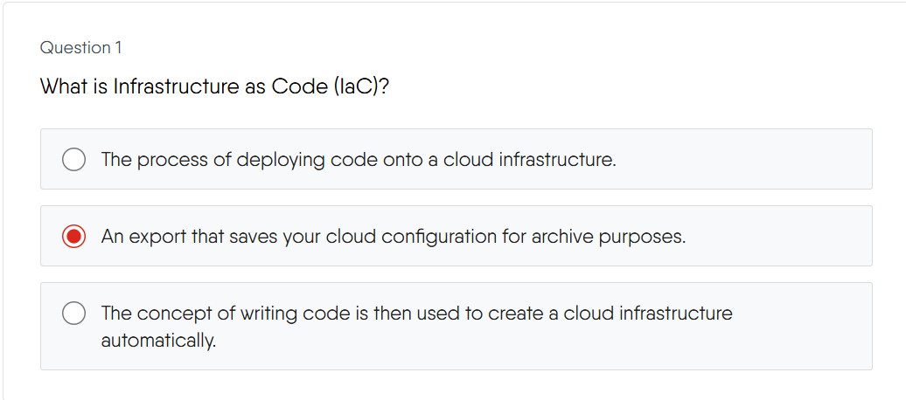
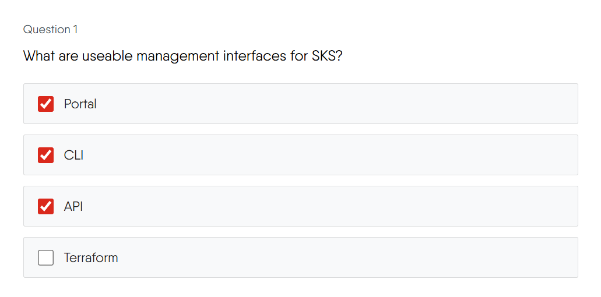
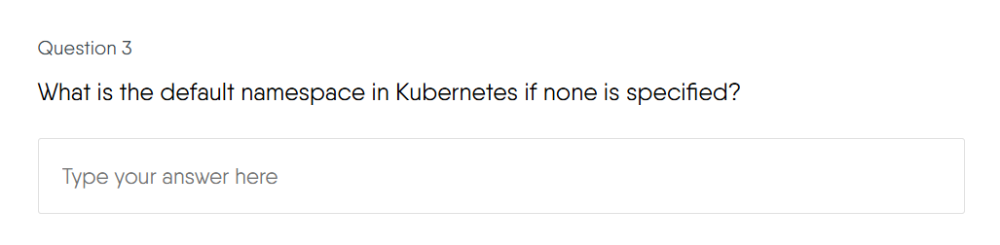
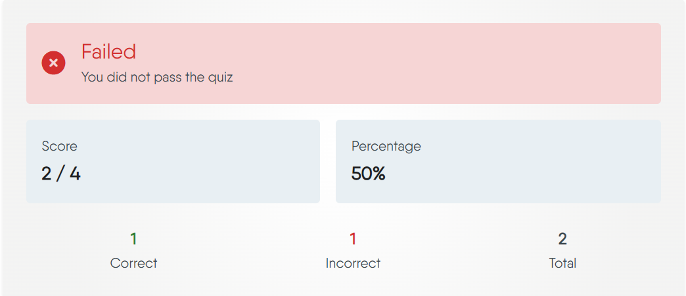
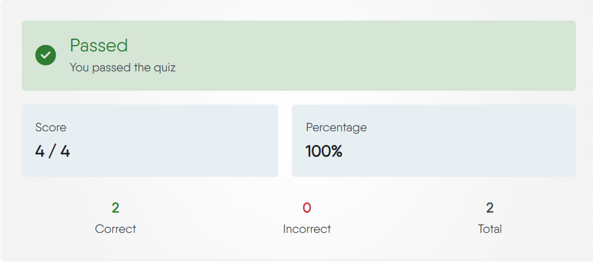
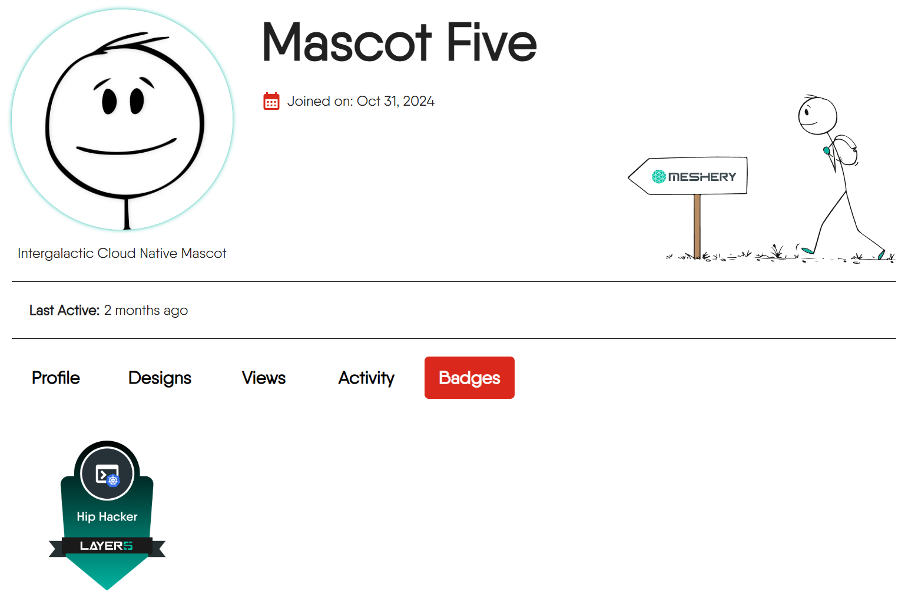

This guide takes you through one complete learning journey in the [Layer5 Academy](https://cloud.layer5.io/academy): you find a learning path, enroll, work through it, pass its final assessment, and receive your credential. Along the way you learn how the Academy tracks your progress and how its tests are scored, so you know what to expect from any content you take next.

You need a Layer5 Cloud account to enroll. Browsing the catalog needs no account.

## Step 1: Find content in the catalog

The catalog lists every piece of content available to you as a card. Each card shows the content type, title, number of courses, and difficulty level.

Narrow the catalog with three filters:

- **Level** limits results to one difficulty level.
- **Content Type** limits results to learning paths, challenges, or certifications. Set it alone to list every item of that type.
- **Organization** limits results to one organization's content. It appears only on the main Layer5 Academy catalog.

Filters combine, so Level plus Content Type lists, for example, every beginner learning path. Clearing the filters returns the full catalog.


The main Layer5 Academy at [cloud.layer5.io/academy](https://cloud.layer5.io/academy) spans organizations and offers the Organization filter. An organization's own Academy on its custom domain shows only that organization's content and hides the Organization filter.


Pick the content type that matches your goal:

| Type | Choose it when you want to |
|---|---|
| Learning path | Learn a subject systematically, from start to finish |
| Challenge | Solve a specific, practical problem in a realistic scenario |
| Certification | Prove skills you already have through a formal exam |

For this walkthrough, choose a beginner learning path.

## Step 2: Enroll

The content's detail page describes what it covers. Enroll from this page.

Enrolling creates your registration for that content and starts progress tracking. From then on the Academy records the item you are on, the items you have completed, your quiz grades, and your time spent, so you resume exactly where you left off. Every piece of content you have enrolled in appears in **My Academy**.

If the content's organization attached an invitation to it, enrolling also accepts that invitation and adds you to the team that the invitation grants.

Your registration moves through these statuses, which your instructors also see in their console:

| Status | Meaning |
|---|---|
| `Registered` | You enrolled and have not yet started |
| `In Progress` | You are working through the content |
| `Completed` | You passed the final test |
| `Failed` | You did not pass |
| `Withdrawn` | The registration was withdrawn, by you or by an instructor in the content's organization |

## Step 3: Work through the learning path

The learning interface has three areas.

1. **Course outline (left sidebar)** shows the full structure of the learning path and your current position. You can move to any course at any time.
2. **Study area (center)** displays the lesson content: text, images, and videos.
3. **Tags and categories (right sidebar)** link to other Academy content on related topics.

Work through the courses in order. Each course ends with an assessment that checks what you just learned.

## Step 4: Take an assessment

Each assessment is a test with a pass percentage set by the content's author. The test may also set a time limit, an attempt limit, and prerequisites.

### Final and practice tests

A test marked final is mandatory: passing it is what completes the content. Other tests are practice. Take them to check your understanding; passing them is not required to complete the content.

### Prerequisites

A test can require you to finish specific items first. If any prerequisite is missing from your completed items, the test does not start and reports `Prerequisites not completed`. Finish those items and try again.

### Attempts and question rotation

Every time you start a test, you begin a new attempt. If the test sets a maximum number of attempts, you cannot start an attempt beyond it; the Academy reports `Maximum attempts reached for this test` with the number of attempts you have used. A test with no maximum allows unlimited attempts.

Tests can draw from a question bank larger than one sitting. Each attempt serves the next set of questions from the bank, wrapping back to the start when the bank runs out, so a retake usually shows you different questions.

### Time limit

If the test sets a time limit, your attempt expires that many minutes after it starts. A submission after expiry is rejected with `Test submission has expired`. Each attempt is submitted once; a second submission of the same attempt is rejected.

### Answering and scoring

Each question carries its own marks. The test supports three question types, each scored strictly:

- **Single answer.** Select one option. You earn full marks only when you select exactly one option and it is the correct one.

  

- **Multiple answers.** Select every option that applies. You earn full marks only when you select every correct option and no incorrect option. There is no partial credit.

  

- **Short answer.** Type your answer. It must match the expected answer exactly, ignoring letter case and leading or trailing spaces. A blank answer is wrong.

  

Unanswered questions score zero. Your percentage is your score divided by the test's total marks, and you pass when that percentage meets or exceeds the pass percentage. Scoring happens on the server the moment you submit, and the result shows your score, your pass or fail status, and which questions you answered correctly.

## Step 5: Review your result

If you do not pass, the result marks which questions you answered correctly, so you can see exactly where to improve. Revisit the relevant courses through the outline, then start another attempt if the test's attempt limit allows it.

If you pass, the assessment is complete and you move on to the next course.

## Step 6: Earn your badge and certificate

When you pass the final test, your registration becomes `Completed` and the Academy awards the content's credentials.

**Badges.** If the content names a completion badge, you receive it immediately. Each badge is tied to one piece of content, is awarded only when you finish everything that content requires, and stays on your public Layer5 Cloud profile. Badges are free.

**Certificates.** If the content defines a certificate, the Academy issues one in your first and last name, with the issuing organization and the issue date, and emails it to you. Each certificate has a unique ID and a public verification page that anyone can open from its link, so you can share it on professional profiles or a resume. Learning and exams are free; issuance of the official certificate is an optional, paid feature. Certificates do not expire.

## Withdrawing from content

You can withdraw your own registration at any time. Withdrawing sets its status to `Withdrawn`. Instructors who hold the View Academy Metrics permission in the content's organization can also withdraw learners from that organization's content.

## Frequently asked questions

Will my progress be saved if I leave and come back later?

Yes. While you are enrolled, the Academy saves your current item, completed items, and quiz grades automatically. You resume where you left off.

Can I skip courses and jump directly to the exam?

You can open any course at any time from the outline. A test with prerequisites does not start until you complete those prerequisite items, and the content is complete only when you pass its final test.

Can I download content for offline study?

No. Academy content is available online only.

If I fail an assessment, can I retake it?

Yes, up to the test's attempt limit. A test with no limit allows unlimited retakes. Each retake usually draws different questions from the test's question bank.

Does my certificate expire?

No. Academy certificates carry an issue date and no expiration date.

How can I share my credential?

Badges appear on your public Layer5 Cloud profile. Each certificate has a public verification page; share its link on professional profiles such as LinkedIn or on your resume so anyone can confirm it.

Where can I ask questions or discuss the content?

Open a new topic or join an existing one in the community [discussion forum](https://discuss.layer5.io), or join the [Layer5 Community Slack](https://slack.layer5.io).

