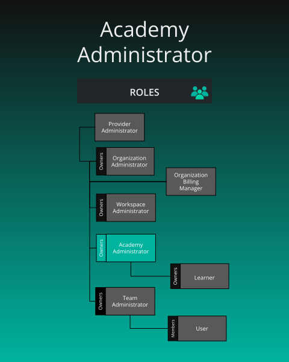


{}

{}




{}

**What is the purpose of this role?**

- Management of an organization's academy, learner management, and access to academy instructor console.

**Who can assign this role?**

- Organization Administrators

**When this role first assigned?**

- Manually assigned by an Organization Administrator.

**How many instances of these roles?**

- Min: 0, Max: many

**Who can remove assignment of this role?**

- Organization Administrators

**What permissions does this role have?**

- Check [Permissions Reference]()

{}



{}
Academy Learner is an organization role. It is separate from the [User]() role. Holding it grants access to Academy content and registration.

{}



There is no seat cap that blocks someone from receiving Academy Learner. A member whose only role is Academy Learner is excluded from the organization's billable user count. The count still never falls below the plan's minimum, and it does not stop anyone from joining.





{}

**What is the purpose of this role?**

- To enroll in academy content within the organization's academy.

**Who can assign this role?**

- An Organization Admin of that organization, a holder of Assign User Roles there, or a Provider Admin. Academy Admin does not assign organization roles by virtue of that role.

**When this role first assigned?**

- When an authorized administrator assigns it, or when an invitation lists Academy Learner. There is no automatic learner role and no separate learner invite link. An invitation is an organization invitation that can name this role.

**How many instances of these roles?**

- Any number. The role is available on every plan.

**Who can remove assignment of this role?**

- The same people who can assign it. Removing the role does not end the membership.

**What permissions does this role have?**

- Check [Permissions Reference]()

**Status as a Learner**

Each individual academy content item (learning path, certification, or challenge) that a learner enrolls in tracks one of the following 4 status types:

| Status      | What it means |
|-------------|-------------|
| registered (enrolled)  | They signed up but haven't started |
| completed   | They finished the course |
| failed      | They didn't pass |
| withdrawn   | They left the course |

{}

