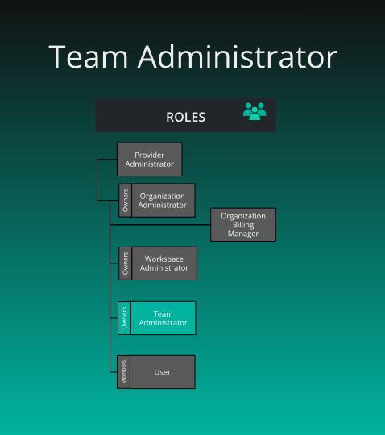


{}

{}



{}

**What is the purpose of this role?**

- Administering one team. The keys apply across every organization the team is mapped into, not only inside the team. The role includes team, user-viewing, and security management permissions.

**Who can assign this role?**

- Team Admin of that team, an Organization Admin or holder of Assign User Roles for a team mapped to the organization, or a Provider Admin. Teams accept no other role.

**When this role first assigned?**

- A team created from the Teams page makes its creator owner, a member, and Team Admin. Creating a user account does not assign Team Admin. Ownership is separate and cannot be transferred.

**How many instances of these roles?**

- Any number, on every plan. Layer5 Cloud does not stop you removing the last Team Admin. Owner alone cannot delete the team. Team Admin alone cannot delete it either.

**Who can remove assignment of this role?**

- The same people who can assign it. The roles you submit replace the roles held in that team. An empty list removes every team role and keeps the membership. Granting Team Admin to an organization member who is not yet on the team also adds them to it.

**What permissions does this role have?**

- Check [Permissions Reference]()

{}

