## Introduction

Meshery's GitHub Integration is a powerful feature that lets you authorize your GitHub account and import infrastructure files into Meshery. These files are then readily available in the Meshery catalog and can be easily opened in the Meshery Playground for viewing and configuration.

The GitHub integration offers an alternative to [importing designs from the canvas or through mesheryctl](https://docs.meshery.io/guides/configuration-management/importing-designs). It simplifies configuration management and enhances deployment workflow efficiency. By leveraging this integration, you ensure your infrastructure designs are easily accessible and always up-to-date.

This integration offers the following benefits:

1. **Easy Design Imports**: Quickly import existing configuration files directly from GitHub.

1. **Designs Available in Meshery Catalog**: The files imported from GitHub will be available in your Meshery catalog, allowing you to easily open the designs in the Meshery Playground to view and work with them.

1. **Collaboration**: Integrating Meshery with GitHub fosters collaboration by providing a streamlined process for teams to quickly access and collaborate on their designs.

## How to Integrate GitHub with Meshery

You can commence the integration process from the "**Extensions Page in Meshery**", or alternatively from the “**Layer5 Cloud Dashboard**”.

### Access Integrations Page from the Meshery Extensions Page

1. Go to [Extensions](https://playground.meshery.io/extensions).
1. Click on **Enable** for **GitHub Action: Kanvas Snapshot**.
1. You will be redirected to the Integrations page.

    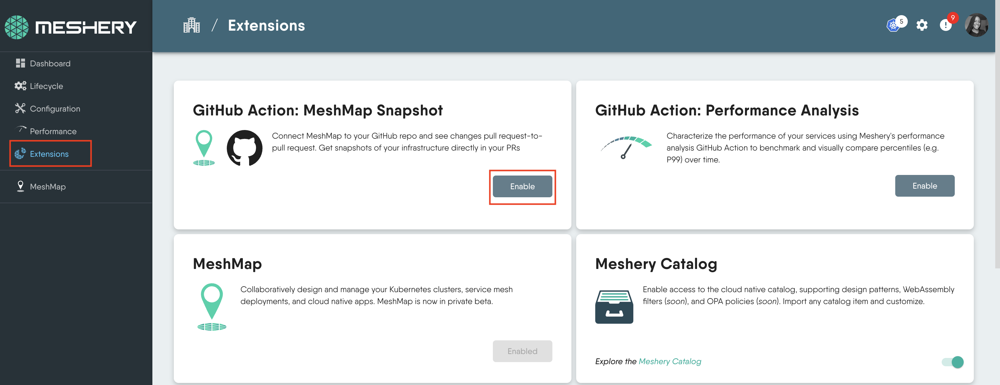

### Navigate to the Integrations Page via the Layer5 Cloud Dashboard

1. On [Layer5 Cloud](https://cloud.layer5.io/dashboard), click on the **menu icon** on the navigation bar to open the global navigation menu.

    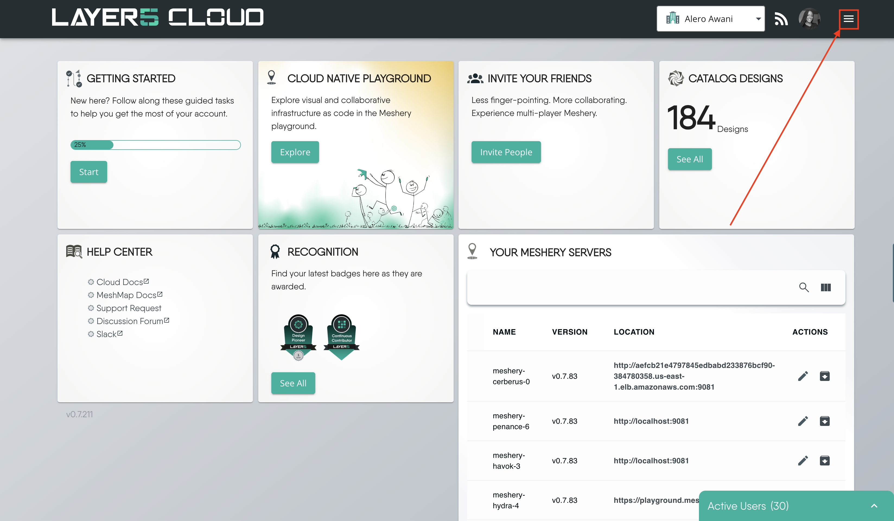

1. From the **Spaces** drop down, select **Integrations**.

    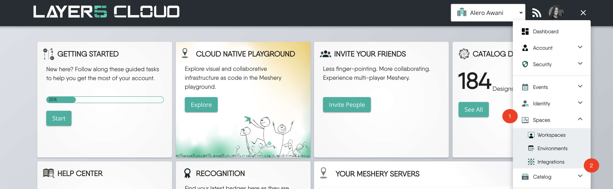

1. You will be redirected to the Integrations page. Click **Connect** to begin the integration process.

    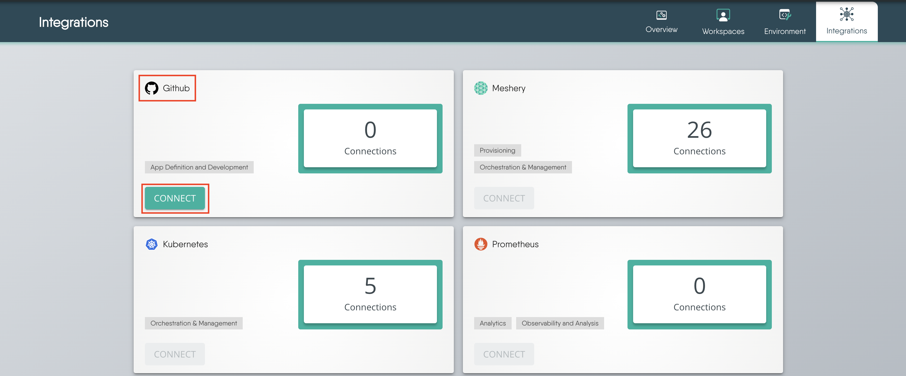

    If you open the GitHub card's connection count before you have connected, the **GitHub Connections** window reads "No GitHub connections yet". It explains that connecting GitHub imports Helm charts, Kubernetes manifests and Docker Compose files from your repositories as designs, and refreshes them when the files change. Click **Connect GitHub** there to start the same wizard, or follow **Learn how the GitHub integration works** to return to this guide.

### Connect GitHub and Import Designs

Let’s go through the steps required to connect your GitHub account and import files from your repository.

1. **Connect GitHub App**: This initiates the authorization process where you'll link your GitHub account with Meshery.
    - Click **Connect**.

      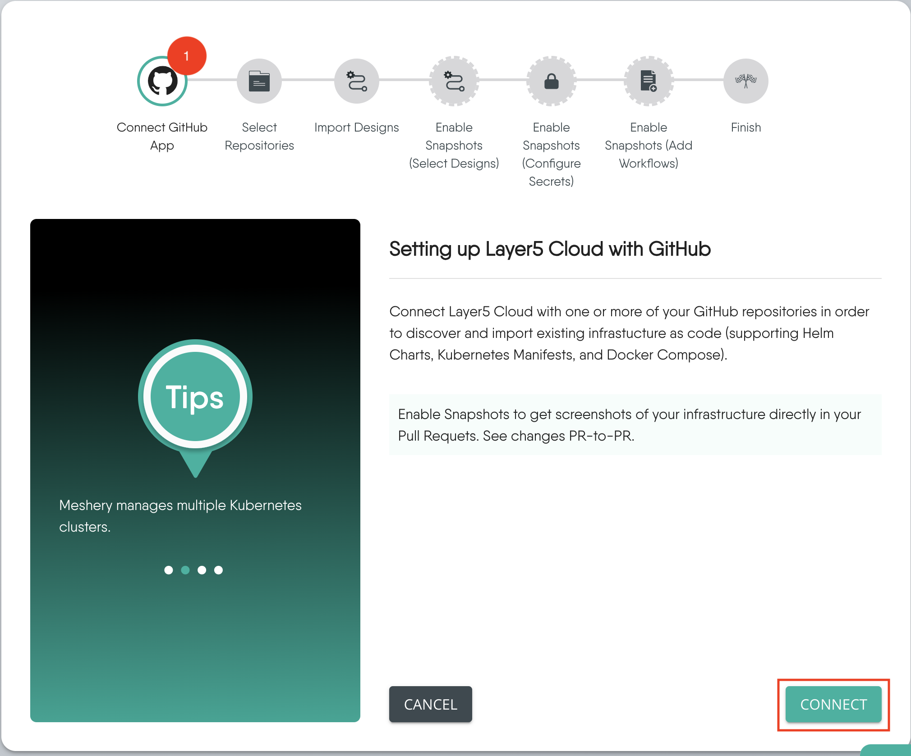

    - You will be asked to sign in to your GitHub account if you are not already signed in.
    - Once signed in, GitHub will prompt you to select the GitHub account where you want to install the Meshery GitHub App. This account could be your personal account or an organization account you can access.

      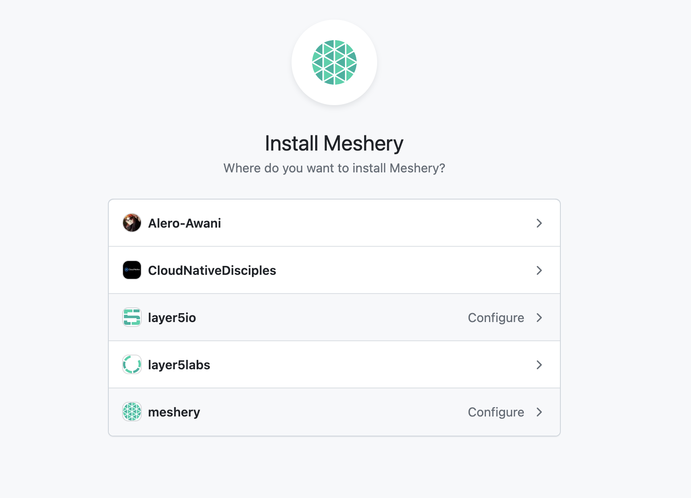

    - After selecting the account, GitHub will prompt you to authorize the Meshery GitHub App so it can access your account.
    - You can choose to allow access to all repositories or select specific ones.
    - After making your selection, click **Install and Authorize** to complete the authorization process.

      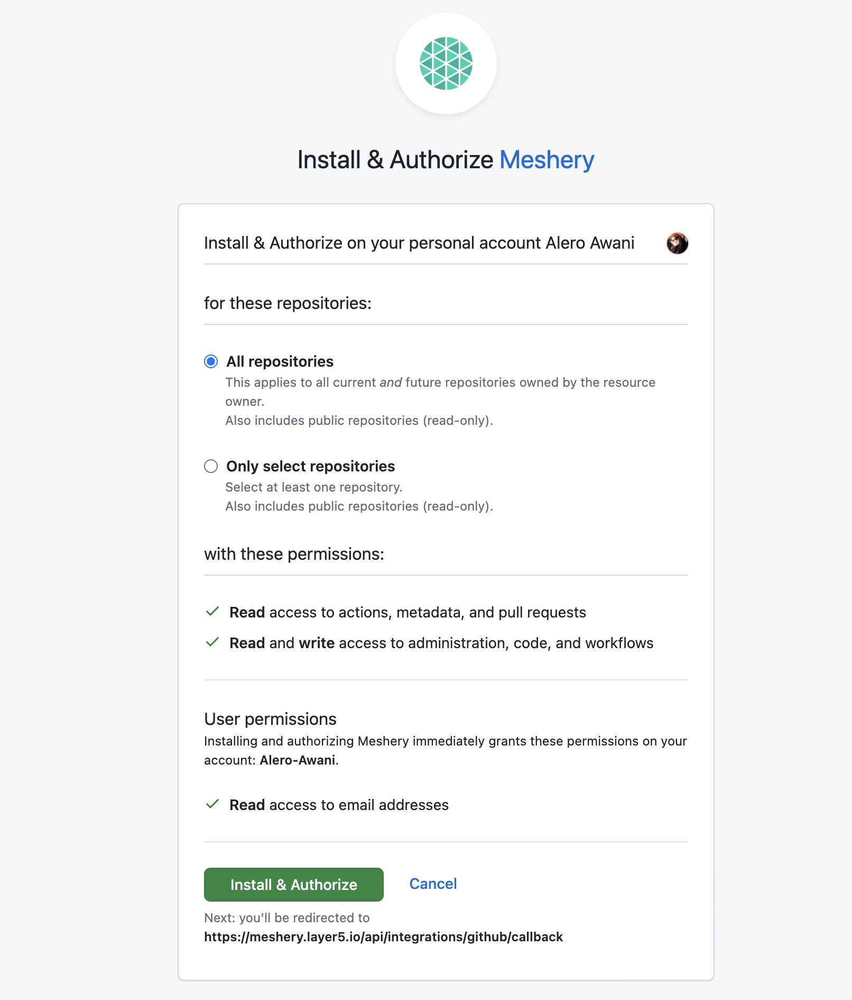

> Note: When you install a GitHub App on your account or organization, you grant the app permission to access the organization and repository resources that it requested. You also specify which repositories the app can access.

2. **Select Repositories**: After authorization, you will be redirected back to this page to select the GitHub repository you want to import files from.

    - Select the repository or repositories you want, then click **Next**.

      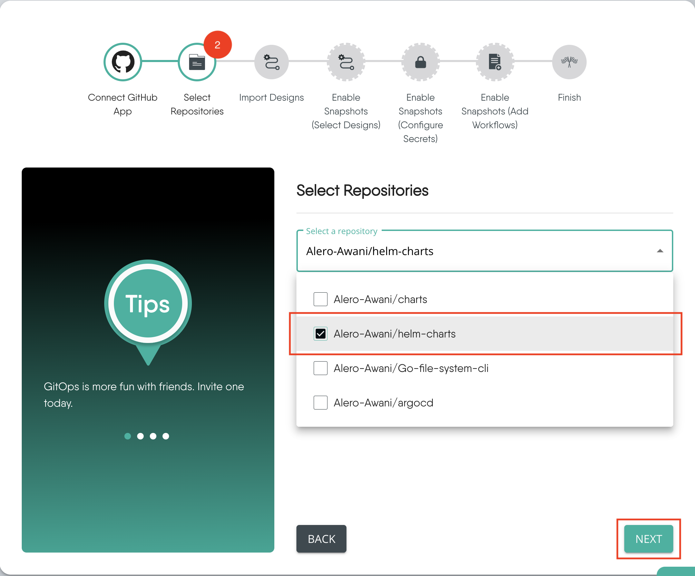

    **Reconfigure Repository Selection**

    If you are reconfiguring your existing GitHub integration, you will see the **Add Repository** button. This takes you to the “Install Meshery” page where you can either:

    1. Select a new repository you want to import files from.
    1. Reconfigure repository access for GitHub accounts that already have the Meshery GitHub App installed or
    1. Install the Meshery GitHub App on a new GitHub account to gain access to the repositories there.

        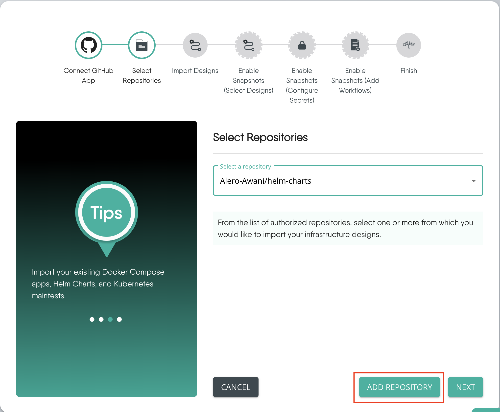

1. **Import Design Files**: The files in the repository are displayed for you to select the ones you want to import as designs.

    - There is a checkbox that allows you to choose between displaying all file types or only the file types that are typically supported by Meshery for import.

      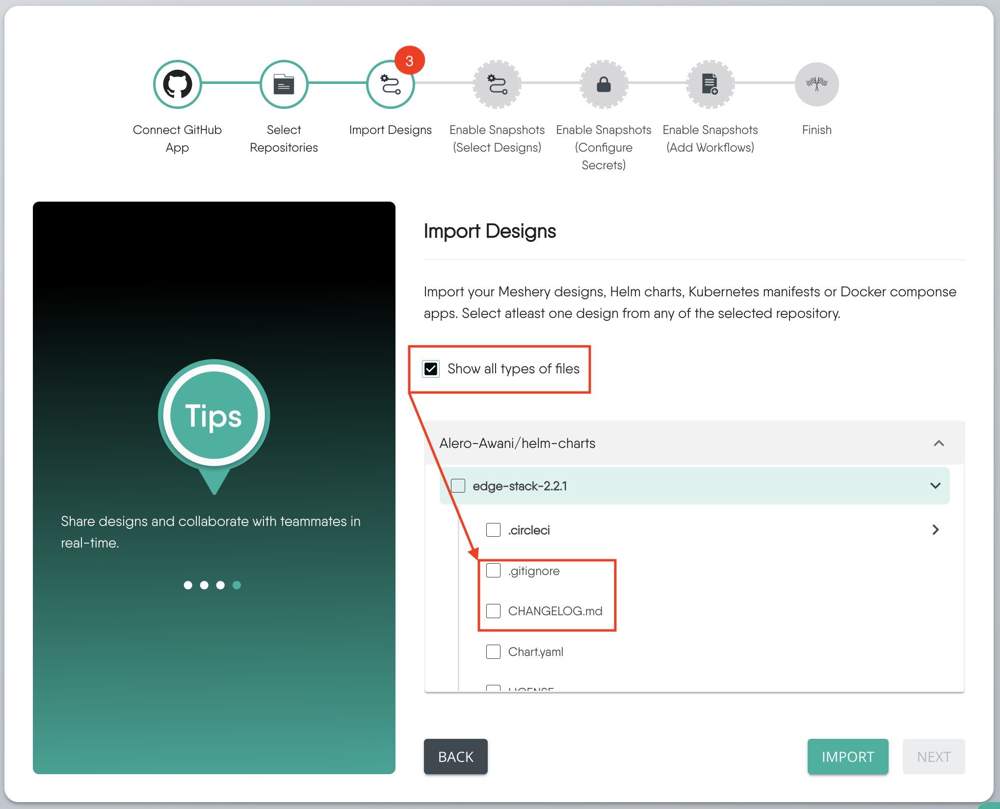

    - The file types supported for import are:
      1. Helm charts
      2. Docker Compose files
      3. Kubernetes manifests
      4. Designs

    - Select the checkbox beside the directory name to import all the files in the directory, or individually select the files you want to import and click **Import**.
    - If you want to go back and change your selection or choose a different repository, click **Back**.

      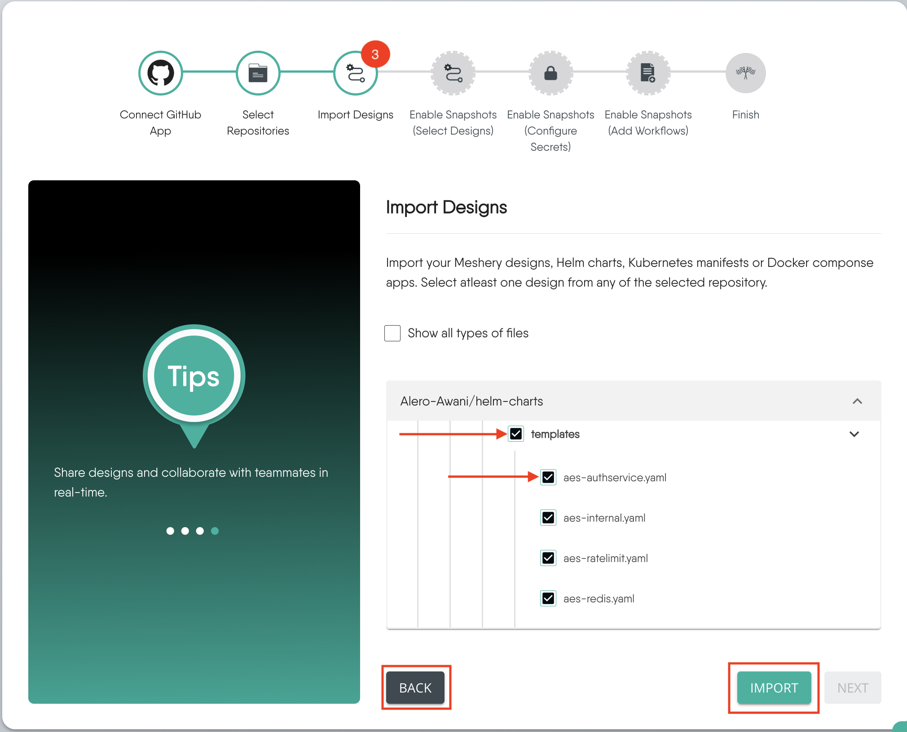
    - After the import, the files that were imported successfully and those that weren't will be indicated on the screen. A notification sums up the result, for example `2 designs imported, 1 updated, 3 already imported and skipped.`

      <!--  -->

    **Returning to a Repository You Imported From**

    When you run the wizard again for a repository you have imported from, for example with **Reconfigure** on the GitHub card, files you already imported carry a check mark. Hover over it to see which design the file became, for example `Imported as "nginx-deployment"`. If you have nothing new to import, you can click **Next** without importing.

    A design is matched to its file by repository, path and branch, never by name, so renaming a design does not break the match. When your selection includes files you imported before, Meshery asks what to do with them before importing. The prompt lists the files, up to five followed by "and N more", and offers three choices:

    | Choice | What happens to the previously imported files |
    |---|---|
    | **Import new files only** (default) | They are left as they are. Only files that were never imported become new designs. |
    | **Update the existing designs** | Each design's content is replaced with the file's current content. The design keeps its ID, sharing and links. Edits made to it since the last import are lost. |
    | **Import them again as new designs** | Additional designs are created alongside the existing ones. |

    Click **Import** to proceed with your choice, or **Cancel** to change the selection. A file selected both on its own and through its directory is imported once.

### [Optional] Enabling Snapshots

These next steps are optional. By enabling snapshots, you can choose a design from each repository to configure [Meshery snapshots](https://docs.meshery.io/extensions/snapshot). This feature allows you to capture snapshots of design infrastructure changes with each pull request made using a GitHub workflow that Meshery will add to your repository.

1. **Select Designs**: Select the design from the repository you want to enable snapshots for, then click **Next**.

    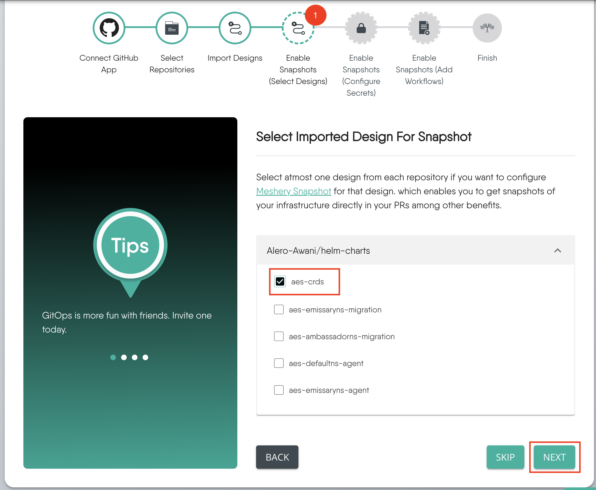

    **Warning: Workflow Already Exists**

    If you attempt to add a workflow to a repository that already contains an existing workflow from this process, you will see a warning message. Proceeding to the next step after receiving this warning will overwrite the existing snapshot workflow in that repository.

    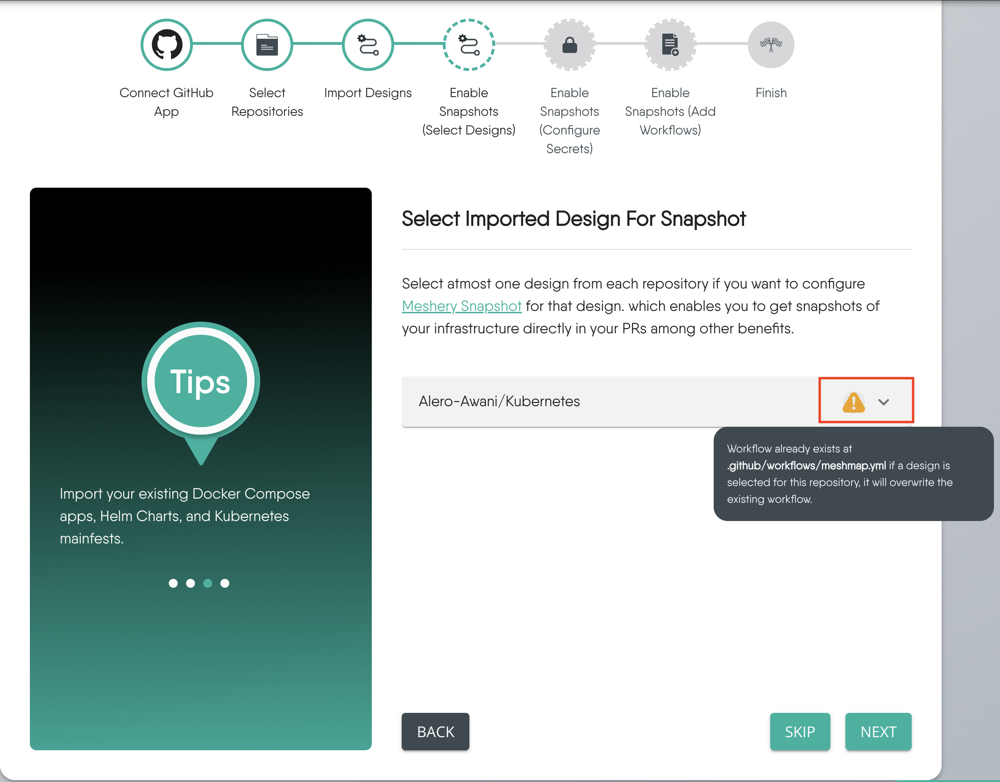

1. **Configure Secrets**:
    - Copy the **API TOKEN** and add it to the secrets page of your selected repository. To learn more about configuring secrets check out [Using secrets in GitHub Actions](https://docs.github.com/en/actions/security-guides/using-secrets-in-github-actions).
    - Tick the check box to confirm that you have added the token.

      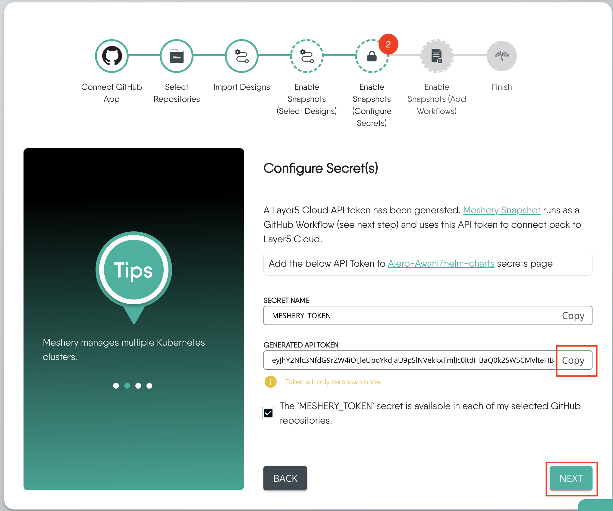

1. **Add workflows**: Allowing Meshery to add this workflow ensures the smooth integration of Meshery Snapshot with your GitHub repository. The workflow:

    - **Triggers on Pull Requests**: Automatically runs when a pull request is opened, synchronized, or reopened.

    - **Assigns Permissions**: Provides necessary permissions for reading actions, writing content, handling security events, statuses, and pull requests.

    - **Captures Snapshots**: Uses the Kanvas-Snapshot action to capture snapshots of your infrastructure based on the specified application_type (e.g. Kubernetes Manifest, Docker Compose, Helm Chart).

    With the workflow active in your repository, you can now visualize changes to your infrastructure directly in your pull requests, making it easier to track and review updates on designs.

    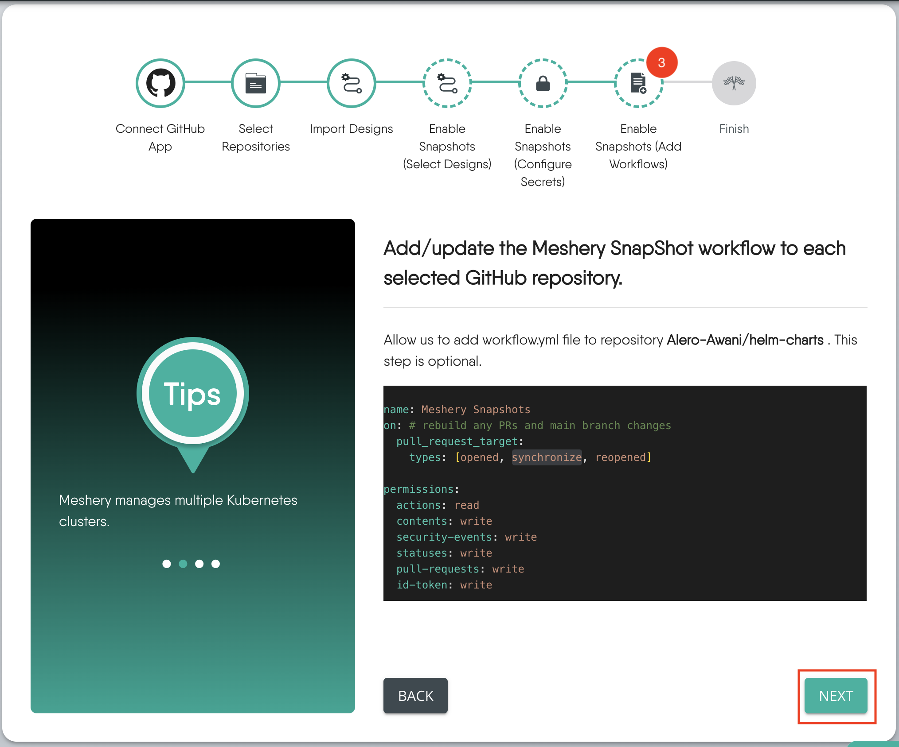

    Click **Next** to finish setting up!

### Finish Setup

You have successfully Integrated GitHub with Meshery! This page provides an overview of the steps you completed.

1. Click on the commit hash link (e.g. `#7f2d9`) to see where the workflow was added in your repository.
1. Click on the **View** icon to open the Meshery Catalog and see the design.
1. If everything looks good, click **Finish**. If you need to make any updates, you can go **Back** to the previous steps.

    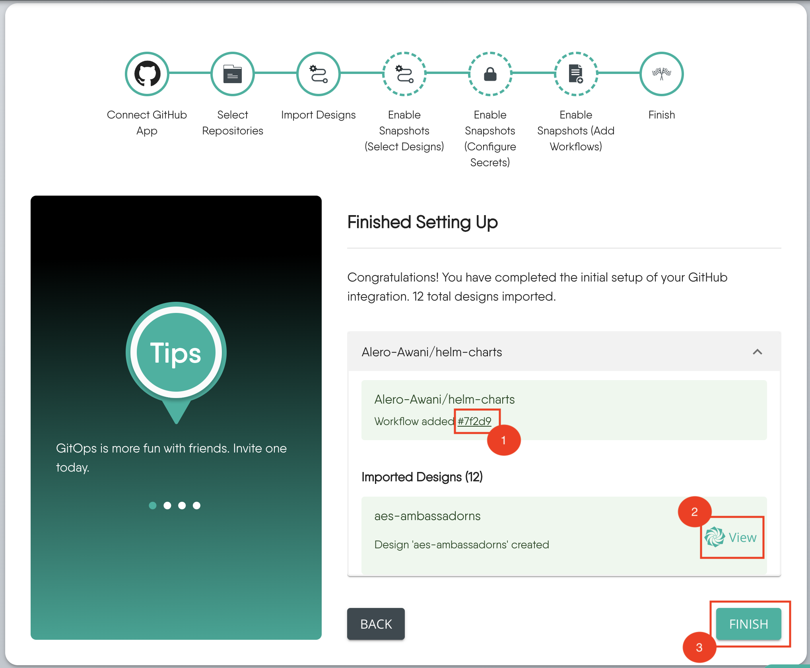

## View Imported Designs

To view imported designs:

1. Go to [Meshery Catalog](https://cloud.layer5.io/catalog).
1. Click on **My Designs** on the navigation bar.

    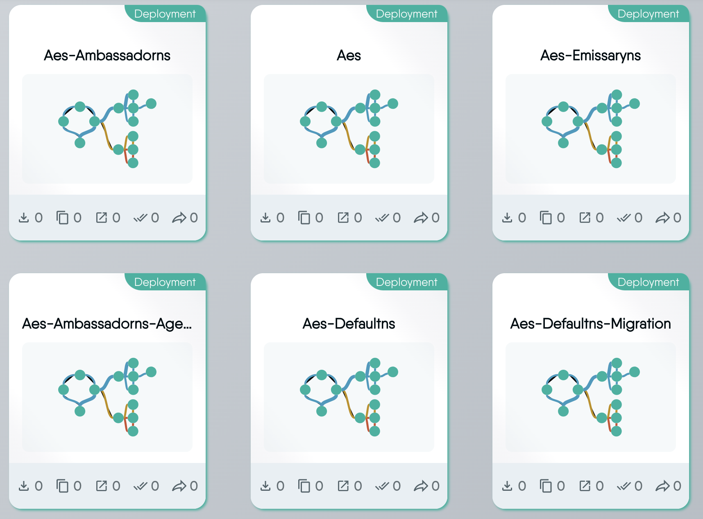

In the table view of My Designs, the **Source** column shows where each imported design came from: the repository and the file path, followed by the branch when the design was imported from one other than the repository's default. Hover over it to see the full source, or click it to open the file on GitHub. The cell is empty for a design that was not imported from GitHub. The column appears on large screens.

When you open an imported design's details page, a **Source** section below the left panel lists the repository, which links to the file on GitHub, the file path and the branch ("Default branch" when the design follows the repository's default branch).

The source stays with the design when you edit it in Kanvas or Meshery, so later imports and refreshes still recognize it.

## Manage Imported Designs from the GitHub Connection

Your GitHub connection lists every design you have imported from GitHub, with actions to open each one or bring it up to date with its file.

1. On the [Integrations page in Layer5 Cloud](https://cloud.layer5.io/spaces/integrations), click the GitHub card's connection count to open **GitHub Connections**.
1. Click a connection to expand it. Below the connection's details, **Imported designs** lists your imported designs, newest first, with these columns:

    | Column | Shows |
    |---|---|
    | **Design** | The design's name. |
    | **Type** | The format the design was imported from, or `-` when it is not known. |
    | **Source** | The repository, file path and, when it is not the default, branch the design was imported from. Click it to open the file on GitHub. |
    | **Last updated** | When the design last changed. |
    | **Actions** | **Open design** opens the design's page in My Designs. **Open source file on GitHub** opens the file in a new tab. **Refresh from source** updates the design from the file, described below. |

The list shows only your own designs, and only you can see it on your connection. When you have not imported any designs yet, it reads "No imported designs yet" and offers **Import designs**, which reopens the wizard for this connection. If the list cannot be loaded, it reads "Imported designs could not be loaded"; click **Try again**.

### Refresh a Design from Its Source

When a file changes in its repository, refresh the design instead of importing the file again:

1. In **Imported designs**, click **Refresh from source** on the design's row. The action appears only if your role can import designs.
1. Confirm with **Refresh**. The design's content is replaced with the file's current content on GitHub, and changes made to the design since it was imported or last refreshed are lost.

The refresh updates the same design, so it keeps its ID, owner, visibility, catalog data, workspace assignments and links. Only its content and source change. A design that was not imported as a Meshery Design keeps its source file unconverted, and Meshery converts it the next time you open it.

If the refresh fails, the notification names the cause and what to do:

| Cause | What to do |
|---|---|
| The source file no longer exists, for example because it was moved, renamed or deleted | Import the file from its new location. |
| The file is no longer a valid Helm chart, Kubernetes manifest, Docker Compose file or Meshery design | Fix the file in its repository and refresh again. |
| The GitHub App no longer has access to the repository | Reconfigure your GitHub connection and grant the GitHub App access to the repository. |
| GitHub could not be reached, rate-limited the request or rejected the GitHub App's credentials | Retry in a few minutes, and reconfigure your GitHub connection if the problem persists. |

## View GitHub Integration Connection on Meshery Playground

To view and manage the GitHub connection, on the left sidebar of the playground, click on **Lifecycle** > **Connections**.

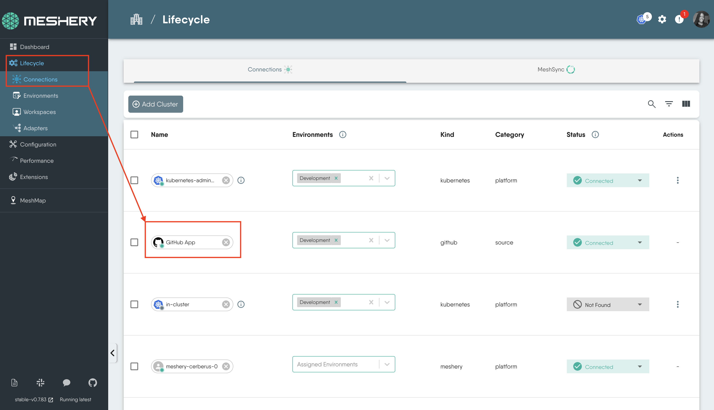

## Delete GitHub Integration

You can delete the GitHub Integration Connection from the “**Connections page in Meshery**" shown in the preceding section or “**Integrations page in Layer5 cloud**".

On the Connections page in Meshery:

  1. Identify the connection and click on its checkbox.
  1. Click **Delete**.

On the [Integrations Page in Layer5 Cloud](https://cloud.layer5.io/spaces/integrations) page:

  1. Click on the GitHub Connection.
      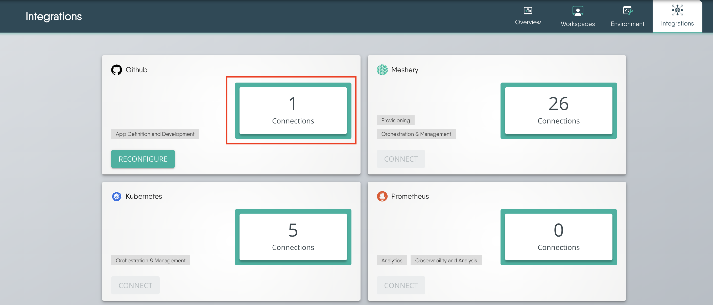

  1. Tick the checkbox then **delete**.
      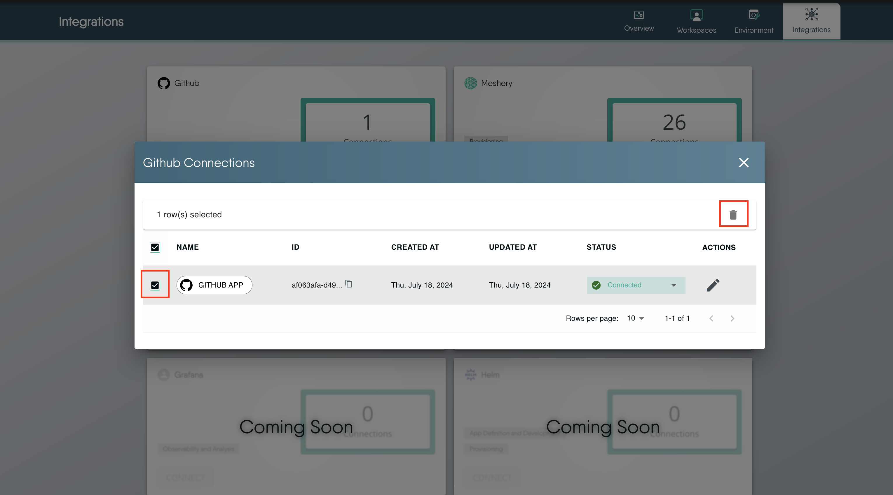

## Conclusion

In this guide, you walked through the steps to integrate your GitHub account with Meshery.

You authorized Meshery to access your GitHub account, imported designs from repositories, viewed them and their sources in the Meshery Catalog, and kept them up to date by refreshing them from their files. You also learned how to enable Meshery Snapshots for your GitHub repositories, allowing you to version and track changes to your infrastructure configurations.

Additionally, you saw how to view, manage, and delete your GitHub connection within Meshery and Layer5 Cloud.

By connecting your GitHub account, you gain seamless access to your resources, streamline your deployment workflow, and ensure your design infrastructure configurations are always up-to-date.
