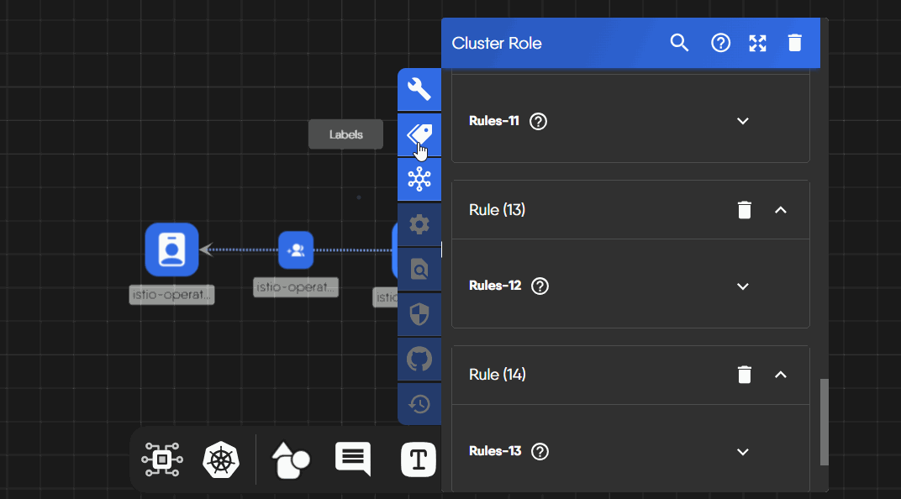

You can group components using tags. Tags are key-value pairs that help you organize and categorize components within your design. Tags can be used to visually group components. Designer has no filter that shows only components with a given tag. Operator mode filters live resources by namespace, kind, model, label, and free-text search. Palette search matches model and component names, not labels.


Kubernetes resources are capable of being assigned Label and Annotation key/value pairs. When pairs of Labels or Annotations match, a relationship is formed and visualized as shown below.


## Grouping Components with Tags

To group components using tags, follow these steps.

## Labels and Annotations

Designs support two different types of tags: Labels and Annotations. Labels are often used to identify components and are visible on the design canvas. Annotations are often used to provide additional information about components.


Tags are indexed and searchable. However, the performance of design operations may degrade as the number of tags increases. To ensure an optimal user experience, we recommend using tags judiciously and limiting the number of tags used in a design.

TagSets draw only in Full render mode, and only while at most 30 are drawn. Past 30, Kanvas skips the rest and shows "Skipped rendering of N matchlabels relationships due to limit of 30". Grouping does not turn itself off at 10 tags, and there is no Group Components control that re-enables it after that limit. The TagSets layer must also be visible.



