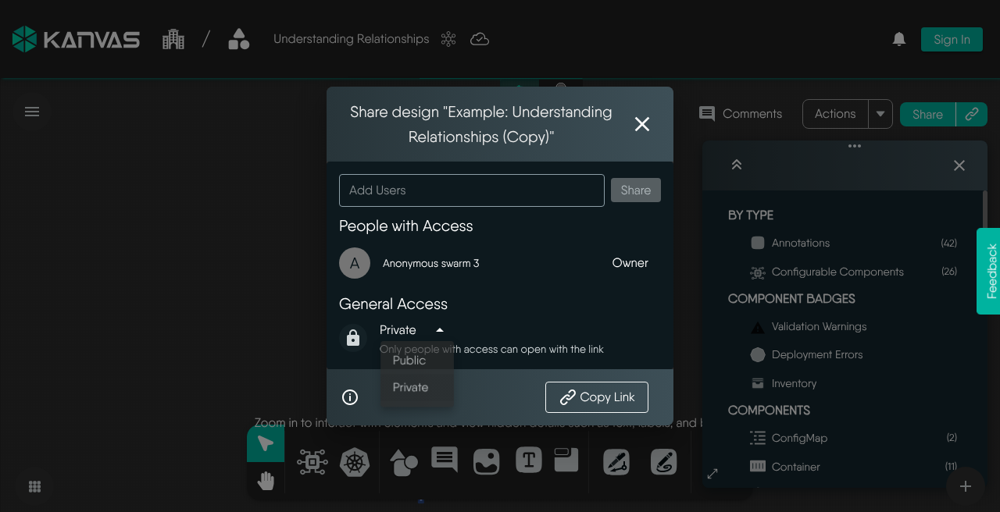

Sharing opens a private design to the people you name. Each grant is for one person, and it has no access level: a person who can open the shared design can also edit it and comment on it. You can also change a design's visibility to make it open to everyone, and you can copy a link that points people to it.

This guide covers the task. For the reasoning behind the access model, read [Collaboration Model](). For a worked example with two people, follow [Collaborative Editing]().

## Before you start

| Requirement | Detail |
|---|---|
| Signed-in account | Anonymous visitors to [kanvas.new](https://kanvas.new) can design without signing in, but sharing asks them to sign in first. Layer5 Cloud also refuses a share from an anonymous session. |
| Share Design permission | Kanvas hides the Share action without it, and Layer5 Cloud checks it again when the request arrives. Layer5 Cloud checks it in the organization that owns the design's workspace. A design that is in no workspace is checked in an organization the design's owner belongs to. |
| View All Users permission | The people picker searches users through this permission. Without it the search is rejected, and the dialog does not find anyone. |
| A loaded, non-empty design | Share is unavailable while a design is empty, and while it is still loading. A new design has no link until its first save assigns it an id. |
| An unpublished design | Share is hidden for a published design. |
| A remote provider | Under the local provider, sharing returns HTTP 501 Not Implemented. See [Feature Availability by Plan](). |

Views use the same dialog and the same grant model. Sharing a view needs the Share Views permission instead of Share Design. See [Views]().

## Visibility levels

Visibility decides who can open a design without a grant.

| Visibility | Who can open it | Who can edit it |
|---|---|---|
| Private | The owner, provider administrators, and people you grant access | The same people |
| Public | Anyone with the link or the design id, including anonymous visitors | Any signed-in user |
| Published | Everyone, through the Layer5 Cloud catalog | The owner, provider administrators, and people with a grant |

A newly saved design is public, whatever visibility the client requests. Make a design private before you put sensitive architecture in it. A design cannot change visibility while it is published. See [Publish Designs]() for the published state.

Changing visibility saves like any other edit: it raises the design's version and counts against the plan's components limit.

## Give people access

1. Open Share for the design. It is in the design's top bar, and in the menu of a design in your list of recent designs.
2. Search for the person and add them. The search covers every user on Layer5 Cloud your role may search, not only your organization. It returns ten matches at a time and nothing for an empty search.
3. Confirm the person appears in **People with Access**.

The grant takes effect immediately. The person opens the design with the link, and it also appears in their list of designs.

### What a grant allows

A grant carries no access level. It lets a person open a private design, edit and save it, comment on it, clone it, and download it. What else they can do depends on their own permissions, not on the grant: deploying, validating, and sharing each check the person's role.

| Action | Owner | Person with a grant |
|---|---|---|
| Open and edit the design | Yes | Yes |
| Comment, resolve, and reopen threads | Yes | Yes |
| Clone and download | Yes | Yes |
| Share it onward | With the Share Design permission | With the Share Design permission |
| Change visibility | Yes | Layer5 Cloud does not restrict it to the owner |
| Revoke access | Yes | With the Share Design permission |
| Delete the design | Yes, and provider administrators | No |
| Transfer ownership | Not supported | Not supported |

Most accounts hold the Share Design permission, because the default Organization Admin role includes it. Expect a collaborator to be able to share the design onward unless your organization has changed its roles. See [Permissions by Role]().

### Rules for grants

- The owner cannot be granted access, and the owner's access cannot be revoked.
- A person can be granted access once. A second grant for the same person is rejected.
- Grants and revokes in one request are applied independently. If one half fails, the other half stays in place, and the failure names the half: "access could not be granted" or "access could not be revoked".
- Layer5 Cloud sends an invitation email to a newly granted person only when the request asks for one. The email links to the design in the Meshery Playground.
- Each share request is recorded as an event.

### Grant access to people in another organization

A grant does not compare the person's organization with the design's. You can share a design with a user from any organization on the same Layer5 Cloud. There is no provider setting that enables or blocks this. The [cross-organization tutorial]() walks through it.

## Share a link {#sharing-your-design-with-a-link}

Copy Link produces a link that opens the design in Kanvas. It works for private and public designs.

- **Public design:** anyone with the link can open it and, if signed in, edit it.
- **Private design:** the link only points to the design. The person also needs a grant, or an administrator role. Without one, Layer5 Cloud refuses the request, and an anonymous visitor cannot open it.

The link carries the design's id. Anyone who learns the id of a public design can open it.

## Revoke access

Remove the person from **People with Access**. The change applies at once. Their clones and any copies they made stay theirs. Comments they wrote remain in the design, because comments are part of the design.

Deleting a design removes every grant for it.

## What does not grant access

- **Teams.** The dialog finds individual users only. Layer5 Cloud accepts a grant for a team through its API, but no access check honors it, so team members gain nothing from it.
- **Workspaces.** Adding a design to a workspace, and assigning teams to that workspace, does not open a private design to those teams. Layer5 Cloud checks the owner, provider administrators, and the design's own grants. See [Workspaces]() for what a workspace does control.
- **Organization membership.** Being in the owner's organization does not open a private design.

To give a whole team access, grant each member.

## Messages and failures

| Message | Cause | What to do |
|---|---|---|
| Unable to share: this design could not be loaded. Try again once it has loaded. | Share was opened while the design was still loading, or after its load failed. | Wait for the design to load, or reopen it, and open Share again. |
| Failed to load the list of people with access. | The owner or the access list could not be fetched. Kanvas shows this error instead of an empty list. | Close and reopen Share. An empty list does not mean nobody has access while this error shows. |
| Failed to update visibility. | The visibility change was rejected. | Retry. |
| Changing visibility is not supported for this kind of item. | The item has no visibility control. | Keep its current visibility. |
| A single error naming the parts that failed | A grant, a revoke, or the invitation email did not complete. Parts that succeeded stay in place. | Reopen Share, check **People with Access**, and repeat the missing part. |

After any grant or revoke, check **People with Access** before you rely on the change.

<figure>
  
  <figcaption>The Share dialog: add people, review who has access, set visibility, and copy the link.</figcaption>
</figure>

## Related

- [Collaboration Model]() explains how access, live editing, and comments fit together.
- [Review a Design with Comments]() covers feedback on a shared design.
- [Delete a Design]() explains who can delete and what disappears with a design.
