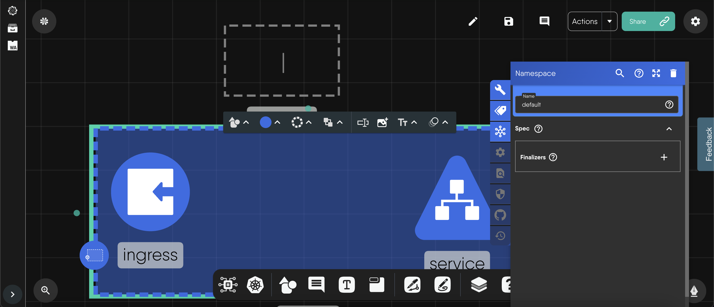

A component is one piece of infrastructure in a design, and its configuration is what Kanvas applies when you deploy. This guide covers placing components on the canvas, editing their configuration, and moving them around by duplicating, copying, and pasting.

You need a design open in Designer mode. Designer is the only mode that allows authoring.

## Add a component

Kanvas offers several ways to place a component. All of them produce the same result: a component in the design, with its configurator open beside it.

| Method | Behavior |
|---|---|
| Drag from the component palette | The component lands where you release it. |
| Click a component in the palette or in a dock picker | The component lands at a random position near the center of the canvas. |
| Drop a component onto another component | If the pair can form a parent-child relationship, Kanvas creates it. See [Create Relationships](). |
| Drop or paste a file | Image and text files become objects on the canvas. Infrastructure files (YAML, JSON, and archives such as TAR, GZ, ZIP, RAR, and 7Z) start an import. |

Text boxes, sections, and comments are annotation objects rather than infrastructure. They have their own keys: <kbd>T</kbd>, <kbd>S</kbd>, and <kbd>M</kbd>. Press <kbd>I</kbd> to pick an image file. See [Whiteboard on the Canvas]().

### Find the right model and version

The palette groups models by category. Open a category to list its models, then expand a model to load its components. Each model has a version selector, sorted newest first, with the first version selected by default. The dock's compact pickers offer an "All Versions" choice and hide duplicate components, keeping the highest version.

Typing in the palette search box queries the Meshery registry after you pause for one second. Results appear in two groups, Models and Components, and an empty result reads "Sorry, no matching records found". Search matches model and component names only. It does not match labels.

The palette applies no filter of its own for deprecated or ignored models: it lists whatever the registry returns. Components whose schema is invalid appear dimmed, but you can still drag or click them.

The Kubernetes picker in the dock lists every Kubernetes component in a grid with a version filter. It hides List kinds, such as `PodList`.

### File drop limits

| File | Result | Limit |
|---|---|---|
| Image (PNG, JPG, GIF, BMP, WebP, SVG) | An image object, embedded in the design as data | 512,000 bytes (about 500 KB) |
| Text (`.txt`) | A text box holding the file text | 512,000 bytes (about 500 KB) |
| YAML, JSON, TAR, GZ, TGZ, ZIP, RAR, 7Z | An import placed at the drop position | None applied by the canvas |
| Anything else | Ignored with no message | - |

A file over the limit is rejected with an error message. The limit is fixed and identical on every plan, although the message refers to your plan.

## Edit a component's configuration

Open the configurator with any of these:

- Double-click the component (two taps within 500 ms).
- Select the component and use the Configure control in its floating style toolbar. The toolbar appears when you are zoomed in far enough to see component detail.
- Add a new component. Its configurator opens automatically.
- Select a validation warning badge on the component. The configurator opens with the offending field highlighted.

The configurator is a panel anchored to the component, on the right when there is room and on the left otherwise. The right-click menu has no Configure item.

### The header

| Control | Behavior |
|---|---|
| Component icon | Hover to see the component version. |
| Title | The component kind, in sentence case. |
| Versions menu | Appears when the component exists in more than one model version. Choosing a version swaps the component's definition and model reference to that version. |
| Search | Narrows the form to matching fields. When nothing matches, the form says so. |
| Help | Shows the component's own description from its schema. |
| Expand and collapse | Switches the panel width between 32 rem and 45 rem. |
| Delete | Removes the component immediately, with no confirmation. |

Switching versions keeps your configuration values as they are. Kanvas does not migrate them, and validation then flags any value the new version does not accept. The switch also replaces custom styling with the new version's defaults.

### The tabs

A tab strip on the left appears when two or more tabs apply to the component. Which tabs are enabled depends on the capabilities the component's definition declares. Role permissions do not decide this. A tab that does not apply appears dimmed.

| Tab | What it holds |
|---|---|
| Config | The component's specification, as a form built from its JSON schema. |
| Labels | Key-value maps for labels and annotations. Not offered for alias components. |
| Json Schema | A read-only view of the component definition, with an Open in Registry button. |
| Relationships | The relationships this component participates in, grouped by kind, with a Show only active switch. |

Comment components open a chat thread instead of tabs.

### Required fields, defaults, and validation

- Fields are rendered from the component's schema, and defaults come from the schema. A namespaced kind shows a Namespace field that defaults to `default`.
- A red asterisk marks a required field. An empty required field shows "This field is required". Kanvas enforces first-level required fields up front, and an object whose children are all optional is not treated as required.
- The form does not validate as you type. Kanvas validates each changed component against its JSON schema after the change. Errors appear as a small red triangle beside the field label, with the messages in its tooltip, and the field is outlined.
- The component also shows a validation warning badge on the canvas, so an error you scrolled past stays visible after you close the panel. See [Component Badges]().

### How edits are saved

There is no Apply button. Kanvas writes an edit to the design 300 ms after you stop typing. Each write triggers three follow-ups: the design autosaves after a 3 second pause, the component is validated, and relationships are re-evaluated. Configuration that a relationship controls can therefore change shortly after you edit a related component. See [Policy Evaluation]().

Undo reverses configuration changes like any other edit. See [Saving Designs]().

### Alias components

An alias component stands for one field inside its parent component. Its form edits that field of the parent, using the field's sub-schema, and omits the Labels tab. Deleting an alias clears that field's configuration on the parent.

## Lock, duplicate, copy, and delete

Right-click a component to open its action menu. Items appear only when they apply.

| Action | Shortcut | Behavior |
|---|---|---|
| Lock and Unlock | - | Fixes the component's position so it cannot be dragged. Configuration, labels, and style stay editable. The lock is saved with the design. |
| Duplicate | <kbd>Ctrl</kbd>/<kbd>Cmd</kbd>+<kbd>D</kbd> | Creates a copy offset 50 px right and 50 px down, with a new id. Relationships between duplicated components are copied too. Names do not change. |
| Copy | <kbd>Ctrl</kbd>/<kbd>Cmd</kbd>+<kbd>C</kbd> | Copies the component. The menu item copies one component without relationships. |
| Delete | <kbd>Delete</kbd> or <kbd>Backspace</kbd> | Removes the component. Relationships that touched it are marked deleted, and the next evaluation reverses their effects on configuration. |
| Reset styles | - | Restores the model's default appearance. |
| Move Out of Parent | - | Detaches a component from the parent it sits in. |

The menu labels Delete as <kbd>Ctrl</kbd>/<kbd>Cmd</kbd>+<kbd>Delete</kbd>, but <kbd>Delete</kbd> or <kbd>Backspace</kbd> alone performs the deletion.

Other items appear in Operator mode, such as terminal, log, and performance sessions. See [Operator]().

### Style a component

A floating toolbar above a selected component offers the controls the component declares: shape (24 outlines), fill color with opacity from 0 to 1, border color, style, and thickness from 0 to 25, layer order, label, external link, image, and animation (none, blink, ripple, bounce, or pulse). Each control is shown only when the component supports it.

## Copy and paste across designs

| Task | Shortcut |
|---|---|
| Select every component | <kbd>Ctrl</kbd>/<kbd>Cmd</kbd>+<kbd>A</kbd> |
| Select several | Hold <kbd>Ctrl</kbd>/<kbd>Cmd</kbd> and drag a selection box, or <kbd>Ctrl</kbd>/<kbd>Cmd</kbd>+click each one |
| Copy the selection | <kbd>Ctrl</kbd>/<kbd>Cmd</kbd>+<kbd>C</kbd> |
| Paste | <kbd>Ctrl</kbd>/<kbd>Cmd</kbd>+<kbd>V</kbd> |
| Undo and redo | <kbd>Ctrl</kbd>/<kbd>Cmd</kbd>+<kbd>Z</kbd>, <kbd>Ctrl</kbd>/<kbd>Cmd</kbd>+<kbd>Y</kbd> or <kbd>Shift</kbd>+<kbd>Z</kbd> |

A keyboard copy carries the selected components with their configuration, styles, and labels, plus every relationship whose two ends are both in the selection. Kanvas writes this to the system clipboard, so you can paste into another design, another browser tab, or another Kanvas session. Paste lands at the pointer when it is over the canvas and at the canvas center otherwise. The pasted group keeps its layout, and every id is regenerated.

Browsers allow clipboard access only after a user gesture. If the browser denies access, paste does nothing and shows no message. Use the keyboard shortcuts. The full list is in [Keyboard Shortcuts]().

## Limits and errors

- A design has a maximum number of components that depends on your plan. Layer5 Cloud enforces it when you save or import, not when you add a component. A save over the limit is rejected with a 403 response. Drawn objects such as shapes and text boxes count as components. See [Designs and Components]() for the per-plan values.
- When zoomed out, the canvas hides text, labels, and badges and prompts you to zoom in before interacting with elements.

## See also

- [Relationships](): what the Relationships tab lists.
- [Tool Modes](): every mouse interaction available on the canvas.
