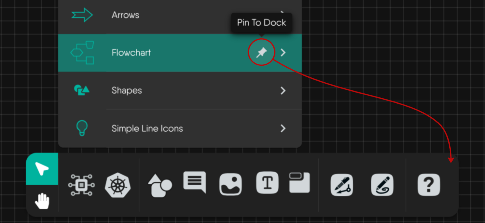
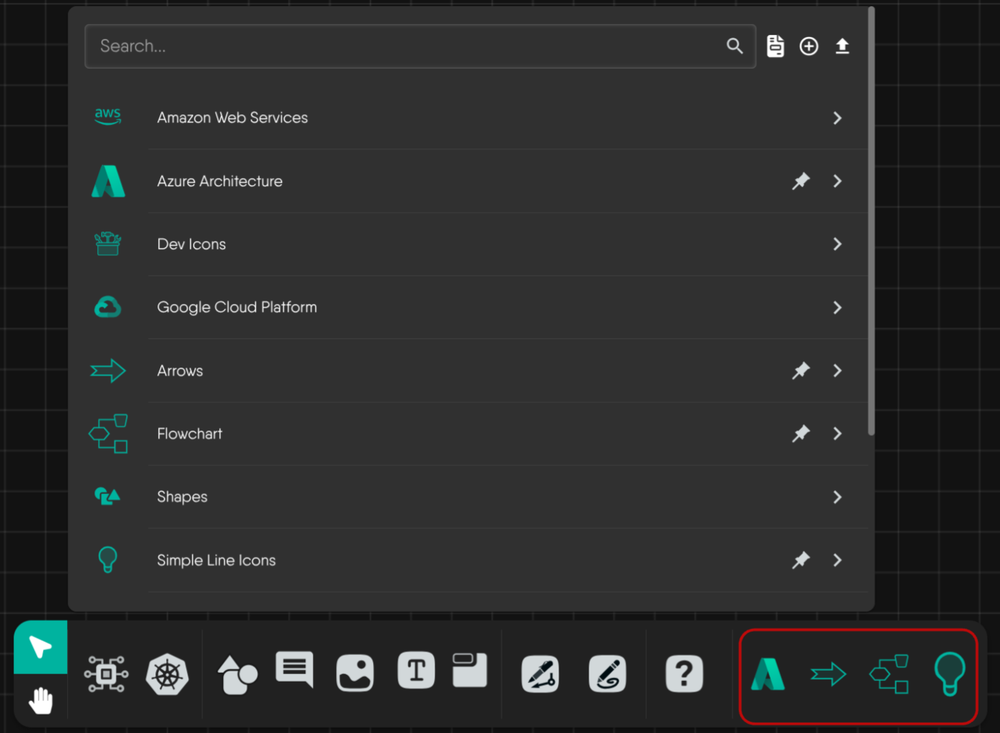
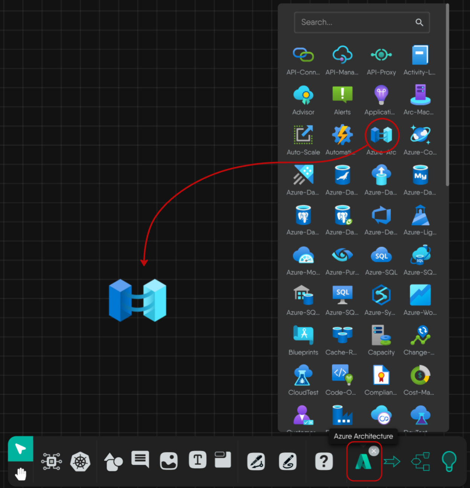
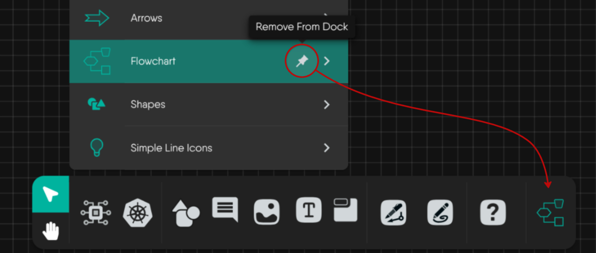
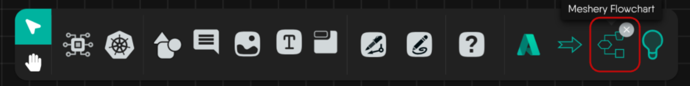

Pinning a model puts its icon in the dock at the bottom of the canvas, so you can reach its components without opening the full palette. Pins belong to your account. They are not stored per design or in the browser, so they follow you across designs, browsers, and devices.

Pinning works in Designer mode. In Operator mode the dock does not show pinned models.

## Pin a model

Hover a model row in the component palette and use the pin icon. Its tooltip reads "Pin To Dock". The shape palette offers the same pin on each shape category row.

Only models and shape categories can be pinned. Individual components cannot. There is no limit on how many models you pin. Kanvas matches pins by model name, so pinning the same model at a different version is the same pin.

## Use a pinned model

Pinned models appear after a divider at the right end of the dock.

Select a pinned model to open a picker with its components. Click a component to add it near the center of the canvas, or drag it to a specific spot. The picker has its own search box and a version selector with an "All Versions" choice. A pinned model whose lookup returns nothing is not drawn.

## Remove a pin

Either of these removes the pin without affecting any design:

- Select the pin icon again on the model row. Its tooltip reads "Remove From Dock".
- Hover the pinned model in the dock and select the close (X) badge.

## Default dock

With nothing pinned the dock holds Select, Hand, Components, Kubernetes, Shapes, Comment, Image, TextBox, Section, Pen, Pencil, and Help Center. See [Whiteboard on the Canvas]().
