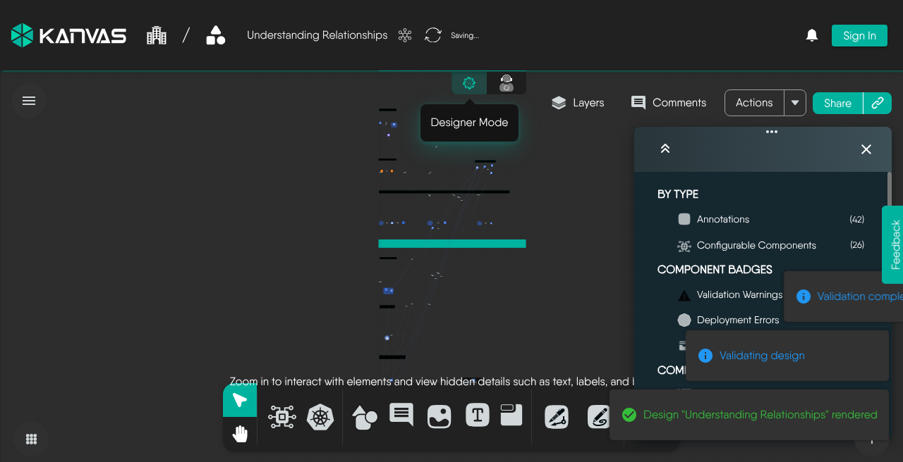
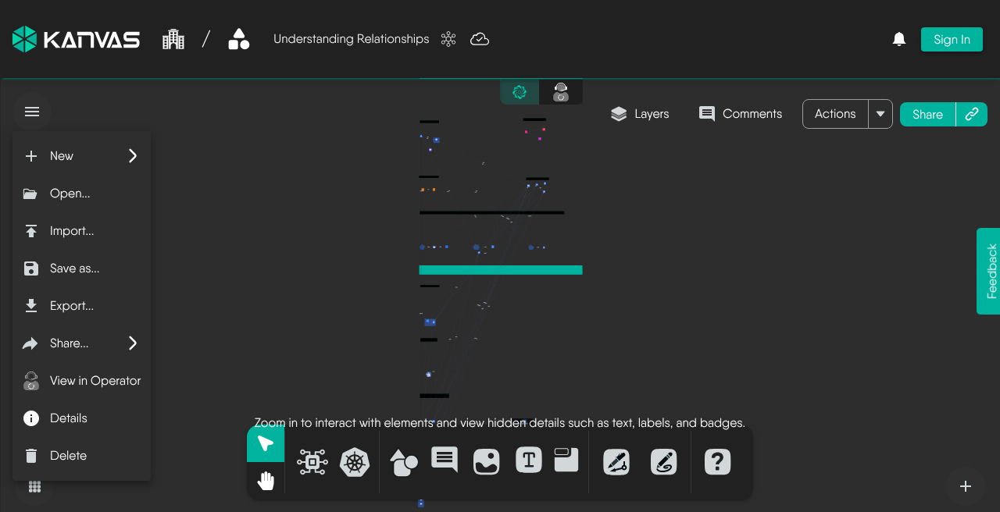

# Saving Designs

> How Kanvas persists your work, what the save indicator is telling you, and how to save a copy.

While you are signed in, Kanvas saves for you. There is no save button you must remember to press before closing the tab: every change you make to a design - adding a component, moving it, editing its configuration, drawing a relationship, renaming the design - is persisted to your account. Kanvas writes pending changes 3 seconds after you stop editing. If a save fails, it retries with a doubling delay (3 seconds, then 6, then 12, and so on) for up to 100 attempts. Any new edit resets that count.

That leaves two things worth knowing: how to tell whether a change has actually landed, and how to deliberately create a second, separate copy.

## The save indicator

The indicator beside the design name reports the state of the design against your account.

| Indicator | Meaning |
| --- | --- |
| Cloud with a tick, plus a brief "Saved" | Every change is persisted. Hovering shows how long ago the last save completed. |
| Circling arrows, plus "Saving..." | A change is in flight. |
| Struck-through cloud, plus "Unable to save. Retrying..." | A save failed. Kanvas retries on its own; the message clears once one succeeds. |

If the indicator sits on "Unable to save" for more than a moment, stop making changes until it clears - your recent edits exist only in the browser until a save succeeds. The usual causes are a lost connection to Layer5 Cloud or an expired session.

Clicking the indicator forces a save immediately rather than waiting for the next automatic one.

<figure>
  
  <figcaption>Anonymous capture (Sep 2026): the save indicator reads <strong>Saving…</strong> while the design syncs. Notification toasts from a recent Validate may also appear in this view.</figcaption>
</figure>

## Save history

Hovering the save indicator on a saved design offers **View Save History**, which opens a list titled "Design Version History". It is an event log of who changed the design and when. You cannot restore, diff, or export an earlier version from it. If you need a version you can return to, export a copy at that point.

Every save raises the patch number: the first save is 0.0.1, the next 0.0.2, and so on. Autosaves, visibility changes, and catalog data edits all count. There is no way to bump the major or minor number. Cloning and imports reset the version to 0.0.1. Saving sends the whole design and the server overwrites the stored copy. The last save wins. Collaborators editing the same open design are reconciled live in the editor, not at the storage layer.

## Save as

**Save as...** in the file menu creates a *new* design from what is currently on the canvas. You give the copy a name, Kanvas stores it as a separate design owned by you, and the canvas switches to that new design - so any further edits go to the copy, not to the original.

Use it to:

- take a private working copy of a design someone shared with you,
- branch a design before making a change you may not keep,
- turn a design opened from the catalog into one of your own.

**Save as...** is disabled while the canvas is empty.

<figure>
  
  <figcaption>File menu (hamburger): New, Open, Import, <strong>Save as…</strong>, Export, Share, View in Operator, Details, and Delete.</figcaption>
</figure>

## Signed out

Anonymous users save normally into a guest account with its own organization and workspace. On sign-in, guest designs migrate to the account. [Exporting the design](/kanvas/designer/export-designs/) is how you take a file with you.

A new, unsaved design is named "Untitled Design". Kanvas saves a new design only when it has at least one component, or a name that is not empty and not "Untitled Design". An empty, unnamed canvas is not saved. Once a design has been saved, it can always be saved again, even after you remove every component. You cannot create a design while your organization scope is set to all organizations. Select a single organization first.

The server rejects a save when the design has more components than your plan allows: Personal 100, Team Designer 200, Team Operator 100, Enterprise 300. These are the seeded values. A deployment can differ. The limit applies to every save, to Save as, to merges, and to URL imports. It does not apply to cloning. A cloned design that exceeds your limit opens normally but fails its first save.

The server answers 403 with the message "Design exeeds maximum limit of N components supported by your current plan" (the misspelling ships) and an upgrade remediation. Kanvas does not show that message. You see only "Unable to save. Retrying..." and the edits stay on the canvas, unsaved. An organization with no active subscription that grants the feature gets "Org is not entitled to adding components to a design". Other messages: "Failed to reach the cloud. Any changes made may not be saved." when the server is unreachable (HTTP 503), and "Failed to save Design with name: <name>" for other failures, including "Design is invalid or empty" when the payload was empty. Closing the tab or switching designs with unsaved changes asks "You have unsaved changes. Are you sure you want to leave?"

***

### See Also

* **[Sharing Designs](/kanvas/designer/sharing/):** Give other people access to a saved design.
* **[Exporting Designs](/kanvas/designer/export-designs/):** Take a design out of Kanvas as a file.
* **[Publishing Designs](/kanvas/designer/publishing-designs/):** Offer a design to the catalog.

