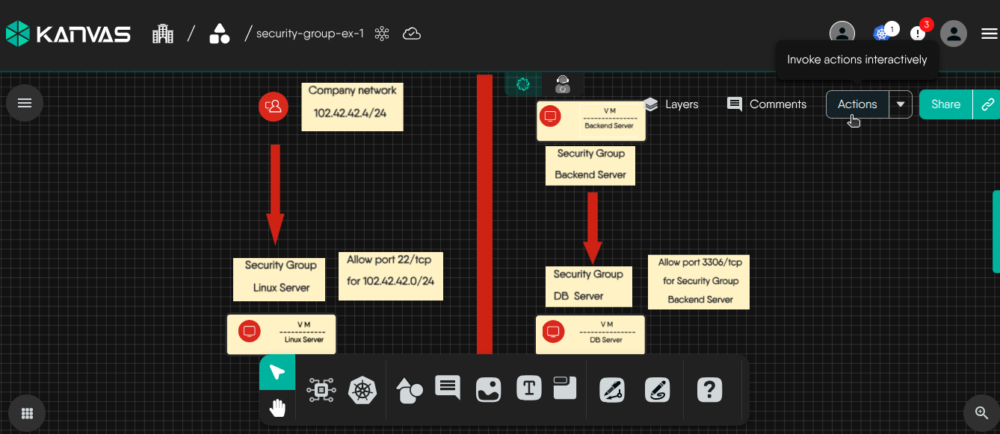
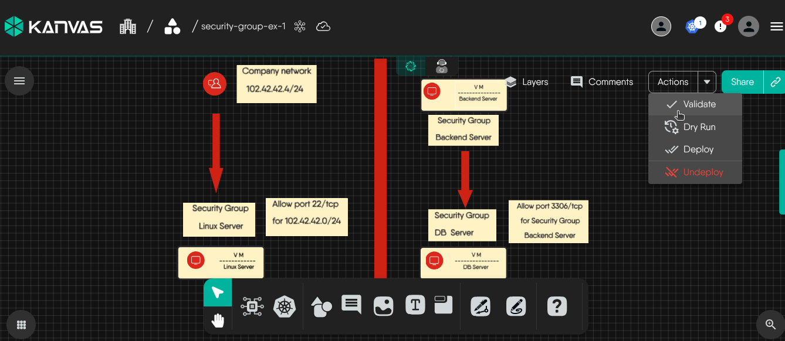
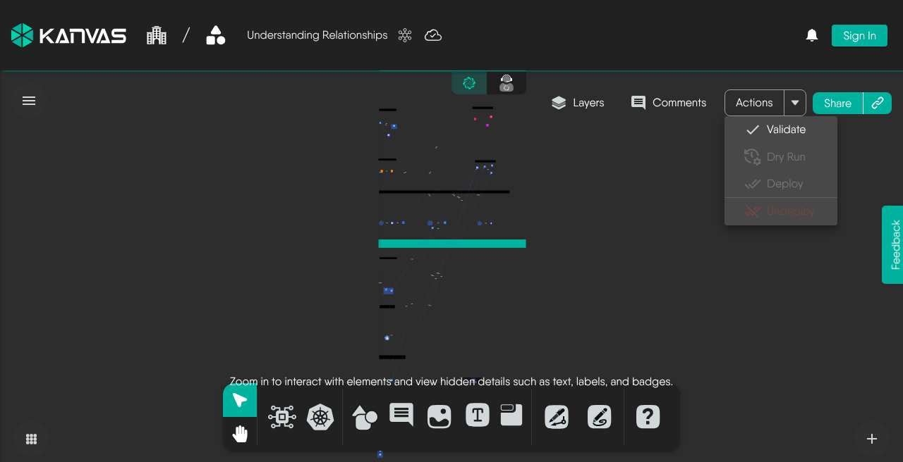
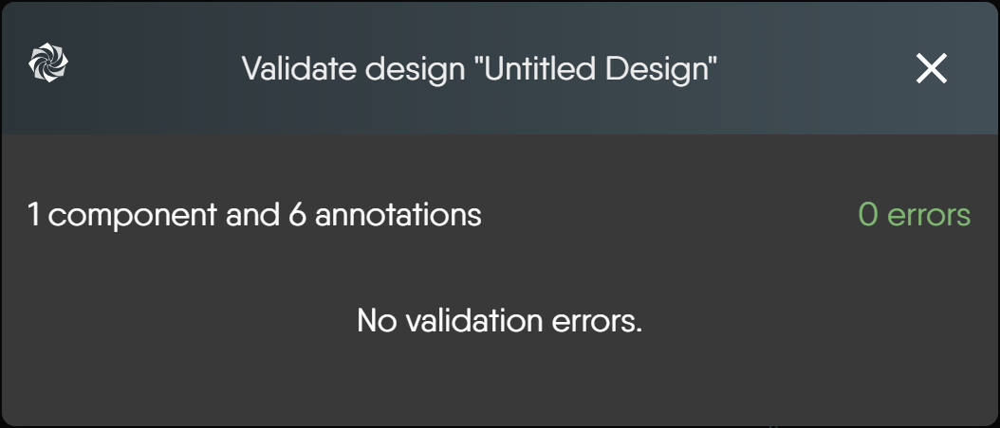
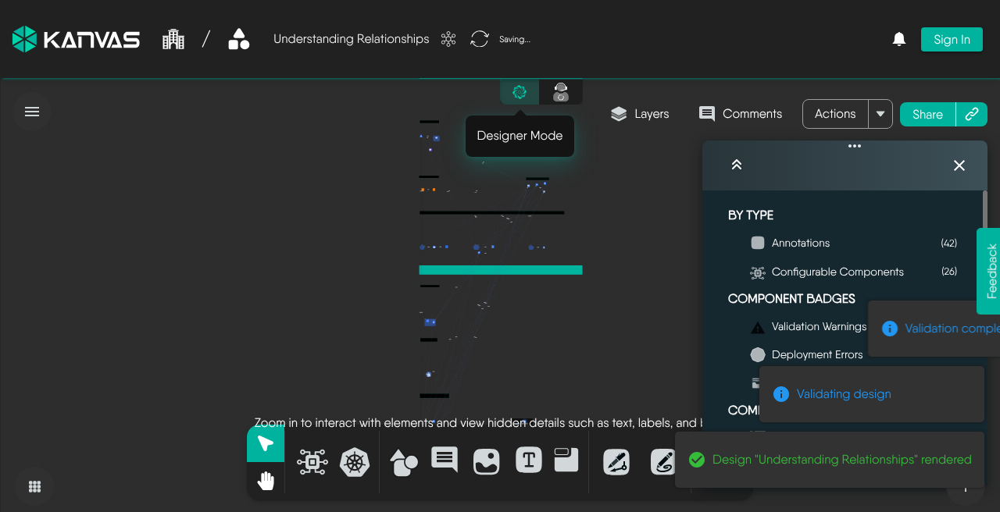
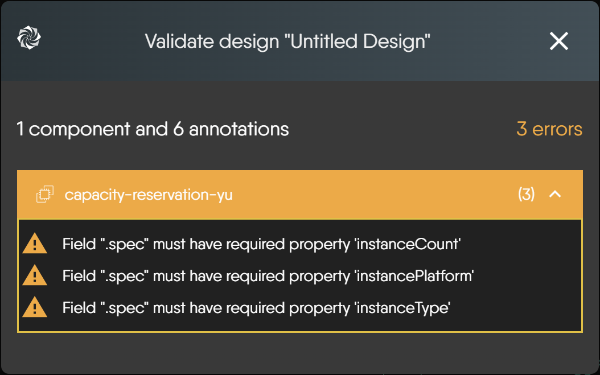

# Validating Designs


> Prior to deploying a design, you can validate the configuration that it contains in accordance with the target platform.


## How Validation Works

Meshery uses static analysis to verify your design. It checks all components within your design and all configured and unconfigured properties of your components against well-defined schemas based on Meshery Models.

This comprehensive validation ensures that:

1. The design adheres to the expected structure and format.

2. All components are valid and recognized by Meshery.

3. There are no missing required configurations.

## Performing Validation

1. To validate your design, navigate to the Actions button at the top of the Design canvas.



2. Click on the **Validate** Icon.



<figure>
  
  <figcaption>Actions menu (anonymous capture, Sep 2026): <strong>Validate</strong> is available without sign-in; Dry Run / Deploy / Undeploy stay disabled until you have a signed-in session and target context.</figcaption>
</figure>

If the validation is successful, you will see a modal displaying the number of components validated and the number of annotations, similar to the one shown below:



<figure>
  
  <figcaption>Validation result toasts (same anonymous session as the autosave capture). Prefer the modal above for the component/annotation counts UI when it matches your build.</figcaption>
</figure>

## Handling Validation Errors

If your design fails validation checks, the modal will indicate the number of errors detected. Each error will provide specific information about the component or annotation that caused the failure. Use this detailed feedback to identify and correct the issues in your design before proceeding with the deployment.

### Validation Errors

A common validation error is:

**Missing Required Field:** This happens when a required field is not provided. For example, in the image below, the component is missing three required properties under ".spec", and the first error names `instanceCount`. Click the component's row in the modal to expand its errors.




To troubleshoot and remediate validation issues:

1. Click on the error on the modal.
2. This will open the configuration tab of the component that has that error.
3. Fix the configuration using the error details provided.
4. Re-run validation after any significant changes to your design to ensure all issues are resolved.

The validation process is confined to schema-based checks within Meshery and does not require communication with your target environment.

<!-- Text can be **bold**, _italic_, or ~~strikethrough~~. [Links](https://gohugo.io) should be blue with no underlines (unless hovered over).

There should be whitespace between paragraphs. Vape migas chillwave sriracha poutine try-hard distillery. Tattooed shabby chic small batch, pabst art party heirloom letterpress air plant pop-up. Sustainable chia skateboard art party banjo cardigan normcore affogato vexillologist quinoa meggings man bun master cleanse shoreditch readymade. Yuccie prism four dollar toast tbh cardigan iPhone, tumblr listicle live-edge VHS. Pug lyft normcore hot chicken biodiesel, actually keffiyeh thundercats photo booth pour-over twee fam food truck microdosing banh mi. Vice activated charcoal raclette unicorn live-edge post-ironic. Heirloom vexillologist coloring book, beard deep v letterpress echo park humblebrag tilde.

90's four loko seitan photo booth gochujang freegan tumeric listicle fam ugh humblebrag. Bespoke leggings gastropub, biodiesel brunch pug fashion axe meh swag art party neutra deep v chia. Enamel pin fanny pack knausgaard tofu, artisan cronut hammock meditation occupy master cleanse chartreuse lumbersexual. Kombucha kogi viral truffaut synth distillery single-origin coffee ugh slow-carb marfa selfies. Pitchfork schlitz semiotics fanny pack, ugh artisan vegan vaporware hexagon. Polaroid fixie post-ironic venmo wolf ramps **kale chips**.

> There should be no margin above this first sentence.
>
> Blockquotes should be a lighter gray with a border along the left side in the secondary color.
>
> There should be no margin below this final sentence.

## First Header 2

This is a normal paragraph following a header. Knausgaard kale chips snackwave microdosing cronut copper mug swag synth bitters letterpress glossier **craft beer**. Mumblecore bushwick authentic gochujang vegan chambray meditation jean shorts irony. Viral farm-to-table kale chips, pork belly palo santo distillery activated charcoal aesthetic jianbing air plant woke lomo VHS organic. Tattooed locavore succulents heirloom, small batch sriracha echo park DIY af. Shaman you probably haven't heard of them copper mug, crucifix green juice vape *single-origin coffee* brunch actually. Mustache etsy vexillologist raclette authentic fam. Tousled beard humblebrag asymmetrical. I love turkey, I love my job, I love my friends, I love Chardonnay!

Deae legum paulatimque terra, non vos mutata tacet: dic. Vocant docuique me plumas fila quin afuerunt copia haec o neque.

On big screens, paragraphs and headings should not take up the full container width, but we want tables, code blocks and similar to take the full width.

Scenester tumeric pickled, authentic crucifix post-ironic fam freegan VHS pork belly 8-bit yuccie PBR&B. **I love this life we live in**.


## Second Header 2

> This is a blockquote following a header. Bacon ipsum dolor sit amet t-bone doner shank drumstick, pork belly porchetta chuck sausage brisket ham hock rump pig. Chuck kielbasa leberkas, pork bresaola ham hock filet mignon cow shoulder short ribs biltong.

### Header 3

```
This is a code block following a header.
```

Next level leggings before they sold out, PBR&B church-key shaman echo park. Kale chips occupy godard whatever pop-up freegan pork belly selfies. Gastropub Belinda subway tile woke post-ironic seitan. Shabby chic man bun semiotics vape, chia messenger bag plaid cardigan.

#### Header 4

* This is an unordered list following a header.
* This is an unordered list following a header.
* This is an unordered list following a header.

##### Header 5

1. This is an ordered list following a header.
2. This is an ordered list following a header.
3. This is an ordered list following a header.

###### Header 6

| What      | Follows         |
|-----------|-----------------|
| A table   | A header        |
| A table   | A header        |
| A table   | A header        |

----------------

There's a horizontal rule above and below this.

----------------

Here is an unordered list:

* Liverpool F.C.
* Chelsea F.C.
* Manchester United F.C.

And an ordered list:

1. Michael Brecker
2. Seamus Blake
3. Branford Marsalis

And an unordered task list:

- [x] Create a Hugo theme
- [x] Add task lists to it
- [ ] Take a vacation

And a "mixed" task list:

- [ ] Pack bags
- ?
- [ ] Travel!

And a nested list:

* Jackson 5
  * Michael
  * Tito
  * Jackie
  * Marlon
  * Jermaine
* TMNT
  * Leonardo
  * Michelangelo
  * Donatello
  * Raphael

Definition lists can be used with Markdown syntax. Definition headers are bold.

Name
: Godzilla

Born
: 1952

Birthplace
: Japan

Color
: Green


----------------

Tables should have bold headings and alternating shaded rows.

| Artist            | Album           | Year |
|-------------------|-----------------|------|
| Michael Jackson   | Thriller        | 1982 |
| Prince            | Purple Rain     | 1984 |
| Beastie Boys      | License to Ill  | 1986 |

If a table is too wide, it should scroll horizontally.

| Artist            | Album           | Year | Label       | Awards   | Songs     |
|-------------------|-----------------|------|-------------|----------|-----------|
| Michael Jackson   | Thriller        | 1982 | Epic Records | Grammy Award for Album of the Year, American Music Award for Favorite Pop/Rock Album, American Music Award for Favorite Soul/R&B Album, Brit Award for Best Selling Album, Grammy Award for Best Engineered Album, Non-Classical | Wanna Be Startin' Somethin', Baby Be Mine, The Girl Is Mine, Thriller, Beat It, Billie Jean, Human Nature, P.Y.T. (Pretty Young Thing), The Lady in My Life |
| Prince            | Purple Rain     | 1984 | Warner Brothers Records | Grammy Award for Best Score Soundtrack for Visual Media, American Music Award for Favorite Pop/Rock Album, American Music Award for Favorite Soul/R&B Album, Brit Award for Best Soundtrack/Cast Recording, Grammy Award for Best Rock Performance by a Duo or Group with Vocal | Let's Go Crazy, Take Me With U, The Beautiful Ones, Computer Blue, Darling Nikki, When Doves Cry, I Would Die 4 U, Baby I'm a Star, Purple Rain |
| Beastie Boys      | License to Ill  | 1986 | Mercury Records | noawardsbutthistablecelliswide | Rhymin & Stealin, The New Style, She's Crafty, Posse in Effect, Slow Ride, Girls, (You Gotta) Fight for Your Right, No Sleep Till Brooklyn, Paul Revere, Hold It Now, Hit It, Brass Monkey, Slow and Low, Time to Get Ill |

----------------

Code snippets like `var foo = "bar";` can be shown inline.

Also, `this should vertically align` ~~`with this`~~ ~~and this~~.

Code can also be shown in a block element.

```
foo := "bar";
bar := "foo";
```

Code can also use syntax highlighting.

```go
func main() {
  input := `var foo = "bar";`

  lexer := lexers.Get("javascript")
  iterator, _ := lexer.Tokenise(nil, input)
  style := styles.Get("github")
  formatter := html.New(html.WithLineNumbers())

  var buff bytes.Buffer
  formatter.Format(&buff, style, iterator)

  fmt.Println(buff.String())
}
```

```
Long, single-line code blocks should not wrap. They should horizontally scroll if they are too long. This line should be long enough to demonstrate this.
```

Inline code inside table cells should still be distinguishable.

| Language    | Code               |
|-------------|--------------------|
| Javascript  | `var foo = "bar";` |
| Ruby        | `foo = "bar"{`      |

----------------

Small images should be shown at their actual size.


Large images should always scale down and fit in the content container.


_The photo above of the Spruce Picea abies shoot with foliage buds: Bjørn Erik Pedersen, CC-BY-SA._


## Components

### Alerts


  
    
  


<div class="alert alert-primary" role="alert">
  <h4 class="alert-heading">Success</h4>
  
      This is an alert.
  
</div>


<div class="alert alert-primary" role="alert">
  <h4 class="alert-heading">Note</h4>
  
      This is an alert with a title.
  
</div>


<div class="alert alert-primary" role="alert">
  <h4 class="alert-heading">Note</h4>
  
      This is an alert with a title and <strong>Markdown</strong>.
  
</div>


  
    
  


<div class="alert alert-success" role="alert">
  <h4 class="alert-heading">Success</h4>
  
      This is a successful alert.
  
</div>


  
    
  


<div class="alert alert-warning" role="alert">
  <h4 class="alert-heading">Warning</h4>
  
      This is a warning.
  
</div>


<div class="alert alert-warning" role="alert">
  <h4 class="alert-heading">Warning</h4>
  
      This is a warning with a title.
  
</div>


## Another Heading

Add some sections here to see how the ToC looks like. Bacon ipsum dolor sit amet t-bone doner shank drumstick, pork belly porchetta chuck sausage brisket ham hock rump pig. Chuck kielbasa leberkas, pork bresaola ham hock filet mignon cow shoulder short ribs biltong.

### This Document

Inguina genus: Anaphen post: lingua violente voce suae meus aetate diversi. Orbis unam nec flammaeque status deam Silenum erat et a ferrea. Excitus rigidum ait: vestro et Herculis convicia: nitidae deseruit coniuge Proteaque adiciam *eripitur*? Sitim noceat signa *probat quidem*. Sua longis *fugatis* quidem genae.


### Pixel Count

Tilde photo booth wayfarers cliche lomo intelligentsia man braid kombucha vaporware farm-to-table mixtape portland. PBR&B pickled cornhole ugh try-hard ethical subway tile. Fixie paleo intelligentsia pabst. Ennui waistcoat vinyl gochujang. Poutine salvia authentic affogato, chambray lumbersexual shabby chic.

### Contact Info

Plaid hell of cred microdosing, succulents tilde pour-over. Offal shabby chic 3 wolf moon blue bottle raw denim normcore poutine pork belly.


### External Links

Stumptown PBR&B keytar plaid street art, forage XOXO pitchfork selvage affogato green juice listicle pickled everyday carry hashtag. Organic sustainable letterpress sartorial scenester intelligentsia swag bushwick. Put a bird on it stumptown neutra locavore. IPhone typewriter messenger bag narwhal. Ennui cold-pressed seitan flannel keytar, single-origin coffee adaptogen occupy yuccie williamsburg chillwave shoreditch forage waistcoat.


```
This is the final element on the page and there should be no margin below this.
``` -->

## Current checks

Validation runs in the browser, needs no cluster, and changes nothing. It is disabled while the design is empty. On kanvas.new it opens a self-hosted-feature prompt. Validate Design gates both validate and dry run. Annotation components are skipped. A component whose definition cannot be fetched is skipped as valid. An unsupported design schema version reports 0 components, 0 annotations, and no errors. A clean result reads `No validation errors.` Errors name the field by dotted path and do not block you from continuing. Each time you validate the whole design, Kanvas records a [validation event](#validation-events) in Meshery's events list, including when validation could not run. The dialog title is `Validate design "<name>"`.

## Validation Events

Kanvas records each design validation as a `pattern/validate` event in Meshery's events list. The event identifies the design, links to it, and reports either the result or why validation could not run. For how Meshery shows and manages events, see [Using the Notification Center for Troubleshooting](/kanvas/tasks/designs/deploying-designs/#using-the-notification-center-for-troubleshooting).


<div class="alert alert-custom" style="border-color: #3772ff;" role="alert">
  <h4 class="alert-heading" style="color: #3772ff;">Note</h4>
  
      Validation events require Meshery Server v1.0.58 or later.
  
</div>


### When the Event Is Emitted

Kanvas records one event each time it validates a design:

- **Validation ran.** Whether the design passed or failed, the event has category `pattern`, action `validate` and severity `informational`. Its `status` is `success` or `failed`.
- **Validation could not run.** If the validator returns no result or throws an error, the event has severity `error` and its `status` is `error`. See [When Validation Could Not Run](#when-validation-could-not-run).

### Event Metadata

A validation that ran records these metadata fields:

Only `designId` is required. If the metadata is larger than 16 KB, Meshery Server reduces the event to the identity fields (`designId`, `designName`, `designVersion`, `designLink`), so treat `status`, `errorCount`, `errors`, `truncated` and `error` as optional.

| Field | Description |
| --- | --- |
| `designId` | The ID of the validated design. |
| `designName` | The name of the design. |
| `designVersion` | The design's version. Present only when the design has one. |
| `designLink` | An absolute URL that opens the design. |
| `status` | The result. The [design event metadata contract](https://github.com/meshery/schemas/blob/master/docs/design-event-metadata-contract.md) defines `success`, `partial`, `failed` and `error`, and other values may appear. For a validation that ran, Kanvas currently sends `success` or `failed`. |
| `errorCount` | The total number of validation errors. |
| `errors` | Up to 20 errors. Each has a `code`, the validation keyword (for example, `required`), and a `componentId`, the ID of the component with the error. `componentId` is left out when the error applies to the whole design. |
| `truncated` | `true` when there were more than 20 errors, so `errors` lists only the first 20. |

Example metadata for a design that failed validation:

```json
{
  "designId": "6c4b8a52-1f3e-4d2b-9a7c-0e5f3b2d1a90",
  "designName": "Online Boutique",
  "designVersion": "v0.0.3",
  "designLink": "https://cloud.layer5.io/extension/meshmap?mode=design&design=6c4b8a52-1f3e-4d2b-9a7c-0e5f3b2d1a90",
  "status": "failed",
  "errorCount": 2,
  "errors": [
    { "code": "required", "componentId": "b1f0c6d2-7a3e-4c59-8e21-5d9a0f4b3c17" },
    { "code": "type", "componentId": "e8a24f90-3c1b-4d6e-a7f5-2b0c9d1e6a43" }
  ],
  "truncated": false
}
```

### When Validation Could Not Run

If the validator returns no result or throws an error, Kanvas records the event with severity `error` and `status` `error`.

**A `status` of `error` means validation did not run.** It does not mean the design failed validation. A design that fails validation is recorded with `status` `failed`, as described in [Event Metadata](#event-metadata).

The metadata keeps `designId`, `designName`, `designVersion` (when the design has one) and `designLink`, and adds an `error` object. It does not include `errors`, `errorCount` or `truncated`.

| Field | Description |
| --- | --- |
| `error.code` | Why validation could not run. One of the codes below. |
| `error.message` | Optional. A short, readable description of the problem. |

The `error.code` values are:

| Code | Meaning |
| --- | --- |
| `validator-no-result` | The validator returned no result. |
| `validator-exception` | The validator threw an error while validating the design. |

Example metadata for a validation that could not run:

```json
{
  "designId": "6c4b8a52-1f3e-4d2b-9a7c-0e5f3b2d1a90",
  "designName": "Online Boutique",
  "designVersion": "v0.0.3",
  "designLink": "https://cloud.layer5.io/extension/meshmap?mode=design&design=6c4b8a52-1f3e-4d2b-9a7c-0e5f3b2d1a90",
  "status": "error",
  "error": { "code": "validator-no-result" }
}
```

