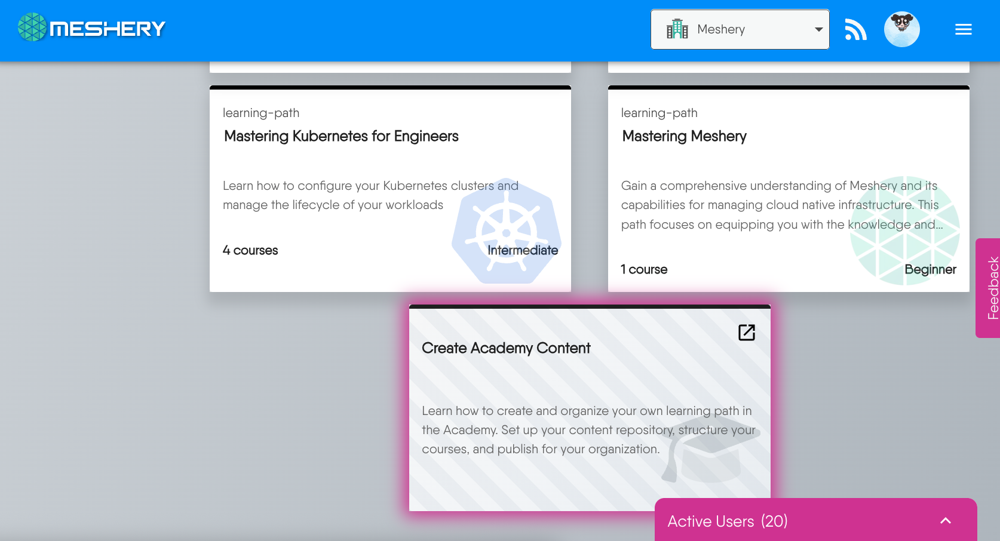
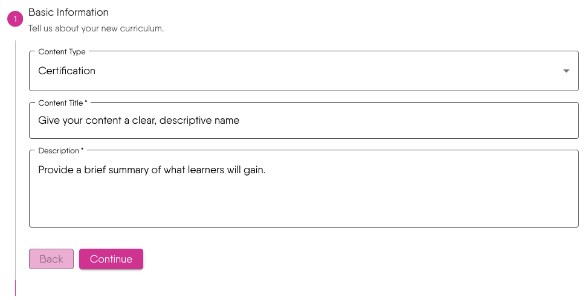
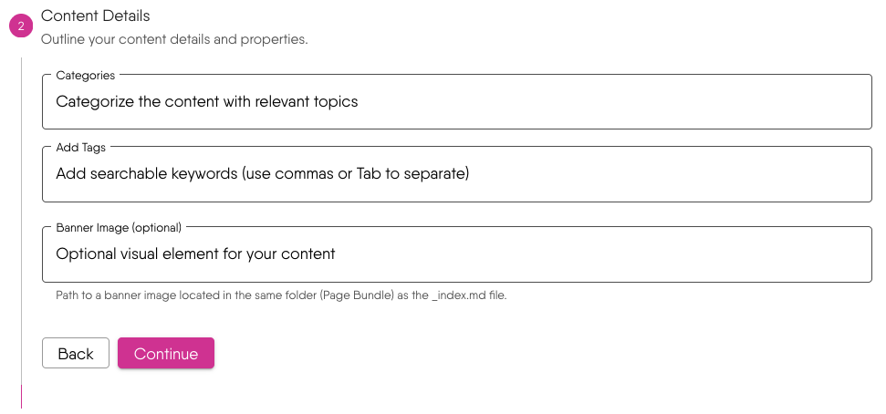
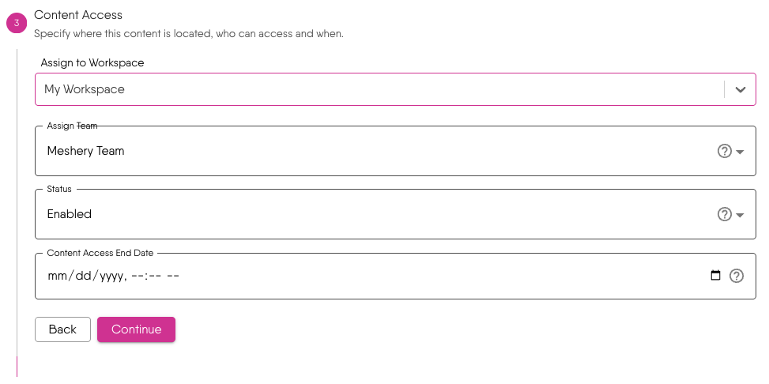
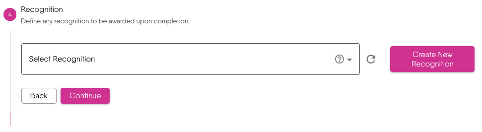
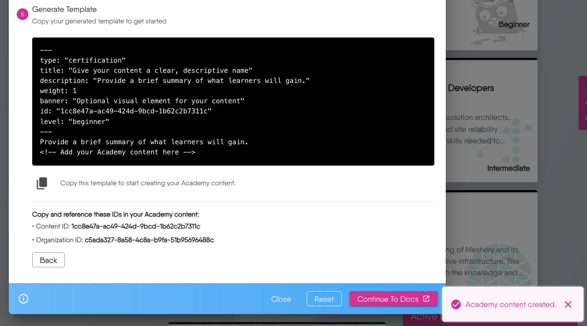
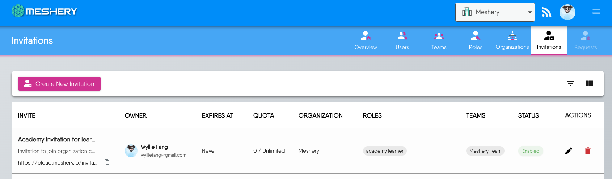
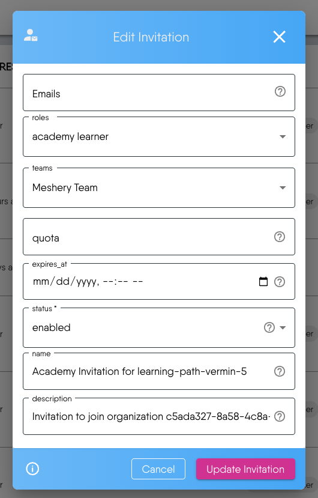

# Using Academy Content Template Creator


The Academy Content Template Creator is a step-by-step wizard that helps you create structured templates for your Academy content. This generator streamlines the process of
creating learning paths, challenges, and certifications by collecting all necessary metadata and generating a ready-to-use template.


## Getting Started

1. Access the Creator: Click on the "Create New Content" card in your Academy dashboard
2. Create Your Content: The wizard will guide you through **5 essential steps** to create your content template

Since it's straightforward, let's walk through a practical example to demonstrate the process.

## Example: Creating "Meshery Contributors Certification"

This example demonstrates how to use the **Academy Content Template Creator** to build a **certification** program for **Meshery contributors**. Each step shows what information to enter, followed by specific example values.

### Step 1: Basic Information

- Type: Choose "Certification" from Learning Path, Challenge, or Certification
- Title: "Meshery Contributors Certification"
- Description: "A comprehensive certification program for developers looking to become active contributors to Meshery"

### Step 2: Content Details

<!-- - Level: Intermediate (assumes basic cloud-native knowledge) -->
- Categories: "open-source, cloud-native"
- Add Tags: "meshery", "kubernetes", "golang", "contribution", "open-source"
- Banner Image: "images/meshery-contributors-banner.svg"

### Step 3: Content Access

- Workspace: "Meshery Academy"
- Team: "Contributors Program"
- Access Status: Enabled
- Content Access End Date: Leave blank for permanent access (Meshery always welcomes contributors)

**Understanding Access Status: Enabled vs Disabled**

Access status sets the invitation to enabled or disabled. It defaults to enabled. It does not by itself hide the catalog card. New content starts public, not ready, and beginner. Catalog visibility is that public flag. Access status only governs enrollment.

**Enabled:** a signed-in learner can enroll. Enrolling accepts the invitation.

**Disabled:** the invitation blocks enrollment. Learners who already enrolled keep their role and team membership. Their progress is not paused.

**Content Access End Date** is the invitation's expiry. Leave it empty for no expiry. Expiry is checked at enrollment. After it passes, new learners cannot enroll. Learners who already enrolled keep their role and team membership.

The team field accepts one existing team. That team is added to the invitation, and learners join it when they enroll. You can type a new workspace name. The team must already exist.

### Step 4: Recognition


The Recognition step defines the badge or certificate awarded upon completion. You have two options:
- **Use Existing Recognition**: Choose from the Layer5 collection
- **Create New Recognition**: Design a custom badge with an image URL

**For our example:**
- Create a "Meshery Contributor" badge with the Meshery logo


### Step 5: Generate Template


After clicking "Continue" in Step 4, a success notification appears in the bottom-right corner confirming your template has been created successfully.


<div class="alert alert-custom" style="border-color: #3772ff;" role="alert">
  <h4 class="alert-heading" style="color: #3772ff;">Navigation Between Steps</h4>
  
      You can navigate back to any previous step to make modifications. When you return to earlier steps and make changes, your entries in the subsequent steps will remain intact.
  
</div>


**Generated Template Output for Meshery Contributors Certification:**

This template provides the YAML front matter metadata for static site generators (like Hugo/Jekyll). After copying it, we can directly create new content files in our Academy repository.

```yaml
---
type: "certification"
title: "Meshery Contributors Certification"
description: "A comprehensive certification program for developers looking to become active contributors to Meshery"
weight: 1
banner: "images/meshery-contributors-banner.svg"
id: "unique-content-id"
level: "beginner"
---

Provide a brief summary of what learners will gain.
<!-- Add your Academy content here -->
```


<div class="alert alert-custom" style="border-color: #3772ff;" role="alert">
  <h4 class="alert-heading" style="color: #3772ff;">Important Reference IDs</h4>
  
      <p>Make note of two key identifiers for your content files:</p>
<ul>
<li><strong>Content ID</strong>: Unique identifier for this specific content</li>
<li><strong>Organization ID</strong>: Your organization&rsquo;s identifier (remains constant)</li>
</ul>
  
</div>


The `level` key in this output always reads `beginner`, whatever difficulty you picked on Content Details. Set it to `beginner`, `intermediate`, or `advanced` yourself. The creator also includes `tags` and `categories` when you entered them, and commented `competencies` and `prerequisite_knowledge` samples you can uncomment. `weight` is fixed at `1` until you change it.


<div class="alert alert-custom" style="border-color: #3772ff;" role="alert">
  <h4 class="alert-heading" style="color: #3772ff;">Content ID Updates</h4>
  
      The creator writes the record when you advance from Recognition to Generate Template. You can go back and your entries stay, but advancing to the last step again creates another record with a new content ID and a new invitation. Use the ID on the final screen of your last run, and treat any earlier record as unused.
  
</div>


### Next Steps

After generating our template:

1. **Copy the Template**: Use the provided copy button to get your front matter
2. **Create Your Content File**: Paste the template into a new .md file in your academy repository
3. **Add Your Content**: Replace the placeholder comment with your actual learning material


## Manage Invitation

### Auto-Generated Invitations
Navigate to **Identity → Invitations** to find your automatically created invitation.


The first column labeled "INVITATION" contains a shareable link that you can copy.

## What Can the Invitation Link Do for You?

The auto-generated invitation link is a powerful tool that helps instructors efficiently manage learner access and streamline the enrollment process.

### 1. What accepting the invitation does

Enrolling accepts the invitation. Acceptance is where access is decided.

- **Team**: The learner is added to the one team you picked, if they are not already a member. The creator does not assign several teams.
- **Role**: Academy Learner is assigned in the organization if the learner does not already hold it.
- **Who can accept**: The email list starts empty, so anyone who is signed in can accept. The invitation is not limited to people already in your organization, and it does not email the team for you. Add exact addresses or `@domain` entries on the invitation to restrict who can accept. See [User Invitations](/pr-preview/pr-1210/cloud/concepts/identity-and-security/users/user-invitations/).

### 2. Sharing the link

Copy the invitation link from the invitation list and send it yourself. The link registers a learner for the content by accepting that invitation. It does not send mail on its own.


### Customize Invitation Properties

Click the pencil icon to access the invitation customization form.


The invitation form contains eight properties. Three are automatically generated by the system for convenience, which you can modify according to your needs:

**Auto-Generated Properties:**
1. **Name**: `Academy Invitation for <slug>`, using the generated slug, not the title you typed.
2. **Description**: Identifies the organization and the curricula the invitation is for.
3. **Roles**: Defaults to Academy Learner. [Academy roles](/pr-preview/pr-1210/cloud/concepts/identity-and-security/roles/academy-roles/) lists what that role can do. Empty quota means unlimited acceptances, and the invitation counts each person once.


<div class="alert alert-custom" style="border-color: #3772ff;" role="alert">
  <h4 class="alert-heading" style="color: #3772ff;">Admin Role Invitations</h4>
  
      Academy admins can invite other instructors to become co-admins by changing the <strong>Roles</strong> property from &ldquo;Academy Learner&rdquo; to &ldquo;Academy Admin&rdquo; during invitation customization.
  
</div>


**Customizable Properties:**

### 1. Emails - Invitation Email List

The email list restricts who may accept. It starts empty, and an empty list lets any signed-in user accept. It does not send the invitation for you.

- **Supported Formats:**
  - Individual emails: `test@domain.com`
  - Domain entries: `@domain.com` (only addresses at that domain may accept)
- **Duplicate Handling**: The system automatically merges duplicate entries
- **Quantity Recommendations:**
  - Small team invitations: 10-50 email addresses
  - Department-level invitations: 100-200 email addresses
  - Large organizations: Use domain wildcards like `@company.com` instead of listing individual emails

### 2. Expires At - Expiration Settings

Control when the invitation expires:

- **Flexibility**: Supports any time setting, extension, and recovery. Leave blank for permanent access
- **What happens at expiration?**
  - Expiration is only checked when users attempt to accept the invitation
  - If the expiration time has passed, users cannot proceed with the invitation
  - Expiration check compares server current time vs. set expiration time
- **Can I modify expired invitations?**
  - Yes, you can recover and extend expiration times by entering edit mode

### 3. Quota - Usage Limits

Set limits on how many users can accept the invitation:

- **When quota is exceeded:**
  - Operates on a first-accept, first-in basis
  - Users beyond the quota cannot join, even with a valid invitation link
- **Recovery options:**
  - If quota is reached, you can increase the quota to restore access
  - Admin console provides real-time usage monitoring

### 4. Teams - Team Assignment List

Specify which teams invited users will join:

- **Team Selection**: Choose one existing team. The creator accepts a single team, and learners join that team when they enroll.
- **No Teams Available**: If your organization has no teams, [create one](/pr-preview/pr-1210/cloud/concepts/identity-and-security/teams/) first.


<div class="alert alert-custom" style="border-color: #3772ff;" role="alert">
  <h4 class="alert-heading" style="color: #3772ff;">Team Structure Changes</h4>
  
      <p><strong>During Organization Restructuring:</strong></p>
<ul>
<li>If team structure changes after invitations are sent</li>
<li>Some teams may be merged or deleted</li>
<li>New users can still join remaining valid teams</li>
</ul>
<p><strong>Permission Management Updates:</strong></p>
<ul>
<li>Team permission policies may change</li>
<li>Some teams might close to new users</li>
<li>Other teams continue accepting new members normally</li>
</ul>

  
</div>


### 5. Status - Enabled/Disabled

Control invitation accessibility:

- **Enabled**: Enrollment can accept the invitation.
- **Disabled**: Enrollment fails. Learners who already enrolled are not removed.


<div class="alert alert-custom" style="border-color: #3772ff;" role="alert">
  <h4 class="alert-heading" style="color: #3772ff;">Invitation Idempotency</h4>
  
      Acceptance is idempotent. A learner who accepts twice gains no duplicate membership or role, and the invitation counts them once.
  
</div>


When an enrollment hits a disabled, expired, full, or email-restricted invitation, the request fails with a server error. The registration is recorded before the invitation is evaluated, so the learner can appear in the Learners view without having joined the organization or the team. Fix the invitation, then have the learner enroll again.

Content created while the console is scoped to all organizations belongs to the provider organization. It has no attached invitation, so enrollment accepts nothing and grants no team or role.

You can change the team, access status, and end date later from the Curricula view of the [Instructor Console](/pr-preview/pr-1210/cloud/academy/creating-content/instructor-console-guide/). To bring in a co-instructor, create an invitation with the Academy Admin role instead of Academy Learner.

