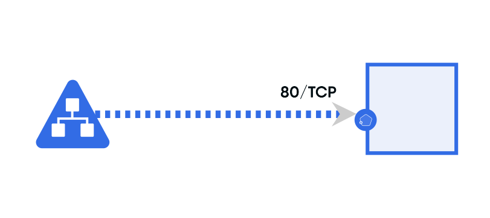
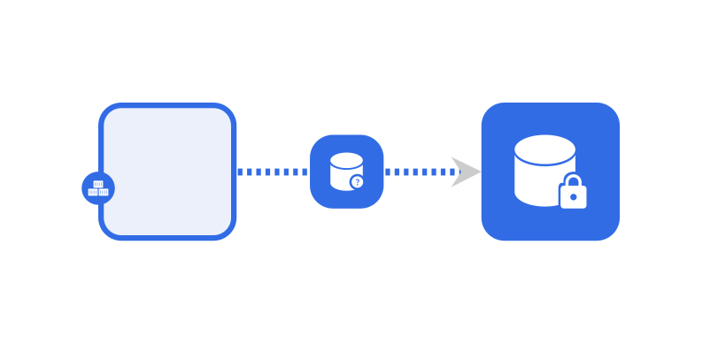
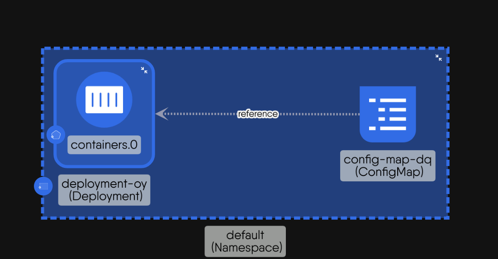
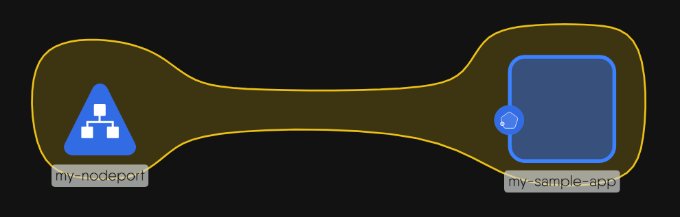

# Relationships

> What relationships are, the kinds Kanvas draws and evaluates, how each one forms, and how relationships keep component configuration consistent.

A relationship records how two components connect: one runs inside the other, one sends traffic to the other, one mounts the other's storage, or both carry the same label. Relationships do more than draw lines. Each relationship definition names the configuration fields on both sides that must agree, so Kanvas can write values from one component into the other and keep the design consistent as you edit. The definitions come from the Meshery registry, not from Kanvas, so the set of relationships available to you depends on the models you use.

## Kinds of relationship

The Layers panel lists eight kinds of relationship, which fall into three families.

### Edge relationships

An edge is a line between two components that interact. You draw it by hand. Kanvas lists the edges the registry allows from the component you start on, and highlights the targets that are compatible.

| Subtype | Meaning | Example |
|---|---|---|
| Network | Traffic can flow between the components. The edge labels source and target ports and protocols. | A Service gives a stable endpoint to a Deployment's replicas. |
| Mount | One component gives storage or files to another, through a binding component placed between them. | A PersistentVolume mounted into a Pod. |
| Reference | One component points to another by name, identifier, or scope. It declares a dependency and does not itself grant access or carry traffic. | A Pod that references a ConfigMap or a Secret. |
| Annotation | A line you draw with the Pen tool to explain flow. It has no effect on configuration. | A traced request path on a diagram. |

The registry can define other edge subtypes. They appear in the edge picker when they can start from the selected component.

### Hierarchical relationships

A hierarchical relationship nests one component in another. A component has at most one parent.

- **Inventory.** The child is drawn inside its parent, as a Pod sits inside a Namespace. Because the Namespace's name is the Pod's namespace, the parent's configuration flows to the child.
- **Wallet.** The child is absorbed into its host and shown as a count badge on the host, as a sidecar is attached to a workload.
- **Alias.** The child stands for one field inside its parent. Editing the alias edits that field of the parent.

### TagSets

Components that carry matching labels or annotations form a TagSet. Kanvas never asks you to draw one. It appears when the labels match and disappears when they stop matching. See [Work with Tags](/pr-preview/pr-1299/kanvas/guides/designing/tagsets/).

## How relationships form

Three mechanisms create relationships:

| Mechanism | Kinds |
|---|---|
| You create them: drag an edge, drop a component into a parent, or draw with the Pen | Edge, inventory, wallet, annotation |
| Evaluation creates them from the registry definitions | TagSets, alias, and any relationship the definitions say should exist |
| Paste or duplicate copies them with the components | Any relationship whose two ends are both in the copied set |

Deleting a component marks the relationships that touched it as deleted. The next evaluation then reverses their effects on configuration.

## Relationships keep configuration in sync

Evaluation is the process that applies relationship definitions to a design. It runs shortly after a change, writes values across related fields, and can add or remove components and relationships. The direction of a write depends on the definition and the kind.

| Kind | Typical direction | Example |
|---|---|---|
| Inventory | Parent to child | The child takes its namespace from the parent Namespace. |
| Edge | Source to target | A Service's port is written into the related Deployment's container port. |
| Wallet | Attached item to host | The host takes the item's configuration. |

Treat these as typical. The relationship definition is the authority, and Kanvas does not hard-code a direction. [Policy Evaluation](/pr-preview/pr-1299/kanvas/concepts/relationship-evaluation/) explains when evaluation runs and why results can change after you stop editing.

## What relationships mean at deploy time

Annotation edges, TagSets, and the drawing of any relationship never change what Kanvas deploys by themselves. What gets deployed is the configuration of each component. Relationships matter because they decided what that configuration is.

## Related pages

- [Create Relationships](/pr-preview/pr-1299/kanvas/guides/designing/creating-relationships/): create, remove, and hide relationships.
- [Designs and Components](/pr-preview/pr-1299/kanvas/concepts/designs/): what a design contains.

