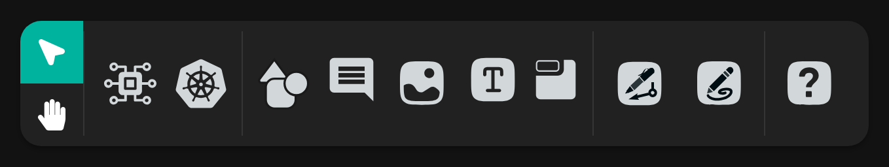
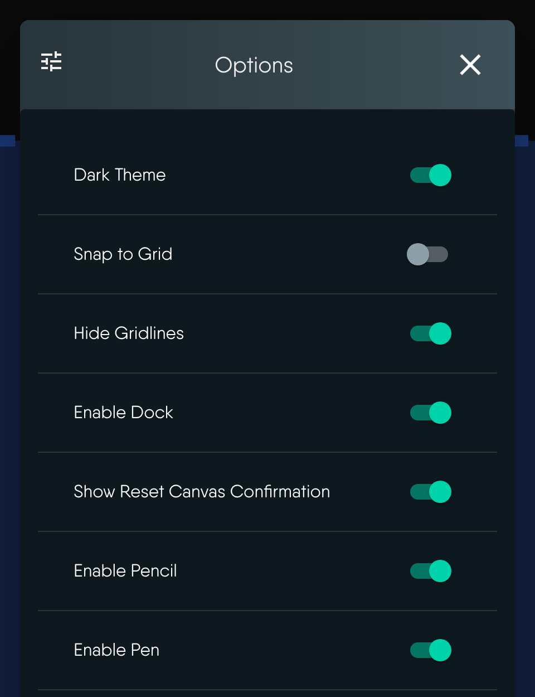
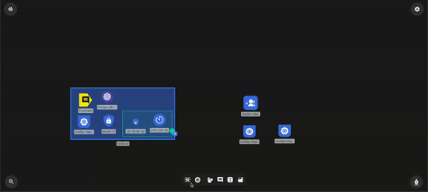
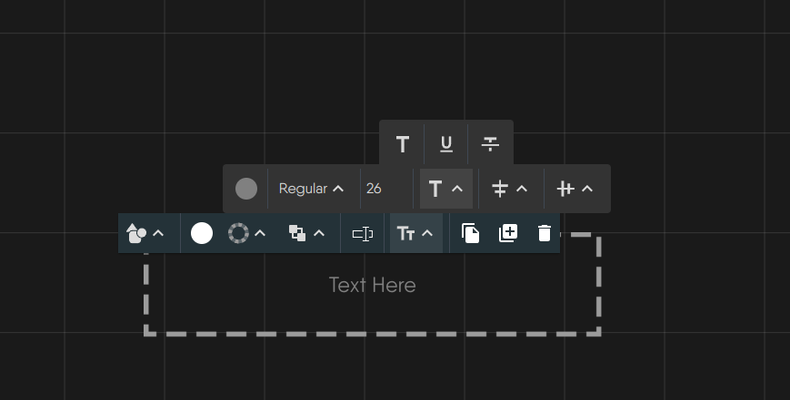
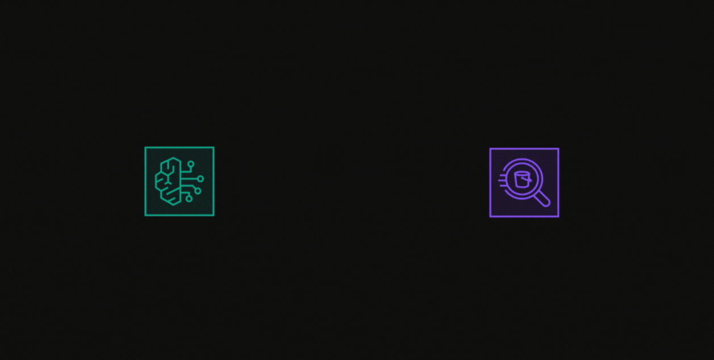
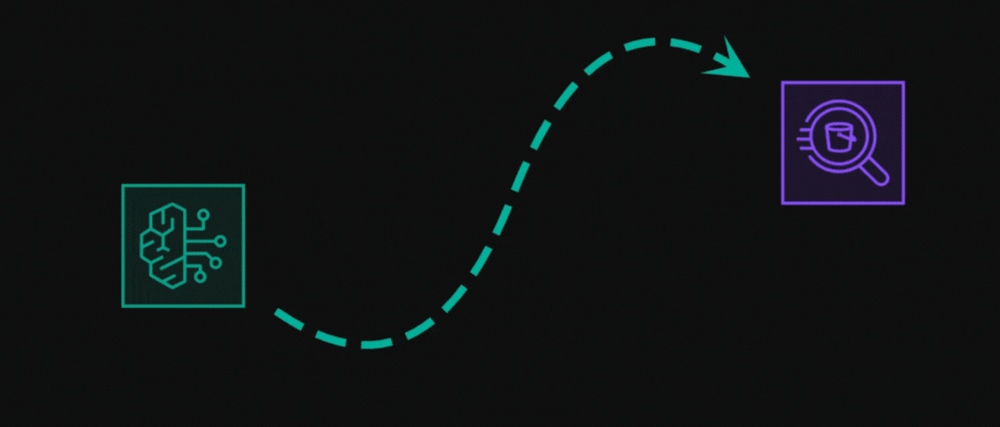

# Whiteboard on the Canvas

> Sketch freehand, draw annotation lines, and add shapes, text, sections, images, and comments alongside real components.

      <iframe allow="accelerometer; autoplay; clipboard-write; encrypted-media; gyroscope; picture-in-picture; web-share; fullscreen" loading="eager" referrerpolicy="strict-origin-when-cross-origin" src="https://www.youtube.com/embed/o58hO4RDCR4?autoplay=0&amp;controls=1&amp;end=0&amp;loop=0&amp;mute=0&amp;start=0" title="YouTube video"></iframe>
    

*[Whiteboarding in Kanvas](/pr-preview/pr-1301/videos/features/kanvas/whiteboarding-in-kanvas/) (3:41) follows one late-night incident from page to postmortem on a single live design. Its page has chapters and a transcript.*

Whiteboarding lets you diagram freely on the same canvas as your infrastructure. You draw shapes, text, freehand strokes, and lines to explain intent, and they sit beside real components in one design. It is on by default and available on every plan.

Drawn objects are saved with the design and shared live with collaborators. They are components marked as annotations, so they count toward your plan's components-per-design limit. See [Designs and Components](/pr-preview/pr-1301/kanvas/concepts/designs/).

This guide covers the drawing tools. For per-object operations such as copying, locking, and resizing, see [Working with Canvas Objects](/pr-preview/pr-1301/kanvas/designer/canvas-objects/).

## The dock {#step-3-utilizing-whiteboard-tools}

The dock sits at the bottom of the canvas in Designer mode. Its tools, left to right:

| Tool | Shortcut | What it does |
|---|---|---|
| Select | <kbd>V</kbd> | Select, move, and configure objects. |
| Hand | <kbd>H</kbd>, or hold <kbd>Space</kbd> | Pan the canvas. |
| Components | - | Open the component palette. |
| Kubernetes | - | Open every Kubernetes component. |
| Shapes | - | Browse shape categories. |
| Comment | <kbd>M</kbd> | Drop a comment thread. |
| Image | <kbd>I</kbd> | Pick an image file and place it. |
| TextBox | <kbd>T</kbd> | Add a text box. |
| Section | <kbd>S</kbd> | Add a labeled, dashed region that holds other objects. |
| Pen | <kbd>Ctrl</kbd>/<kbd>Cmd</kbd>+<kbd>E</kbd> | Draw annotation lines. |
| Pencil | <kbd>Ctrl</kbd>/<kbd>Cmd</kbd>+<kbd>P</kbd> | Draw freehand. |
| Help Center | <kbd>Ctrl</kbd>/<kbd>Cmd</kbd>+<kbd>Shift</kbd>+<kbd>/</kbd> | Open help. |

The Pen and Pencil icons turn green while their mode is active. Press <kbd>Esc</kbd> to leave a mode. Pinned models appear after a divider at the right end. See [Pin Models to the Dock](/pr-preview/pr-1301/kanvas/guides/designing/pin-model-to-dock/).

The dock scrolls horizontally when it overflows, and it is greyed out while the app is in an error state, for example after a failed save. In Operator mode only the Select and Hand tools, Help Center, and minimized panels remain.

### Turn tools on or off

The canvas right-click menu opens an Options dialog with these toggles, all on by default:

- **Enable Dock** hides or shows the entire dock, including component pickers, not only the drawing tools.
- **Enable Pencil** and **Enable Pen** hide or show those two icons.

Each change saves to your user preferences, so it applies to all your designs and devices. The toggles hide icons only. The keyboard shortcuts for Pen, Pencil, <kbd>M</kbd>, <kbd>T</kbd>, <kbd>S</kbd>, and <kbd>I</kbd> keep working.

No permission key gates drawing. Tier listings show Pencil, Pen, and 500 built-in shapes on Free, Team Designer, Team Operator, and Enterprise.

## Draw freehand with the Pencil

Each stroke becomes one filled shape. Defaults are caribbean green, thickness 1, and opacity 1. There is no color or thickness control before you draw. Afterward, select the stroke and use its style toolbar to change fill color, opacity, and border.

## Draw lines with the Pen

The Pen is Connector mode. Click empty canvas to place a small terminal point, then click elsewhere to place another and join them with a line. Repeated clicks draw a connected polyline. Starting from a component's edge handle also works. Cancelling mid-draw removes the dangling point.

Pen lines are annotation edges. They explain flow and do not change any component's configuration. Style them like any edge: color, line style, arrow and curve style, label, and animation.

Pan and box selection are off while you draw with the Pen or Pencil.

## Add shapes, text, sections, images, and comments

- **Shapes.** Choose from the shape categories. A shape carries no configuration and is never deployed. You can swap any object's outline for one of 24 shapes while keeping its content, position, and size.
- **Text boxes.** Double-click to edit text inline. Text options include color, weight (regular, medium, semi bold, bold, black), underline or strikethrough, alignment, and font size.
- **Sections.** A section groups the objects dropped inside it, and they move with it.
- **Images.** Images up to 512,000 bytes are embedded in the design. Larger files are rejected.
- **Comments.** A comment opens a discussion thread on the canvas. Resolved threads disappear from the canvas until reopened. See [Reviewing Designs](/pr-preview/pr-1301/kanvas/designer/comments/).

## Style objects and lines

Select an object to open its toolbar. Controls appear only when the object supports them.

| Control | Options |
|---|---|
| Fill | 13 swatches including transparent, with opacity from 0 to 1 |
| Border | Color, style (solid, dotted, dashed, double), thickness from 0 to 25 |
| Layer order | Move to front, forward, backward, to back |
| Animation | None, blink, ripple, bounce, pulse |
| Line style | Solid, dashed, or dotted; ten curve styles; eleven arrow heads |
| Line animation | Marching ants, which shows the direction of flow |

## Collaborate

Every change, including drawn objects, syncs live between everyone in the design through a shared document over a peer-to-peer session. Each collaborator appears as an avatar in the toolbar, and live cursors and selections are shared. Undo and redo cover the shared document: components, configuration, styles, relationships, drawn objects, and layer toggles.

## Limits and behavior

- Drawn objects are saved with the design. Kanvas never deploys annotations.
- Images and text files over about 500 KB are rejected, whatever your plan.

