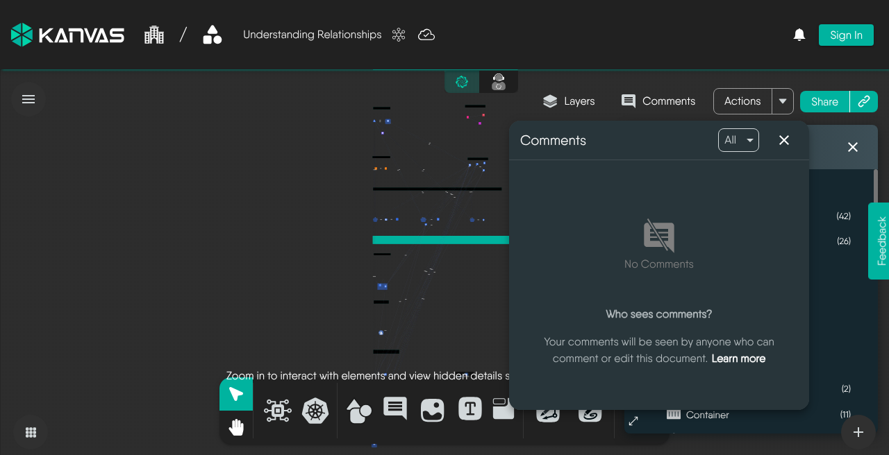

# Collaborative Editing

> Work on one Kanvas design with a teammate in real time, from saving and sharing it to resolving a review thread.

In this tutorial, you and a teammate work on the same design at the same time. You save a design, share it, watch your teammate join as a live collaborator, edit together, and run a short review in a comment thread. Along the way you learn the four separate mechanisms behind collaboration in Kanvas: the live session, access, comments, and saving. Each one explains a different part of what you see.

## Before you begin

- You and a teammate each need a Layer5 account, and both of you sign in. Anonymous sessions are asked to sign in to share.
- Sharing requires the Share Design permission. Searching for people in the Share dialog and in comment mentions requires the View All Users permission. See [Permissions](/pr-preview/pr-1303/kanvas/reference/permissions/).
- Use [kanvas.new](https://kanvas.new). Everything in this tutorial happens in Designer and needs no cluster.

## Step 1: Save a design

Open Designer, add two or three components, give the design a name, and save it.

Saving matters before anything else. A live session is keyed to the saved design, and a new design has no identity until its first save, so it has no session and nobody can join it. From the moment the design is saved, Kanvas opens a session for it whenever the design is loaded.

You should now see the design's name in the top bar and the Share control available. Kanvas hides Share for an empty design.

## Step 2: Share the design with your teammate

Open the Share dialog, search for your teammate, and add them. Leave visibility set to Private. Copy the link and send it to your teammate.

<figure>
  
  <figcaption>The Share dialog</figcaption>
</figure>

You should now see your teammate in the list of people with access.

This step is about **access**. A share is a grant to one person, and it carries no access level: there is no view-only or comment-only option. Your teammate can now do what you can do with the design except delete it or take ownership. They can open, edit, and save it, clone and download it, comment on it, switch it between private and public, and share it with others if their role includes Share Design. Only you as owner, or a provider administrator, can delete the design, and ownership never transfers.

The link alone does not open a private design. The grant does.

## Step 3: Open the design together

Your teammate opens the link while signed in. Keep the design open on your side.

You should now see:

- Your teammate's avatar in the action toolbar, with their first name and a ring in their color.
- Their cursor on your canvas, labeled with their first name in the same color, whenever it lies inside your visible canvas area.
- A border in their color around any component they select.

This step is about the **live session**. Your browsers connect to each other directly, peer to peer. Layer5 Cloud only introduces the two browsers; your design edits do not pass through it. People appear as live collaborators only while both of you have the saved design open. Granting access does not make anyone appear, and closing the design removes them. Colors are assigned at random for each session, so two people can share a color. A second browser tab of your own appears as another collaborator.

If no avatar appears, the session did not open. Kanvas shows no error in that case, and each of you keeps working alone. Confirm that both of you are signed in and have the saved design open. Live sync uses direct browser connections with a public relay as fallback, so a network that blocks WebRTC prevents the session.

## Step 4: Edit at the same time

Move or reconfigure one component while your teammate adds another.

You should now see each other's changes arrive without reloading. Your zoom, viewport, selection, and layout stay your own; the design itself is what syncs.

This step is about **saving**. The live session shares changes but does not store them. Each person's browser autosaves that person's own changes a few seconds after they stop editing, and each save writes the whole design, so the last save wins. Receiving a teammate's change does not trigger a save on your side. Anyone who opens the design later loads the last saved version, not the live session.

## Step 5: Start a review thread

Place a comment next to the component your teammate added, using the comment tool on the dock, Add Comment from the canvas context menu, or the <kbd>M</kbd> key. Type a question, type `@` followed by part of your teammate's name, pick them from the suggestions, and press Enter to send.

You should now see the comment appear on your teammate's canvas immediately. Your teammate receives an email because you mentioned them, unless they turned off comment notifications in their account preferences.

The Comments panel in the toolbar lists every thread that has at least one message, with filters for All, Open, Resolved, and For me. Before the first comment, it shows an empty state.

<figure>
  
  <figcaption>The Comments panel before any comments exist</figcaption>
</figure>

This step is about **comments**. A comment is part of the design: it syncs live, saves with the design, and travels with clones and exports. Anyone who can edit the design can comment on it. Email follows mentions and participation: a first comment that mentions nobody emails nobody, including the owner. The mention search covers all users, and mentioning someone does not give them access to the design. Grant access through the Share dialog.

## Step 6: Reply and resolve

Your teammate replies in the same thread. Because you took part in the thread, you receive an email about the reply, unless you muted the thread with its bell or turned off the preference. A thread shows its first message until you choose to show all of them.

Resolve the thread from its own controls.

You should now see the comment leave the canvas for both of you and appear under the Resolved filter in the Comments panel. Resolving sends no notification, and neither does reopening. Adding a new message to a resolved thread reopens it.

## What you learned

- **Live session:** a peer-to-peer connection keyed to the saved design. It exists only while people have that design open, and an unsaved design has none.
- **Access:** a grant to one person with no access level. Grantees can do what the owner can do except delete the design or take ownership.
- **Comments:** part of the design itself. Mentions and thread participation decide who gets email; resolving and reopening notify no one.
- **Saving:** each person's changes autosave from their own browser, and the last save wins.

## Where to go next

- [Share a Design](/pr-preview/pr-1303/kanvas/guides/collaborating/sharing-designs/) covers visibility, grants, revokes, and share errors.
- [Review a Design with Comments](/pr-preview/pr-1303/kanvas/guides/collaborating/reviewing-designs/) covers comment placement, filters, muting, and notifications.
- [Collaboration](/pr-preview/pr-1303/kanvas/concepts/collaboration/) explains how live sessions, presence, and persistence work.
- [Saving Designs](/pr-preview/pr-1303/kanvas/guides/designs/saving-designs/) explains how and when a design is saved.
- [Publishing Designs](/pr-preview/pr-1303/kanvas/guides/designs/publishing-designs/) explains publishing, which is separate from sharing.

