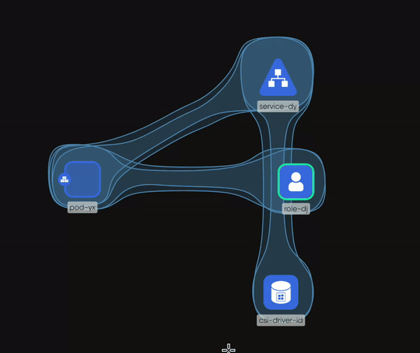

# Tool Modes

> Reference for the Designer tool modes - Select, Pan, Pencil and Pen - covering how to enter and leave each, what the mouse does in each, and how wheel and zoom controls behave.

The canvas has four tool modes. The mode decides what a mouse drag does: move an object, pan the view, draw freehand or draw a connecting line. Select is the default. This page lists how to enter and leave each mode, what every mouse gesture does in it, and the wheel and zoom controls that work in all of them.

## Modes at a glance

| Mode | Purpose | Enter | Leave | Drag on empty canvas | Box selection |
| --- | --- | --- | --- | --- | --- |
| Select | Select, move, configure and style objects. The default. | <kbd>V</kbd> or <kbd>Esc</kbd> | Choose another mode | Draws a selection box | On |
| Pan | Move the view without touching objects. | <kbd>H</kbd>, or hold <kbd>Space</kbd> | <kbd>V</kbd>, <kbd>Esc</kbd>, or release <kbd>Space</kbd> | Pans the view | Off |
| Pencil | Draw freehand annotations. | <kbd>Ctrl</kbd>/<kbd>Cmd</kbd> + <kbd>P</kbd>, or the Pencil tool in the dock | The same shortcut, <kbd>V</kbd> or <kbd>Esc</kbd> | Draws a stroke | Off |
| Pen | Draw connecting lines and annotation edges. | <kbd>Ctrl</kbd>/<kbd>Cmd</kbd> + <kbd>E</kbd>, or the Pen tool in the dock | The same shortcut, <kbd>V</kbd> or <kbd>Esc</kbd> | Places points and lines | Off |

The Pencil and Pen dock icons turn green while their mode is active. The mode shortcuts work in Designer mode. Select and Pan also work in Operator mode.

Releasing <kbd>Space</kbd> returns you to Select, not to the mode you held it from. If you were drawing with Pencil or Pen, re-enter that mode afterward.

Kanvas ignores single-key shortcuts while you type in a text field, so typing a label or a comment never changes the mode.

## Select mode

| Gesture | Result |
| --- | --- |
| Hover | No effect. |
| Click an object | Selects it and shows its style toolbar, resize handles and connection handles. |
| Drag an object | Moves it. Locked objects do not move. |
| Double-click a component | Opens its configurator. |
| Double-click a textbox or comment | Edits its text inline. |
| Right-click, or press and hold, on an object | Opens the object menu. |
| Right-click on empty canvas | Opens the canvas menu. See [Canvas Actions](/pr-preview/pr-1310/kanvas/reference/canvas-actions/). |
| Drag on empty canvas | Draws a selection box that selects the objects it covers. |
| <kbd>Ctrl</kbd>/<kbd>Cmd</kbd> + click | Adds an object to the selection or removes it. |

The cursor shows an arrow while hovering, a move cursor while dragging an object and a crosshair while you draw a selection box.

Object actions are listed in [Canvas Objects](/pr-preview/pr-1310/kanvas/reference/canvas-objects/).

## Pan mode

Pan mode turns a drag on the canvas into a pan. The cursor is an open hand, and a closed hand while you drag. Hold <kbd>Space</kbd> to pan for as long as the key is down, or press <kbd>H</kbd> to stay in Pan mode until you leave it.

## Pencil mode

Pencil draws freehand. Each stroke you release becomes one annotation object on the canvas.

| Gesture | Result |
| --- | --- |
| Press and drag | Draws a freehand stroke. |
| Release | Completes the stroke and turns it into an object. |

A new stroke is caribbean green, with thickness 1 and full opacity. Pencil has no color or thickness control before you draw. Select the stroke afterward and change its fill, border and opacity in the style toolbar. See [Canvas Objects](/pr-preview/pr-1310/kanvas/reference/canvas-objects/).

Pencil strokes connect to nothing. They annotate. Pan and box selection are off while Pencil is active.

## Pen mode

Pen draws lines. Each line is an annotation edge, a non-binding relationship that carries no configuration, so it explains a design without changing it.

| Step | Result |
| --- | --- |
| Click on empty canvas | Places a small point to start from. |
| Click again elsewhere on empty canvas | Places another point and draws an edge between the two. Repeating this draws a connected line of segments. |
| Start from a component's connection handle and release on another component or a point | Draws an edge between them. |
| Cancel mid-draw | Removes the dangling point. |

Points are small borderless shapes. Edges drawn with Pen use the same style controls as every other edge: color, line style, curve, arrowhead, label and animation. See [Canvas Objects](/pr-preview/pr-1310/kanvas/reference/canvas-objects/). Pan and box selection are off while Pen is active.

Edges between registry-defined components, which configure the components they join, are drawn in Select mode from a component's connection handle. See [Relationships](/pr-preview/pr-1310/kanvas/concepts/relationships/).

## Wheel and zoom controls

These are registered in Designer and Operator mode.

| Input | Result |
| --- | --- |
| Scroll wheel | Pans vertically. |
| Horizontal scroll, or <kbd>Shift</kbd> + scroll wheel | Pans horizontally. Each <kbd>Shift</kbd> step moves 50 pixels. |
| <kbd>Ctrl</kbd>/<kbd>Cmd</kbd> + scroll wheel | Zooms toward the pointer. Each step changes the zoom by 0.1. |
| <kbd>Ctrl</kbd>/<kbd>Cmd</kbd> + <kbd>+</kbd> and <kbd>Ctrl</kbd>/<kbd>Cmd</kbd> + <kbd>-</kbd> | Zooms in and out by the same step. |

The Options drawer sets the zoom range: a minimum from 0.1 to 5 (default 0.1) and a maximum from 0.1 to 30 (default 30). Zooming the page itself is left to the browser.

Object controls and badges appear only when the canvas is zoomed in far enough. When you are zoomed out, Kanvas shows a hint to zoom in to interact with elements.

## Related reading

- [Keyboard Shortcuts](/pr-preview/pr-1310/kanvas/reference/keyboard-shortcuts/) - every shortcut in one list.
- [Whiteboarding](/pr-preview/pr-1310/kanvas/guides/designing/whiteboarding/) - a task guide to drawing on a design.
- [Designer](/pr-preview/pr-1310/kanvas/concepts/designer/) - what Designer mode is for.

