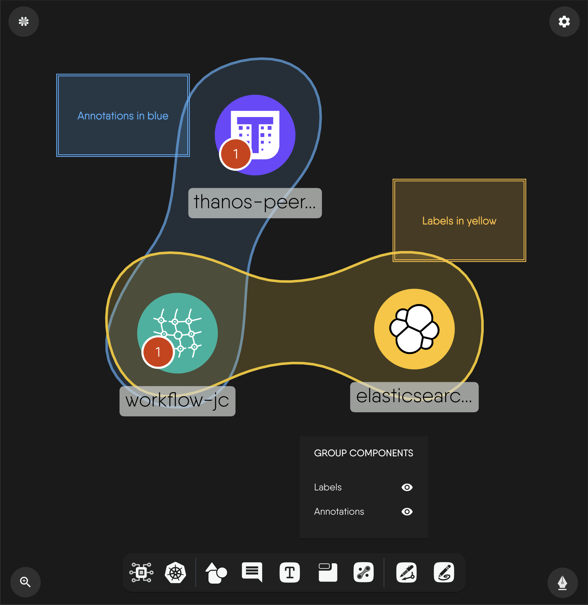

# Work with Tags

> Add labels and annotations to components and see components that share labels grouped into TagSets on the canvas.

Tags are the key-value labels and annotations on a component. When components share matching labels, Kanvas groups them in a TagSet, a shaded region drawn around the matching components. Use tags to see which components belong together, such as the Service and Deployment of one application.

## Add labels and annotations

Open a component's configurator and go to its Labels tab. It holds two key-value maps:

- **Labels** identify and select Kubernetes components.
- **Annotations** attach extra metadata to a component.

Values are strings and default to empty. The form checks only the type, so it does not enforce Kubernetes label syntax. Edits are written 300 ms after you stop typing and trigger a relationship evaluation. See [Add and Configure Components](/pr-preview/pr-1312/kanvas/guides/designing/configuring-components/).

## How grouping works

Grouping is automatic. No button creates a TagSet. After you change labels, Kanvas evaluates the design, and where the registry's relationship definitions say labels match, it creates a TagSet and draws a translucent steel-blue region around the group. The Layers panel lists these as hierarchical TagSets.

- To remove a TagSet, change the labels so they no longer match.
- To hide TagSets, switch off their toggle in the Layers panel. Evaluation continues.

## Limits

| Limit | Behavior |
|---|---|
| Render fidelity | TagSets draw only in Full render fidelity. |
| Maximum drawn | 30. Past that, Kanvas warns "Skipped rendering of N matchlabels relationships due to limit of 30". |
| Region outline | Kanvas builds the outline from the first 10 members of a group. Later members are still inside the region. |
| Adaptive mode | TagSets disappear when Adaptive mode steps below Full. |

## What tags do not do

- Designer has no filter that shows only components with a given tag. Operator mode filters live resources by namespace, kind, model, label, and free-text search.
- Palette search matches model and component names, not labels.

## See also

- [Relationships](/pr-preview/pr-1312/kanvas/concepts/relationships/): how TagSets fit with the other kinds.
- [Create Relationships](/pr-preview/pr-1312/kanvas/guides/designing/creating-relationships/): hiding relationship kinds.

