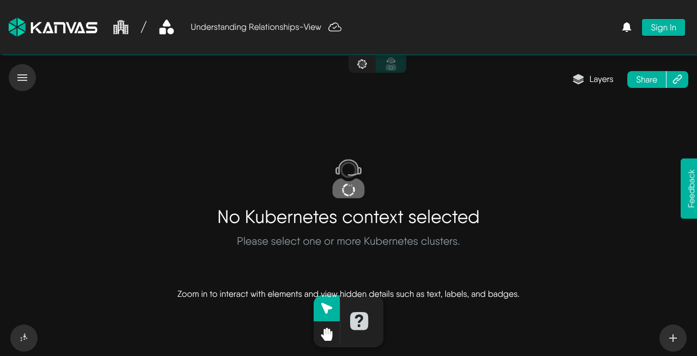
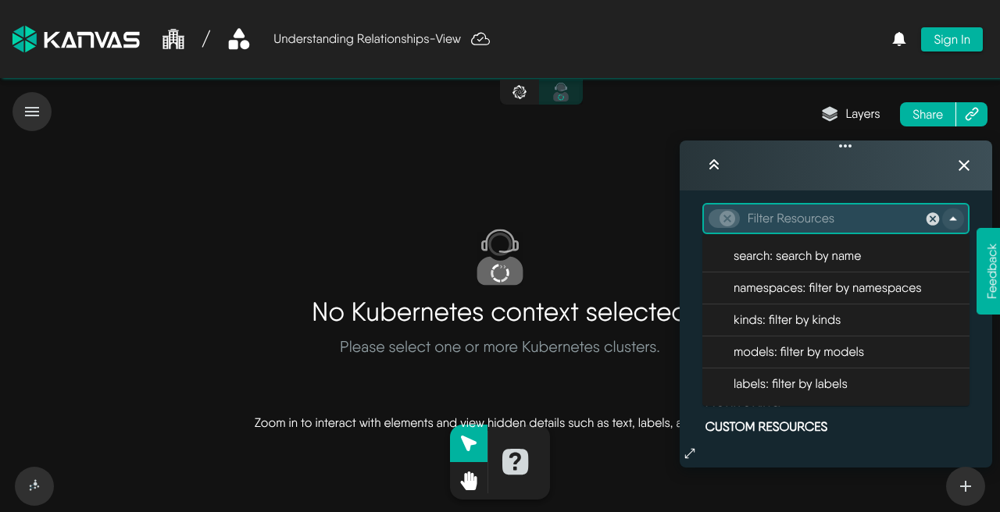
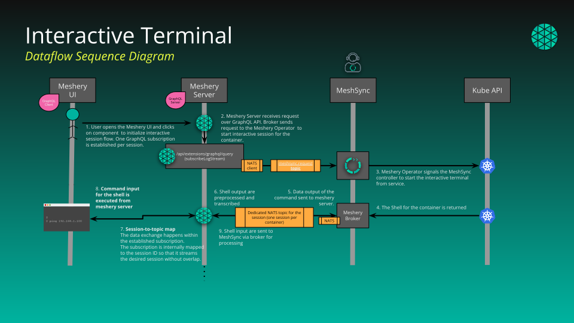
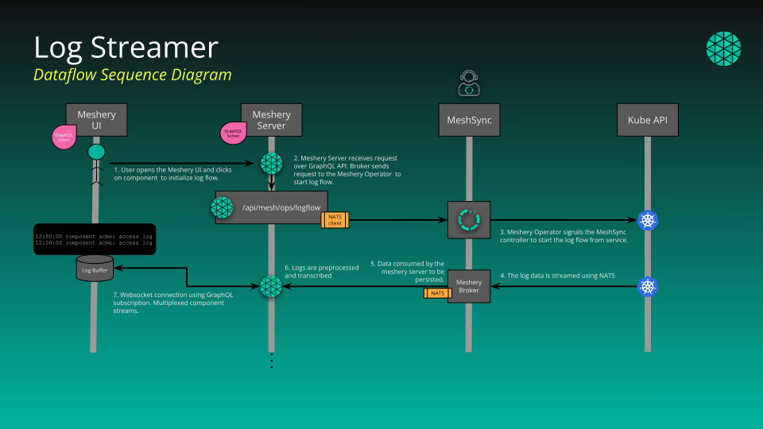

# Operator

> How Operator mode shows your clusters, where its data comes from, what it filters and caps, and how terminal and log sessions reach your containers.

Operator mode is Kanvas's view of what is running. Designer mode works on what you intend to run. Operator draws the Kubernetes resources found in your connected clusters on the same canvas, shows each one's recorded state, and gives you actions against the live workloads: open a shell, follow logs, run a load test, or jump back to the design that produced a resource.

<figure>
  
  <figcaption>Operator with no Kubernetes context selected. Choose one or more clusters to draw resources.</figcaption>
</figure>

## Where Operator data comes from

Kanvas does not talk to your clusters directly. Four pieces sit between a cluster and the canvas:

1. **Meshery Operator** runs in each connected cluster. It deploys MeshSync and a message broker.
2. **MeshSync** discovers the cluster's resources and records them. It also carries out terminal and log requests inside the cluster.
3. **Meshery Server** stores the discovered inventory and relays terminal and log traffic through the broker. Kanvas runs inside the Meshery you operate.
4. **Kanvas** queries Meshery Server and draws the result.

This is why Operator mode needs a Meshery deployment that can reach your clusters, and why the hosted kanvas.new site does not offer it. Design, validate, and deploy do not depend on Meshery Operator. Operator mode does, and so do the terminal and log actions. See [How Kanvas Works with Meshery and Layer5 Cloud](/pr-preview/pr-1317/kanvas/concepts/architecture/) for the wider picture.

### The canvas is a snapshot

Operator draws a snapshot of Meshery Server's inventory, not a continuous feed. MeshSync keeps that inventory current in Meshery, but Kanvas re-reads it only when you:

- load or create a view,
- change a filter, or
- change the selected clusters.

Resources that appear, change, or disappear in the cluster show up on the canvas after one of those triggers. The Details panel works the same way: it fetches a resource once when you open it. When you need current state, change a filter or reselect the cluster.

### What one snapshot contains

Meshery turns the inventory into a design: each resource becomes a component, and Meshery evaluates relationships between them to draw edges. Kanvas then lays the result out with a force-directed layout. Each snapshot is limited to **100 resources**, the first page, with no paging and no notice that anything was left out. The Layers panel counts every matching resource, so a count can exceed what is drawn. Narrow the filters, or use a [view](/pr-preview/pr-1317/kanvas/reference/views/) for one slice, until the resources you need are within 100.

Resources deployed from a Kanvas design carry a design identity label. Those nodes show a Meshery badge that opens the source design. Container nodes with an open terminal or log session show a terminal badge.

## Choosing what to draw

Cluster selection comes from the Meshery context selector, not from Kanvas. Everything else is a filter, set in the Layers panel or in the typing filter at its top.

| Filter | Matches |
|---|---|
| `search` | Resource names containing the text |
| `namespaces` | Resources in those namespaces |
| `kinds` | Resources of those kinds |
| `models` | Resources of those models |
| `labels` | Resources carrying any of those `key=value` labels |

Filter types combine with AND, and values within a type combine with OR. A new view starts with kinds `Node` and `Namespace` so the first snapshot is small. The Layers panel groups kinds, each with a count, so you can toggle them without typing:

| Group | Kinds |
|---|---|
| Cluster | Namespaces, Nodes, ResourceQuotas, ClusterRoles, ClusterRoleBindings, LimitRanges |
| Workloads | Deployments, Pods, ReplicaSets, ReplicationControllers, StatefulSets, DaemonSets, Jobs, CronJobs |
| Configurations | ConfigMaps, Secrets, ResourceQuotas, LimitRanges, ServiceAccounts, Roles, RoleBindings, PodDisruptionBudgets, PriorityClasses, RuntimeClasses, Leases, MutatingWebhookConfigurations |
| Networking | Services, Ingresses, IngressClasses, NetworkPolicies, Endpoints, EndpointSlices |
| Storage | PersistentVolumeClaims, PersistentVolumes, StorageClasses, VolumeAttachments |
| Monitoring | Events, HorizontalPodAutoscalers, VerticalPodAutoscalers |
| Custom Resources | Every other kind MeshSync has discovered |

<figure>
  
  <figcaption>The filter menu: search, namespaces, kinds, models, and labels.</figcaption>
</figure>

Every filter change refetches the snapshot and autosaves the open view. Selecting a resource opens the Details panel; search narrows what is drawn and does not select anything. See [Resource Details](/pr-preview/pr-1317/kanvas/reference/resource-details/) for the panel.

### When the canvas is empty

| What you see | Meaning |
|---|---|
| `Please select one or more Kubernetes clusters.` | No cluster is selected in the context selector. |
| `No data available for the current view`, with removable filter chips | The filters match nothing. Remove or loosen a chip. |
| `Is MeshSync healthy on the selected cluster?` or `No MeshSync data available for the selected cluster` | The selected cluster returned no inventory. Check that Meshery Operator and MeshSync are running and connected. |

Kanvas shows no separate notice when a cluster disconnects or MeshSync is missing. An empty canvas is the signal. While a snapshot loads, a `Fetching resources` notice shows; a failure shows `Failed to fetch resources`.

## Operating on running workloads

Three actions send requests back down the same path. Each is offered on specific kinds.

| Action | Kinds | Guide |
|---|---|---|
| Interactive terminal | Pod, Container | [Open an Interactive Terminal](/pr-preview/pr-1317/kanvas/guides/operating/interactive-terminal/) |
| Log streaming | Pod, Container | [Stream Container Logs](/pr-preview/pr-1317/kanvas/guides/operating/log-streaming/) |
| Performance test | Service, Ingress | [Run a Performance Test](/pr-preview/pr-1317/kanvas/guides/operating/performance-testing/) |

For a terminal or log session, Kanvas asks Meshery Server, which signals MeshSync through the broker. MeshSync opens the shell or log stream in the cluster and sends output back over the broker. Meshery Server preprocesses it and delivers it to your browser over a WebSocket subscription. Input travels the opposite way. Each session has its own identifier, so streams for several open sessions stay separate.

A performance test is different: Meshery Server generates the load itself against the URL you give it. It does not go through MeshSync.

### Why terminal and log errors are quiet

Meshery Server reports failures such as an unready broker or a missing container, but Kanvas does not request or display those error fields for terminal and log sessions. A failed start looks like an empty tab. When a session is blank, check the cluster connection, Meshery Operator, and MeshSync first.

## Views

A view saves a set of filters so a slice of your infrastructure comes back on demand. The Operator view for a design shows only the resources that design deployed. See [Operator Views](/pr-preview/pr-1317/kanvas/reference/views/).

## Where Operator is available

| Environment | Operator mode |
|---|---|
| Self-hosted Meshery or Meshery you run, with Meshery Operator in the cluster | Available |
| Hosted kanvas.new | Not available. Kanvas shows a self-hosted-feature prompt. |
| Meshery Playground | Disabled by the Playground's capability configuration. |

Kanvas gates Operator mode on the provider enabling the Operator capability. It does not apply role or plan checks to the mode switch itself. See [Feature Availability](/pr-preview/pr-1317/kanvas/reference/feature-availability/) and [Permissions by Role](/pr-preview/pr-1317/kanvas/reference/permissions/) for the role and plan matrix.

## What Operator does not do

- It does not stream continuous updates to the canvas.
- It does not show live CPU or memory utilization, per-pod metrics, or time series.
- It does not change cluster resources. Deploy and undeploy run from Designer. See [Validate and Deploy](/pr-preview/pr-1317/kanvas/guides/deploying/).

## Related

- [Operate Infrastructure](/pr-preview/pr-1317/kanvas/guides/operating/)
- [Resource Details](/pr-preview/pr-1317/kanvas/reference/resource-details/)
- [Operator Views](/pr-preview/pr-1317/kanvas/reference/views/)

