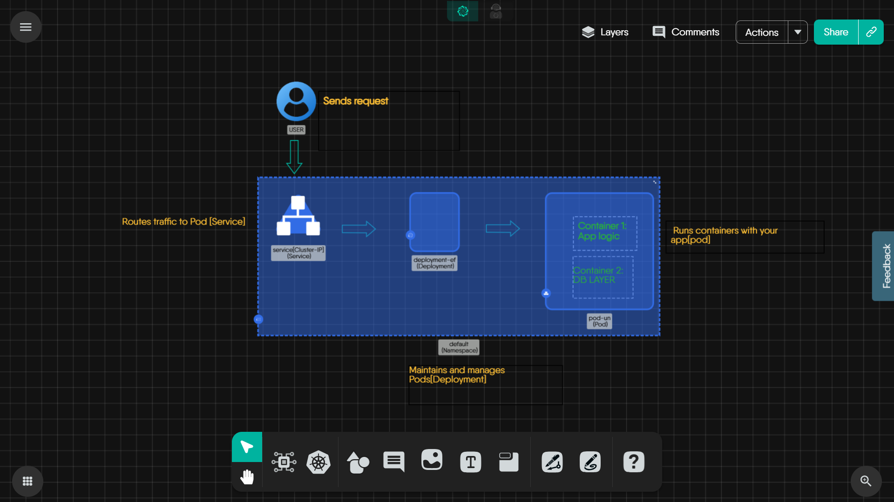

# Kubernetes Request Flow

> How a request travels from a client through Ingress or a Service to a Pod and its containers, why labels and selectors hold the path together, how the path maps to a Kanvas design, and how to debug it layer by layer.

A request to an application in Kubernetes passes through several objects before it reaches a process in a container, and none of those objects is wired to the next by a fixed address. Each layer finds the next one by name or by label at the moment the request arrives. Knowing that path, and what each layer is responsible for, turns "why am I not getting a response?" into a short list of places to look. This page walks the path from the client to the container, explains why labels and selectors are what hold it together, and shows how the same path appears in a Kanvas design.

## The path at a glance

The prebuilt design below models the in-cluster part of the path: a user, a ClusterIP Service, a Deployment, and a Pod running two containers. Select the image to open the design in Kanvas.

The full path, including the entry layer the design leaves out, is:

| Layer | Kubernetes object | Responsibility |
|---|---|---|
| Entry | Ingress, or a Service of type LoadBalancer or NodePort | Accept traffic from outside the cluster |
| Stable address | Service (ClusterIP) | Give a changing set of Pods one name and one virtual IP |
| Routing | kube-proxy rules on every node, EndpointSlices | Translate the virtual IP to the IP of one ready Pod |
| Backends | Deployment, ReplicaSet, Pod | Keep the right number of matching Pods running |
| Process | Containers in the Pod | Listen on a port and serve the request |

## Getting into the cluster

A ClusterIP Service is reachable only from inside the cluster. Traffic from outside enters through one of three doors:

- **NodePort.** Kubernetes opens the same port, by default in the range 30000-32767, on every node. A request to any node's IP on that port is forwarded to the Service.
- **LoadBalancer.** The cluster's cloud integration provisions an external load balancer and points it at the Service's node ports. Until the provider assigns an address, the Service's external address stays pending.
- **Ingress.** An Ingress is a set of HTTP routing rules (host and path to Service). The rules do nothing on their own: an Ingress controller, itself exposed through a LoadBalancer or NodePort Service, reads them and proxies each request to the matching Service.

Every door ends in the same place: a Service.

## The Service: a stable name and address

Pods are disposable. They are replaced on every rollout, rescheduled when a node fails, and receive a new IP each time. A Service gives clients something that does not change: a DNS name (`<service>.<namespace>.svc.cluster.local`, or just `<service>` from the same namespace) and a virtual IP, the ClusterIP. Clients talk to the Service and never need to know which Pods exist right now.

The ClusterIP is not attached to any machine. On every node, kube-proxy (or a replacement that fills the same role) programs packet-forwarding rules that rewrite traffic sent to the ClusterIP and Service port into traffic to one backend Pod's IP and target port. The list of backends comes from EndpointSlices, which Kubernetes keeps current with the IPs of the Pods that match the Service's selector **and** report Ready. A Pod that fails its readiness probe drops out of the list and receives no new traffic until it recovers.

## Labels and selectors are the glue

No layer of this path holds a reference to a specific Pod. Each layer describes the Pods it wants with a label selector, and Kubernetes evaluates the selector continuously:

- The **Service** selector (for example `app: web`) decides which Pods receive traffic.
- The **Deployment** selector decides which Pods the Deployment, through its ReplicaSet, counts and replaces.
- The **Pod template** in the Deployment stamps labels onto every Pod it creates.

For traffic to flow, the Pod template's labels must satisfy both selectors. The Service does not route to the Deployment: it routes to whatever Pods carry matching labels, whoever created them. That design is what lets a rollout replace every Pod without touching the Service, and it is also the most common cause of a silent failure. A one-character difference between a selector and a label produces a Service with no endpoints and no error message.

The ports follow the same pattern. A Service's `targetPort` must be the port the process in the container actually listens on. The container's declared `containerPort` is informational; declaring a port does not make a process listen on it.

## Deployment, ReplicaSet, Pod: who keeps the backends alive

A Deployment does not carry traffic. It declares how many Pods you want and what they look like. The Deployment creates a ReplicaSet for each version of its Pod template, and the ReplicaSet creates and replaces Pods until the count matches. During a rolling update the old and new ReplicaSets both own Pods, and because both sets carry the labels the Service selects, the Service sends traffic to old and new Pods alike until the rollout finishes.

## Inside the Pod: one network namespace

All containers in a Pod share one network namespace. They have the same IP address and the same port space, and they reach each other on `localhost`. In the prebuilt design, the application container can reach the database-layer container at `localhost` on that container's port, and two containers in the same Pod cannot both listen on the same port. A request that arrives at the Pod's IP is delivered to whichever container listens on the target port.

## How the path maps to a Kanvas design

In a Kanvas design, each Kubernetes object on the path is a component, configured with the same fields as its manifest: the Service's type, selector, and ports; the Deployment's replicas, selector, and Pod template; each container's image and ports. The connection between a Service and the workload it fronts is a Network relationship, drawn as an edge labeled with the ports and protocols on each side. A relationship definition can also write a value from one component into the other, such as a Service port into a container port. See [Relationships](/pr-preview/pr-1320/kanvas/concepts/relationships/) for the kinds of relationships and what each one changes.

The edge documents intent; the selector and labels decide behavior. When you deploy, the cluster routes traffic according to the selector and labels in the components' configuration, so check those fields whenever the edge and the running system disagree.

After a deploy, Operator shows the same objects as they exist in the cluster. Its resource details show what you need to follow the path: a Service's type, ClusterIP, and selector; a Deployment's available and desired Pods and its selector; a Pod's IP and status; and each container's status, ports, and restart count. Operator can also list EndpointSlices, open a terminal or a log session on a Pod, and filter the view by any label, which shows at once whether a selector's label matches the Pods you expect. Operator reads a snapshot of the cluster, so fetch again after a change by reopening the view or changing a filter.

## Debug a failing path layer by layer

Work from the client inward and stop at the first layer that does not behave:

| Symptom | Layer to check | What to look at |
|---|---|---|
| External clients get no answer, but requests from inside the cluster work | Entry | An Ingress controller is installed and the Ingress names its class; the LoadBalancer has an external address; the NodePort is open in the node firewall |
| The Service name does not resolve | Service | The Service exists in the namespace you are calling; use the full name `<service>.<namespace>.svc.cluster.local` across namespaces |
| The name resolves, but connections time out | Routing | The Service has endpoints. No endpoints means the selector matches no Pods or no matching Pod is Ready |
| The Service has no endpoints | Labels and selectors | Compare the Service selector with the Pod labels key by key, and check that the matching Pods pass their readiness probes |
| Endpoints exist, but connections are refused | Ports | `targetPort` equals the port the container process listens on, and the process listens on all interfaces, not only `127.0.0.1` |
| Fewer Pods than replicas, or Pods stuck in `Pending` | Deployment and ReplicaSet | Pod events for scheduling and image-pull failures, resource requests, and quotas |
| Pods restart repeatedly | Container | Container logs and exit codes, and liveness probe settings |
| One container cannot reach the other on `localhost` | Pod | Both containers are in the same Pod, the target container listens on the expected port, and no two containers use the same port |

## Related

- [Explore Kubernetes Services](/pr-preview/pr-1320/kanvas/tutorials/kubernetes/kubernetes-services/) - build ClusterIP, NodePort, and LoadBalancer Services and inspect them in Operator.
- [Explore Kubernetes Pods](/pr-preview/pr-1320/kanvas/tutorials/kubernetes/kubernetes-pods/) - build, deploy, and inspect a Pod.
- [Relationships](/pr-preview/pr-1320/kanvas/concepts/relationships/) - what each relationship in a design means and changes.

