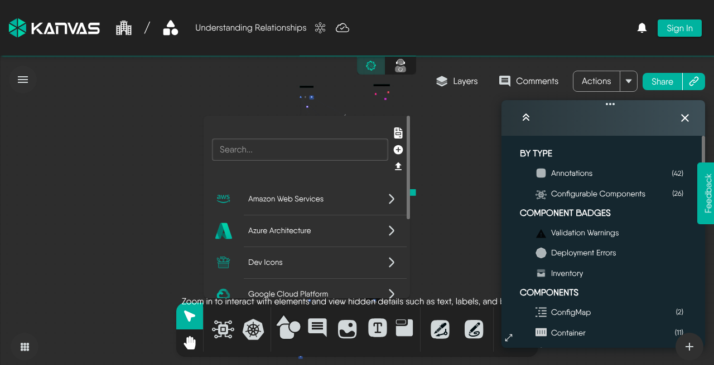

# Designer

> How Designer mode turns a shared design document into an editable canvas, what it gates by mode and by permission, and how changes save and sync.

Designer mode is where you author a Kanvas design. You compose infrastructure from versioned components, configure each one against its schema, connect components with relationships, annotate the result, and validate or deploy it, all on one canvas that every collaborator edits at the same time. Designer works on intent: what you want to run. [Operator](/pr-preview/pr-1322/kanvas/concepts/operator/) works on live state: what is running.

<figure>
  
  <figcaption>Designer: the bottom dock holds the tools for adding components and annotations, and the Layers panel controls what the canvas draws.</figcaption>
</figure>

## A design is a shared document

Everything on the canvas is an entry in one design document: every component you configure, every relationship, and every annotation you draw. The canvas draws that document. Moving a node, applying a layout, or hiding a layer writes into the design. As a result:

- Collaborators see the same canvas, including positions, locks, and layer visibility.
- Undo and redo cover every change to the document: components, configuration, styles, relationships, annotations, and layer toggles.
- Hiding a component in the Layers panel changes only what is drawn. The component stays in the design and deploys with it.

For what a design contains and how it is versioned, see [Designs](/pr-preview/pr-1322/kanvas/concepts/designs/).

## Designer and Operator

| | Designer | Operator |
|---|---|---|
| Purpose | Author and change a design | Inspect and act on resources running in connected clusters |
| What the canvas draws | Components, relationships, and annotations from the design document | Kubernetes resources discovered in the selected clusters |
| What you can edit | The whole design: add, configure, relate, annotate, style, lay out, delete | Nothing; live nodes are read-only |
| Actions | Validate, deploy, undeploy, share, reset design | Open a terminal, follow logs, run a performance test, open the source design |

Selection, panning, zoom, the Layers panel, and undo and redo work in both modes. Keyboard shortcuts that add or change content, such as copy, paste, duplicate, delete, Pen, and Pencil, act only in Designer.

## What you do in Designer

- **Compose from versioned components.** The palette lists models from the Meshery registry by category, and each model offers a version selector with the newest version first. Add a component by dragging or clicking, nest it by dropping it onto a compatible parent, or drop YAML, JSON, or archive files to import infrastructure as code.
- **Configure.** A new component opens its configurator, a form rendered from the component's JSON schema with the schema's defaults. Edits write to the design after a short pause and trigger validation and relationship evaluation. Switching a component to another version keeps its configuration values; validation flags any that no longer fit.
- **Relate.** Drawing an edge or nesting one component in another creates a relationship when a registry definition matches the pair. A relationship can write values from one component's configuration into another's. Kanvas re-evaluates relationships about one second after changes stop, and evaluation never blocks editing. See [Relationships](/pr-preview/pr-1322/kanvas/concepts/relationships/) and [Relationship Evaluation](/pr-preview/pr-1322/kanvas/concepts/relationship-evaluation/).
- **Annotate.** Shapes, text boxes, sections, images, comments, Pen connectors, and Pencil strokes explain the design without configuring infrastructure.
- **Lay out.** Six layouts rearrange the canvas: Grid, Constrained (the default), hierarchical, star, bus, and ring. A design with no saved positions is laid out automatically when it opens; otherwise Kanvas keeps the saved positions. A layout changes positions only, never configuration.
- **Validate, dry-run, deploy, and undeploy.** Kanvas checks each changed component against its schema. A badge on the component counts its validation warnings and dry-run errors. Meshery Server carries out deployment.
- **Share.** A share gives others access to the design, and anyone with a share can edit it.

## What mode gates and what permission gates

Authoring is gated by mode, not by role. Adding, configuring, duplicating, deleting, and renaming work in Designer and are blocked in Operator. Resources synced from a live cluster are read-only in every mode. Within Designer, what you can change on a component depends on that component's registry capabilities: a configurator tab or a style control appears only when the component declares it.

Only four actions are permission-gated: validate, deploy, undeploy, and share. When your role lacks one of these permissions, its control is hidden. The permission catalog also lists permissions for individual canvas gestures, such as adding shapes or resetting styles. Kanvas does not enforce those on the canvas, so withholding them has no effect. Users who are not signed in are prompted to sign in before sharing, and to sign in or run Meshery locally before validating or deploying. See [Permissions](/pr-preview/pr-1322/kanvas/reference/permissions/).

## How changes are stored and synchronized

Designer has no Save button. Every change to the design requests a save, and Kanvas sends it 3 seconds after the last change. A new design is not saved until it has a component or a name.

While a design is open, every change, drawn objects included, syncs live between collaborators through the shared document. Each collaborator appears as an avatar in the toolbar, and their cursor and current selection show on your canvas. Storage does not merge: each save sends the whole design, and the last save wins. Live co-editing in the open session is what reconciles concurrent edits. See [Collaboration](/pr-preview/pr-1322/kanvas/concepts/collaboration/).

If a save fails, Kanvas enters an error state: the dock is disabled and edits are not applied while Kanvas retries the save with increasing delays.

## Configurable components and annotations

Every object on the canvas is a component entry in the design. Annotations carry an annotation flag; configurable components do not. The Layers panel uses that flag to split the canvas into Annotations and Configurable Components, each with a count and its own visibility toggle. Pen connectors are non-binding annotation relationships: they draw lines without changing any configuration.

The distinction does not exempt annotations from your plan. When a design is saved, Layer5 Cloud counts every component entry, annotations included, against the components-per-design limit. The limit is checked on save, not when you add an object, so a design can grow past it on the canvas and then fail to save.

## What Designer does not do

- It does not operate live workloads. Terminal sessions, log streams, and performance tests are Operator actions.
- It does not filter components by label. Label filters exist only in Operator views.
- It does not set an access level on a share. Every share can edit.
- It does not narrow relationship evaluation by layer. Evaluation always covers the whole design.

## Where to go next

- Reference: [Canvas Objects](/pr-preview/pr-1322/kanvas/reference/canvas-objects/), [Tool Modes](/pr-preview/pr-1322/kanvas/reference/tool-modes/), [Canvas Actions](/pr-preview/pr-1322/kanvas/reference/canvas-actions/), [Layout and Layers](/pr-preview/pr-1322/kanvas/reference/layout-and-layers/), [Component Badges](/pr-preview/pr-1322/kanvas/reference/component-badges/), and [Keyboard Shortcuts](/pr-preview/pr-1322/kanvas/reference/keyboard-shortcuts/).
- Build a design: [Configuring Components](/pr-preview/pr-1322/kanvas/guides/designing/configuring-components/), [Creating Relationships](/pr-preview/pr-1322/kanvas/guides/designing/creating-relationships/), and [Whiteboarding](/pr-preview/pr-1322/kanvas/guides/designing/whiteboarding/).
- Check and save a design: [Validating Designs](/pr-preview/pr-1322/kanvas/guides/deploying/validating-designs/) and [Saving Designs](/pr-preview/pr-1322/kanvas/guides/designs/saving-designs/).
- Give others access: [Sharing Designs](/pr-preview/pr-1322/kanvas/guides/collaborating/sharing-designs/).

