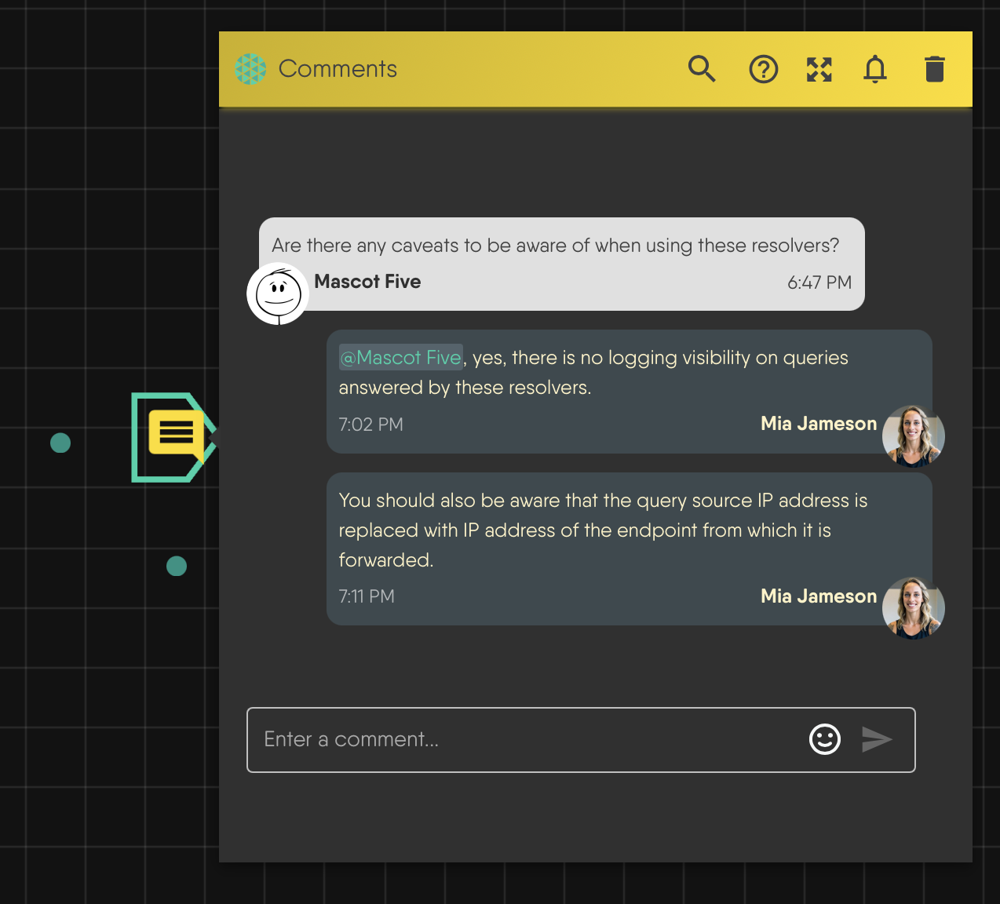

# Review a Design with Comments

> Leave threaded comments on a design, mention collaborators, resolve and reopen threads, and control who gets emailed.

A comment is a note on the canvas that holds a threaded conversation. Use comments to give feedback, record the reason behind a configuration choice, or ask a teammate a question next to the component it concerns. A comment is part of the design: it saves with the design, appears live to everyone who has the design open, and travels with clones and exports.

For how comments fit with live editing and access, read [Collaboration Model](/pr-preview/pr-1324/kanvas/concepts/collaboration/).

## Who can comment

Anyone who can open a design can comment on it. The role catalog lists separate permissions for adding, resolving, deleting, and styling comments, but Kanvas does not enforce them. Whoever can edit a design can do every comment action. Comments work in Designer mode only.

Because new designs are public, a comment on a public design is visible to anyone who opens it. To limit who sees your review, make the design private and share it with the reviewers. See [Share a Design](/pr-preview/pr-1324/kanvas/guides/collaborating/sharing-designs/).

<figure>
  
  <figcaption>A comment thread on the canvas.</figcaption>
</figure>

## Add a comment

Add a comment in any of three ways:

- Drag the Comment tool from the dock onto the canvas, or click it to drop a comment near the center.
- Right-click the canvas and choose Add Comment. The comment lands where you clicked.
- Press <kbd>M</kbd>. The comment appears near the center of the canvas, and you can drag it into place.

A comment is an annotation component, so it moves, locks, groups, copies, and deletes like other annotations. See [Canvas Objects](/pr-preview/pr-1324/kanvas/reference/canvas-objects/). The Annotations toggle in the Layers panel hides all annotations, comments included, on your canvas. Hidden comments still sync.

## Hold a conversation

Each comment holds one thread. Type a message and press <kbd>Enter</kbd> to send it. Press <kbd>Ctrl</kbd> or <kbd>Cmd</kbd> with <kbd>Enter</kbd> to add a line break. A message cannot be empty. A thread shows its first message and offers to show the rest when it has more than one.

A message can contain:

- **Mentions.** Type `@` and the start of a name. The picker searches every user on the platform, not only people with access to the design, and shows up to seven matches. A bare `@` shows none. The search needs the View All Users permission. If it fails, Kanvas shows an error instead of "no users".
- **Links.** URLs become links.
- **Emoji.** Type `:` and part of an emoji name to pick one.

Messages cannot be edited, and a single message cannot be deleted. Deleting a comment removes the whole thread. Resolve a thread instead of deleting it when you want to keep the record.

### Resolve and reopen

Resolve a thread when the discussion is done. A resolved comment leaves the canvas but stays in the design with all its messages. Reopen it to bring it back. Adding a message to a resolved thread reopens it. Resolving and reopening send no notification.

### Find threads in the comments panel

The Comments panel lists every comment that has at least one message, newest activity first. Filter it by:

| Filter | Shows |
|---|---|
| All | Every comment with a message |
| Open | Threads that are not resolved |
| Resolved | Resolved threads |
| For me | Threads where any message mentions you |

The panel uses the same thread control as the canvas, so you can read, reply, resolve, reopen, and mute from it.

### Reuse a comment

Copy, paste, and duplicate create a new comment with the original's messages, timestamps, and name. The new comment is independent: editing or deleting the original does not change it. Copying or duplicating sends no notification. A reply to the copy notifies participants in the copy's thread. Pasting a comment into another design does not change who can open that design, so participants from the original thread may be unable to open the copy's design.

## Notifications {#managing-comment-notifications}

Kanvas sends comment notifications by email when a message is added. Resolving and reopening a thread send nothing.

Kanvas emails these people, after removing the author of the new message:

| Recipient | Receives email when |
|---|---|
| Mentioned users | The new message mentions them |
| Thread participants | They wrote an earlier message in the thread, or an earlier message mentioned them |
| The design owner | Someone other than the owner added the message |

A request is sent only when the message mentions someone, or the thread already has an earlier message by or mentioning another person. **A first comment that mentions nobody emails nobody, including the design owner.** Mention the owner when you need them to see a new comment.

An email goes out only if the recipient's account preferences allow it. Two preferences apply: comments on your designs, which governs the owner's email, and participating and mentions in comments, which governs the other two. See [Notification Preferences](/pr-preview/pr-1324/cloud/concepts/identity-and-security/users/notification-preferences/).

Kanvas does not check that a recipient can open the design before it emails them. The email shows the thread and links to the design in the Meshery Playground, whichever Meshery the design is stored for.

If a message posts but the emails fail, Kanvas shows "Comment posted, but the mentioned users could not be notified" and the reason. The comment stays.

Kanvas does not track which messages a person has read. Someone who misses an email learns of the comment only from a later notification or by opening the design.

### Mute a thread {#mute-comment-notifications}

Use the bell in a thread to stop mention and participant emails to you for that thread. The bell toggles your mute. The mute is stored in the thread, so it saves with the design and every collaborator can see the list of people who muted it.

Muting affects only the thread where you set it. Mentions in other threads and designs still reach you. The owner's email is decided by the commenter's mute list, not the owner's: a thread the owner muted still emails the owner, and a thread the commenter muted does not.

Account preferences apply to every design. A disabled preference stops those emails everywhere.

## Review practices that match how Kanvas works

- **Mention the person you need.** Mentions are the dependable notification path.
- **Resolve instead of delete.** Resolution keeps the discussion for later.
- **Review in a private, shared design.** Everyone with access can also edit, so agree who changes the design and who comments.
- **Use the For me filter after time away.** It lists threads that mention you.

## Related

- [Collaboration Model](/pr-preview/pr-1324/kanvas/concepts/collaboration/)
- [Share a Design](/pr-preview/pr-1324/kanvas/guides/collaborating/sharing-designs/)
- [Collaborative Editing](/pr-preview/pr-1324/kanvas/tutorials/collaborative-editing/)
- [Canvas Objects](/pr-preview/pr-1324/kanvas/reference/canvas-objects/)
- [Keyboard Shortcuts](/pr-preview/pr-1324/kanvas/reference/keyboard-shortcuts/)

