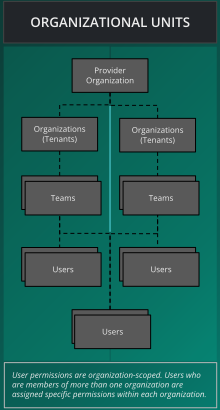

# Organizations

> Organizations serve as the fundamental component of multi-tenancy within the Layer5 Cloud.

An organization is the tenant boundary in Layer5 Cloud. It decides whose resources a request can reach, whose billing it counts against, and which roles apply. Understanding how organizations isolate, nest, and resolve explains most of what a user can and cannot see.

## What an organization is

The organization is the unit of multi-tenancy and the core security boundary. Everything else composes on top of it: teams, workspaces, roles, keychains, and keys all belong to one organization. Resources, billing, and access control are isolated per organization, so a role held in one organization grants nothing in another.

The structure is flexible:

- An organization has any number of teams.
- A team has any number of users, and a user can belong to any number of teams.
- A user can belong to any number of organizations, and holds an independent set of roles in each.

Teams group users inside an organization and control access to workspaces and to workspace resources such as environments and managed and unmanaged connections. See [Teams](/pr-preview/pr-1329/cloud/concepts/identity-and-security/teams/) and [Workspaces](/pr-preview/pr-1329/cloud/concepts/workspaces/).

## Organization types and hierarchy

Every Layer5 Cloud deployment has one **provider organization** and any number of **tenant organizations**.

- **Provider organization.** The single top-level organization that operates the deployment. It owns the deployment's default identity providers, which tenant organizations use unless they bring their own. The provider organization is never a child, and it cannot hold child organizations: its child list is always empty.
- **Tenant organization.** Every other organization. Each tenant is configured as Hosted, Branded, or White-Label, depending on the domain it uses and the identity provider that authenticates its users. See [Organization Configuration Scenarios](/pr-preview/pr-1329/cloud/guides/organizations/configuration-scenarios/) to choose between them.
- **Child organization.** A tenant organization created inside another tenant organization, its **parent**.

Child organizations follow these rules:

- An organization can have any number of children, and children can have children of their own. There is no depth limit.
- A child has exactly one parent, fixed when the child is created.
- The Organization Admin or Owner of a parent governs its **direct** children only: they can edit a child's settings, add members to it, search its members, and delete it. Governing a grandchild belongs to the administrator of the intermediate organization.
- A parent administrator is not a member of the child. Workspaces, teams, connections, identity providers, and the mail server inside the child still require membership and a role in the child.
- An organization that still has live child organizations cannot be deleted. Delete the deepest children first.

See [Child Organizations](/pr-preview/pr-1329/cloud/guides/organizations/org-management/child-organizations/) for the full behavior.

## The owner

The user who creates an organization is its **owner**. Ownership is a fixed attribute of the organization, separate from the Organization Admin role:

- The owner cannot be removed from the organization. A removal request for the owner fails with "Organization owner cannot be removed".
- Ownership cannot be transferred. Layer5 Cloud has no operation that reassigns the owner of an organization.
- No member can leave an organization on their own. Membership ends only when an authorized administrator removes the member.
- The owner can delete the organization. An Organization Admin who is not the owner cannot.

Plan who creates each organization accordingly. For a shared or long-lived organization, have it created by the account that should remain its owner.

## How a request or sign-in finds its organization

Every guarded request runs in one organization. Layer5 Cloud resolves that organization from these sources, in this order, and the first source that applies wins:

1. **Domain.** The request's host matches an organization's custom domain.
2. **`X-Current-Orgid` header.** The organization an API client names.
3. **Saved preference.** The default organization stored in the user's preferences.
4. **Browser session.** The organization the browser session last selected.

The header, the saved preference, and the browser session must name an organization the user is a live member of. A value that names any other organization is ignored, and the request runs with no organization scope. Callers who hold View All Organizations (Provider Admin by default) are the exception: they can name any organization, or `all` to span every organization. Layer5 Cloud reads no organization from the query string. The [Organization context](/pr-preview/pr-1329/cloud/reference/api-reference/#organization-context) section of the API reference gives the exact rules for API clients.

### Why the domain wins

A custom domain identifies the tenant before the user makes any choice. A sign-in page served on an organization's domain shows that organization's branding, authenticates through that organization's identity provider, and applies its open invitation, so the request belongs to that organization regardless of the user's saved preference. Resolving by domain does not check membership; every guarded action still checks the permissions the user holds in that organization.

Domain matching follows these rules:

- The host is matched exactly against organization domains, with the protocol and port removed.
- The deployment's own base host, IP addresses, and the provider's reserved domains are never treated as custom domains.
- A domain belongs to at most one organization. A deleted organization keeps its domain, so clear the domain before deleting if the address must be reused.
- Domain-to-organization lookups are cached for five minutes. Creating, editing, or deleting an organization clears its entry on the server that handled the change, so other server instances can serve the previous mapping until their entry expires.

Assigning a new domain to an organization requires a Provider Admin. Organization administrators can keep the current domain or clear it. Layer5 Cloud validates the domain's syntax when it is saved and does not perform a DNS lookup. See [Organization Configuration Scenarios](/pr-preview/pr-1329/cloud/guides/organizations/configuration-scenarios/) for how domains combine with identity providers.

The organization switcher lists only the organizations the user is a member of; holders of View All Organizations can also select All Organizations. See [Switching Between Organizations](/pr-preview/pr-1329/cloud/guides/organizations/org-management/#switching-between-organizations).

## Lifecycle

An organization moves through three operations. [Organization Management](/pr-preview/pr-1329/cloud/guides/organizations/org-management/) covers the procedures.

### Create

An organization starts with a name (required), a country, and a region. Creating it does two things:

- The creator becomes the owner.
- Layer5 Cloud creates a default workspace named "My Workspace", owned by the creator.

A domain is not set at creation; a Provider Admin assigns one afterward. Creating a child organization inside a parent requires Create Organization in the parent, and makes the creator a member and an Organization Admin of the child.

### Edit

Administrators of the organization shape how it looks and how users join it:

| Setting | What it controls |
|---|---|
| Name, country, region | The organization's identity in lists and the switcher. |
| Branding | Theme colors (hex values only) and four logos: desktop, mobile, dark desktop, and dark mobile, each up to 500 KB. Resetting the theme also clears the logos. |
| Links | Terms of service, privacy policy, support channels, and social links shown on the organization's sign-in, sign-up, and error pages and in email footers. Unsafe values are dropped rather than rejected. |
| Sign-in carousel | Whether sign-in pages show the feature carousel. On by default. |
| Domain | The custom host that resolves to the organization. New values require a Provider Admin. |
| Open invitation | One invitation that admits any non-member who signs in through the organization's host. The user gains the invitation's organization, team, and role grants. The invitation's ID is public and works as a shareable link. |
| Teams | Which teams belong to the organization. Removing a team ends the mapping; the team itself is not deleted. |
| Identity providers | The organization's own sign-in providers, in place of the provider organization's defaults. |
| Mail server | The organization's own SMTP server for outgoing email. See [Bring Your Own Mail Server](/pr-preview/pr-1329/cloud/guides/organizations/org-management/bring-your-own-mail-server/). |

### Delete

Deleting an organization is a soft delete:

- The organization, every membership in it, and every team-to-organization mapping end.
- Teams, workspaces, environments, and designs are not deleted by the request, but nothing reaches them through the organization afterward.
- No restore operation exists.

Layer5 Cloud refuses the deletion in two cases:

- The organization still has live child organizations (HTTP 409). Nothing is changed.
- The organization is the last live organization the caller owns (HTTP 403). This check does not apply when a parent administrator deletes a child.

The organization's owner, a Provider Admin, or an Organization Admin or Owner of the live parent can delete an organization.

## Who can do what

The matrix shows which default roles hold each organization permission. It is refreshed automatically from the Layer5 permission list. See [Roles and Permissions](/pr-preview/pr-1329/cloud/reference/default-permissions/) for how to read it and for every other permission area.

<table class="feature-tiers-table keys-matrix">
  <caption>Organization permissions</caption>
  <thead>
    <tr>
      <th scope="col">Permission</th>
      <th scope="col">What it allows</th>
      <th scope="col">User</th><th scope="col">Team Admin</th><th scope="col">Workspace Admin</th><th scope="col">Org Admin</th><th scope="col">Provider Admin</th>
    </tr>
  </thead>
  <tbody>
    
    
    
    
    
    
    
    
    
    
    
    
    
    
    
    
    
    
    
    
    
    
    
    
    
    
    
    
    
    
    
    
    
    
    
    
    
    
    
    
    
    
    
    
    
    
    
    
    
    
    
    
    
    
    
    
    
    
    
    
    
    
    
    
    
    
    
    
    
    
    
    
    
    
    
    
    
    
    
    
    
    
    
    
    
    
    
    
    
    
    
    
    
    
    
    
    
    
    
    
    
    
    
    
    
    
    
    
    
    <tr>
      <th scope="row">View Org</th>
      <td>See only organizations to which you are a member. See all other members within your membership teams.</td>
      
      
      <td class="tier-cell">&#10003;Allowed</td>
      
      
      <td class="tier-cell">&#10003;Allowed</td>
      
      
      <td class="tier-cell">&#10003;Allowed</td>
      
      
      <td class="tier-cell">&#10003;Allowed</td>
      
      
      <td class="tier-cell">&#10003;Allowed</td>
      
    </tr>
    
    
    
    
    
    
    
    
    
    
    
    
    
    
    
    
    
    
    
    
    
    
    
    
    
    
    
    
    
    
    
    
    
    
    
    
    
    
    
    
    
    
    
    
    
    
    
    
    
    
    
    
    
    
    
    
    
    
    
    
    
    
    
    
    
    
    
    
    
    
    
    
    
    
    
    
    
    
    
    
    
    
    
    
    
    
    
    
    
    
    
    
    
    
    
    
    
    
    
    
    
    
    
    
    
    
    
    
    
    
    
    
    
    
    
    
    
    
    
    
    
    
    
    
    
    
    
    
    
    
    
    
    
    
    
    
    
    
    
    
    
    
    
    
    
    
    
    
    
    
    
    
    
    
    
    
    
    
    
    
    
    
    
    
    
    
    
    
    
    
    
    
    
    
    
    
    
    
    
    
    
    
    
    
    
    
    
    
    
    
    
    
    
    
    
    
    
    
    
    
    
    
    
    
    
    
    
    
    
    
    
    
    
    
    
    
    
    
    
    
    
    
    
    
    <tr>
      <th scope="row">View Organizations</th>
      <td>See all organizations of which you are an administrator. See all members of those organizations.</td>
      
      
      <td class="tier-cell">-Not granted</td>
      
      
      <td class="tier-cell">-Not granted</td>
      
      
      <td class="tier-cell">-Not granted</td>
      
      
      <td class="tier-cell">&#10003;Allowed</td>
      
      
      <td class="tier-cell">&#10003;Allowed</td>
      
    </tr>
    
    
    
    
    
    
    
    
    
    
    
    
    
    
    
    
    
    
    
    
    
    
    
    
    
    
    
    
    
    
    
    
    
    
    
    
    
    
    
    
    
    
    
    
    
    
    
    
    
    
    
    
    
    
    
    
    
    
    
    
    
    
    
    
    
    
    
    
    
    
    
    
    
    
    
    
    
    
    
    
    
    
    
    
    
    
    
    
    
    
    
    
    
    
    
    
    
    
    
    
    
    
    
    
    
    
    
    
    
    
    
    
    
    
    
    
    
    
    
    
    
    
    
    
    
    
    
    
    
    
    
    
    
    
    
    
    
    
    
    
    
    
    
    
    
    
    
    
    
    
    
    
    
    
    
    
    
    
    
    
    
    
    
    
    
    
    
    
    
    
    
    
    
    
    
    
    
    
    
    
    
    
    
    
    
    
    
    
    
    
    
    
    
    
    
    
    
    
    
    
    
    
    
    
    
    
    
    
    
    
    
    
    
    
    
    
    
    
    
    
    
    
    
    
    <tr>
      <th scope="row">View All Organizations</th>
      <td>See all organizations within a Cloud deployment. See all organizations, teams, and users.</td>
      
      
      <td class="tier-cell">-Not granted</td>
      
      
      <td class="tier-cell">-Not granted</td>
      
      
      <td class="tier-cell">-Not granted</td>
      
      
      <td class="tier-cell">&#10003;Allowed</td>
      
      
      <td class="tier-cell">&#10003;Allowed</td>
      
    </tr>
    
    
    
    
    
    
    
    
    
    
    
    
    
    
    
    
    
    
    
    
    
    
    
    
    
    
    
    
    
    
    
    
    
    
    
    
    
    
    
    
    
    
    
    
    
    
    
    
    
    
    
    
    
    
    
    
    
    
    
    
    
    
    
    
    
    
    
    
    
    
    
    
    
    
    
    
    
    
    
    
    
    
    
    
    
    
    
    
    
    
    
    
    
    
    
    
    
    
    
    
    
    
    
    
    
    
    
    
    
    
    
    
    
    
    
    
    
    
    
    
    
    
    
    
    
    
    
    
    
    
    
    
    
    
    
    
    
    
    
    
    
    
    
    
    
    
    
    
    
    
    
    
    
    
    
    
    
    
    
    
    
    
    
    
    
    
    
    
    
    
    
    
    
    
    
    
    
    
    
    
    
    
    
    
    
    
    
    
    
    
    
    
    
    
    
    
    
    
    
    
    
    
    
    
    
    
    <tr>
      <th scope="row">Create Organization</th>
      <td>Establish new organization for organizing teams, users, and resource access.</td>
      
      
      <td class="tier-cell">-Not granted</td>
      
      
      <td class="tier-cell">-Not granted</td>
      
      
      <td class="tier-cell">-Not granted</td>
      
      
      <td class="tier-cell">&#10003;Allowed</td>
      
      
      <td class="tier-cell">&#10003;Allowed</td>
      
    </tr>
    
    
    
    
    
    
    
    
    
    
    
    
    
    
    
    
    
    
    
    
    
    
    
    
    
    
    
    
    
    
    
    
    
    
    
    
    
    
    
    
    
    
    
    
    
    
    
    
    
    
    
    
    
    
    
    
    
    
    
    
    
    
    
    
    
    
    
    
    
    
    
    
    
    
    
    
    
    
    
    
    
    
    
    
    
    
    
    
    
    
    
    
    
    
    
    
    
    
    
    
    
    
    
    
    
    
    
    
    
    
    
    
    
    
    
    
    
    
    
    
    
    
    
    
    
    
    
    
    
    
    
    
    
    
    
    
    
    
    
    
    
    
    
    
    
    
    
    
    
    
    
    
    
    
    
    
    
    
    
    
    
    
    
    
    
    
    
    
    
    
    
    
    
    
    
    
    
    
    
    
    
    
    
    
    
    
    
    
    
    
    
    
    
    
    
    
    
    
    
    
    
    
    
    
    
    
    
    
    
    
    
    
    
    
    
    
    
    
    
    
    
    
    
    
    <tr>
      <th scope="row">Edit Organization</th>
      <td>Edit organiaztions and add teams to it</td>
      
      
      <td class="tier-cell">-Not granted</td>
      
      
      <td class="tier-cell">-Not granted</td>
      
      
      <td class="tier-cell">-Not granted</td>
      
      
      <td class="tier-cell">&#10003;Allowed</td>
      
      
      <td class="tier-cell">&#10003;Allowed</td>
      
    </tr>
    
    
    
    
    
    
    
    
    
    
    
    
    
    
    
    
    
    
    
    
    
    
    
    
    
    
    
    
    
    
    
    
    
    
    
    
    
    
    
    
    
    
    
    
    
    
    
    
    
    
    
    
    
    
    
    
    
    
    
    
    
    
    
    
    
    
    
    
    
    
    
    
    
    
    
    
    
    
    
    
    
    
    
    
    
    
    
    
    
    
    
    
    
    
    
    
    
    
    
    
    
    
    
    
    
    
    
    
    
    
    
    
    
    
    
    
    
    
    
    
    
    
    
    
    
    
    
    
    
    
    
    
    
    
    
    
    
    
    
    
    
    
    
    
    
    
    
    
    
    
    
    
    
    
    
    
    
    
    
    
    
    
    
    
    
    
    
    
    
    
    
    
    
    
    
    
    
    
    
    
    
    
    
    
    
    
    
    
    
    
    
    
    
    
    
    
    
    
    
    
    
    
    
    
    
    
    
    
    
    
    
    
    
    
    
    
    
    
    
    
    
    
    
    
    <tr>
      <th scope="row">Add User to Organization</th>
      <td>Directly create a new user account within an organization.</td>
      
      
      <td class="tier-cell">-Not granted</td>
      
      
      <td class="tier-cell">-Not granted</td>
      
      
      <td class="tier-cell">-Not granted</td>
      
      
      <td class="tier-cell">&#10003;Allowed</td>
      
      
      <td class="tier-cell">&#10003;Allowed</td>
      
    </tr>
    
    
    
    
    
    
    
    
    
    
    
    
    
    
    
    
    
    
    
    
    
    
    
    
    
    
    
    
    
    
    
    
    
    
    
    
    
    
    
    
    
    
    
    
    
    
    
    
    
    
    
    
    
    
    
    
    
    
    
    
    
    
    
    
    
    
    
    
    
    
    
    
    
    
    
    
    
    
    
    
    
    
    
    
    
    
    
    
    
    
    
    
    
    
    
    
    
    
    
    
    
    
    
    
    
    
    
    
    
    
    
    
    
    
    
    
    
    
    
    
    
    
    
    
    
    
    
    
    
    
    
    
    
    
    
    
    
    
    
    
    
    
    
    
    
    
    
    
    
    
    
    
    
    
    
    
    
    
    
    
    
    
    
    
    
    
    
    
    
    
    
    
    
    
    
    
    
    
    
    
    
    
    
    
    
    
    
    
    
    
    
    
    
    
    
    
    
    
    
    
    
    
    
    
    
    
    
    
    
    
    
    
    
    
    
    
    
    
    
    
    
    
    
    
    <tr>
      <th scope="row">Invite User to Organization</th>
      <td>Send a request for a user to join an organization.</td>
      
      
      <td class="tier-cell">-Not granted</td>
      
      
      <td class="tier-cell">-Not granted</td>
      
      
      <td class="tier-cell">-Not granted</td>
      
      
      <td class="tier-cell">&#10003;Allowed</td>
      
      
      <td class="tier-cell">&#10003;Allowed</td>
      
    </tr>
    
    
    
    
    
    
    
    
    
    
    
    
    
    
    
    
    
    
    
    
    
    
    
    
    
    
    
    
    
    
    
    
    
    
    
    
    
    
    
    
    
    
    
    
    
    
    
    
    
    
    
    
    
    
    
    
    
    
    
    
    
    
    
    
    
    
    
    
    
    
    
    
    
    
    
    
    
    
    
    
    
    
    
    
    
    
    
    
    
    
    
    
    
    
    
    
    
    
    
    
    
    
    
    
    
    
    
    
    
    
    
    
    
    
    
    
    
    
    
    
    
    
    
    
    
    
    
    
    
    
    
    
    
    
    
    
    
    
    
    
    
    
    
    
    
    
    
    
    
    
    
    
    
    
    
    
    
    
    
    
    
    
    
    
    
    
    
    
    
    
    
    
    
    
    
    
    
    
    
    
    
    
    
    
    
    
    
    
    
    
    
    
    
    
    
    
    
    
    
    
    
    
    
    
    
    
    
    
    
    
    
    
    
    
    
    
    
    
    
    
    
    
    
    
    <tr>
      <th scope="row">Remove User from Organization</th>
      <td>Discontinue user access to organization, teams and resources; cease billing accrual.</td>
      
      
      <td class="tier-cell">-Not granted</td>
      
      
      <td class="tier-cell">-Not granted</td>
      
      
      <td class="tier-cell">-Not granted</td>
      
      
      <td class="tier-cell">&#10003;Allowed</td>
      
      
      <td class="tier-cell">&#10003;Allowed</td>
      
    </tr>
    
    
    
    
    
    
    
    
    
    
    
    
    
    
    
    
    
    
    
    
    
    
    
    
    
    
    
    
    
    
    
    
    
    
    
    
    
    
    
    
    
    
    
    
    
    
    
    
    
    
    
    
    
    
    
    
    
    
    
    
    
    
    
    
    
    
    
    
    
    
    
    
    
    
    
    
    
    
    
    
    
    
    
    
    
    
    
    
    
    
    
    
    
    
    
    
    
    
    
    
    
    
    
    
    
    
    
    
    
    
    
    
    
    
    
    
    
    
    
    
    
    
    
    
    
    
    
    
    
    
    
    
    
    
    
    
    
    
    
    
    
    
    
    
    
    
    
    
    
    
    
    
    
    
    
    
    
    
    
    
    
    
    
    
    
    
    
    
    
    
    
    
    
    
    
    
    
    
    
    
    
    
    
    
    
    
    
    
    
    
    
    
    
    
    
    
    
    
    
    
    
    
    
    
    
    
    
    
    
    
    
    
    
    
    
    
    
    
    
    
    
    
    
    
    <tr>
      <th scope="row">Promote or Demote User to Org Admin</th>
      <td>Elevate or remove organization level administrative privileges.</td>
      
      
      <td class="tier-cell">-Not granted</td>
      
      
      <td class="tier-cell">-Not granted</td>
      
      
      <td class="tier-cell">-Not granted</td>
      
      
      <td class="tier-cell">&#10003;Allowed</td>
      
      
      <td class="tier-cell">&#10003;Allowed</td>
      
    </tr>
    
    
    
    
    
    
    
    
    
    
    
    
    
    
    
    
    
    
    
    
    
    
    
    
    
    
    
    
    
    
    
    
    
    
    
    
    
    
    
    
    
    
    
    
    
    
    
    
    
    
    
    
    
    
    
    
    
    
    
    
    
    
    
    
    
    
    
    
    
    
    
    
    
    
    
    
    
    
    
    
    
    
    
    
    
    
    
    
    
    
    
    
    
    
    
    
    
    
    
    
    
    
    
    
    
    
    
    
    
    
    
    
    
    
    
    
    
    
    
    
    
    
    
    
    
    
    
    
    
    
    
    
    
    
    
    
    
    
    
    
    
    
    
    
    
    
    
    
    
    
    
    
    
    
    
    
    
    
    
    
    
    
    
    
    
    
    
    
    
    
    
    
    
    
    
    
    
    
    
    
    
    
    
    
    
    
    
    
    
    
    
    
    
    
    
    
    
    
    
    
    
    
    
    
    
    
    
    
    
    
    
    
    
    
    
    
    
    
    
    
    
    
    
    
    
    
    
    
    
    
    
    
    <tr>
      <th scope="row">Assign Roles to Organization members</th>
      <td>Assign roles to users in an organization</td>
      
      
      <td class="tier-cell">-Not granted</td>
      
      
      <td class="tier-cell">-Not granted</td>
      
      
      <td class="tier-cell">-Not granted</td>
      
      
      <td class="tier-cell">&#10003;Allowed</td>
      
      
      <td class="tier-cell">&#10003;Allowed</td>
      
    </tr>
    
    
    
    
    
    
    
    
    
    
    
    
    
    
    
    
    
    
    
    
    
    
    
    
    
    
    
    
    
    
    
    
    
    
    
    
    
    
    
    
    
    
    
    
    
    
    
    
    
    
    
    
    
    
    
    
    
    
    
    
    
    
    
    
    
    
    
    
    
    
    
    
    
    
    
    
    
    
    
    
    
    
    
    
    
    
    
    
    
    
    
    
    
    
    
    
    
    
    
    
    
    
    
    
    
    
    
    
    
    
    
    
    
    
    
    
    
    
    
    
    
    
    
    
    
    
    
    
    
    
    
    
    
    
    
    
    
    
    
    
    
    
    
    
    
    
    
    
    
    
    
    
    
    
    
    
    
    
    
    
    
    
    
    
    
    
    
    
    
    
    
    
    
    
    
    
    
    
    
    
    
    
    
    
    
    
    
    
    
    
    
    
    
    
    
    
    
    
    
    
    
    
    
    
    
    
    
    
    
    
    
    
    
    
    
    
    
    
    
    
    <tr>
      <th scope="row">Remove Roles from Organization members</th>
      <td>Remove roles from users in an organization</td>
      
      
      <td class="tier-cell">-Not granted</td>
      
      
      <td class="tier-cell">-Not granted</td>
      
      
      <td class="tier-cell">-Not granted</td>
      
      
      <td class="tier-cell">&#10003;Allowed</td>
      
      
      <td class="tier-cell">&#10003;Allowed</td>
      
    </tr>
    
    
    
    
    
    
    
    
    
    
    
    
    
    
    
    
    
    
    
    
    
    
    
    
    
    
    
    
    
    
    
    
    
    
    
    
    
    
    
    
    
    
    
    
    
    
    
    
    
    
    
    
    
    
    
    
    
    
    
    
    
    
    
    
    
    
    
    
    
    
    
    
    
    
    
    
    
    
    
    
    
    
    
    
    
    
    
    
    
    
    
    
    
    
    
    
    
    
    
    
    
    
    
    
    
    
    
    
  </tbody>
</table>

### Enforced differently from the matrix

Several organization actions check a role or ownership on the server rather than the permission alone:

- **Delete the organization.** Allowed for the organization's owner, a Provider Admin, or an Organization Admin or Owner of the live parent. An Organization Admin who is not the owner cannot delete.
- **Assign a new domain.** Allowed for Provider Admins only. Any other caller receives HTTP 403 when saving the change.
- **Edit the organization and add members.** Allowed for an Organization Admin or the Owner of the organization, a Provider Admin, or an Organization Admin or Owner of the live parent. Holding Edit Organization or Add User to Organization through another role is not enough. Adding a member adds an existing account; it does not create one.
- **Assign organization roles.** Allowed for an Organization Admin of the organization, a Provider Admin, or a holder of Assign User Roles there. The target must be a member. Role rows the caller cannot write are skipped and reported in the response; the rest are applied.
- **List every organization.** Requires View All Organizations. Without it, the organization list shows only the organizations the caller is a member of.

### Plan availability

<table class="feature-tiers-table">
  <caption>Identity &amp; Access Management</caption>
  <thead>
    <tr>
      <th scope="col">Capability</th>
      <th scope="col">What it does</th>
      <th scope="col">Free</th>
      <th scope="col">Team Designer</th>
      <th scope="col">Team Operator</th>
      <th scope="col">Enterprise</th>
    </tr>
  </thead>
  <tbody>
    
    
    
    
    
    
    
    
    
    
    
    
    
    
    
    
    
    
    
    
    
    
    
    
    
    
    
    
    
    
    
    
    
    
    
    
    
    
    
    
    
    
    
    
    
    
    
    
    
    
    
    
    
    
    
    
    
    
    
    
    
    
    
    
    
    
    
    
    
    
    
    
    
    
    
    
    
    
    
    
    
    
    
    
    
    
    
    
    
    
    
    
    
    
    
    
    
    
    
    
    
    
    
    
    <tr>
      <th scope="row">Organizations</th>
      <td>Participate as a member of multiple organizations each with their own accounting and billing structure. Multiple organizations, multiple teams.</td>
      
      
      <td class="tier-cell">-Not included</td>
      
      <td class="tier-cell">-Not included</td>
      
      <td class="tier-cell">-Not included</td>
      
      <td class="tier-cell">&#10003;Included</td>
      
    </tr>
    
    
    
    
    
    
    
    
    
    
    
    
    
    
    
    
    
    
    
    
    
    
    
    
    
    
    
    
    
    
    
    
    
    
    
    
    
    
    
    
    
    
    
    
    
    
    
    
    
    
    
    
    
    
    
    
    
    
    
    
    
    
    
    
    <tr>
      <th scope="row">Organizations</th>
      <td>Establish new organization for organizing teams, users, and resource access.</td>
      
      
      <td class="tier-cell">-Not included</td>
      
      <td class="tier-cell">-Not included</td>
      
      <td class="tier-cell">-Not included</td>
      
      <td class="tier-cell">&#10003;Included</td>
      
    </tr>
    
    
    
    
    
    
    
    
    
    
  </tbody>
</table>

The table lists the plans that include organizations; Layer5 Cloud does not block organization actions by plan today. See [Feature Availability](/pr-preview/pr-1329/cloud/reference/feature-availability/) for every capability.

## Cross-organization access

Entitlements are scoped to an organization. The roles a user holds in one organization do not apply in another, even for the same person.

Cross-organization access works through **resource-access mappings**. A mapping is attached to one resource, such as a single design, and names the user it is shared with. Mappings deliberately cross the organization boundary: a user does not need to be a member of an organization to open a resource that has been shared with them there. This is the mechanism that makes collaboration between organizations possible.

A mapping grants access to that resource only. It does not make the recipient a member of the organization, give them a role there, or reach any of the organization's other resources.

  <h4 class="alert-heading" style="color: #3772ff;">Info</h4>
  
      Organization membership alone does not decide what a user can see and do. For how the connected identity provider, organization-scoped roles, and resource-access mappings fit together, and what counts as a security boundary, see <a href="/pr-preview/pr-1329/cloud/concepts/identity-and-security/#security-boundaries">Identity and Security: Security Boundaries</a>.
  

### Example: the Orbital Labs ecosystem

| Organization | Type | Administrator | Relationship |
|---|---|---|---|
| Constellation Cloud | Provider organization, a managed service provider | Dr. Aiko Sato, Provider Admin | Operates the deployment and hosts Orbital Labs and Stellar Dynamics as tenants. |
| Orbital Labs | Tenant organization, a cloud-native startup | Maya Chen, Org Admin | Its users belong to the Infrastructure and Development teams and work in Orbital Labs workspaces. |
| Stellar Dynamics | Tenant organization, an enterprise client of Orbital Labs | Marcus Webb, Org Admin | A separate tenant. Its users reach Orbital Labs content only through resource-access mappings. |

When Maya shares the `stellar-saas-platform` design with Marcus, Marcus can open that one design even though he is not a member of Orbital Labs. He sees no other Orbital Labs workspace or design, and his Org Admin role in Stellar Dynamics grants him nothing in Orbital Labs.

