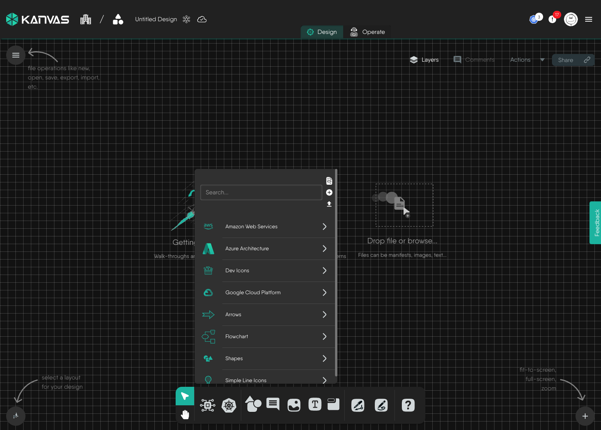
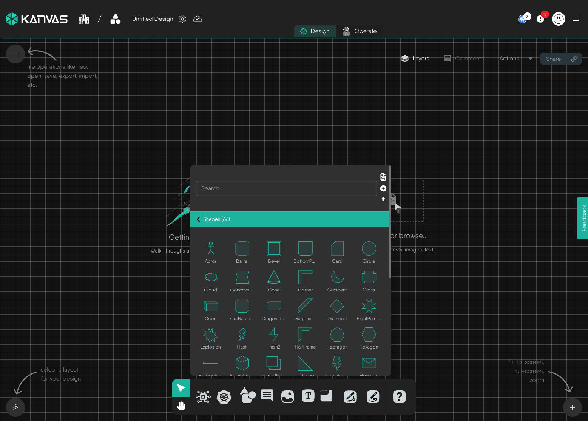
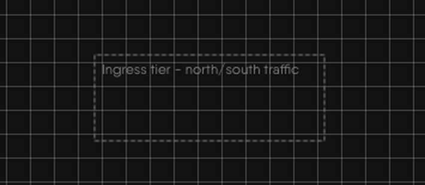
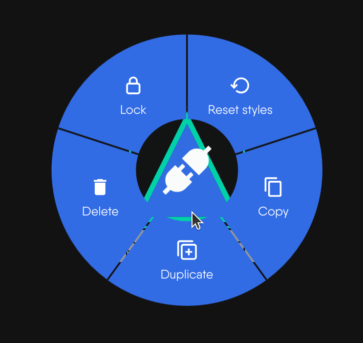
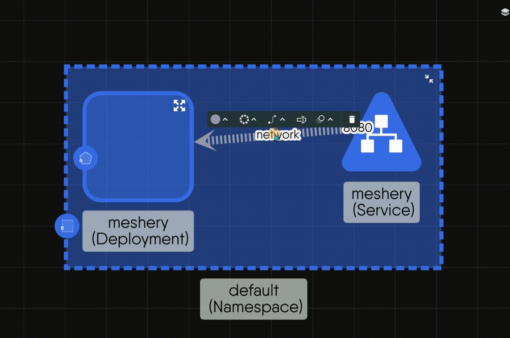

# Canvas Objects

> Reference for every object on the Designer canvas - components, shapes, sections, textboxes, images and edges - covering how each is added, what you can do to it, its style options, defaults and limits.

Everything on a Designer canvas is an object, and every object answers to the same small set of actions: add, select, copy, duplicate, lock, restyle, resize and delete. This page lists each object kind, each action, every style option and the limits that apply. Edges - the lines that connect objects - have their own section at the end.

Designer mode only. In Operator mode you cannot add, edit, duplicate, delete or rename objects, and live nodes discovered from a cluster are read-only in every mode. See [Designer](/pr-preview/pr-1332/kanvas/concepts/designer/) for how the two modes differ.

## Object kinds {#canvas-objects}

| Object | What it is | Configurable | Added from |
| --- | --- | --- | --- |
| **Component** | A piece of infrastructure under management, such as a Deployment, an S3 bucket or a Lambda function. | Yes. It carries configuration and is part of what gets deployed. | The Components and Kubernetes pickers in the dock, a file import, or a drop |
| **Shape** | A visual primitive: a circle, an arrow, a flowchart symbol or a cloud-provider glyph. | No | The Shapes picker in the dock |
| **Section** | A labeled frame that fences off a region. Objects dropped inside it become its children and move with it. | No | The Section tool in the dock, or <kbd>S</kbd> |
| **Textbox** | A resizable box whose content is text. | No | The Textbox tool in the dock, or <kbd>T</kbd> |
| **Image** | A picture embedded in the design. | No | <kbd>I</kbd>, the Image tool in the dock, or a file drop |
| **Comment** | A threaded note pinned to the canvas. See [Reviewing Designs](/pr-preview/pr-1332/kanvas/guides/collaborating/reviewing-designs/). | No | <kbd>M</kbd> or the Comment tool in the dock |
| **Pencil stroke** and **pen point** | Freehand drawings and the joints of drawn lines. See [Tool Modes](/pr-preview/pr-1332/kanvas/reference/tool-modes/). | No | The Pencil and Pen tools |

Every object except a component is an **annotation**. Kanvas stores annotations in the design alongside components, but treats them differently:

| Behavior | Annotation | Configurable component |
| --- | --- | --- |
| Layers panel toggle | **Annotations** | **Configurable Components** |
| Kind name appended to the on-canvas label | No | Yes |
| Has configuration to edit | No | Yes |
| Counts toward the components-per-design limit of your plan when the design is saved | Yes | Yes |

The plan limit counts every entry in a design, drawn objects included, so a heavily annotated design can reach the limit sooner than its infrastructure alone suggests. See [Feature Availability by Plan](/pr-preview/pr-1332/kanvas/reference/feature-availability/).

## Adding objects {#adding-objects}

| Method | Result |
| --- | --- |
| Drag from a dock picker onto the canvas | The object lands where you release it. |
| Click an icon in a picker | The object lands at a random position near the center of the canvas. |
| <kbd>M</kbd>, <kbd>T</kbd>, <kbd>S</kbd> | Adds a comment, textbox or section near the center of the canvas. A textbox opens ready for typing. |
| <kbd>I</kbd> | Opens a file picker for an image. |
| Drop or paste a file | See the file rules below. |
| Paste a copied selection | Adds the copied objects and the relationships between them at the pointer. |

A newly added component opens its configurator beside the node. A textbox starts inline text editing on double-click. Shapes accept body text too, so double-click a shape to type in it.

### Shapes {#adding-shapes}

The Shapes picker lists the shape libraries registered in Meshery, with search across all of them. A default installation includes libraries for cloud providers (Amazon Web Services, Azure, Google Cloud Platform), developer icons, arrows, flowchart symbols, general-purpose shapes and line icons. The libraries come from the registry, so the list can differ between installations. Pin a library to the dock to keep it one action away - see [Pinning a Model to the Dock](/pr-preview/pr-1332/kanvas/guides/designing/pin-model-to-dock/).

<figure>
  
  <figcaption>The Shapes picker lists every shape library available to your design</figcaption>
</figure>

<figure>
  
  <figcaption>A shape library expanded</figcaption>
</figure>

### Sections {#adding-sections}

A section draws its label along its top edge instead of through its middle, so the region it encloses stays readable. Drop other objects inside it and they move with the section. Deleting the section does not delete them.

### Textboxes {#adding-textboxes}

<figure>
  
  <figcaption>A textbox carrying a caption</figcaption>
</figure>

### Files dropped or pasted on the canvas {#files}

| File | Result | Limit |
| --- | --- | --- |
| Any image type the browser recognizes | An image object. The picture is embedded in the design as data, not linked. | 512,000 bytes (about 500 KB) |
| Plain text (`.txt`) | A textbox holding the file text. | 512,000 bytes (about 500 KB) |
| YAML, JSON, TAR, GZ, TGZ, ZIP, RAR, 7Z | An infrastructure-as-code import at the drop position. See [Importing Designs](/pr-preview/pr-1332/kanvas/guides/designs/import-designs/). | Import rules apply |
| Any other type | Ignored with no message | - |

Files over the size limit are rejected with an error message. The limit is fixed and is the same on every plan. A file with no browser-reported type is classified by its extension.

## Selecting objects {#selecting}

| Gesture | Effect |
| --- | --- |
| Click | Selects one object and shows its style toolbar. |
| <kbd>Ctrl</kbd>/<kbd>Cmd</kbd> + click | Adds or removes one object from the selection. |
| <kbd>Ctrl</kbd>/<kbd>Cmd</kbd> + drag on empty canvas | Draws a selection box. Box selection is off in Pan, Pen and Pencil modes. |
| <kbd>Ctrl</kbd>/<kbd>Cmd</kbd> + <kbd>A</kbd> | Selects every component on the canvas. |

Dragging selected objects moves them together. Locked objects do not move.

## Actions on objects {#object-menu}

Right-click an object, or press and hold on it, to open its menu. Each entry appears only when its condition holds.

| Action | Shortcut | Appears when | Behavior |
| --- | --- | --- | --- |
| Copy | <kbd>Ctrl</kbd>/<kbd>Cmd</kbd> + <kbd>C</kbd> | Designer mode, object is not a group | Menu: copies that one object. Keyboard: copies the whole selection and every relationship whose two ends are both selected. |
| Duplicate | <kbd>Ctrl</kbd>/<kbd>Cmd</kbd> + <kbd>D</kbd> | Designer mode, not a group | Adds a copy to the same design. |
| Lock | - | Designer mode, not a group, not locked | Fixes the object's position. |
| Unlock | - | The object is locked | Releases the position. |
| Delete | <kbd>Delete</kbd> or <kbd>Backspace</kbd> | Designer mode, not a group | Removes the object. The keys delete the whole selection. |
| Reset styles | - | The object supports style changes | Restores the object's default styling. |
| Group | - | A multi-selection | Turns the temporary selection group into a permanent group. |
| Ungroup | - | A permanent group | Dissolves the group. |
| Move Out of Parent | - | Designer mode, the object sits inside a parent | Takes the object out of its parent. |

<figure>
  
  <figcaption>The context menu open on a selected object</figcaption>
</figure>

Every change an action makes, restyling included, is a change to the shared design, so <kbd>Ctrl</kbd>/<kbd>Cmd</kbd> + <kbd>Z</kbd> reverses it. See [Canvas Actions](/pr-preview/pr-1332/kanvas/reference/canvas-actions/).

### Copy and paste {#copying}

Copy writes the object data to your system clipboard. Paste with <kbd>Ctrl</kbd>/<kbd>Cmd</kbd> + <kbd>V</kbd> into the same design, a different design or another browser tab running Kanvas.

- Pasted objects land at the pointer when it is over the canvas, otherwise at the canvas center, and keep their relative layout.
- Every pasted object receives a new identifier. Styling travels with the copy.
- The browser must allow clipboard access. If it refuses, nothing happens and no message appears.

### Duplicate {#cloning}

Duplicate skips the clipboard. It places the copy 50 pixels right and 50 pixels down from the original, gives it a new identifier and copies the relationships between members of the duplicated set. Duplicating a section together with its children reproduces the whole arrangement. Names are unchanged.

### Lock {#locking}

A lock fixes position only. A locked object can still be selected, restyled, configured and deleted, but it cannot be dragged, directly or inside a selection. The lock is stored with the object, so it survives a reload and applies to collaborators. Locking a section does not lock the objects inside it.

### Delete {#deleting}

Deleting an object also removes the relationships that touch it. Kanvas marks those relationships as deleted rather than discarding them, so the next [policy evaluation](/pr-preview/pr-1332/kanvas/concepts/relationship-evaluation/) can undo any configuration they had applied. Deleting a section leaves its children on the canvas. Deletion is immediate and has no confirmation, but it can be undone.

## Style options {#configuring-styles}

Selecting one object shows a style toolbar above it. The toolbar edits the selected object; it does not apply a change to a multi-selection. Each control appears only when the object's definition declares that capability, so the controls you see vary by object. The toolbar appears only when the canvas is zoomed in past a detail threshold; zoomed out, the canvas shows a hint to zoom in.

| Property | Options |
| --- | --- |
| Shape | 24 outlines: ellipse, triangle, round-triangle, rectangle, round-rectangle, bottom-round-rectangle, cut-rectangle, barrel, rhomboid, diamond, round-diamond, pentagon, round-pentagon, hexagon, round-hexagon, concave-hexagon, heptagon, round-heptagon, octagon, round-octagon, star, tag, round-tag, vee. Changing the outline keeps the content. |
| Fill | 13 swatches including transparent, and an opacity slider from 0 to 1 in steps of 0.1. |
| Border | Color from the same swatches, style (solid, dotted, dashed, double) and thickness from 0 to 25. |
| Layer order | Move To Front, Move Forward, Move Backward, Move To Back. |
| Label | The name drawn with the object. |
| Link | An external URL. A link adds an External Link badge, which opens the URL in a new tab. See [Component Badges](/pr-preview/pr-1332/kanvas/reference/component-badges/). |
| Image | A background image, set by URL or by upload, with a reset to the default. |
| Animation | None, blink, ripple, bounce or pulse. |
| Text | Color, weight (Regular, Medium, Semi Bold, Bold, Black), decoration (none, underline, line-through), horizontal alignment (left, center, right), vertical alignment (top, center, bottom) and size. |
| Configure | Opens the configurator. Components only. See [Configuring Components](/pr-preview/pr-1332/kanvas/guides/designing/configuring-components/). |

The default text style is gray, 12 pixels, regular weight and centered. Sections carry their label on the top edge rather than body text.

Restyling changes only how an object is drawn. It never changes a component's configuration or what gets deployed.

### Reset styles {#resetting-styles}

Reset styles re-applies the styling recorded in the object's definition and discards every change made in the style toolbar. It restores the definition, not an earlier state, so it is not an undo. Position, lock state, configuration and relationships are untouched.

## Resizing {#resizing}

Select a single object and Kanvas draws eight handles around it, one at each corner and one at the midpoint of each side.

- Drag a corner or side handle to resize.
- Hold <kbd>Shift</kbd> while dragging to keep the aspect ratio.
- Objects that contain other objects, such as a parent component or a section with children, show no handles.

Resizing needs the object's definition to declare the resize capability. The new size is saved with the design.

## Edges {#edges}

An edge is a line between two objects. Each edge is a relationship in the design, and relationships come in two kinds.

| Edge kind | What it represents | Effect |
| --- | --- | --- |
| Semantic | A relationship defined in the registry, such as a network connection or a volume mount. | Kanvas updates the configuration of the components it joins as you draw it, and re-evaluates it as the design changes. See [Relationships](/pr-preview/pr-1332/kanvas/concepts/relationships/). |
| Annotation | A line you draw with the Pen tool to explain a flow or a dependency. | Visual only. It is non-binding and configures nothing. |

Select an edge to open the edge toolbar.

| Control | Options |
| --- | --- |
| Line Color | The same 13 swatches as fills. The arrowhead takes the same color. |
| Line Style | Dotted, Solid, Dashed. |
| Arrow/Curve Style | A curve style and an arrowhead, listed below. |
| Name | A text label drawn on the edge. |
| Edge Animation | None, or marching ants: a dashed line that travels along the edge. |
| Delete | Removes the edge. Works on any edge. |

### Curve styles

| Curve style | Shape |
| --- | --- |
| Bezier | A smooth curve. The default. |
| Straight | A direct line. |
| Segments | A line with two bends. |
| Round segments | Segments with rounded corners. |
| Taxi | Right-angle routing. |
| Round taxi | Right-angle routing with rounded corners. |
| Haystack | A short line that starts and ends inside the nodes. |
| Unbundled bezier | A curve with one adjustable control point. |
| Multi unbundled bezier | A curve with two control points. |
| Straight triangle | A straight line drawn with a triangular profile. |

Choosing a curve style applies its default geometry. Choosing Round taxi does not apply its default corner radius.

### Arrowheads

Vee (the default), triangle, circle, square, diamond, triangle-cross, tee, triangle-tee, circle-triangle, triangle-backcurve and chevron. An arrowhead is drawn at the target end only.

### Edge defaults

A new edge uses a dotted line, a vee arrowhead, a bezier curve, a width of 1.5 pixels and a light gray color. A selected edge draws at 4 pixels. Edges that carry TCP traffic draw as a solid gold line with a triangle-cross arrowhead.

## Permissions {#permission-reference}

Kanvas gates canvas actions by mode and by object capability, not by role. The permission catalog in Layer5 Cloud lists a key for each shape, section, textbox and component-styling action (add, copy, clone, lock, delete, configure styles, reset styles and resize), and organization administrators can include them in roles and keychains. Kanvas does not check those keys on the canvas today, so withholding one does not hide a control.

The permissions Kanvas does enforce on the toolbar are Validate Design, Deploy Design, Undeploy Design and Share Design. See [Permissions by Role](/pr-preview/pr-1332/kanvas/reference/permissions/).

| Action | Gate | When the gate fails |
| --- | --- | --- |
| Add, duplicate, copy, paste, delete, lock | Designer mode | The control is not offered in Operator mode. |
| Edit a live cluster node | Never allowed | Live nodes are read-only in every mode. |
| Style, reset styles, resize | The object's definition declares the capability | The control is hidden. |
| Pen and Pencil | The Enable Pen and Enable Pencil options | The dock icons are hidden. |

## Limits {#limits}

| Item | Limit |
| --- | --- |
| Image file | 512,000 bytes (about 500 KB), same on every plan |
| Text file | 512,000 bytes (about 500 KB), same on every plan |
| Border thickness | 0 to 25 |
| Fill opacity | 0 to 1 |
| Components per design | Set by your plan and enforced when the design is saved. Annotations count. |
| Image count per design | No limit |

## Related reading

- [Tool Modes](/pr-preview/pr-1332/kanvas/reference/tool-modes/) - select, pan, pencil and pen.
- [Whiteboarding](/pr-preview/pr-1332/kanvas/guides/designing/whiteboarding/) - a task guide to drawing on a design.
- [Keyboard Shortcuts](/pr-preview/pr-1332/kanvas/reference/keyboard-shortcuts/) - every shortcut.
- [Layout and Layers](/pr-preview/pr-1332/kanvas/reference/layout-and-layers/) - arranging and hiding objects.

