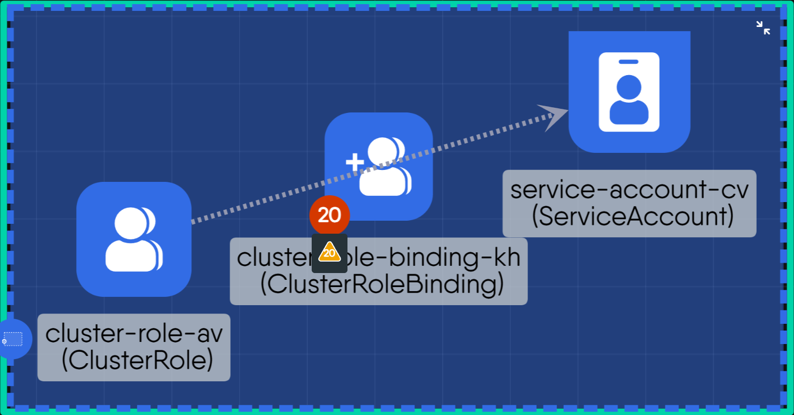
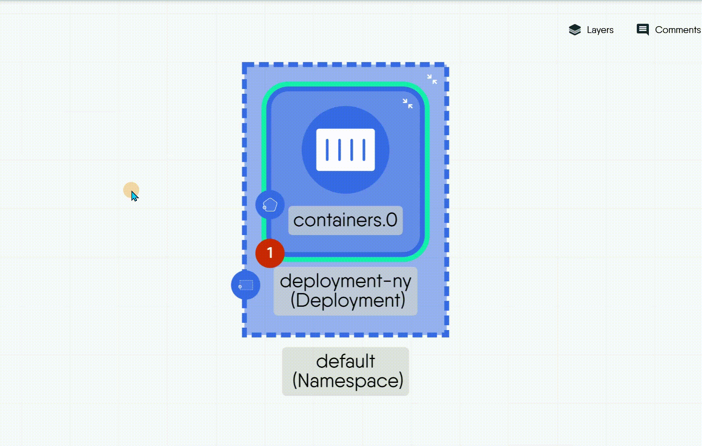

# Component Badges

> Reference for every badge Kanvas draws on a component - what it means, where it sits, when it appears, what a click does and how to hide it - in Designer and Operator modes.

A badge is a small marker Kanvas draws on the edge of a component to report something about it: errors waiting to be fixed, components held inside it, a link, or where it came from. Badges are status, not decoration. A count on a badge tells you there is something to read, and clicking it shows what.

Which badges appear depends on the mode. Designer mode draws badges that help you build a valid design. Operator mode draws badges about live resources.

## Badges in Designer mode

| Badge | Position | Appears when | Click |
| --- | --- | --- | --- |
| Error count | Bottom-left, red, shows a number | The component has at least one schema validation warning or deployment error. The number is the sum of both. | Opens a summary with one count per category. Each count opens the matching details: the validation results or the deployment results. |
| Inventory | Bottom-right, shows a number | The component holds other components inside it. The number is how many. | Lists the held components. Choosing one opens its configurator. |
| External Link | Top-right | You set a **Link** on the component in its style options. | Opens the URL in a new tab. |
| Parent model icon | Left edge, above the error count | The component is a parent that contains other components. | None. It shows the parent's model icon in the component color. |
| Expand and collapse | Inside the component, top-right | The component is a parent with children. | Hides the children, or shows them again. |
| Section label | Top-left, inside the section | The object is a section. | None. It carries the section name, shortened with an ellipsis when it does not fit the width. |

### Error count

The error count joins two checks into one number:

- **Validation warnings** come from checking the component's configuration against its schema, such as a missing required field or an invalid value.
- **Deployment errors** come from a dry run of the design against a cluster. See [Validating Designs](/pr-preview/pr-1335/kanvas/guides/deploying/validating-designs/).

A component with no errors shows no badge. Fix the field the warning names and the count drops, and the badge disappears at zero. Opening a validation warning from the badge takes you to the offending configuration field.

### Inventory

An inventory badge appears on a component that holds other components, such as a workload that holds its configuration objects. The held components are drawn inside the inventory rather than as separate nodes on the canvas. The relationship between them is created by the policy engine; see [Relationships](/pr-preview/pr-1335/kanvas/concepts/relationships/).

## Badges in Operator mode

| Badge | Position | Appears when | Click |
| --- | --- | --- | --- |
| Managed by Meshery | Top-left, green | The resource was created from a design and Kanvas knows which one. | Opens the source design in Designer mode. |
| Terminal | Bottom-right, black | The resource is a container that has a terminal session open. | Opens the terminal panel. See [Interactive Terminal](/pr-preview/pr-1335/kanvas/guides/operating/interactive-terminal/). |

Operator mode draws no health, performance or policy badge. Resource state is on the resource itself; see [Resource Details](/pr-preview/pr-1335/kanvas/reference/resource-details/).

## Showing and hiding badges

- The **Layers** panel has a **Component Badges** section with separate switches for **Validation Warnings**, **Deployment Errors** and **Inventory**. Switching one off removes its share of the error count, or the inventory badge, from the canvas without changing the design's contents. The setting is saved with the design. See [Layout and Layers](/pr-preview/pr-1335/kanvas/reference/layout-and-layers/).
- Badges draw only at Full render fidelity. In Medium and the lower fidelity modes Kanvas leaves them out to keep large designs responsive.
- Badges, like object controls, draw only when the canvas is zoomed in far enough to read them.

## Practical use

- Clear the error count on every component before you deploy. A design with no badges is a design that passes both checks.
- Use the Managed by Meshery badge to jump from a live resource to the design that produced it when you need to change its configuration.
- Hide badges before you take a screenshot for a review if you want a clean image. See [Canvas Actions](/pr-preview/pr-1335/kanvas/reference/canvas-actions/).

