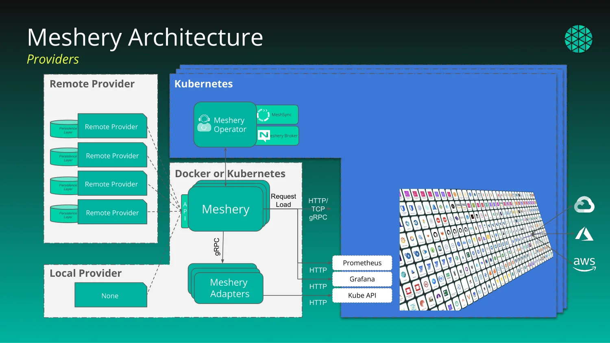

# How Kanvas Works with Meshery and Layer5 Cloud

> How Kanvas runs inside Meshery, where designs are stored, what talks to your clusters, and what differs between kanvas.new and self-hosted Meshery.

Kanvas is not a standalone service. It is an extension that runs inside Meshery, relies on Meshery Server to reach your clusters, and relies on a remote provider, Layer5 Cloud, to store and share designs. Knowing which part does what explains why some features need a cluster connection, why others need an account, and why the hosted Kanvas at kanvas.new offers a subset of what a self-hosted Meshery deployment offers.

<figure>
  
  <figcaption>Read the diagram from left to right. Providers sit on the left: Meshery runs with either a remote provider (Layer5 Cloud for Kanvas), which stores designs and handles identity and sharing, or a local provider. Meshery sits in the middle and mediates every request. Your clusters sit on the right, where Meshery Operator runs MeshSync and Meshery Broker to report live state back to Meshery.</figcaption>
</figure>

## Kanvas is a Meshery extension

Kanvas has two parts, and both run inside Meshery:

- **The Kanvas interface** loads into Meshery UI at runtime. Designer and Operator modes are screens of Meshery UI supplied by the extension.
- **A server-side plugin** is loaded by Meshery Server and adds Kanvas behavior to it.

Because Kanvas lives inside Meshery, it inherits Meshery's connections to your clusters and Meshery's choice of provider.

## Every request goes through Meshery Server

Kanvas sends every request to Meshery Server. Meshery Server then does one of two things:

- **Answers local requests itself.** Requests about your connected clusters and their resources stay within Meshery.
- **Forwards provider-bound requests to the remote provider.** Requests for designs, views, the catalog, sharing, and support go to Layer5 Cloud, and Meshery Server relays the response back to Kanvas.

Kanvas never calls Layer5 Cloud directly, with one exception: real-time collaboration, described below.

The provider also decides which features Kanvas offers. Each provider publishes a capability document that lists the features it supports, and Kanvas enables only those features. The hosted Kanvas at kanvas.new ships its own capability document.

## Where designs live

The remote provider persists your designs. Layer5 Cloud stores each design and every version of it, records who a design is shared with, hosts the catalog of published designs, and keeps the event log. For example, when Kanvas completes a validation of a whole design, it publishes a validation event to the Layer5 Cloud event log.

## What talks to your clusters

Meshery Server, not your browser, talks to your Kubernetes clusters. It reaches them through components it deploys into each cluster:

- **Meshery Operator** runs in the cluster and deploys MeshSync and Meshery Broker there.
- **MeshSync** records the state of the cluster in Meshery Server.

Meshery Server feeds that inventory into Operator mode. Operator draws a snapshot of it each time you load a view, change a filter, or change clusters, so it reflects the cluster as of the last refresh. When you dry-run, deploy, or undeploy a design, Meshery performs the operation against the Kubernetes contexts you selected, or against all connected contexts when you select none. Meshery can also connect to adapters, which Kanvas does not require for designing or deploying.

Every resource Kanvas deploys carries a label with the id of its source design and annotations with the design version and component id. Operator's per-design view uses that label to show exactly what one design produced. See [Designs and Components](/pr-preview/pr-1336/kanvas/concepts/designs/).

## Real-time collaboration: the one direct path

Real-time collaboration is the only path from your browser straight to Layer5 Cloud. When you edit a design with others, your browser connects to a signaling service hosted by Layer5 Cloud, which introduces the participants to each other. After that, edits synchronize directly between participants' browsers, peer to peer over WebRTC, rather than through Meshery Server.

## Hosted kanvas.new versus self-hosted Meshery

The hosted Kanvas at [kanvas.new](https://kanvas.new) is for authoring designs. Every capability that needs a cluster is reserved for Meshery deployments: the [Meshery Playground](https://playground.meshery.io) or your own self-hosted Meshery.

| Capability | kanvas.new, anonymous | kanvas.new, signed in | Meshery Playground or self-hosted Meshery, signed in |
|---|---|---|---|
| Author and edit designs | Available | Available | Available |
| Import designs | Available | Available | Available |
| Share and publish designs | Requires sign-in | Available | Available |
| Validate | Not available | Not available | Available |
| Dry-run | Not available | Not available | Available |
| Deploy and undeploy | Not available | Not available | Available |
| Operator mode | Not available | Not available | Available |
| Connect clusters | Not available | Not available | Available |

Every action in the table also requires the matching permission in your organization. Validate, dry-run, deploy, and undeploy are disabled while the design is empty.

What you see when you reach a boundary:

- **A cluster-bound capability on kanvas.new** opens a prompt that explains Operator mode is not available on kanvas.new and directs you to the Meshery Playground or a self-hosted Meshery deployment.
- **Sharing or publishing while anonymous** opens a "Sign in to" prompt that names the feature and offers a single Sign in action. You are anonymous when no user is signed in or the signed-in user has anonymous status.
- **Signing in** navigates the whole page to the provider and returns you to the page you started from. If the provider address is malformed, sign-in does not start and Kanvas shows the error "Sign-in could not start:" followed by the reason.

## The local provider limitation

Meshery can run with a local provider instead of a remote one. Under the local provider there is no remote service to forward requests to, so every provider-bound feature, including views, the catalog, sharing, and support requests, returns HTTP 501 Not Implemented. Use a remote provider such as Layer5 Cloud for any feature that depends on it.

