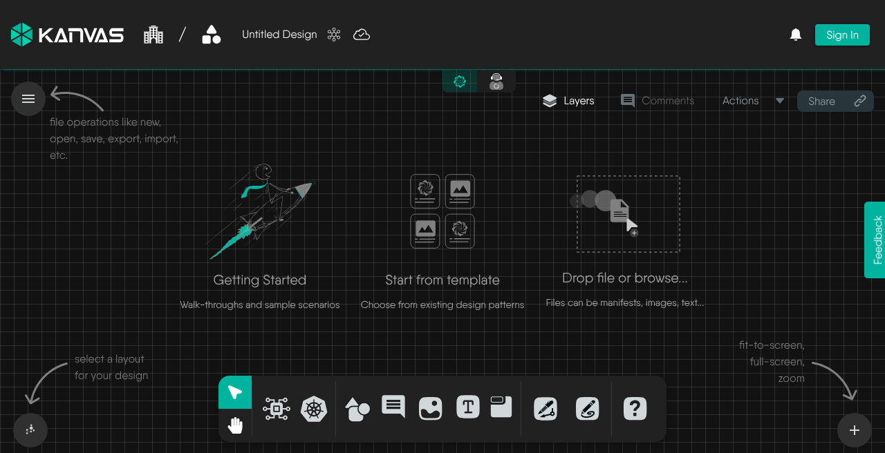
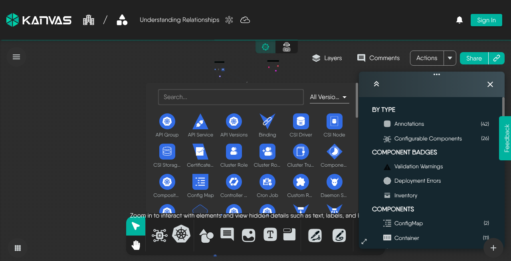

# Layout and Layers

> Reference for the six automatic layouts and the Layers panel - what each layout produces, when Kanvas lays a design out on its own, and what each layer toggle hides.

Two controls decide how a design reads on screen. **Layout** arranges the components - where they sit relative to one another. **Layers** decide which of them are drawn at all.

Both are recorded in the design rather than in your browser, so they travel with it: a layout writes the components' positions, and the Layers panel writes their visibility into the design's preferences. Anyone else opening the design sees the same arrangement and the same components hidden. What neither touches is **configuration** - a hidden component is still part of the design and is still deployed, and re-running a layout changes only where components sit.

## Change design layout

The layout control sits in the bottom-left corner of the canvas, showing the icon of the layout currently in use. Clicking it fans out the available layouts; picking one re-arranges every component on the canvas with an animated transition, so you can see where things moved to. The zoom controls sit at the opposite corner, bottom-right.

| Layout | Shape it produces | Suits |
| --- | --- | --- |
| Constrained | A force-directed arrangement that respects grouping and containment | The default, and the best general-purpose choice |
| Grid | Even rows and columns | Inventories and flat sets of similar components |
| Hierarchical | A layered, top-down tree following the direction of relationships | Designs with a clear flow, such as ingress to service to workload |
| Star | Concentric rings around the most connected components | Finding the hubs in a design |
| Bus | A breadth-first arrangement fanning out from a root | Tracing what a component reaches, level by level |
| Ring | A single circle | Small designs, and comparing components at a glance |

Constrained is the layout selected by default.

### When Kanvas lays a design out for you

Kanvas arranges a design automatically on open only when every component has no saved position, or sits at the origin. That is the case for a design imported from a file that carries no coordinates. Any other design opens with its saved positions untouched, and nothing re-arranges it until you choose a layout.

Once you drag components by hand, those positions are what the design stores. Choosing a layout overwrites them for everyone who opens the design. Use undo (<kbd>Ctrl</kbd>/<kbd>Cmd</kbd> + <kbd>Z</kbd>) if an arrangement was not what you wanted: positions are part of the shared design, so undo restores them.

<figure>
  
  <figcaption>The layout control, bottom-left of the canvas</figcaption>
</figure>

  <h4 class="alert-heading" style="color: #7A848E;">Layouts on large designs</h4>
  
      Re-running a layout across a very large design is the most expensive operation on the canvas. If a design is slow to arrange, see <a href="/pr-preview/pr-1336/kanvas/reference/performance/">Performance Limits</a>.
  

## Configure visible layers

The **Layers** panel controls what the canvas draws. Open it with the **Layers** button in the toolbar above the canvas, or press <kbd>&#92;</kbd> (backslash). Every entry has an eye toggle: switch it off and that entity disappears from the canvas until you switch it back on.

<figure>
  
  <figcaption>The Layers panel in Designer mode: By Type, Component Badges and Components</figcaption>
</figure>

In Designer mode the panel is organized into four sections:

- **By type** - a single toggle each for **Annotations** (comments, shapes, text and other non-semantic components) and **Configurable Components** (the semantic components that actually get deployed). Turning annotations off is the fastest way to see the deployable shape of a design on its own. The count beside each is the number of components of that type in the design.
- **Component Badges** - **Validation Warnings**, **Deployment Errors** and **Inventory** badges. These are the small markers Kanvas draws on components; hiding them declutters a design that is mid-review. See [Component Badges](/pr-preview/pr-1336/kanvas/reference/component-badges/).
- **Components** - every kind present in the design, grouped by model. Expanding a group lists the individual components, each with its own visibility toggle, so you can hide one Deployment without hiding the rest. Clicking a component's name selects it on the canvas and zooms the view to it.
- **Relationships** - each relationship kind, type and subtype found in the design, with its own toggle and a count. TagSet relationships appear here under that name.

The header of the panel expands or collapses every section at once.

A resolved comment is not drawn at all until its thread is reopened, whatever the toggles say. A parent component can be collapsed to hide its children; see [Component Badges](/pr-preview/pr-1336/kanvas/reference/component-badges/).

Because visibility travels with the design, the Layers panel is a way of presenting a design as much as a way of reading one - hide the noise before you hand a design to someone else and they will open it the way you left it.

  <h4 class="alert-heading" style="color: #7A848E;">Layers in Operator mode</h4>
  
      The Layers panel is present in Operator mode too, but it filters rather than hides: instead of design components it lists the Kubernetes resource kinds MeshSync has discovered - Cluster, Workloads, Configurations, Networking, Storage, Monitoring and Custom Resources - and choosing among them changes which resources are fetched and drawn. Those choices are what a saved <a href="/pr-preview/pr-1336/kanvas/reference/views/">view</a> records.
  

## Render mode

Layout and layers decide what is drawn and where. **Render mode**, in the Options drawer and the Designer toolbar, decides how much detail each component is drawn with - from full fidelity down to a wireframe - and can be set to adapt automatically when the canvas slows down. Reach for it when a design has become large enough that panning and zooming feel heavy. [Render Modes](/pr-preview/pr-1336/kanvas/concepts/render-modes/) explains the trade-off, and [Performance Limits](/pr-preview/pr-1336/kanvas/reference/performance/) lists what each mode draws.

