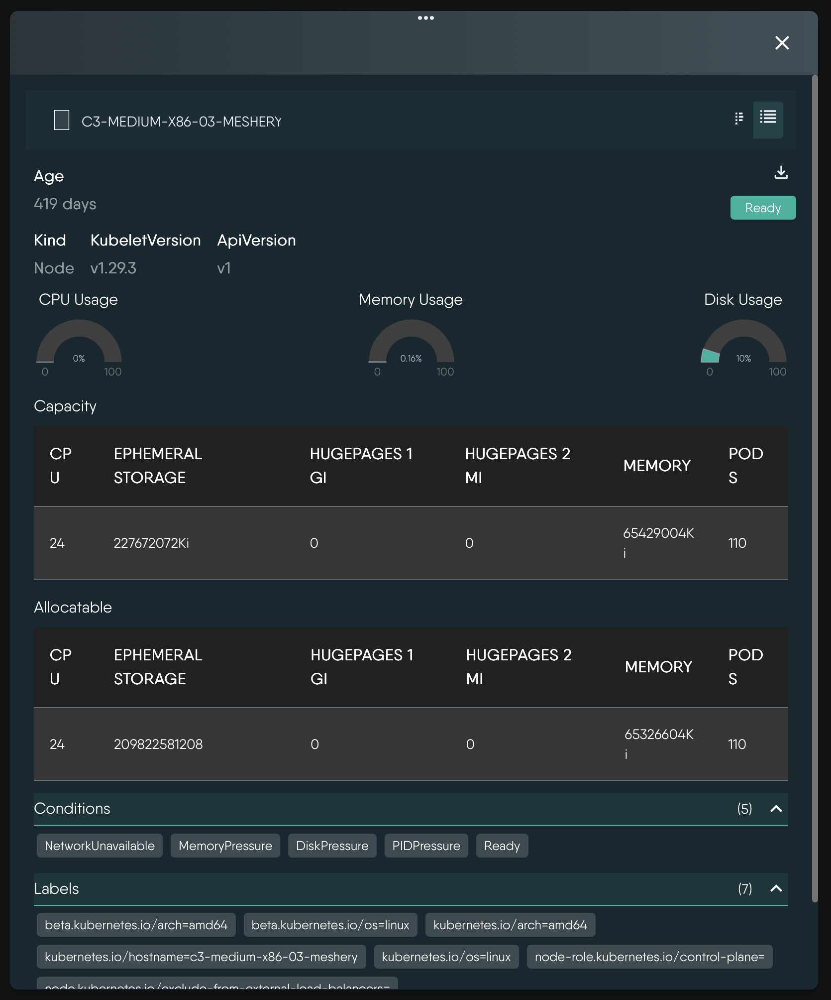
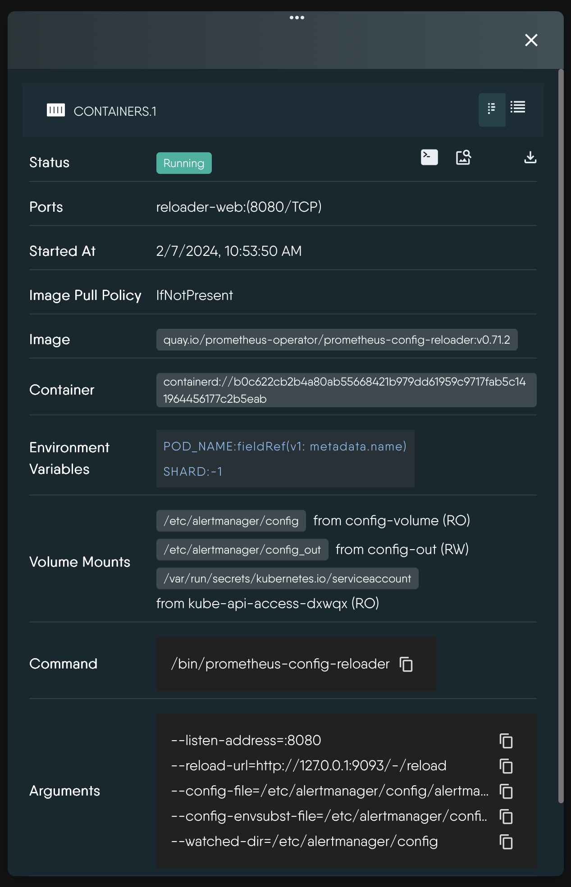

# Resource Details

> The fields, actions, and capacity gauges the Details panel shows for each Kubernetes resource kind in Operator mode, and what it does not show.

Selecting a resource on the Operator canvas opens the Details panel. It shows the resource as Meshery last recorded it from the cluster, and it carries the actions that apply to that kind. Fields with no value are omitted, so each kind shows only what applies.

  

      Node Details
    

    

        
    
    
<i>Example: Kubernetes Node details.</i>

  

      

  

  

      Container Details
    

    

        
    
    
<i>Example: Kubernetes Pod Container details.</i>

  

      

  

## How the panel behaves

- **Opens on a single click.** Selecting several resources does not change this: the panel always shows the last resource you clicked.
- **Not live.** The panel shows the canvas snapshot immediately, then fetches the resource's full record once. It does not update while open. Close and reselect the resource to refresh it. See [Operator](/pr-preview/pr-1342/kanvas/concepts/operator/) for how the snapshot is built.
- **Two views.** **Summary** (the default) shows the key fields. **Details** adds the collapsible sections and tables, each titled with its item count, for example `Labels (4)`.
- **Status chip.** Shows the resource's phase when it has one (Running, Pending, Failed, Succeeded, Active, Terminating, Bound, Available, and so on). Otherwise it shows `Ready` whenever the resource has a Ready condition, whatever that condition's value. Do not read `Ready` as a health check.
- **Load failures.** While loading you see a loader. If the fetch fails the panel shows `Error loading instance details.`

## Fields by kind

| Kind | Fields shown |
|---|---|
| All kinds | Age (hours below 24 hours, otherwise days), kind, API version, labels, annotations, condition type names (not their True or False values), and deep links |
| Node | Kubelet version, three capacity gauges, and `Capacity` and `Allocatable` tables |
| Pod | Pod IP, host IP, QoS class, node selector, priority, container count, total restarts, init containers, containers, volumes by type, tolerations |
| Container | Status, ports, start time, image pull policy, restarts, image, container id, environment variables, volume mounts (read-only or read-write), command, arguments, liveness, readiness, and startup probes, resource requests and limits |
| Deployment, ReplicaSet, StatefulSet | Available and total pods, ready and total replicas, selector, container images from the pod template, update strategy (StatefulSet) |
| DaemonSet | Selector, images, update strategy. Replica counts may be blank. |
| Service | Service type, cluster IP, external IP, selector, load balancer ingress addresses, the remaining spec as an expandable tree |
| Ingress | Rule hosts, the rules as an expandable tree, load balancer addresses |
| PersistentVolume | Capacity, claim, claim namespace, access modes, storage class |
| PersistentVolumeClaim | Requested size, storage class, access modes |
| Namespace | Phase and finalizers |
| Secret, ConfigMap | Secret type. Secret values are not rendered. |
| Event and all other kinds | The fields under All kinds only |

Container environment variables show their plain values. Values drawn from another source appear as `source(apiVersion: fieldPath)`.

### Labels and annotations

Labels render as `key=value` chips in the Details view. Selecting a chip toggles that label in the open view's `labels` filter and the chip turns green. The filter matches resources carrying any selected label, and the view autosaves. Annotations are listed without actions.

### Deep links

A resource that references a Node, Namespace, or ServiceAccount shows a link for each. Selecting one replaces the view's `kinds` filter with that kind and sets the name search to the value, keeping other filters. Use it to walk from a failing pod to the node it landed on.

## Node capacity gauges

For a Node, three gauges show how much of the node's capacity Kubernetes holds back from Pods.

| Gauge title | Resource |
|---|---|
| `System Reserved Cpu` | CPU |
| `Memory Usage` | Memory |
| `Disk Usage` | Ephemeral storage |

Each value is `(capacity - allocatable) / capacity` as a percentage, rounded to two decimals, using the node's reported `capacity` and `allocatable`. The gauge color follows the value:

| Value | Color |
|---|---|
| 0 to 30 percent | Teal-green |
| Over 30 to 60 percent | Amber |
| Over 60 to 90 percent | Orange |
| Over 90 percent | Red |

  <h4 class="alert-heading" style="color: #7A848E;">Reserved capacity, not utilization</h4>
  
      Despite the titles <code>Memory Usage</code> and <code>Disk Usage</code>, these gauges show reserved capacity, the share of the node unavailable to Pods. They do not show what Pods request or consume. Operator mode shows no live CPU or memory utilization, no per-pod metrics, and no time series. Use your metrics stack for those. Memory and storage parsing assumes the node reports values in <code>Ki</code> units.
  

## Actions

The panel header carries these actions. The same actions are in the canvas right-click menu, except **Open Source Design** and **Download**.

| Action | Offered on | Result |
|---|---|---|
| `Initiate Terminal Session` | Pod, Container | Opens shells. See [Open an Interactive Terminal](/pr-preview/pr-1342/kanvas/guides/operating/interactive-terminal/). |
| `Initiate Log Session` | Pod, Container | Streams logs. See [Stream Container Logs](/pr-preview/pr-1342/kanvas/guides/operating/log-streaming/). |
| `Initiate Performance Test` | Service, Ingress | Opens the load test form. See [Run a Performance Test](/pr-preview/pr-1342/kanvas/guides/operating/performance-testing/). |
| `Open In Design` | Resources deployed from a design | Opens the source design in Designer with this component focused. |
| `Open Source Design` | Resources deployed from a design | Opens the source design. |
| `Download` | All kinds | Saves the resource record as indented JSON. The file name is the resource name with no `.json` extension. |

A resource counts as deployed from a design when it carries the design identity label that Meshery adds at deploy time. Resources created outside Meshery have no such label and do not offer the design actions. The header also shows **Expand** and **Collapse** buttons for every kind; they currently render without an icon.

## Events

Kubernetes `Event` objects appear on the canvas when you enable **Events** under **Monitoring** in the Layers panel. It is a plain kind toggle, grouped with the autoscalers. Selecting an event shows the generic fields only. Because events are short-lived and numerous, filter to a namespace first.

## Secrets

The panel does not render Secret values. The stored values still reach your browser: Meshery keeps the Secret and ConfigMap data MeshSync discovers and returns it with the resource, and **Download** writes it to the JSON file. Treat downloaded files as sensitive, and restrict who can use Operator mode against clusters whose Secrets matter.

## Related

- [Operator Views](/pr-preview/pr-1342/kanvas/reference/views/) save the filters you build with labels and deep links.
- [Kubernetes events and the Layers panel](/pr-preview/pr-1342/kanvas/reference/layout-and-layers/) describes the Layers panel in both modes.

