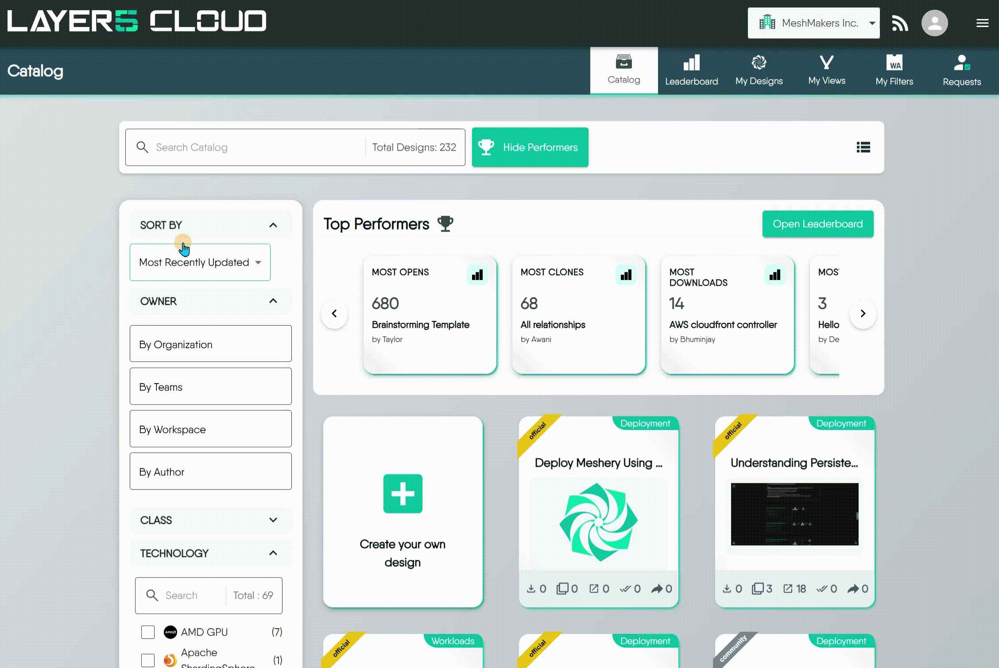
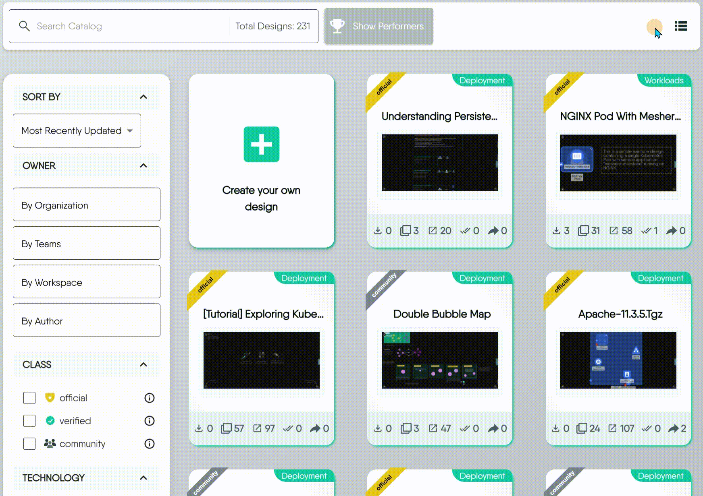
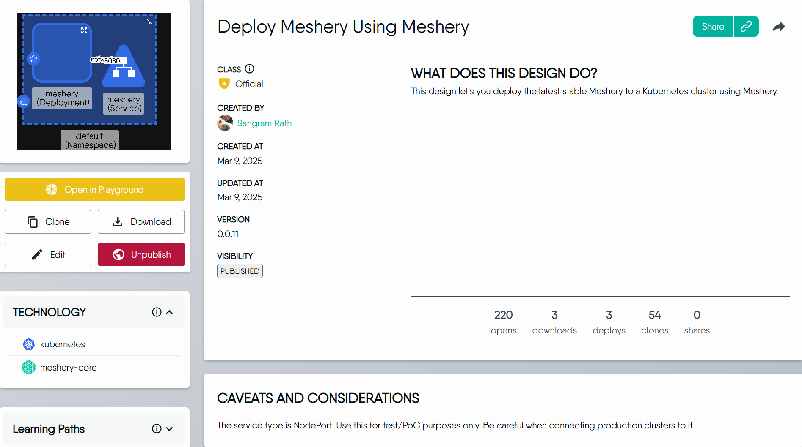
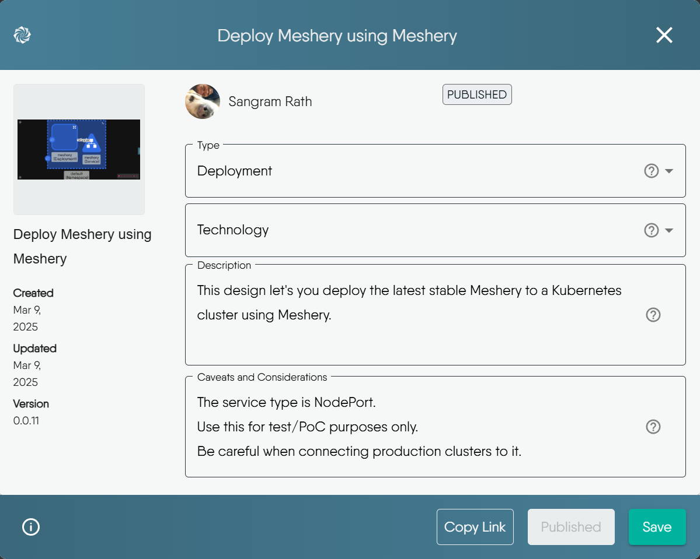

# Find and Use Catalog Designs

> Search the catalog, read a design's details, open it in the Playground, clone it into your workspace, and manage the catalog entries you own.

The [catalog](https://cloud.layer5.io/catalog) holds published designs: reusable infrastructure patterns that anyone can inspect and any signed-in user with the right permission can clone. This guide covers finding a design, using it, and managing the entries you own. For how the catalog works, who can publish, and what the metrics mean, see [Catalog](/pr-preview/pr-1343/cloud/concepts/catalog/).

## Before you start

- **Browsing needs no account.** Signed-out visitors can search, filter, and read every published design.
- **Cloning, downloading, editing, and deleting need you to sign in** and hold the matching permission. A role without the permission sees the action disabled. See [Roles and Permissions](/pr-preview/pr-1343/cloud/reference/default-permissions/).
- **Cloning needs an organization.** The copy lands in your selected workspace, so you must have an organization selected. Cloud refuses a clone while the all-organizations view is active.

| Action | Permission | Notes |
| --- | --- | --- |
| Browse, search, read details | None | Open to signed-out visitors. |
| Open in the Playground | None | Changes there are never written back to the catalog design. |
| Clone | Clone Design | Source must be published or public. |
| Download | Download a design | Core YAML only, without catalog metadata. |
| Edit catalog details | Publish Design | Type, technology, description, and caveats. |
| Unpublish | Unpublish Design | You must be the design's creator or hold Approve Catalog Request. |
| Delete | Delete a design | You must own the design. Provider administrators are the exception. |

## Browse the catalog

The catalog shows every published design from every organization. Two layouts show the same results:

- **Grid view** shows one card per design. The top-left banner is the design's class, such as Official. The top-right tag is its type, such as Deployment. A row of icons shows the usage counters (Opens, Downloads, Deploys, Clones, Shares). Hovering a card flips it to show the author, version, technologies, and last update.
- **Table view** is denser and suits sorting and comparing. The column control chooses which attributes show, such as Author, Created At, or Downloads.

The **Top Performers** panel above the results previews the leaderboard. You can hide it and show it again, and it opens the full leaderboard.

### Rank designs on the leaderboard

The leaderboard lists designs as a table sorted by Opens by default, ten rows per page. Sorting by any metric column re-ranks the list, and the sort order is kept in the page address, so you can share a ranking by copying the URL. You can also:

- Search by design name.
- Narrow by Type and Class. Each filter takes one value at a time, and All turns it off.
- Show or hide metric columns.
- Act on a row: clone it, download it, copy its link, share it with users or on social networks, or open it in the Playground.

Viewing the leaderboard needs the View Designs permission. Without it, the page shows a permission-denied message instead of the table.

## Find a design

The filter bar narrows the catalog. Filters combine, so each one you add shrinks the result set.

| Control | What it does |
| --- | --- |
| Search | Matches design **names** only, as a case-insensitive substring. It does not search descriptions or technologies. |
| Sort by | Alphabetical (A-Z or Z-A), most or least recently updated, most opened, most shared, most cloned, most deployed, most downloaded. Results default to most recently updated. |
| Owner | Limits results to your organization, specific teams, or one author. |
| Class | Official, Verified, or Community. |
| Technology | The technology tags authors attached when they published, such as `Argo CD` or `AWS API Gateway`. |
| Type | The category authors chose when they published: Deployment, Traffic Management, Security, Workloads, Observability, Scaling, or Resiliency. |

The three classes tell you how much to trust a design:

- **Official** is produced and fully supported by Meshery maintainers.
- **Verified** is produced by partners and verified by Meshery maintainers.
- **Community** is produced and shared by Meshery users, with varying support.

## Read a design's details

Selecting a design opens its detail view.

| Field | Meaning |
| --- | --- |
| Class, Created By, dates | The design's class, its original author, and when it was created and last updated. |
| Version | Increments each time the design is updated. |
| Visibility | **Published** for every design in the public catalog. |
| Caveats and Considerations | Stipulations and known behaviors to weigh before you use the design. |
| Similar Designs by Type | Other designs of the same type. |
| Metrics | Lifetime Opens, Downloads, Deploys, Clones, and Shares. |

## Open a design in the Playground

**Open in Playground** opens the design in the Kanvas designer at [playground.meshery.io](https://playground.meshery.io/extension/meshmap), in a new browser tab. The catalog page stays open behind it.

The Playground is a hosted Kanvas instance. It lets you pan, zoom, open components, and inspect relationships without installing Meshery or signing in. Changes you make there are not written back to the catalog design. To keep an editable copy, clone the design.

The link Layer5 Cloud builds carries the design's identifier as URL parameters, so the Playground opens that specific design. See [URL Parameters](/pr-preview/pr-1343/kanvas/reference/url-parameters/) to build such a link yourself.

## Clone a design

Cloning creates your own editable copy of a published or public design. Use it when a catalog design is a good starting point for your own.

A clone has these properties:

- It is **private**, owned by you, and placed in your selected workspace. It appears in [My Designs](https://cloud.layer5.io/catalog/content/my-designs).
- Its name is the original name with `(Copy)` appended.
- It keeps the original's catalog metadata and origin, but it is not published. Publishing it is a separate request.
- The source design's Clones counter rises by one.

You cannot clone a private design, including your own. Save a copy from Kanvas instead. A clone attempt on a private design fails with `unauthorized to clone design`.

## Download a design

**Download** saves the design as a Design (YAML) file, which suits offline backups and handing the file to someone else. The file holds the core definition only and omits catalog metadata such as the description, technology, and class.

To export in other formats, see [Exporting Designs](/pr-preview/pr-1343/kanvas/guides/designs/export-designs/).

## Edit a published entry

You can change how an entry you published is described. **Edit** opens a dialog with these fields:

- **Type**: the design's category.
- **Technology**: the technology tags.
- **Description**: the design's purpose and intended uses.
- **Caveats and Considerations**: stipulations and known behaviors.

Two properties of a published design are fixed. The **name** cannot change, and the **visibility** cannot be switched directly. To take a design out of the catalog, unpublish it.

## Unpublish a design

**Unpublish** withdraws a design from the catalog without deleting it. The design returns to **private** in the owner's account, so only the owner and anyone it is shared with can open it.

You can unpublish a design if you created it or if you hold Approve Catalog Request. The action also needs the Unpublish Design permission in the interface. Without either, Cloud answers `unauthorized to unpublish to catalog`.

## Delete a design

**Delete** destroys a catalog item you own: a design, a view, or a filter. The confirmation dialog is titled **Delete Catalog item?**.

Deleting is not unpublishing. Unpublishing keeps the design in your account. Deleting removes it permanently and unassigns it from every workspace it belonged to. There is no trash and no undo.

The permission is specific to the item type:

| Catalog item | Permission required |
| --- | --- |
| Design | Delete a design |
| WASM filter | Delete WASM Filter |
| View | Delete View |

The server requires you to own the item. A user who holds the permission but does not own the item is refused. Provider administrators are the exception. The **Delete** action stays disabled when your role lacks the permission.

My Designs also supports bulk delete in table view. Select rows and use the bulk **Delete** action. Each item is deleted independently, so a failure on one does not stop the others. Check the list afterward.

For the full walkthrough, including how deletion differs from removing a design from a workspace, see [Deleting a Design](/pr-preview/pr-1343/kanvas/guides/designs/deleting-a-design/).

## Troubleshooting

| You see | Cause | What to do |
| --- | --- | --- |
| `unauthorized to clone design` | The design is private. | Ask the owner to share it, or have them publish it. |
| `orgID is not provided` | No organization is selected. | Select an organization, then clone again. |
| Clone is disabled | Your role lacks Clone Design. | Ask an organization administrator to review your role. |
| An action is disabled or a page shows a permission-denied message | Your role lacks the matching permission. | See [Roles and Permissions](/pr-preview/pr-1343/cloud/reference/default-permissions/). |
| A design you searched for by technology does not appear | Search matches names only. | Use the Technology filter instead. |

## Next steps

- [Start from a Catalog Design](/pr-preview/pr-1343/cloud/getting-started/creating-a-design-from-template/) walks through cloning a design and making it yours.
- [Publish Designs](/pr-preview/pr-1343/kanvas/guides/designs/publishing-designs/) covers sending your own design to the catalog.
- [Catalog](/pr-preview/pr-1343/cloud/concepts/catalog/) explains classes, review, and metrics.

