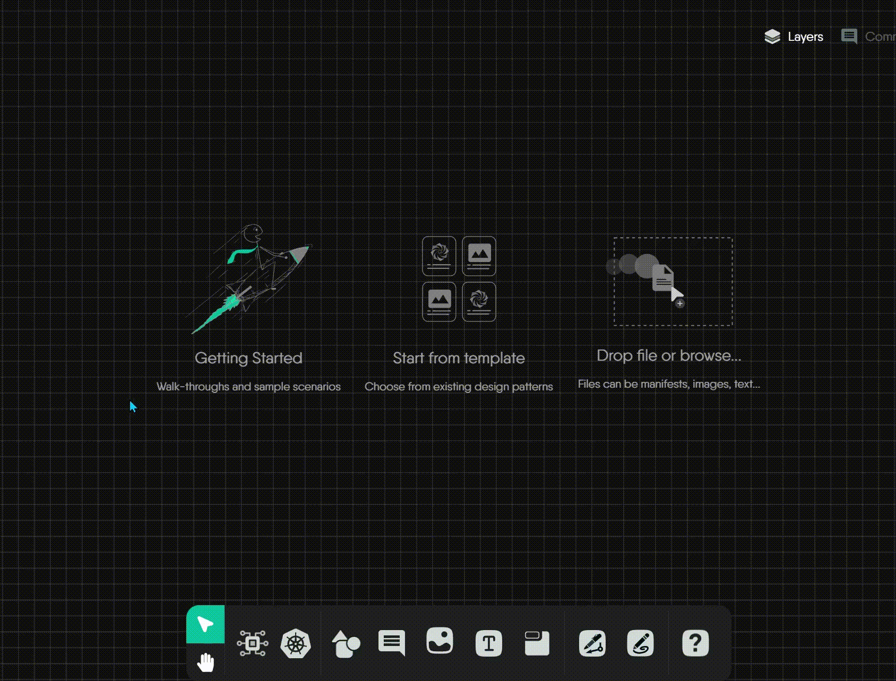
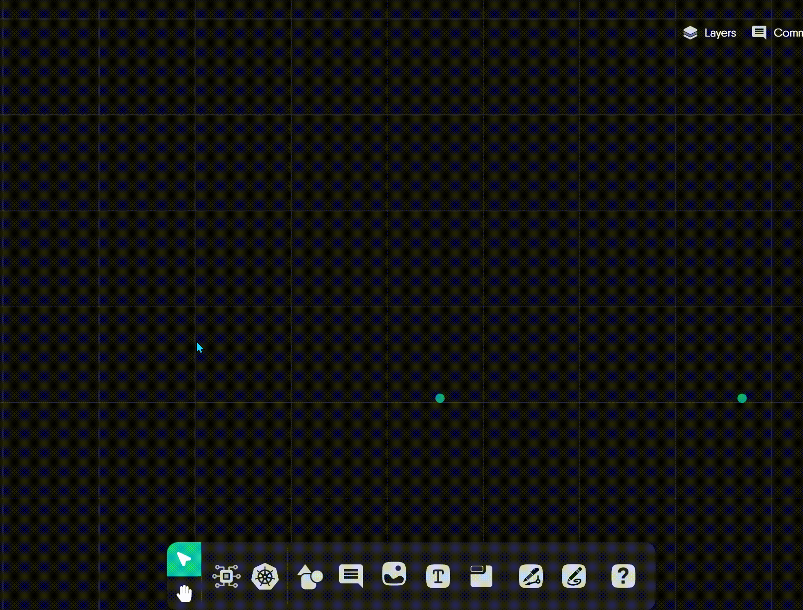
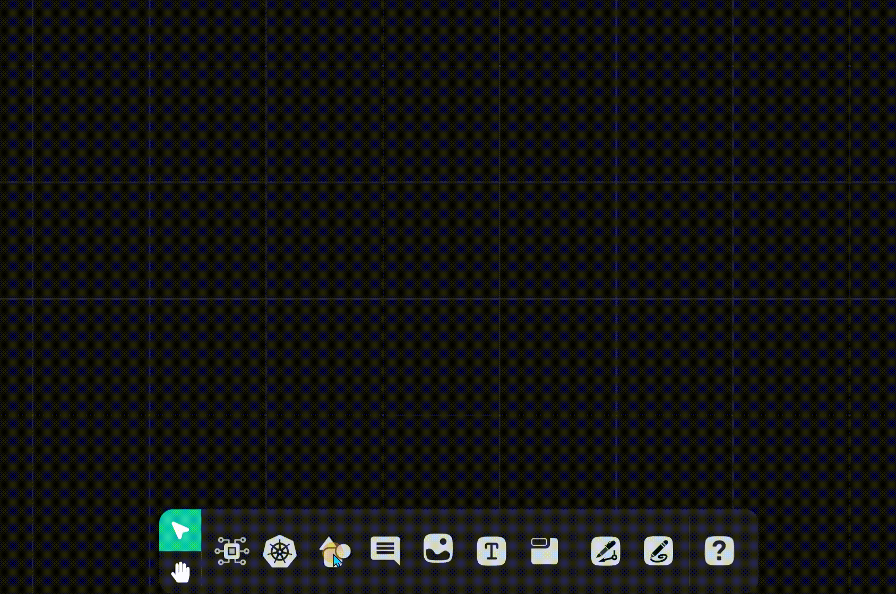
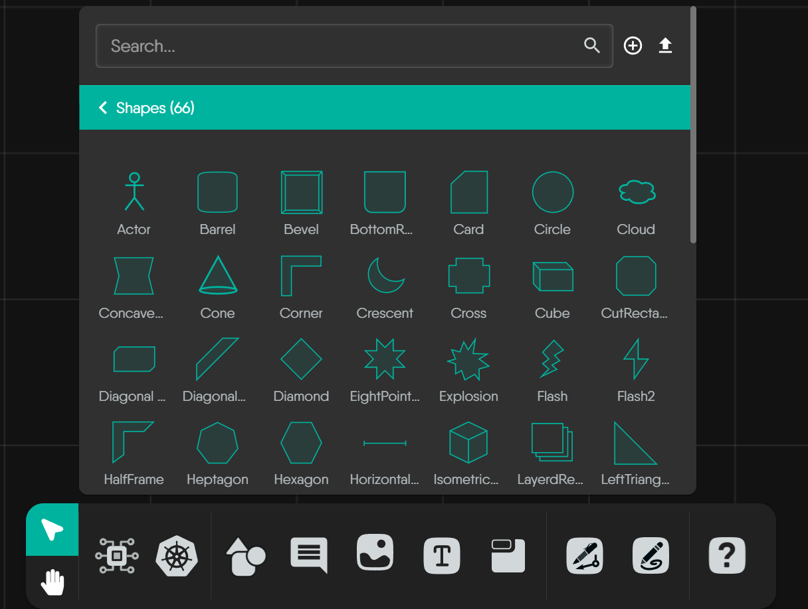
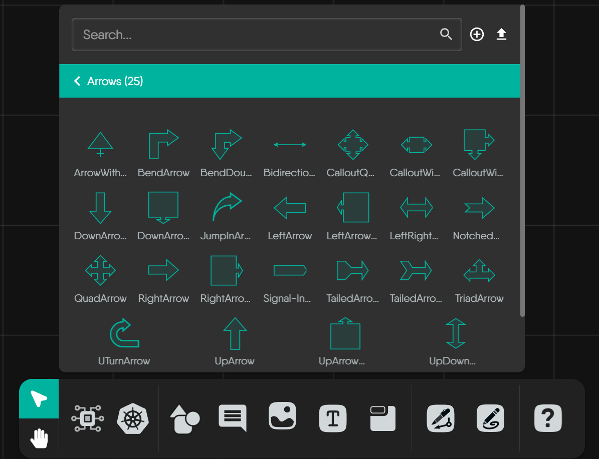
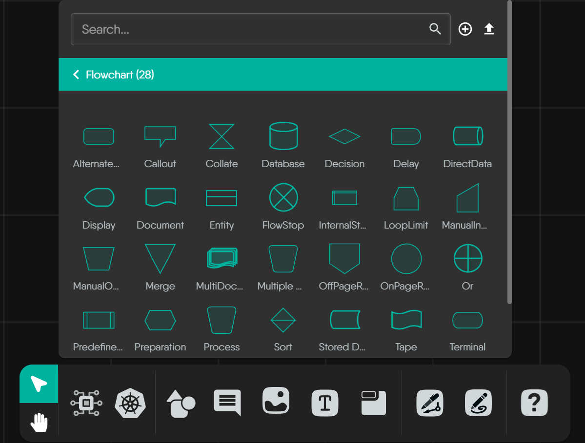
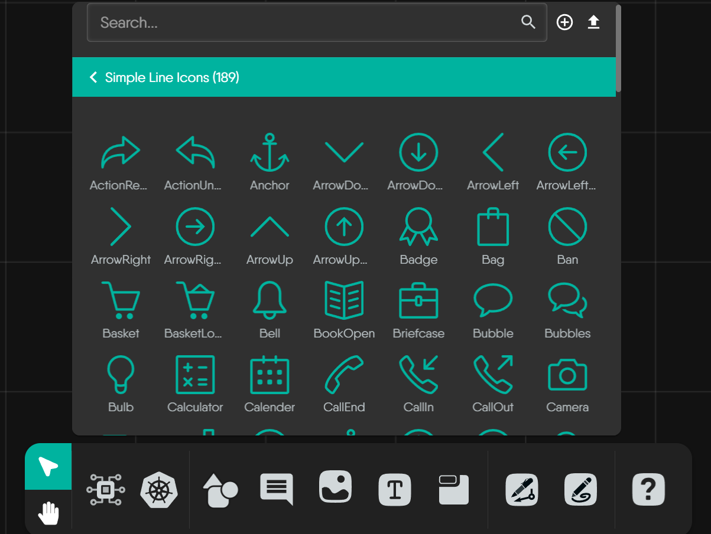
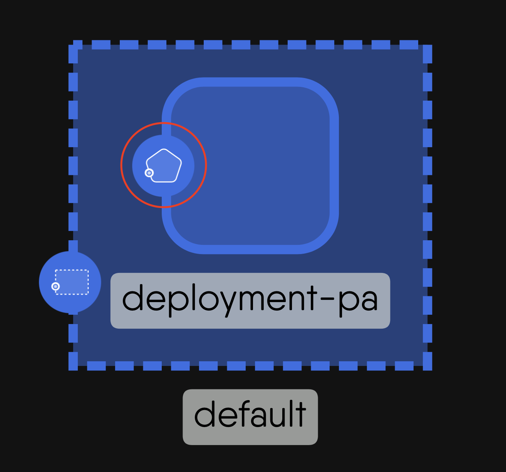
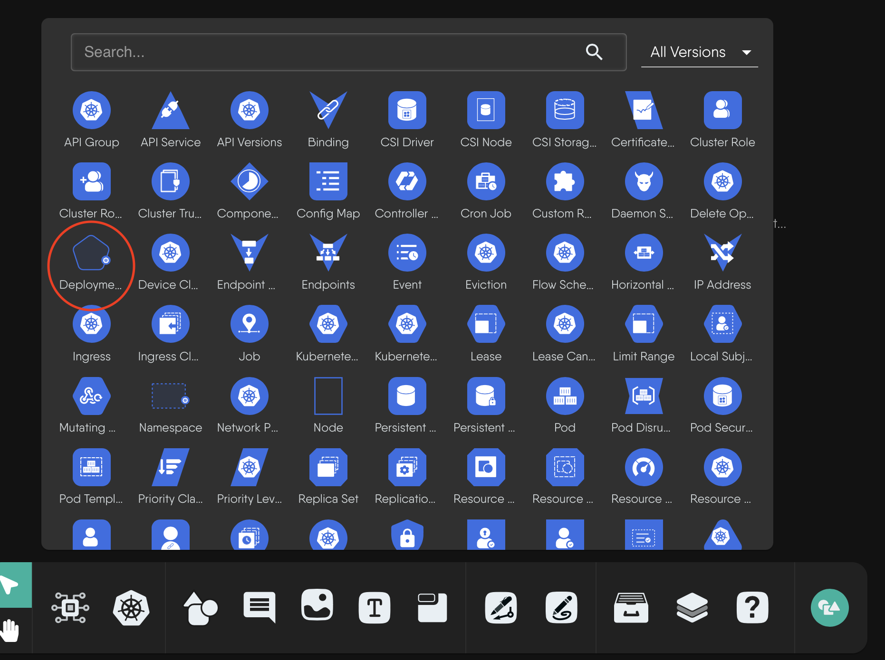
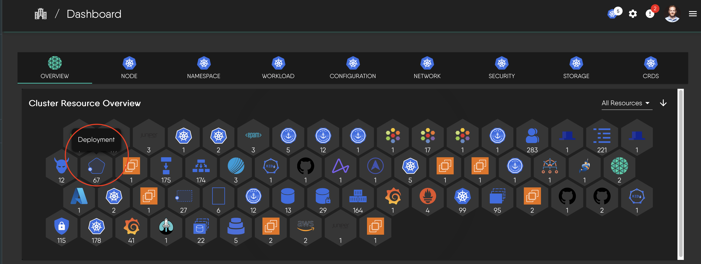

# Designs and Components

> What a Kanvas design is, how it is saved, versioned, and shared, what components are, and how a design maps to the resources it deploys.

A design is the unit of work in Kanvas. It is a declarative description of infrastructure that you author on a canvas, save as a versioned document, share with others, and deploy to your clusters. Components are the building blocks of a design: some represent real infrastructure that Kanvas deploys, and others are annotations that only explain the design. Knowing which is which, and how a design behaves when you save, share, and deploy it, tells you exactly what Kanvas will do with your work.

## What a design contains

A design holds four kinds of content:

- **Components** - the infrastructure resources in the design, such as Kubernetes Deployments, Services, or cloud provider resources, each with its own configuration.
- **Relationships** - the connections between components and what those connections mean. See [Relationships](/pr-preview/pr-1344/kanvas/concepts/relationships/).
- **Configuration** - the settings of each component.
- **Annotations** - shapes, arrows, text, and icons that document the design. Kanvas never deploys annotations.

## How designs are saved

### Naming and the saveability rule

A new, unsaved design is named "Untitled Design". Kanvas saves a new design only when it has at least one component, or a name that is not empty and not "Untitled Design". An empty, unnamed canvas is not saved. Once a design has been saved, it can always be saved again, even after you remove every component.

You cannot create a design while your organization scope is set to all organizations. Select a single organization first.

### Autosave

Kanvas saves pending changes automatically 3 seconds after you stop editing. If a save fails, Kanvas retries with a doubling delay (3 seconds, then 6, then 12, and so on) for up to 100 attempts.

### Versions

Every save creates a new version of the design. You never overwrite a previous version by saving.

## Who can see a design

A design has one of three visibility values:

| Visibility | Meaning |
|---|---|
| Public | Visible beyond its owner. Every newly created design starts as public. |
| Private | Visible to its owner. Other organization members need the "View Designs" permission to view private designs. |
| Published | Listed in the catalog. Unpublishing a design sets its visibility back to private. |

Saving an existing design never changes its visibility. Non-owners read private and published designs only when the design is shared with them or when they hold administrator rights.

## Components

[Components](https://docs.meshery.io/concepts/logical/components) in Kanvas fall into two categories, distinguished by whether Kanvas can orchestrate them during deployment.

### Semantic components (orchestratable)

Semantic components represent actual infrastructure resources. They map directly to real infrastructure elements, so Kanvas can create, configure, and manage their lifecycle during deployment. Examples include:

- Kubernetes resources (Pods, Services, Deployments)
- Cloud provider resources (AWS S3 buckets, Azure Functions)
- Infrastructure components (load balancers, databases)

Semantic components are either built in, like the Kubernetes components, or custom components that you [create](https://docs.meshery.io/guides/configuration-management/creating-models).

### Non-semantic components (annotation-only)

Non-semantic components are visual and organizational elements that document and organize your design. They do not represent deployable resources, and Kanvas ignores them during deployment. Examples include:

- Text boxes and comments
- Shapes and containers for grouping
- Arrows and lines
- Labels and tags

  <h4 class="alert-heading" style="color: #3772ff;">Visual distinction rule</h4>
  
      Semantic components have a background, which marks them as real infrastructure resources. Non-semantic components have a transparent background, which marks them as visual aids only.
  

Both kinds support visual customization. You can change a Kubernetes Pod's color, modify its shape, or replace its background logo without changing what Kanvas deploys.

### How components are organized

Kanvas draws semantic components from integration models. Kubernetes is the most common, and every integration model, such as KEDA, Prometheus, or AWS, provides components with the same orchestratable capabilities. Kanvas organizes them in a three-level hierarchy:

1. **Categories** - high-level groups, such as "Cloud Native Network" or "Database".
2. **Integration models** - specific technologies, such as Prometheus or Kubernetes.
3. **Components** - the deployable building blocks within a model.

For the full list of technologies Kanvas integrates, see the [integrations directory](https://docs.meshery.io/extensions/integrations).

### Kubernetes component conventions

Kubernetes components follow a consistent visual system, so you can identify a resource kind at a glance.

**Color and structure**

- Kubernetes component icons use a distinctive blue background.
- Every icon has the same structure: an outer shape filled with blue that encloses a white inner symbol.
- The white inner symbol identifies the specific Kubernetes kind.

**Shape as an indicator**

The outer shape identifies the component's role:

- **Triangles** mark core networking resources, such as `Service` and `APIService`.
- **Hexagons** mark foundational workload controllers, such as `StatefulSet`.
- **Unique polygons** mark specialized resources, such as `Endpoints`, `PriorityClass`, or `ValidatingWebhookConfiguration`.

### Non-semantic palettes

Kanvas provides four palettes of annotation-only components. None of them is ever deployed.

**Generic shapes** cover general-purpose diagramming.

**Arrows** show direction or create simple visual annotations. They are static shapes for illustration only. To represent a functional relationship between semantic components, such as network traffic or a dependency, use an edge instead; see the [edges shape guide](https://docs.meshery.io/extensions/edges-shape-guide).

**Flowchart shapes** document a design's logic and flow with standard flowchart symbols.

**Simple Line Icons** add icons for annotation and visual emphasis.

### One component, several representations

A semantic component looks different depending on where it appears. The Deployment component is a good example:

1. On the canvas, it has its distinctive shape and badge.

   

2. In a component selection panel, it appears as an icon.

   

3. In a cluster resource overview, it appears as a resource entry.

   

To practice reading designs, see [interpreting Meshery designs](https://cloud.layer5.io/academy/learning-paths/mastering-meshery/introduction-to-meshery?chapter=interpreting-meshery-designs) in the Layer5 Academy.

## Limits as shipped

The limits below describe Kanvas as it ships today. Current plans and their entitlements are listed at [layer5.io/pricing](https://layer5.io/pricing).

### Components per design

Kanvas enforces a maximum number of components per design whenever you save or import a design. The limit depends on your organization's plan and is the same for monthly and annual billing.

| Plan | Components per design |
|---|---|
| Personal | 100 |
| Team Designer | 200 |
| Team Operator | 100 |
| Enterprise | 300 |

When a design exceeds the limit, the save or import is rejected with HTTP 403 and the message "Design exceeds maximum limit of N components supported by your current plan", where N is your plan's limit. To proceed, reduce the number of components in the design or upgrade your plan.

If your organization is not entitled to add components to a design at all, the save fails with HTTP 500 and the message "Org is not entitled to adding components to a design".

### Files dropped on the canvas

You can drop files directly onto the canvas:

- **Image and text files** up to 500 KB are accepted. Larger files are rejected. The rejection message says "Your current plan allows files up to 500 KB", but the 500 KB limit is the same on every plan.
- **Infrastructure-as-code files**, such as Kubernetes manifests, are imported as a design.

## How a design maps to deployed resources

When Kanvas deploys a design, every resource it creates carries the identity of its source design:

| Metadata | Key | Value |
|---|---|---|
| Label | `design.meshery.io/id` | The id of the source design |
| Annotation | `design.meshery.io/version` | The version of the design that was deployed |
| Annotation | `component.meshery.io/id` | The id of the component in the design |

A resource that carries the design id label is managed by Meshery. Because the label is a standard Kubernetes label, you can also select a design's resources with your own tooling.

This metadata powers Operator's per-design view. A design's view is named "&lt;design name&gt;-View" and shows only the resources whose design id label matches that design, so you see exactly what one design produced across your clusters. See [Operator](/pr-preview/pr-1344/kanvas/concepts/operator/).

