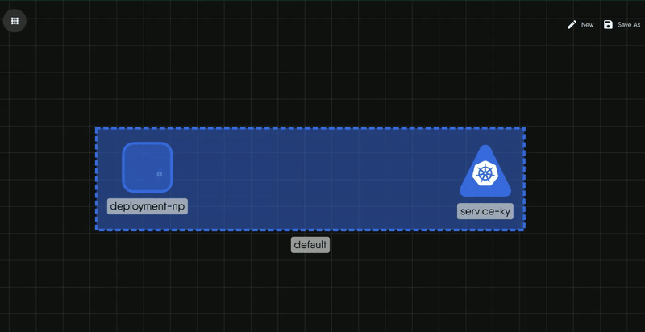
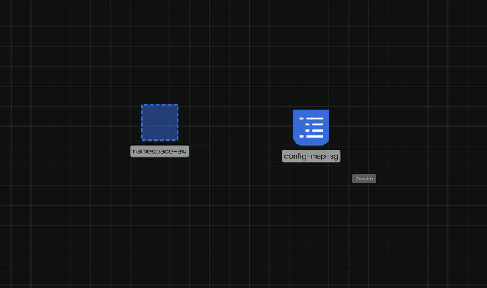
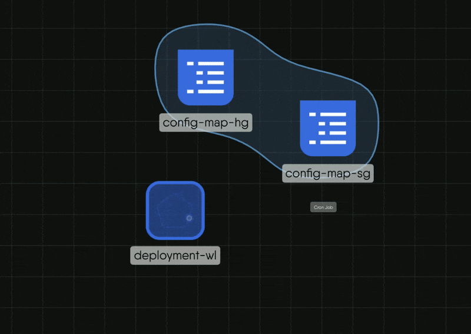
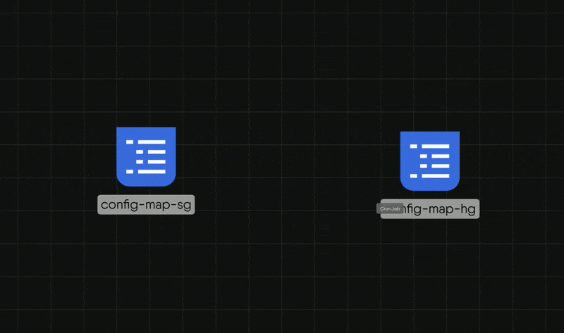
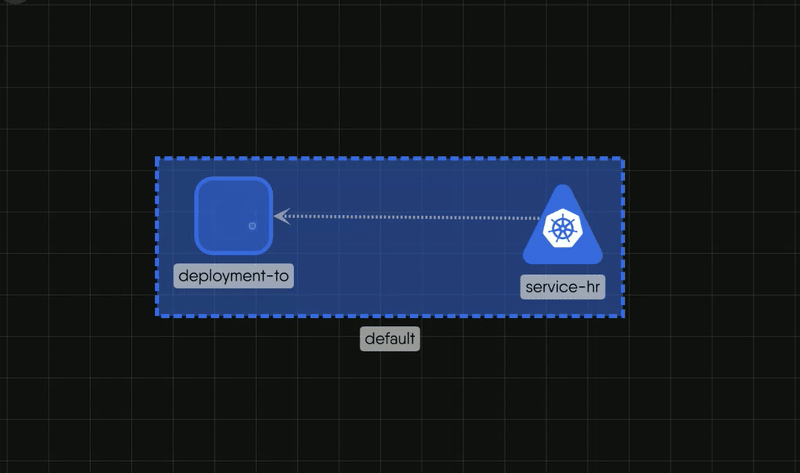
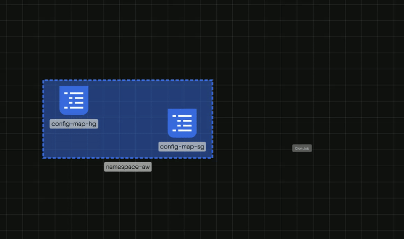
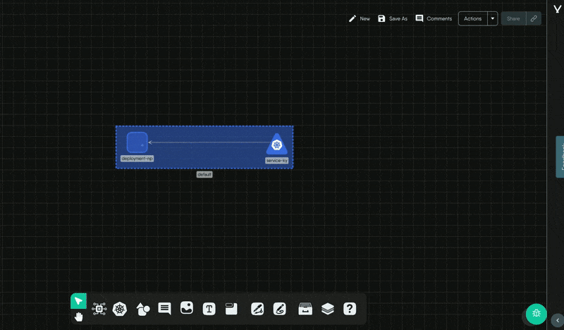

# Create Relationships

> Connect components with edges, nest them in parents, and remove or hide relationships. Covers which relationships you draw and which Kanvas forms for you.

Relationships record how components connect, and Kanvas keeps related configuration in sync once they exist. You create some relationships by hand and Kanvas creates others when it evaluates the design. This guide shows which is which, how to create each kind, and how to remove or hide them.

Relationships work only in Designer mode. For what each kind means, read [Relationships](/pr-preview/pr-1348/kanvas/concepts/relationships/).

| Kind | You create it by | You remove it by |
|---|---|---|
| Edge (network, mount, reference, and other edge subtypes) | Picking an edge from a component's handle and dragging to a target | Selecting the edge and choosing Delete |
| Hierarchical, inventory | Dropping a component onto a compatible parent | Dragging it out, or choosing Move Out of Parent |
| Hierarchical, wallet | Dropping a component onto a compatible host | Deleting the component, or choosing Move Out of Parent |
| Hierarchical, alias | Kanvas creates it during evaluation | Deleting the alias component |
| TagSets (shared labels) | Giving components matching labels | Changing the labels so they stop matching |
| Annotation edge | Drawing with the Pen tool | Selecting the edge and choosing Delete |

## Create an edge relationship

Edge relationships connect components that exchange traffic or depend on one another, such as a Service and a Deployment.

1. Hover a component to reveal arrow handles on its bottom, left, and right sides, then select one. A circular menu opens.
2. Pick a relationship from the menu. It lists every edge relationship in the registry that can start from this component, with the subtype in a tooltip. A binding relationship lists one item per component that can sit between the two ends.
3. Drag from the source to a target. Compatible targets in view get a green outline, and incompatible components dim to half opacity. Kanvas checks only the components visible in the viewport.
4. Release on a compatible target.

Releasing on an incompatible component, a non-component, or empty canvas cancels the creation without a message. A binding relationship also places its binding component between the two ends.

The edge shows an arrow and a label. Network edges label the source and target ports and protocols, read from the configuration the relationship manages.

## Nest components in a parent

Drag a component onto another and release. Valid targets are the components that form an inventory or wallet relationship with it, and Kanvas outlines them in green while you drag. The same drop works when you drag a component from the palette onto an existing component.

- **Inventory.** The child is drawn inside the parent. For example, a Pod dropped on a Namespace becomes its child. You can collapse and expand parents.
- **Wallet.** The child is absorbed into the host and shown as a green badge at the host's bottom-right corner with the item count. Select the badge to list the items, then select an item to open its configurator. A sidecar attached to a workload is an example.

A component has at most one parent. Dropping it into a new parent replaces the old relationship, and dropping it on empty canvas removes it.

## Let labels form TagSets

You never draw a TagSet. When components carry labels or annotations that match under a registry relationship definition, the next evaluation creates a TagSet and draws a translucent region around the group. See [Work with Tags](/pr-preview/pr-1348/kanvas/guides/designing/tagsets/).

## Remove a relationship

- **Edge.** Select the edge and choose Delete in its toolbar. Kanvas marks the relationship deleted, and the next evaluation reverses its effects on configuration.
- **Inventory.** Drag the child out of the parent, or right-click it and choose Move Out of Parent.
- **Wallet.** No control deletes a wallet relationship by itself. Delete the component, or choose Move Out of Parent.
- **TagSet.** No control deletes a TagSet. Change the labels so they no longer match, or hide the layer.

## Style an edge

Select an edge to open its toolbar. It offers line color, line style (solid, dashed, or dotted), curve and arrow style, a label, and an animation (none or marching ants). Styling changes only appearance.

## Hide a kind of relationship

The Layers panel lists eight relationship kinds, each with a count and a show or hide toggle: hierarchical inventory, wallet, and alias; TagSets; and edge mount, network, annotation, and reference. Open the panel with the backslash key or from the design toolbar.

Hiding a kind removes it from the canvas. It does not stop evaluation. Kanvas still evaluates the whole design, so configuration that a hidden relationship manages keeps syncing. The toggles are stored in the design, so they are saved with it, restored when it reopens, and shared with collaborators. Everything is visible by default.

## Configuration sync

When two components are related, the registry definition names which fields on each side are linked, and Kanvas writes values across them each time it evaluates the design. For example, changing a Service's port updates the matching container port on a related Deployment. The relationship definition decides the direction, so it can differ by kind. See [Policy Evaluation](/pr-preview/pr-1348/kanvas/concepts/relationship-evaluation/).

## Limits

- Kanvas draws at most 30 TagSets. Beyond that, it shows the warning "Skipped rendering of N matchlabels relationships due to limit of 30".
- TagSets render only in Full render fidelity.
- No other kind has a rendering limit.

## See also

- [Add and Configure Components](/pr-preview/pr-1348/kanvas/guides/designing/configuring-components/): the Relationships tab lists each component's relationships.

