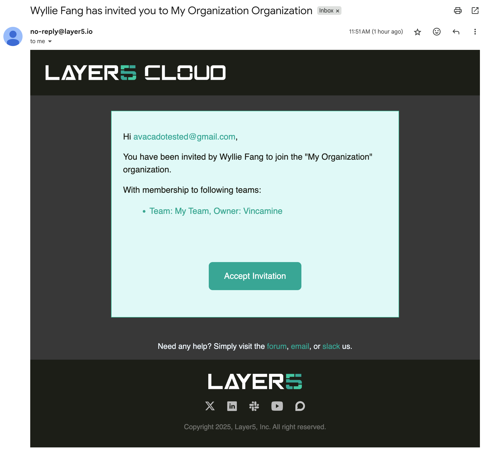
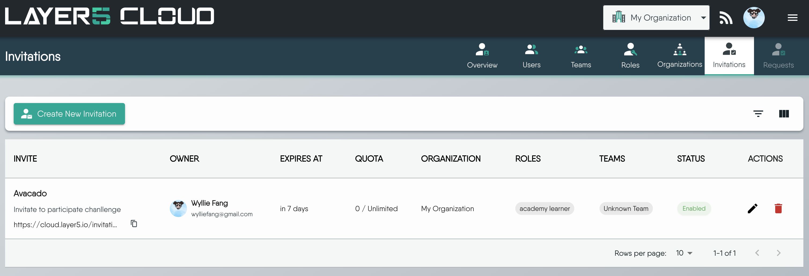

# User Invitations

> Learn how to create custom, secure, and flexible invitations for new members.

The [invitation system](https://cloud.layer5.io/identity/invitations) gives you precise control over how members join your organization, allowing you to streamline onboarding and enhance security.

You can create highly customized invitations for any scenario, from onboarding specific individuals to launching large-scale community challenges. Each invitation can be configured with expiration dates, usage quotas, and pre-assigned roles, ensuring new members get the right access from the moment they join.

  <h4 class="alert-heading" style="color: #3772ff;">Required permission</h4>
  
      From Layer5 Cloud v1.0.293, creating, editing, and deleting invitations requires the <strong>Manage Invitations</strong> permission within your organization. That one permission also covers choosing the roles and teams an invitation grants, so anyone who can write an invitation, Academy Admins included, can specify its roles. Contact your organization administrator if you need access.
  

### Default organization state

By default, organizations are **closed**: there is no open registration. A user cannot join your organization simply by navigating to a URL. They must either open a valid invitation link or sign in through a page associated with an organization that has a [default invitation](#invitation-properties-explained) configured.

When no default invitation is set, new users who arrive at your organization's registration page are registered as platform users but are **not** automatically added to your organization. They will have no organization membership and no roles until an administrator adds them or they accept an invitation link.

  <h4 class="alert-heading" style="color: #3772ff;">Two ways to designate the open signup invitation</h4>
  
      
An organization&rsquo;s open signup invitation can be set in two places: the invitation picker in <strong>Edit Organization</strong>, or the <code>isDefault</code> setting on the invitation itself.

The <strong>Edit Organization</strong> selection takes precedence. The <code>isDefault</code> marker is used when no selection has been made there, or when the invitation that selection points at no longer exists.

  

  <h4 class="alert-heading" style="color: #3772ff;">Roles are not assigned automatically</h4>
  
      When a user joins an organization via invitation, they receive only the roles explicitly listed on that invitation. If the invitation has no roles configured, the user joins with no role. Use the <code>roles</code> field on each invitation to ensure new members receive the correct initial permissions.
  

### Key capabilities

The invitation system provides three main areas of control to help you manage access effectively.

#### Create custom invitations for any audience
Tailor each invitation to your specific needs with three flexible modes:
- **Precise invitation**: Target a single user by specifying their full email address.
- **Domain-wide invitation**: Onboard an entire organization at once by allowing any email from a specific domain (e.g., `@layer5.io`).
- **Public invitation**: Leave the email field blank to create an open link for public events (e.g., Academy Challenge invitations).

  <h4 class="alert-heading" style="color: #EBC017;">Use domain wildcards carefully</h4>
  
      Patterns like <code>@company.com</code> allow anyone with that domain. Verify ownership and pair with roles and teams that grant only necessary access.
  

#### Control the invitation lifecycle
Manage access with settings that put you in control:
- **Expiration date**: Set a specific date and time after which the invitation link can no longer be used to join. This prevents new signups but does not affect members who have already accepted the invitation.
- **Usage quota**: Limit the number of times an invitation can be used. The invitations table shows current acceptance count alongside the limit (e.g., `2 / 5`).

  <h4 class="alert-heading" style="color: #3772ff;">Blank means unlimited</h4>
  
      If <code>expiresAt</code> is not set, the invitation never expires. If <code>quota</code> is not set, the invitation has unlimited uses.
  

#### Manage invitations dynamically
Instantly revoke access by switching an invitation's status between **enabled** and **disabled** at any time. A disabled invitation can be re-enabled later without recreating it.

### How to create an invitation

To create a new invitation, navigate to the [Invitations page](https://cloud.layer5.io/identity/invitations) from the main menu. Click the **Create New Invitation** button to open the creation dialog.

  <h4 class="alert-heading" style="color: #3772ff;">Email notifications</h4>
  
      After an invitation is created, a notification email is sent only to addresses listed in the <code>emails</code> field that are exact email addresses. Domain-wide patterns (e.g., <code>@layer5.io</code>) and public invitations (empty <code>emails</code> field) do not trigger individual notification emails. Share the invitation link directly in those cases. The email is sent at creation only. Editing an invitation does not send it again, and there is no resend. A failed send does not fail the creation. Sending stops at the first failure, so addresses after it are not emailed. The subject reads <code>&lt;Inviter name&gt; has invited you to &lt;Organization name&gt; Organization</code>. The body names the organization and the teams you pre-assigned, and carries an Accept Invitation button. It does not list roles. The sender is your organization&rsquo;s mail configuration when set, otherwise the deployment default. See <a href="/pr-preview/pr-1351/cloud/guides/organizations/org-management/bring-your-own-mail-server/">Bring Your Own Mail Server</a>. Address matching is exact and case-sensitive: <code>User@Example.com</code> does not match <code>user@example.com</code>.
  

#### Invitation properties explained

| Property | Description |
| :--- |  :--- |
| `emails` | List of email addresses or domain patterns allowed to use the invitation. Exact addresses (e.g., `user@example.com`) and domain patterns (e.g., `@example.com`) are both supported. If empty, the invitation is public: any email address can use it. |
| `roles` | List of roles automatically assigned to new members upon accepting the invitation. If empty, the user joins with no role. Each role must be an existing organization role. Provider-wide roles, such as Provider Admin, cannot be granted by an invitation, and an invitation listing one, or a role that does not exist, is refused when it is created or edited. |
| `teams` | List of teams new members are automatically added to upon accepting the invitation. If empty, the user joins no team. Each team must be an existing team of your organization; an invitation listing any other team is refused when it is created or edited. |
| `quota` | Number that limits how many users can accept the invitation. If not set, or set to 0, there is no usage limit. |
| `expiresAt` | Date after which the invitation link can no longer be used. Does not affect existing members. If not set, the invitation never expires. |
| `status` | Invitation status: `enabled` = active and usable; `disabled` = inactive (can be re-enabled later). |
| `name` | A human-readable name used to identify the invitation. Required in the form, up to 255 characters. |
| `description` | Additional information about the invitation's purpose, for internal reference, up to 5000 characters. |
| `acceptanceOutcome` | What accepting does. `direct_membership` (the default) makes the person a member of the inviting organization. `child_organization` creates a new organization for the person beneath it. Creating or editing a `child_organization` invitation requires Create Organization in the inviting organization. |
| `childOrganizationBranding` | Branding copied onto a child organization created by a `child_organization` invitation. Ignored for `direct_membership`. See [Branding of a child organization](#branding-of-a-child-organization). |
| `isDefault` | When enabled, marks this invitation as the organization's open signup invitation. Users who register through your organization's registration page are automatically enrolled through this invitation, receiving the pre-configured roles and teams. Without a default invitation, the registration page does not automatically add users to the organization. Only one invitation can be designated as the default at a time. Designating a new one clears the previous. Turning this setting on or off requires the **Manage Invitations** permission. Editing any other property of an invitation does not, and leaves the setting as it was. An edit that omits this property leaves it unchanged. The Open Org Invitation selection on the organization wins when it names an invitation that exists in the same organization. A selection that points at a deleted invitation, or at another organization's invitation, is ignored and the `isDefault` invitation is used. |

### Managing existing invitations

All existing invitations are displayed in a table showing key details for each invitation: its name and description, a copyable acceptance link, the owner, expiration date, quota usage, assigned roles and teams, and current status.

You can filter the list using the filter control at the top right of the table. Available filters are:
- **Status**: show only enabled or disabled invitations
- **Roles**: show invitations that grant a specific role
- **Teams**: show invitations that add members to a specific team

From the table you can perform the following management actions on each invitation:

* **Copy Link**: Click the copy icon next to the invitation URL to copy it for sharing.
* **Edit Invitation**: Click the pencil icon to open the edit dialog and modify any invitation properties.
* **Delete Invitation**: Click the trash icon to permanently remove the invitation. This action cannot be undone.

If another administrator deletes an invitation while your edit dialog is open, saving reports that the invitation was not found rather than reporting success. Close the dialog and reload the invitations table to see the current list. Whenever an edit cannot be saved, the dialog reports the specific reason it was refused.

### Tracking who has accepted an invitation

The **Quota** column in the invitations table always shows the number of users who have accepted an invitation alongside the configured limit, for example `2 / 5` if a quota is set, or `2 / Unlimited` if no quota is configured. This lets you monitor uptake at a glance. Disabling or deleting an invitation never removes people who already accepted. Delete has no confirmation step. Expiry stops new people only.

To see the individual users who are now members of the organization, navigate to the [User Management](/pr-preview/pr-1351/cloud/concepts/identity-and-security/users/user-management/) page. Members who joined via invitation appear there alongside their assigned roles.

### What happens when a user accepts an invitation

When a user clicks an acceptance link and is logged in, the system performs the following steps in order. Steps 4 to 6 describe a `direct_membership` invitation, the default. A `child_organization` invitation replaces those steps, as described after the list.

1. **Validates the invitation**: confirms it exists, is `enabled`, has not passed its expiration date, and has not exceeded its quota. A person who already accepted is also refused once the quota is full.
2. **Checks email eligibility**: verifies the user's email matches the invitation's `emails` list. An empty list allows any email (public invitation). Matching is exact and case-sensitive.
3. **Checks verification** for a `direct_membership` invitation: an account whose email address is not yet verified is not placed. The invitation applies at the person's first verified sign-in. A `child_organization` invitation is not held for email verification.
4. **Adds the user to the organization**: the user becomes a member of the organization that owns the invitation. An existing member is not added twice.
5. **Assigns roles**: listed roles the person lacks are assigned. If no roles are configured, a new member joins with no role. Existing roles are kept.
6. **Adds the user to teams**: the user is added to listed teams they are not already in.

The first failing check stops the acceptance and nothing is written. The person sees `The invitation cannot be applied to this user` with one of these reasons: `invitation no longer exists`, `invitation is not enabled`, `invitation has expired`, `invitation has reached its quota`, `email is not on the invitation's allowlist`, or `account email address is not verified yet`.

Assignments are additive. An existing member keeps what they have, gains any listed roles and teams they lack, and loses nothing. The first acceptance counts against the quota, including for someone who was already a member. Accepting again does not use more of the quota. Each acceptance writes one event, `<email> accepted invitation "<name>"`. Creating, editing, and deleting invitations write no dedicated event.

For a `direct_membership` invitation, role and team assignment failures are non-blocking: the user is still added to the organization even if an individual role or team assignment fails. The page then shows an **Error Accepting Invitation** message with the probable cause and remediation, and offers **Retry** and **Go to dashboard**. Retrying is safe: it does not duplicate the membership or the acceptance. A stored team that has left the organization is skipped and recorded on the acceptance event, and the acceptance still succeeds.

For a `child_organization` invitation, the user is not added to the inviting organization. Instead, a child organization is created for them with the invitation's roles and teams applied inside it, as described in [Choosing what accepting an invitation does](#choosing-what-accepting-an-invitation-does). That acceptance is all or nothing: if any part of it fails, including a single role or team, nothing is created and the acceptance is not counted against the quota.

### Choosing what accepting an invitation does

Every invitation has an `acceptanceOutcome` that decides where the accepting user ends up.

In the **Create New Invitation** and **Edit Invitation** dialogs, choose it under **When accepted**. **Direct membership** is selected by default. **Child organization** appears only if you have the **Create Organization** permission in the current organization. If you lack that permission and edit an invitation that already uses Child organization, the option is shown selected but cannot be changed.

| `acceptanceOutcome` | Result of accepting |
| :--- | :--- |
| `direct_membership` (default) | The user joins the inviting organization with the invitation's roles and teams, as described above. |
| `child_organization` | A new organization named **My Organization** is created as a child of the inviting organization. The user is its owner and Organization Admin, it gets the standard **My Team** and **My Workspace**, the invitation's roles are granted in it, and teams with the same names and descriptions as the invitation's teams are created in it with the user as a member. The user does not become a member of the inviting organization, and the inviting organization's own teams are unchanged. |

A few things hold for both outcomes:

- Every team listed on an invitation must belong to the inviting organization. An invitation that lists another organization's team is refused when it is created, edited, or accepted.
- Accepting is counted once per person. Accepting the same invitation again does not create a second child organization or use more of the quota.
- When someone creates a new account through your organization's open signup invitation, they do not also receive a separate personal organization; the invitation decides where they land. If the invitation turns out not to apply (for example, its quota is used up), a personal organization is created for them as usual.

#### Branding of a child organization

A child organization created through a `child_organization` invitation starts with your organization's branding by default. The invitation's `childOrganizationBranding`, shown in the invitation dialogs as **Child organization branding**, can change that. It is ignored for `direct_membership`.

| `childOrganizationBranding` | The child organization starts with |
| :--- | :--- |
| `parent` (default) | A copy of your organization's branding: theme (logos and colors), sign-in page branding, links (including social profiles), and the sign-in page carousel setting. |
| `provider` | A copy of the platform provider's branding. |
| `none` | No branding of its own. |

The copy is taken once, when the child organization is created. Later changes to your branding are not carried over, and changes the child organization's admins make do not affect yours. Organizations created directly, not through an invitation, are unaffected.

#### Email verification

Someone who signs up with email and password through your open signup invitation must verify their email address before a `direct_membership` invitation adds them to your organization. Until then they are not a member, and they cannot sign in. They join on their first sign-in after verifying. A `child_organization` invitation does not wait: the new account's own child organization is created at sign-up, because it gives the person nothing of yours beyond a place beneath you. Either way the account becomes active once the address is verified.

### How the open signup invitation is applied at sign-in

The open signup invitation is not limited to first-time registration. It is applied whenever someone signs in through your organization's own address, such as its custom domain, on every sign-in method that address offers, including email and password as well as social sign-in. Someone who already has a Layer5 Cloud account and has never been a member of your organization becomes a member on that sign-in, with the roles and teams the invitation configures. When the open signup invitation is a `child_organization` invitation, that person instead receives their own child organization beneath yours, as described in [Choosing what accepting an invitation does](#choosing-what-accepting-an-invitation-does).

It is applied only to people who are not already members, which has two consequences worth knowing:

- **Roles and teams are never re-applied to an existing member.** If you remove a role or a team from someone who joined this way, signing in again does not restore it.
- **Each person is counted once.** Repeated sign-ins by the same person do not increase the invitation's acceptance count or add them to the organization a second time.

  <h4 class="alert-heading" style="color: #EBC017;">When open signup adds nobody</h4>
  
      
A person can sign in successfully and still not join your organization. The open signup invitation is applied only when all of the following hold:

<ul>
<li>Its status is <code>enabled</code>.</li>
<li>Its expiration date has not passed.</li>
<li>Its quota has not been reached.</li>
<li>The person&rsquo;s email address matches its <code>emails</code> list. An empty list matches everyone.</li>
<li>For a direct membership invitation, the person&rsquo;s email address is verified.</li>
</ul>

When one of them does not hold, someone who is not already a member signs in as a platform user with no membership and no roles in your organization, and no error is shown to them. Existing members are unaffected: they keep the membership, roles, and teams they already have. Check these four properties first when people who sign in at your organization&rsquo;s address are not appearing under <a href="/pr-preview/pr-1351/cloud/concepts/identity-and-security/users/user-management/">User Management</a>.

  

### Use cases and examples

The invitation system offers flexible configurations to fit a variety of use cases.

  <h4 class="alert-heading" style="color: #3772ff;">How invitation links handle unauthenticated users</h4>
  
      When a user who is not logged in clicks an invitation link, the system saves the invitation ID in a short-lived 30-minute cookie and redirects them to the organization&rsquo;s registration page. After a successful login or signup, the system reads the cookie and automatically completes the invitation acceptance with the outcome the invitation&rsquo;s <code>acceptanceOutcome</code> selects: membership in the organization with the configured roles and teams, or a new child organization.
  

#### Scenario 1: Inviting a single team member

- **Goal**: Provide a new employee with a secure, single-use invitation that grants the correct initial permissions.
- **Configuration**:
  - Email: Set to the new member's specific email address.
  - Roles: Assign their specific role (e.g., `Developer`).
  - Teams: Add them directly to their project team (e.g., `Frontend-Team`).
  - Quota: Set to `1` to ensure the link is only used once.

#### Scenario 2: Opening registration for an entire organization

- **Goal**: Allow all employees from your company to join using their corporate email without individual invitations.
- **Configuration**:
  - Email: Use a domain pattern to cover all employees (e.g., `@yourcompany.com`).
  - Roles: Assign a default role for all new members.

#### Scenario 3: Launching a community challenge

- **Goal**: Create a public signup link for a limited-time community event with a maximum number of participants.
- **Configuration**:
  - Email: Leave blank for public access.
  - Name: Give it a clear name like "Layer5 Challenge 2025".
  - Expiration date: Set to the date and time the challenge registration closes.
  - Quota: Set to the maximum number of participants (e.g., `100`).
  - Roles: Assign Academy Learner if that is the access they should have.

  <h4 class="alert-heading" style="color: #3772ff;">Learners and billing</h4>
  
      Invitations are not limited by plan, and a seat count does not block someone from accepting. A member whose only role is Academy Learner is excluded from the billable user count. See <a href="/pr-preview/pr-1351/cloud/concepts/identity-and-security/users/user-management/#billing-and-seats">User Management</a>.
  

#### Scenario 4: Granting temporary partner access

- **Goal**: Give an external partner secure access to specific resources only for the duration of a project.
- **Configuration**:
  - Email: Use the partner's domain (e.g., `@partner.com`).
  - Teams: Add them only to a shared project team (e.g., `Project-X-Shared`).
  - Expiration date: Set to the project's end date to prevent new signups after the project concludes.
  - Description: Add a note for internal reference, such as "Temporary access for Project X contractors".

  <h4 class="alert-heading" style="color: #EBC017;">Expiration does not remove existing members</h4>
  
      Setting an expiration date prevents new users from using the invitation link after that date. It does not automatically remove partners who have already joined. When the project ends, manually remove those users from the organization or team.
  

  <h4 class="alert-heading" style="color: #EBC017;">Public invitations</h4>
  
      Public links can be forwarded broadly. Always set an expiration date and a quota to limit unintended signups.
  

## Review Access Requests

An access request is a person asking for access to a Layer5 product capability, such as Kanvas. Layer5 Cloud collects these as signup requests in a queue. A Provider Admin reviews the queue, then approves or denies each request. Approval grants the requester Kanvas access and, for someone without an account, creates one.

This is not a request for access to a specific design, workspace, or environment. A denial does not restrict any resource. To let people join your organization, use an invitation. To limit what a member can do, change their roles or remove them from the organization.

### Who can review requests

Reviewing requests is a Provider Admin capability. Organization Admins cannot review or decide requests.

| Task | Needs |
| --- | --- |
| Open the User Requests page | View All Access Requests, held by Provider Admin |
| Approve a request | Accept Access Request, held by Provider Admin |
| Deny a request | Deny Access Request, held by Provider Admin |
| Approve or deny from a notification link | Signed in as a Provider Admin |

Anyone who is signed in can file a request. Filing needs no role.

### How requests arrive

A signed-in person files a request from the Playground card on their dashboard. The request is stored with the person's name and email, a form type, a status, and a task link. A request filed this way carries placeholder values that appear as-is in the queue: form type `Cloud`, organization `Cloud org`, occupation `Cloud user`, a placeholder task link, and a role taken from the person's first role or `cloud user`.

A new account receives the Kanvas (`meshmap`) role at its first sign-in, so the queue matters mainly for existing accounts that do not hold it.

A request needs an email, a first name, a last name, and a valid task link. A request that omits one is refused with a message naming the missing field. Creating a request sends no email or notification.

### Review the queue

The User Requests page lists ID, name, last name, email, occupation, organization, role, form type, status, task ID, task, and created time. Processed rows are shaded. The default view is pending requests only. Filter by status (Pending, Approved, or Denied) or by form type (Meshmap, Docker Extension, Playground, or Event). Requests filed from the dashboard card are stored with form type `Cloud` and are not reachable through the form type filter. Find them with search or by clearing the form type filter. Search is a case-insensitive substring over first name, last name, email, organization, and task link. Order by created time or updated time.

### Approve a request

Approval acts only on a request whose status is pending. Layer5 Cloud then:

1. Looks for an existing account with the request's email address.
2. If an account exists, adds the `meshmap` role to it. Roles the account already holds stay in place. The person receives a role-change email.
3. If no account exists, creates one with the request's name and email, marks the email verified, and sets the account up so the person can sign in.
4. Saves the status as approved.
5. Sends the request to the deployment's signup-request webhook, which notifies the requester and updates the request's tracking task.
6. Records an event: `<admin email> approved signup request for <email>`.

Approval has no confirmation step. If the webhook call fails, the status stays saved and you see the failure, so the request does not return to pending. A request with form type `epsma-book` skips steps 1 to 3: approval only records the status and sends the notification.

### Deny a request

Denial asks for confirmation. It sets the status to denied, sends the same webhook notification, and records `<admin email> denied signup request for <email>`. Denial removes nothing. It does not remove a role or an account, and it does not restrict any resource. It closes the request.

### Approve or deny from a link

Notification links open the decision directly. The link requires a Provider Admin session. If you are signed out, you are sent to sign in and returned to the page. A person who is not a Provider Admin receives `Forbidden`. If the request is no longer pending, you are sent to the User Requests page with a notice that it was previously processed, and nothing changes. Opening one of these links changes the request. Treat them like a button, and do not open them to preview.

| Situation | Result |
| --- | --- |
| The request is not pending | `signup request for <email> previously processed`. Nothing changes. |
| The request id is unknown | `unable to get signup request`. |
| The caller is not a Provider Admin | `Forbidden`. |
| Approval cannot create the account | `cannot create account at the moment`, with the cause from the identity provider. |
| The webhook call fails | An error is shown and an alert event is recorded. The status is already saved. |

Statuses are `pending`, `approved`, and `denied`. A processed request cannot be decided again. Catalog publishing uses a separate approval queue.

