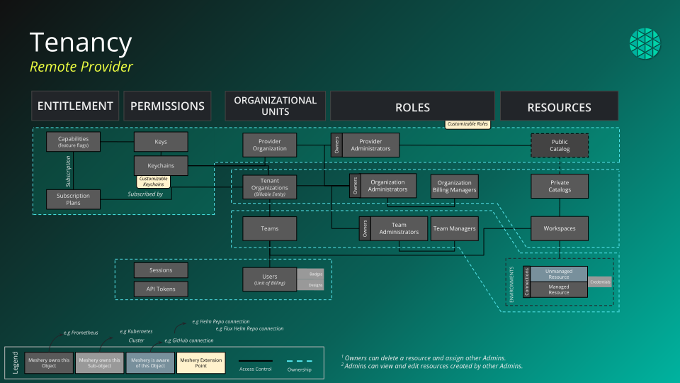

# Concepts

> An overview of Layer5 Cloud concepts and their relationships.

Layer5 Cloud organizes people, infrastructure, and designs into a small set of building blocks. Permission checks, sharing, and the rest of this documentation depend on how those blocks fit together.

## Core Entities

* **User.** One person's account and identity. A user exists independently of any organization, can own resources such as workspaces, designs, connections, and tokens, and is the actor every action is attributed to.
* **Organization.** The unit of tenancy and the core security boundary. Teams and workspaces belong to an organization, and resources, billing, and access control are isolated per organization.
* **Team.** A group of users inside one organization. Teams are how you grant a set of people access to workspaces and to the resources in them.
* **Workspace.** A shared space inside an organization where teams collaborate. A workspace groups designs and environments. A design belongs to at most one workspace at a time.
* **Environment.** A named group of connections, such as Kubernetes clusters or Prometheus instances, and the credentials they use. Assigning an environment to a workspace makes its connections available to that workspace.
* **Design.** A description of infrastructure that you author in Kanvas and deploy through Meshery. A design is owned by a user and lives in at most one workspace.
* **Catalog.** The public collection of published designs. Anyone can browse it. Signed-in users with the Clone Design permission can clone a published or public design from it.
* **Connection.** A resource that Meshery Server registers with Cloud, including the Meshery Server itself. A connection is owned by the user who registered it. Each user sees their own connections.

- [Spaces](spaces/) explains workspaces, environments, and workspace management.
- [Identity and Security](identity-and-security/) explains organizations, teams, users, access control, roles, keychains, keys, tokens, and sessions.
- [Catalog](/pr-preview/pr-1351/cloud/concepts/catalog/) explains how designs are published, discovered, and cloned.
- [Meshery Server Registration](meshery-server-registration) explains how a Meshery Server registers with Cloud. Cloud recognizes an existing registration by kind `meshery`, the authenticated owner, and `metadata.serverId`.

---

### Understanding Relationships

| Relationship | Cardinality | What it means |
| :--- | :--- | :--- |
| User and organization | Many-to-many | A user can belong to any number of organizations, and an organization has any number of users. |
| Organization to team | One-to-many | A team belongs to the organization it is created in. An organization can have any number of teams. |
| User and team | Many-to-many | A team can have any number of users, and a user can belong to any number of teams. |
| Organization to workspace | One-to-many | Organizations own workspaces. Each workspace belongs to one organization. |
| Team and workspace | Many-to-many | A workspace can have zero or more teams, and a team can have access to several workspaces. |
| Workspace and environment | Many-to-many | A workspace can have zero or more environments, and the same environment can be assigned to several workspaces. |
| Environment and connection | Many-to-many | An environment groups any number of connections, and the same connection can be assigned to several environments. |
| Workspace to design | One-to-many | A design belongs to at most one workspace at a time. Assigning a design to a workspace moves it out of its previous workspace. |
| User to connection | One-to-many | Connections, including registered Meshery Servers, are owned by a user. Each user sees their own connections. |
| Design to catalog | Many-to-one | Published designs appear in the one public catalog, where others can view them and clone them. |

Team membership grants access through workspaces. A user who does not own a connection reaches it through a team that has access to a workspace, which has an environment, which contains the connection. That path grants read-only access to the connection.

### Next Steps

The sections below describe how roles attach to these blocks, what a new account receives, and how Layer5 Cloud works as a Meshery remote provider. Meshery's own component layout is documented at [docs.meshery.io/architecture](https://docs.meshery.io/architecture).

## How roles, keys, and keychains attach

- **Keys** are the atomic permissions. Each key names one operation, such as creating a workspace or cloning a design.
- **Keychains** group related keys.
- **Roles** carry keychains and are assigned to users. Roles are evaluated per organization, so the same person can hold different roles, and therefore different capabilities, in each organization they belong to. Roles are assigned at the provider, organization, team, and workspace levels.

The built-in roles are Provider Admin, Organization Admin, Organization User, Team Admin, Workspace Admin, Workspace Manager, Environment Management, Curator, and Kanvas. The Kanvas role is global rather than scoped to an organization: it grants the Kanvas extension capabilities when a Meshery Server connects to Cloud on your behalf.

An individual resource such as a single design can be shared with a specific user. That grant covers only that resource and works across organization boundaries.

## What every new account gets

Cloud provisions a default organization, team, and workspace the first time a new account signs in successfully. Submitting the sign-up form alone does not create them. Email sign-up signs you in immediately, so that first sign-in happens as part of registration. You can rename the organization and the workspace at any time.

| Created | Name and description | Your relationship to it |
| :--- | :--- | :--- |
| Organization | My Organization, "Default Organization" | Owner, with the Organization Admin role |
| Team | My Team, "Default Team", attached to My Organization | Team Admin role |
| Workspace | My Workspace, "Default Workspace", in My Organization | Owner |
| Global role | Kanvas | Assigned to every new user |

If any of your organizations has no workspace, Cloud creates My Workspace in it for you.

## How Layer5 Cloud works with Meshery and Kanvas

Layer5 Cloud is a [Meshery remote provider](https://docs.meshery.io/extensibility/providers). Meshery Server delegates identity, tenancy, and persistence to it, and Kanvas, which runs inside Meshery, reaches it through Meshery Server.

<figure>
  
  <figcaption>Read the diagram from left to right. Providers sit on the left: Meshery runs with either a remote provider, which is the role Layer5 Cloud plays, or a local provider. The remote provider handles identity, tenancy, and the storage and sharing of designs. Meshery sits in the middle and mediates every request between the provider and your infrastructure. Your clusters sit on the right, where Meshery Operator runs MeshSync and Meshery Broker to report live state back to Meshery. Meshery, not the provider, is drawn connecting to the clusters and adapters on the right.</figcaption>
</figure>

### What Cloud provides to a connected Meshery Server

When a Meshery Server uses Layer5 Cloud as its provider, Cloud supplies four things:

- **Identity and sign-in.** Cloud authenticates the user and hands Meshery Server a token. Cloud publishes the keys that verify its tokens, as a JSON Web Key Set, at its unauthenticated `/keys` endpoint.
- **Tenancy.** Cloud holds the organizations, teams, workspaces, environments, and roles that decide what a user can see and do.
- **Persistence.** Cloud stores designs and their versions, records who each design is shared with, hosts the [catalog](/pr-preview/pr-1351/cloud/concepts/catalog/), and keeps the event log.
- **A capabilities document.** Cloud tells Meshery Server which features the provider offers to the current caller, and Meshery and Kanvas enable only those features.

Meshery Server also registers itself with Cloud as a connection owned by the signed-in user. See [Meshery Server Registration](/pr-preview/pr-1351/cloud/concepts/meshery-server-registration/).

### The sign-in handoff

A Meshery Server, or Kanvas, does not collect credentials itself. It hands the browser to Cloud and waits for a token to come back:

1. The client sends the browser to Cloud's sign-in with a source: the address of its own token callback, encoded in base64url.
2. The user signs in to Cloud. If the browser already holds a live Cloud session, Cloud skips the sign-in page.
3. Cloud returns the browser to the source's token endpoint with a token and the original reference in the query string.

The token callback path is `/api/user/token` or `/api/token`. Older Meshery Servers send `/user/login` or `/login`, and Cloud rewrites those to the current paths, so older servers keep working.

If the user was working anonymously and the handoff carries the anonymous identity, Cloud moves the designs created under that anonymous identity to the signed-in account.

#### Which sources Cloud returns a token to

Cloud issues a token only to a source it trusts. A source must use https, name a host, and carry no port and no user information. Its host must then be one of three kinds:

| Source host | Accepted when |
| :--- | :--- |
| Cloud's own host | The source uses the same scheme as Cloud's configured base URL. |
| A custom domain of an organization | The domain is configured on a live organization and the source uses https. |
| A loopback host | The deployment runs in development mode. Outside development mode, loopback sources are refused. |

Every other source is refused with an error and no token is issued. That includes other schemes and any host that is not Cloud's own host or a configured organization domain. There is no built-in list of trusted hosts beyond these rules. If Cloud cannot complete the lookup of an organization's custom domain, it refuses the source rather than accepting it. Cloud never applies the live-session shortcut in step 2 to a source on its own host.

### What a Meshery Server gets from Cloud, by caller

Meshery Server requests the capabilities document with `GET /<meshery-version>/capabilities`, optionally adding `os` and `playground` query parameters. The older unversioned `/capabilities` path is deprecated. The document Cloud returns depends on who is asking:

| Caller | Capabilities returned |
| :--- | :--- |
| Anonymous, or no valid token | Default capabilities only. |
| Signed-in user | Account capabilities: overview, profile, and tokens. |
| Signed-in user with the Kanvas role | Account capabilities, plus the Kanvas extension capabilities and the latest Kanvas extension package version for the connecting Meshery version. |
| Provider Admin | Account capabilities, plus administrative capabilities (user management, statistics, and events) and the Kanvas extension capabilities. |
| Playground (`playground=true`) | Playground capabilities, added to the set the caller would otherwise receive. |

Every new user receives the Kanvas role when their account is created, so a typical signed-in user gets Kanvas in Meshery without any extra setup. A user without that role still signs in but does not receive the Kanvas extension from Cloud.

#### The provider name

Meshery shows the provider's name in its interface. When Cloud resolves the caller's organization, the provider name is that organization's name, which is how branded organizations appear under their own name. Otherwise Meshery shows the default provider name.

### What Cloud stores and what stays with you

| Held by Layer5 Cloud | Held by your Meshery Server and clusters |
| :--- | :--- |
| User accounts, organizations, teams, workspaces, environments, and roles | The live state of each cluster, which MeshSync records in Meshery Server |
| Designs, their versions, and who each is shared with | The workloads and resources a deployed design produces |
| The catalog and the event log | The connections from Meshery Server to your Kubernetes clusters, through Meshery Operator, MeshSync, and Meshery Broker |
| Connection registrations, including each registered Meshery Server and its metadata | |

Meshery Server, not your browser, talks to your Kubernetes clusters, through the components it deploys into each one. Deploying, dry-running, and undeploying a design are operations Meshery Server performs against the contexts you select. When Meshery Server registers a Kubernetes connection with Cloud, Cloud records that connection and its credential.

Real-time collaboration is the one path from the browser straight to Cloud: Cloud hosts the signaling service that introduces collaborators, and edits then synchronize directly between their browsers. Kanvas is documented under [Kanvas](/pr-preview/pr-1351/kanvas/).

### Remote provider versus local provider

Meshery runs with either a remote provider or the local provider. In both cases, requests about your connected clusters and their resources stay within Meshery. The difference is what happens to provider-bound requests:

- **With Layer5 Cloud as a remote provider**, Meshery Server forwards provider-bound requests, such as designs, views, the catalog, sharing, and support, to Cloud and relays the answers back.
- **With the local provider**, there is no remote service behind Meshery, so every provider-bound feature returns HTTP 501 Not Implemented.

Choose a remote provider for any feature that depends on accounts, sharing, or stored designs.

### SaaS versus self-hosted

Layer5 Cloud runs as a hosted service and as a self-hosted deployment, and both act as a remote provider in the same way. The trusted-source rules above are relative to each deployment: a self-hosted Cloud trusts its own configured base URL and the custom domains of its own organizations, not those of the hosted service. To run your own deployment, see [Self-Hosted](/pr-preview/pr-1351/cloud/guides/self-hosted/).

