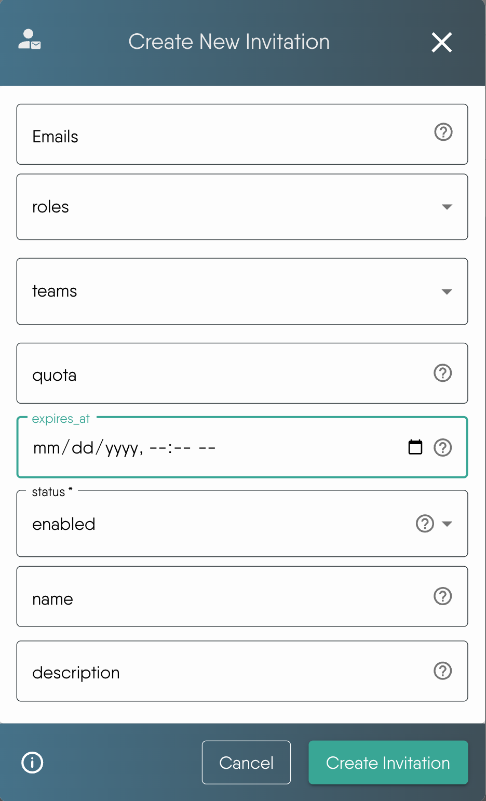

# Invite Users

> Bring people into an organization with invitation links or a direct invite, control who can accept and what they receive, and revoke access.

An invitation is a link that lets people join one organization, with the roles and teams you choose, under limits you set: who may accept, how many may accept, when it stops working, and what accepting does. The same mechanism powers your organization's open sign-up. This guide covers creating and managing invitations, what happens when someone accepts, and the separate direct invite for a single new person.

Layer5 Cloud has two ways to bring a person in:

| | Invitation | Direct invite |
| --- | --- | --- |
| Where | Invitations page | Users page, Invite New User |
| Target | Anyone with the link, a list of addresses, or a whole email domain | One new email address |
| Membership begins | When the person accepts | Immediately, before they act |
| Limits | Quota, expiry, address allowlist, enable and disable | None |
| Existing account | Can accept | Refused. Use [Add an existing user](/pr-preview/pr-1351/cloud/guides/organizations/managing-users/#add-an-existing-user). |
| Permission | Manage Invitations | Invite User to Organization |

## Permissions

**Needs:** the **Manage Invitations** permission in the organization. Provider Admin, Organization Admin, and Academy Admin hold it by default.

Creating, editing, and deleting an invitation, and changing which invitation is the open sign-up invitation, all require the permission. The same permission covers choosing the roles and teams an invitation grants, so anyone who can write an invitation, Academy Admins included, can specify its roles. A write without the permission is refused with HTTP 403.

Invitations are not tier-limited.

## Default organization state

Organizations are **closed** by default. A person cannot join by visiting a URL; they must open a valid invitation link or sign in through your organization's address when it has an [open sign-up invitation](#the-open-sign-up-invitation).

When no open sign-up invitation exists, people who register at your organization's page become platform users with no membership and no roles in your organization until an administrator adds them or they accept an invitation.

  <h4 class="alert-heading" style="color: #3772ff;">Roles are not assigned automatically</h4>
  
      A person who joins through an invitation receives only the roles and teams listed on it. An invitation with no roles adds the person with no role.
  

## Decide what the invitation allows

Choose the audience first, because it decides which fields you set.

- **Precise invitation:** list one or more full email addresses. Only those addresses can accept.
- **Domain-wide invitation:** list a domain pattern such as `@layer5.io`. Any address ending in that domain can accept.
- **Public invitation:** leave the address list empty. Anyone signed in with the link can accept. Use it for events and community programs.

  <h4 class="alert-heading" style="color: #EBC017;">Use domain wildcards and public links carefully</h4>
  
      A pattern such as <code>@company.com</code> admits anyone with that domain, and a public link can be forwarded without limit. Verify domain ownership, grant only the access the audience needs, and set an expiry and a quota on public links.
  

Address matching is exact and case-sensitive. `User@Example.com` does not match an entry written `user@example.com`. List the address in the form people sign in with.

### Invitation properties explained

| Property | Description |
| :--- | :--- |
| `emails` | Exact addresses (`user@example.com`) and domain patterns (`@example.com`). If empty, any address can accept. |
| `roles` | Roles assigned on acceptance. If empty, the person joins with no role. Each role must be an existing organization role. Provider-wide roles, such as Provider Admin, cannot be granted by an invitation, and an invitation listing one, or a role that does not exist, is refused when it is created or edited. |
| `teams` | Teams the person joins on acceptance. If empty, the person joins no team. Each team must be an existing team of your organization; an invitation listing any other team is refused when it is created or edited. |
| `quota` | Maximum number of people who can accept. Not set, or 0, means unlimited. |
| `expiresAt` | Date and time after which the link stops accepting new people. Not set means it never expires. Does not affect people who already accepted. |
| `status` | `enabled` can be accepted. `disabled` cannot, and can be re-enabled later. |
| `name` | Human-readable name. Required in the form, up to 255 characters. |
| `description` | Internal note about the invitation's purpose, up to 5000 characters. |
| `acceptanceOutcome` | What accepting does. `direct_membership` (the default) makes the person a member of the inviting organization. `child_organization` creates a new organization for the person beneath it. See [Choosing what accepting an invitation does](#choosing-what-accepting-an-invitation-does). A `child_organization` invitation requires the **Create Organization** permission in the inviting organization. |
| `isDefault` | Marks this invitation as the organization's open sign-up invitation. Only one invitation per organization can hold the mark; setting it on one clears it from the others. An edit that omits this property leaves it unchanged. |

`emails`, `roles`, and `teams` can each be left empty or omitted.

## Create an invitation

**Needs:** Manage Invitations.

Create the invitation from the Invitations page, setting the audience, roles, teams, quota, expiry, status, name, and description. Enabled is the default status.

### Who receives an email

Creation sends one email to each **exact address** in the list. Domain patterns and public invitations send nothing, so share their link yourself.

- The email is sent at creation only. Editing an invitation does not send it again, and there is no resend. To notify someone again, send them the link.
- A failed send does not fail the creation. Sending stops at the first failure, so addresses after it are not emailed. Check that each person received it.
- The subject reads `<Inviter name> has invited you to <Organization name> Organization`. The body names the organization and the teams you pre-assigned, and carries an **Accept Invitation** button. It does not list roles.
- The sender is your organization's mail configuration when set, else the deployment default. See [Bring Your Own Mail Server](/pr-preview/pr-1351/cloud/guides/organizations/org-management/bring-your-own-mail-server/).

## Share, track, and revoke

The Invitations page lists every invitation with its name, description, copyable link, owner, expiry, quota use, roles, teams, and status.

Filter by status, role, or team. The Quota column shows people accepted against the limit, such as `2 / 5`, or `2 / Unlimited`. To see the people who joined, open the [Users page](/pr-preview/pr-1351/cloud/guides/organizations/managing-users/).

| To | Do this | Effect |
| --- | --- | --- |
| Stop new acceptances temporarily | Set status to disabled | The link stops working for new people at once. Re-enable it later. |
| Stop new acceptances for good | Delete the invitation | The link fails. The delete has no confirmation step. |
| Change who can accept or what they receive | Edit the invitation | Applies to future acceptances only. |
| Remove someone who already accepted | [Remove the person](/pr-preview/pr-1351/cloud/guides/organizations/managing-users/#remove-a-user-from-an-organization) | Disabling or deleting an invitation never removes people who accepted. |

If another administrator deletes an invitation while your edit dialog is open, saving reports that the invitation was not found. Reload the table to see the current list. An expiry date stops new people only; it does not remove anyone.

## What happens when someone accepts

The link is `<your Layer5 Cloud address>/invitations/<id>/accept`. Anyone holding it can try to accept, and eligibility is decided at that moment.

1. **Invitation exists.** A deleted invitation cannot be accepted.
2. **Status is enabled.**
3. **Not expired.**
4. **Quota available.** A person who already accepted is also refused once the quota is full.
5. **Address allowed.** The signed-in person's email matches an entry, or the list is empty.
6. **Account verified.** For a direct membership invitation, an account whose email address is not yet verified is not placed. The invitation applies at the person's first verified sign-in.

The first failing check stops the acceptance and nothing is written. The person sees `The invitation cannot be applied to this user` with one of these reasons:

| Reason shown | Cause |
| --- | --- |
| `invitation no longer exists` | Deleted. |
| `invitation is not enabled` | Disabled. |
| `invitation has expired` | Past its expiry. |
| `invitation has reached its quota` | Quota full. |
| `email is not on the invitation's allowlist` | Address does not match. |
| `account email address is not verified yet` | Verify the email, then sign in again. |

A `child_organization` invitation is not held for email verification; see below.

When the person is eligible, in order:

1. They are added to the organization, once.
2. Each listed role they lack is assigned.
3. Each listed team they are not in is joined.
4. They are recorded as accepted, which counts against the quota.

Assignments are additive. An existing member keeps what they have, gains any listed roles and teams they lack, and loses nothing.

Role and team failures do not block membership. If a role or team step fails, the person is already in the organization, but the page shows an **Error Accepting Invitation** message with the probable cause and remediation, and offers **Retry** and **Go to dashboard**. Retrying is safe: it does not duplicate the membership or the acceptance. A stored team that has left the organization is skipped and recorded on the acceptance event, and the acceptance still succeeds.

Each acceptance writes one event, `<email> accepted invitation "<name>"`. Creating, editing, and deleting invitations write no dedicated event.

### Accepting by situation

- **New person, no account:** opening the link while signed out saves the invitation in a 30-minute cookie and sends the person to registration for your organization. After sign-up and sign-in, the invitation is accepted, the organization is selected, and the person lands on the dashboard. If the cookie lapses, they reopen the link.
- **Existing account, not a member:** the same flow, but the person signs in instead of registering. The signed-out redirect goes to the registration page, so they navigate to sign-in from there. The cookie survives.
- **Existing member:** no duplicate membership. Missing listed roles and teams are added. The acceptance still counts against the quota, and a full quota refuses them even though they are already a member.
- **A revoked or invalid link:** the accept page loads and shows the refusal reason, rather than a not-found page.

### Choosing what accepting an invitation does

Every invitation has an `acceptanceOutcome` that decides where the accepting person ends up. In the create and edit dialogs it is the **When accepted** choice. **Direct membership** is the default. **Child organization** appears only if you have the **Create Organization** permission in the current organization. If you lack it and edit an invitation that already uses Child organization, the choice is shown selected but cannot be changed.

| `acceptanceOutcome` | Result of accepting |
| :--- | :--- |
| `direct_membership` (default) | The person joins the inviting organization with the invitation's roles and teams. Role and team failures do not undo the membership. |
| `child_organization` | A new organization named **My Organization** is created as a child of the inviting organization. The person is its owner and Organization Admin, it gets the standard **My Team** and **My Workspace**, the invitation's roles are granted in it, and teams with the same names and descriptions as the invitation's teams are created in it with the person as a member. The person does not become a member of the inviting organization, and the inviting organization's own teams are unchanged. The acceptance is all or nothing: if any part fails, nothing is created and the quota is not used. |

For both outcomes:

- Every team on an invitation must belong to the inviting organization. An invitation listing another organization's team is refused when it is created or edited.
- Acceptance counts once per person. Accepting again creates no second child organization and uses no more quota.
- A person who creates a new account through your open sign-up invitation does not also receive a separate personal organization; the invitation decides where they land. If the invitation turns out not to apply, such as when its quota is used up, a personal organization is created as usual.

#### Branding of a child organization

A child organization created through a `child_organization` invitation starts with your organization's branding by default. The invitation's `childOrganizationBranding`, shown in the invitation dialogs as **Child organization branding**, can change that. It is ignored for `direct_membership`.

| `childOrganizationBranding` | The child organization starts with |
| :--- | :--- |
| `parent` (default) | A copy of your organization's branding: theme (logos and colors), sign-in page branding, links (including social profiles), and the sign-in page carousel setting. |
| `provider` | A copy of the platform provider's branding. |
| `none` | No branding of its own. |

The copy is taken once, when the child organization is created. Later changes to your branding are not carried over, and changes the child organization's admins make do not affect yours. Organizations created directly, not through an invitation, are unaffected.

#### Email verification

Someone who signs up with email and password through your open signup invitation must verify their email address before a `direct_membership` invitation adds them to your organization. Until then they are not a member, and they cannot sign in. They join on their first sign-in after verifying. A `child_organization` invitation does not wait: the new account's own child organization is created at sign-up, because it gives the person nothing of yours beyond a place beneath you. Either way the account becomes active once the address is verified.

## The open sign-up invitation

The open sign-up invitation is the one that admits people who sign in through your organization's own address, such as a custom domain. You designate it in either of two places:

- The **Open Org Invitation** selection when you edit the organization. Writing it needs Organization Admin in the organization or in its parent.
- The `isDefault` property on the invitation. Setting or clearing it needs Manage Invitations.

The edit-organization selection wins when it names an invitation that exists in the same organization. A selection that points at a deleted invitation, or at another organization's invitation, is ignored and the `isDefault` invitation is used. Releasing the mark on the invitation that the selection names, or deleting that invitation, clears the selection. With neither a selection nor a mark, nobody joins.

### How it is applied at sign-in

It is applied whenever someone signs in through your organization's address, on every sign-in method the address offers, including email and password and social sign-in. A person who has an account and has never been a member becomes one on that sign-in, with the roles and teams the invitation grants. When it is a `child_organization` invitation, the person instead receives their own child organization.

It applies only to people who are not already members:

- **Roles and teams are never re-applied.** If you remove a role or team from someone who joined this way, signing in again does not restore it.
- **Each person counts once.** Repeated sign-ins do not raise the acceptance count.

  <h4 class="alert-heading" style="color: #EBC017;">When open sign-up adds nobody</h4>
  
      
A person can sign in successfully and still not join. The open sign-up invitation applies only when all of these hold:

<ul>
<li>Its status is <code>enabled</code>.</li>
<li>Its expiry has not passed.</li>
<li>Its quota is not reached.</li>
<li>The person&rsquo;s email matches its <code>emails</code> list, or the list is empty.</li>
<li>For a direct membership invitation, the person&rsquo;s email address is verified.</li>
</ul>

When one fails, a non-member signs in as a platform user with no membership and no roles in your organization, and sees no error. Existing members are unaffected. Check these properties first when people who sign in at your address are missing from the <a href="/pr-preview/pr-1351/cloud/guides/organizations/managing-users/">Users page</a>.

  

## Invite one person directly

**Needs:** Invite User to Organization.

Use the direct invite to bring in one person who has no account. You supply an email address, optional first and last name, and optionally the organization roles and teams the person should have.

Unlike an invitation, the direct invite acts before the person does anything:

- Layer5 Cloud creates a Pending account, adds it to the organization and the listed teams, and sends an email with a sign-up link already filled in with the name, email, and organization.
- The email is always sent. There is no quota, expiry, or acceptance step, and no invitation record to disable.
- Roles are applied right after the email is sent, under the rules in [Change a member's roles](/pr-preview/pr-1351/cloud/guides/organizations/managing-users/#change-a-members-roles). A role you may not grant is skipped with an `unauthorized to assign` message.
- If the address already has an account, the invite is refused with `User with email '<email>' already exists`. Add that person as an existing user instead.

## Examples

| Goal | Audience | Grants | Limits |
| --- | --- | --- | --- |
| Onboard one new employee | Their exact address | Their role and project team | Quota 1 |
| Open registration to a company | `@yourcompany.com` | A default role | Optional expiry |
| Run a community challenge | Empty (public) | A temporary role such as Academy Learner | Expiry at close of registration, quota at the participant cap |
| Give a partner temporary access | `@partner.com` | One shared project team only | Expiry at project end |

For learner programs, the seats available depend on your subscription plan. See [how the billable user count works](/pr-preview/pr-1351/cloud/guides/account/managing-subscriptions/#how-the-billable-user-count-works). Expiry stops new signups only. When a project ends, [remove the people](/pr-preview/pr-1351/cloud/guides/organizations/managing-users/#remove-a-user-from-an-organization) who joined through it.

