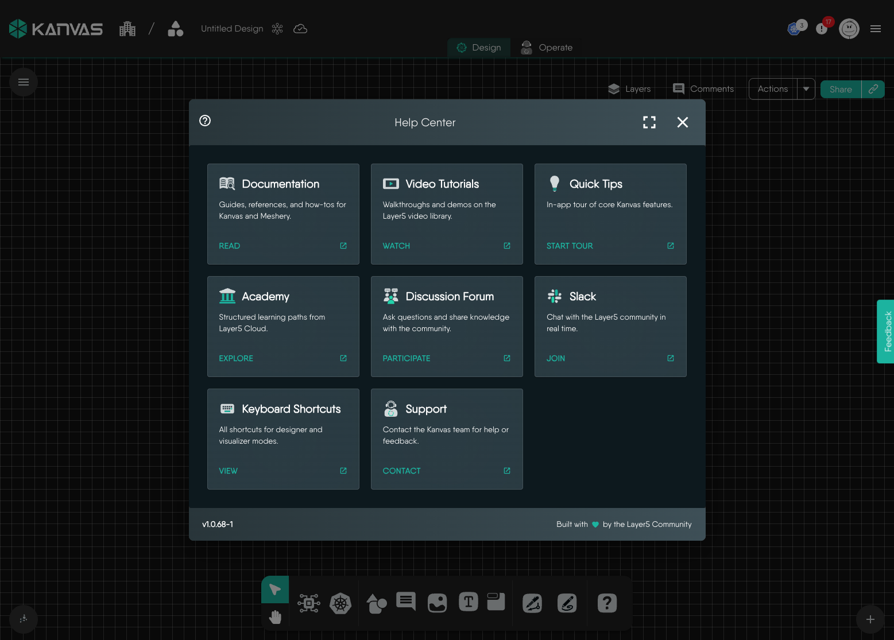

# Canvas Actions

> Reference for the Designer canvas menu - undo and redo, paste, select all, reset, screenshot, options, shortcuts and the Help Center - with the mode in which each action is available.

Right-clicking an empty part of the canvas - anywhere no component sits - opens the **Canvas Actions** menu. Where the component context menu acts on one component, this menu acts on the canvas as a whole: undoing and redoing, pasting, selecting everything, capturing the canvas as an image, and reaching help.

The menu adapts to the mode you are in. Commenting and pasting, for example, are offered in Designer mode but not in Operator mode, where the canvas reflects discovered infrastructure rather than a design you are authoring.

## Editing actions

| Action | Shortcut | Behavior |
| --- | --- | --- |
| Add Comment | <kbd>M</kbd> | Drops a comment at the point you right-clicked. Designer mode only. See [Review a Design with Comments](/pr-preview/pr-1351/kanvas/guides/collaborating/reviewing-designs/). |
| Undo | <kbd>Cmd/Ctrl</kbd> + <kbd>Z</kbd> | Reverses the last change to the design: components, configuration, styles, relationships, annotations and layer toggles. A message confirms the change was reverted, or reports that no changes remain. |
| Redo | <kbd>Cmd/Ctrl</kbd> + <kbd>Shift</kbd> + <kbd>Z</kbd> or <kbd>Cmd/Ctrl</kbd> + <kbd>Y</kbd> | Re-applies the last undone change. |
| Paste | <kbd>Cmd/Ctrl</kbd> + <kbd>V</kbd> | Pastes the clipboard contents at the cursor position. Designer mode only. |
| Select All | <kbd>Cmd/Ctrl</kbd> + <kbd>A</kbd> | Selects every component on the canvas. |
| Reset Design | | Clears every component from the canvas. Designer mode only, and destructive - see below. |

### Reset Design

Reset Design removes everything currently on the canvas. Kanvas asks you to confirm before it does, and the confirmation reminds you that undo is usually the better tool if you only want to step back a few changes. The confirmation dialog carries a "don't show this again" checkbox; ticking it stores that preference against your user settings, and the reset then happens immediately on every subsequent use.

## Screenshot Canvas

**Take Screenshot** captures the canvas as drawn - components, relationships and annotations - and downloads it to your machine as a PNG. The file is named `Kanvas-<timestamp>.png`, so repeated captures of the same design do not overwrite one another.

The capture is of the canvas, not your browser window: panels, the dock and the toolbar are not included. It records the canvas as currently viewed, so pan and zoom to frame what you want before you capture. Object controls and badges appear only when the canvas is zoomed in far enough, so zoom in first if you want them in the image.

This is the quickest way to put a design into a pull request, an incident write-up or a slide. When you need the design as data rather than as a picture - to hand to another tool, or to re-import later - use [Exporting Designs](/pr-preview/pr-1351/kanvas/guides/designs/export-designs/) instead.

## Options

**Options** opens the canvas settings drawer. Each change saves to your user preferences on the server after a short pause, applies to every design you open and shows a confirmation message. Preferences belong to you, not to a design.

| Option | Default | Effect |
| --- | --- | --- |
| Dark Theme | - | Switches the canvas between light and dark themes. |
| Snap to Grid | On | Snaps objects to the grid as you drag. |
| Hide Gridlines | On | Gridlines are hidden by default. |
| Enable Dock | On | Off hides the whole bottom dock, including the drawing tools and pickers. Keyboard shortcuts still work. |
| Show Reset Canvas Confirmation | On | Off makes Reset Design act immediately. |
| Enable Pencil | On | Shows the Pencil tool in the dock. |
| Enable Pen | On | Shows the Pen tool in the dock. |
| Auto-pan on Drag | Off | Pans the view while you drag an object past the canvas edge. Kanvas turns it off on large designs, with a limit for each render mode. See [Auto-pan on Drag](/pr-preview/pr-1351/kanvas/reference/autopan/). |
| Max Canvas Zoom | 30 | Upper zoom limit, from 0.1 to 30. |
| Min Canvas Zoom | 0.1 | Lower zoom limit, from 0.1 to 5. |
| Enable Debugger | Off | Shows debugging aids. |
| Relationship Evaluation Engine | Automatic (recommended) | Chooses how relationships are evaluated. |
| Show Tutorial | On | Shows the in-app tutorial. |
| Show Walkthrough | On | Shows the walkthrough. |
| Render Fidelity | - | Sets how much detail the canvas draws, from full fidelity down to a wireframe, and can adapt as a design grows. See [Render Modes](/pr-preview/pr-1351/kanvas/concepts/render-modes/). |

Operator mode offers only Show Tutorial and Show Walkthrough.

## Shortcuts

**Shortcuts** (<kbd>Cmd/Ctrl</kbd> + <kbd>/</kbd>) opens the keyboard shortcut reference in the help drawer, listing the shortcuts available in both Designer and Operator modes.

## View help center

**Help Center** (<kbd>Cmd/Ctrl</kbd> + <kbd>Shift</kbd> + <kbd>/</kbd>) opens the in-app help modal. It gathers, in one place, every route by which you can learn more about Kanvas or reach someone who can help:

| Card | What it opens |
| --- | --- |
| Documentation | Guides, references and how-tos for Kanvas and Meshery. |
| Video Tutorials | Walkthroughs and demos in the Layer5 video library. |
| Quick Tips | An in-app tour of core Kanvas features, shown in a drawer beside the canvas. |
| Academy | Structured learning paths in Layer5 Cloud. |
| Discussion Forum | The Layer5 discussion forum, for questions and shared knowledge. |
| Slack | The Layer5 community Slack, for real-time conversation. |
| Keyboard Shortcuts | The same shortcut reference the Shortcuts action opens. |
| Support | A form for contacting the Kanvas team with a problem or a piece of feedback. |

Quick Tips and Keyboard Shortcuts open in a drawer alongside the canvas, so you can keep working while you read them. Support opens its form in a modal over the canvas. The remaining five cards open in a new tab. The Help Center is also reachable from the help button at the right-hand end of the dock.

