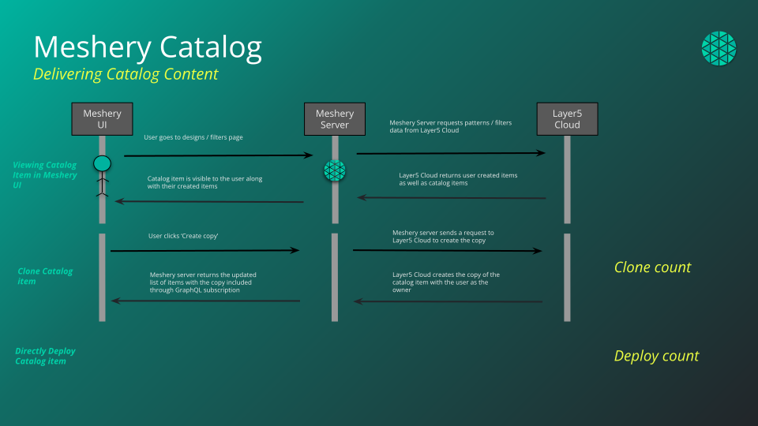
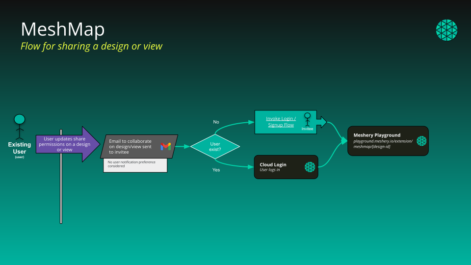

# Catalog

> The Cloud Catalog is a web-based, public catalog to facilitate easy sharing and discovery of common cloud native architectures and design patterns.

Public Catalog: <a href="https://cloud.layer5.io/catalog">https://cloud.layer5.io/catalog</a>

<!-- <figure class="image-center-shadow">
</figure>
 -->

The Cloud Catalog is a web-based, public catalog to facilitate easy discovery of existing designs. Designs that are published into the catalog can be, but are not always curated for known best practices and patterns. Content is published at [cloud.layer5.io/catalog](https://cloud.layer5.io/catalog), and one-click import of catalog content into Meshery Server is seamlessly integrated.

### Content Visibility

Each item in the catalog comes with an associated level of visibility.

- Published: Anyone can read it, signed in or not. Any signed-in user with Clone Design can clone it. It is listed in the catalog.
- Public: Anyone with the link can read it, signed in or not. Any signed-in user can clone it. It is not listed in the catalog. A design saved for the first time is public.
- Private: The owner, provider administrators, and users the design is shared with can read it. Nobody can clone it, not even the owner. Designs imported through GitHub start private.

### Content Types
- Deployment
- Traffic Management
- Security
- Workloads
- Observability
- Scaling
- Resiliency

### Content Categories

Catalog content is categorized in a number of ways:
- **Patterns**: Cloud native patterns enable the business function in simple language.
- **Filters**: Embedded in the data plane of a service mesh, WebAssembly filters offer fine-grained control over service requests.
- **Programs**: Embedded in the data plane of a service mesh, eBPF programs performant, fine-grained control over service requests.
- **Policies**: Applied across the cloud native infrastructure under management, policies may be applied broadly and specifically.
 
<!-- List design metadata and descriptions here -->

### Publishing from Kanvas

To publish a design into the catalog:

1. Open your design in Kanvas (for example from **My Designs**).
1. Click the **hamburger menu** in the top-left of Kanvas.
1. Choose **Share… → Publish to catalog**.
1. In the design details dialog, review or update the **name**, **type**, and **description**, then click **Publish To Catalog**.
1. After the request is submitted, maintainers approve it, and the design appears in the [public catalog](https://cloud.layer5.io/catalog).

### Viewing Filters

Your filter list at [My Filters](https://cloud.layer5.io/catalog/content/my-filters) is not limited to filters you created. When you are signed in, it returns:

- every **public** and **published** filter, whoever owns it - including those belonging to other members of your teams;
- your own **private** filters;
- any filter that has been shared with you directly.

Private filters belonging to other people are never returned. The one exception is a provider administrator, who can see private content across the provider.

Signed-out visitors browsing someone's public profile see only that person's public and published filters.

Filters can be browsed in grid view or table view, and searched and sorted from either. For the operations you can perform on a filter once you have found it - import, publish, unpublish, clone, download, edit, view details, and delete - see [Envoy WASM Filter Management](https://docs.meshery.io/guides/infrastructure-management/filter-management) in the Meshery documentation.

### Importing Filters

WebAssembly filters can be brought into Layer5 Cloud in two ways:

- **File Upload**: select the filter file from your machine and give it a name.
- **URL Upload**: give a name and the `http` or `https` URL that serves the filter body directly.

An imported filter is saved under the name you enter on the import form, whichever method you use.

  <h4 class="alert-heading">URL import cannot reach private networks</h4>
  
      
Layer5 Cloud is a hosted, multi-tenant service, so a URL import is fetched from Cloud&rsquo;s own network rather than from your machine. A URL whose host resolves - or redirects - to a loopback, link-local, private, carrier-grade NAT, or IPv6 unique-local address is refused, and only <code>http</code> and <code>https</code> URLs are accepted.

If your filter lives on an internal host, a private network, or anything else Cloud cannot reach from the public internet - an internal Git server, for example - use <strong>File Upload</strong> instead. It is the supported path for those sources and no capability is lost. There is deliberately no allowlist or opt-out setting.

  

If an import URL is mistyped, has moved, or answers with anything other than a success status, the import fails with **400 Bad Request**: the URL is the problem, so check that it is reachable from the public internet and serves the filter body itself rather than a download page. A `500` or `502` means the fetch itself failed in transit (for example a connection, TLS, or timeout failure) against a URL that was otherwise permitted.

### Content Tags

- Arbitrary strings for categorization.
- Content classes: Official, Verified, and Community. Publishers do not choose their own class.

## Classes

| Class | Meaning |
| --- | --- |
| Official | Produced and fully supported by Meshery maintainers. |
| Verified | Produced by partners and verified by Meshery maintainers. |
| Community | Produced and shared by Meshery users. |

- A publisher without the Approve Catalog Request permission creates a publish request with the class Community. The request waits in the review queue.
- A publisher with the Approve Catalog Request permission skips the queue. The design is approved immediately with the class Official.
- An approver deciding a queued request chooses Official, Verified, or Community at the moment of approval.

## Publication lifecycle

| Stage | What happens | Who is notified |
| --- | --- | --- |
| 1. Request | A signed-in user publishes a design with its catalog metadata. Without Approve Catalog Request, this creates a pending request and the design's visibility does not change yet. | Catalog maintainers receive an email, and the requester receives a copy. |
| 2. Review queue | Pending requests wait. Reviewers see the author, the author's email, the content name and type, the status, the class, and when the request was created. The queue shows the reviewer's current organization, or all organizations for holders of View All Organizations. | |
| 3. Approve or deny | A reviewer approves, choosing the class, or denies. Approval publishes the design and records its published version. Denial leaves visibility unchanged. Only pending requests can be decided. | The owner receives an approval or denial email, unless notification preferences turn approval emails off. |
| 4. Published | The design is in the catalog. | |
| 5. Unpublish | The design's creator, or a holder of Approve Catalog Request, removes it. The design becomes private. | |

The publish form asks for a type, at least one technology, a description, and caveats. Denying a request is checked against Approve Catalog Request, the same as approving. Holding Deny Catalog Request alone does not let you deny a request.

Each design can have only one publish request, ever. A design that already has a request, whether pending, approved, or denied, cannot be submitted again. Unpublishing does not clear the earlier request.

Once a design is published, its visibility cannot be changed from the publish dialog. Unpublishing returns the design to private, not public. Catalog metadata stays on the design after unpublishing.

The Cloud catalog and the public Meshery catalog website are separate listings. When a holder of Approve Catalog Request publishes a design directly, Layer5 Cloud triggers a refresh of the Meshery catalog website. If that refresh cannot be triggered, the publish still succeeds. Approving a request from the review queue does not refresh the Meshery catalog website.

## Cloning

A clone is a private copy that you own. The original stays untouched.

- The copy is placed in the workspace you have selected in your current organization. Cloning requires a selected organization and is refused when you are viewing all organizations.
- The copy starts at a fresh version and keeps the original's catalog metadata.
- The source design's clone count goes up by one.
- Any signed-in user with Clone Design can clone a published or public design. Signed-out visitors cannot clone.
- Private designs cannot be cloned by anyone, including their owner.

## Metrics and the leaderboard

Every design keeps five counters: Opens, Downloads, Deploys, Clones, and Shares. They are lifetime totals with no deduplication and no reset. See [Metrics](/pr-preview/pr-1352/cloud/concepts/catalog/metrics/) and [Leaderboard](/pr-preview/pr-1352/cloud/concepts/catalog/leaderboard/).

The leaderboard is the catalog sorted by one of those counters, Opens by default. The catalog page shows top performers in a summary panel.

## Permissions

Browsing the catalog requires no permission and no account. Publishing, reviewing, unpublishing, and cloning use View Catalog Requests, Approve Catalog Request, Deny Catalog Request, Publish Design, Unpublish Design, Clone Design, and View Designs. Users and Team Admins can unpublish only designs they created. Workspace Admins, Organization Admins, and Provider Admins can unpublish any design. See [Default Permissions](/pr-preview/pr-1352/cloud/reference/default-permissions/).

Layer5 Cloud does not check your plan when you publish, review, or clone a design.

Published WebAssembly filters are available to Meshery and to API clients. The public catalog listing in this page's sense is designs. To manage filters you already have, use [My Filters](https://cloud.layer5.io/catalog/content/my-filters) as described above, and [Filter Management](https://docs.meshery.io/guides/infrastructure-management/filter-management) in the Meshery documentation.

