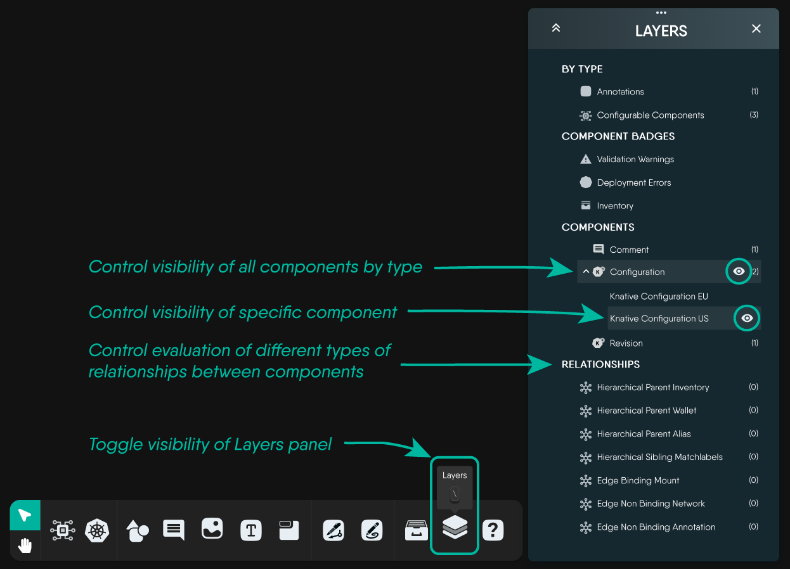

# Performance Limits and Tuning

> Learn about the performance limits of Kanvas and how to tune your environment for optimal performance.

Kanvas is designed to handle a wide range of infrastructure and application configurations. However, there are some performance limits that you should be aware of when working with Kanvas. This guide will help you understand these limits and provide tips for tuning your environment for optimal performance.

## Performance Limits

### Maximum Number of Components

Kanvas enforces a component cap set by the organization's plan, checked whenever a design is saved or imported. The seeded limits are 100 for Personal, 200 for Team Designer, 100 for Team Operator, and 300 for Enterprise. A deployment can differ. There is no separate 1,000-component cap. A design over the plan limit is not saved.

<!--
#### Maximum Number of Components per Layer
  Needs a follow up -->

<!--
#### Maximum Number of Relationship
  Needs a follow up -->

#### Maximum Number of Annotation-only Components (non-semantically meaningful components)

  <h4 class="alert-heading" style="color: #7A848E;">What is a Non-Semantic Component?</h4>
  
      A non-semantic component is a component that does not represent a meaningful entity in your design. For example, a textbox, a shape, a line, or a comment are all examples of non-semantic components. These components are used for annotation purposes only and do not have a direct relationship to the underlying infrastructure or application that you are modeling.
  

Kanvas does not enforce a separate cap on annotation-only components such as text boxes, shapes, lines, and comments. They still add to what the canvas draws and to what each save sends.

#### Maximum Number of Orchestrated Components (semantically meaningful components)

  <h4 class="alert-heading" style="color: #7A848E;">What is a Semantic Component?</h4>
  
      A semantic component is a component that represents a meaningful entity in your design. For example, a server, a database, or a network switch are all examples of semantic components. These components have a direct relationship to the underlying infrastructure or application that you are modeling.
  

### Maximum Number of Relationships

Kanvas enforces no cap on the number of relationships in a design. Large relationship counts still slow rendering, saving, and live editing.

#### Maximum Number of TagSet Relationships

Tags are indexed and searchable. However, the performance of design operations may degrade as the number of tags increases. To ensure an optimal user experience, we recommend using tags judiciously and limiting the number of tags used in a design.

TagSets are drawn only in Full mode, and at most 30 of them. Past 30, Kanvas skips the rest and shows "Skipped rendering of N matchlabels relationships due to limit of 30". There is no Group Components control that turns grouping back on after that limit. See [Working with Tags](/pr-preview/pr-1352/kanvas/designer/tagsets/).

<!--
#### Maximum Number of Relationships per Component
  Needs a follow up -->

### Maximum Number of Users

Kanvas does not enforce a fixed cap of 20 or 34 simultaneous collaborators. Live edits synchronize peer to peer after Layer5 Cloud introduces the participants. Large designs and embedded images still slow that synchronization because each change is sent to every participant. See [Layer5 Cloud Networking Services](/pr-preview/pr-1352/cloud/guides/self-hosted/planning/peer-to-peer-communication/) for the network path.

### Impact of Images

Be aware that designs are self-contained documents and that all artifacts, like any images (e.g. SVG, PNG, GIF, WEBP, etc.) that are added to your design are embedded into your design document, adding to the overall size of your design file. The embedding of images into your design file ensures portability of your design. You can export your design with the assurity that your images will remain in your design upon (re-)import.

As the number and size of images contained in your design grows, images can significantly increase file size, potentially causing performance issues. With each change made to your design, the entire design file is uploaded to Layer5 Cloud. This same performance consideration applies during collaborative editing sessions with multiple users viewing/editing the same design. Each change to your design made by any user in the collaboration session will be propagated to every other currently collaborating user. If your design contains a large number of images, this can lead to slow performance and increased bandwidth usage.

An image or text file added to a design is limited to 512,000 bytes (about 500 KB) each. The limit is the same on every plan. The rejection message says "Your current plan allows files up to 500 KB", but the cap is not plan-specific. Kanvas enforces no separate 10 MB total for images. Embedded images still enlarge every save.

## Performance Tuning

### Optimize Your Design using the Layers Panel

To improve the performance of your design, consider optimizing by disabling one or more layers.

<figure>
  
  <figcaption>Control which layers of your design are visible using the Layers panel.</figcaption>
</figure>

Some layers specifically offer control of **visibility of components**, while other layers offer control over the **ongoing evaluation of relationships** between components. 

Depending on the type of layer disabled, either specific components or all components by type will display or not be displayed, allowing you to finely tune the performance of you design rendering experience by saving design resources and improving the performance of Kanvas as you adjust both the **number and type** of components in view. 

> Even though you might hide components, those components are not deleted or removed from your design. These components are simply hidden from current view.

In the same way, as you toggle the evaluation of different types of relationships, understand that these relationships between your components still exist. Those relationships are simply **temporarily hidden** from view and the overhead of their evaluation eliminated while the respective type of relationship is disabled.

Using the Layers panel you control the level of sophistication or simplicity of the rendering of components and relationships in your designs. You can both simplify your design layout by removing unnecessary elements and improve performance simultaneously. Alternatively, you can increase the level of detail in your design by enabling additional layers and relationships, while controlling the balance between detail and performance.

  <h4 class="alert-heading" style="color: #3772ff;">Keep It Lightweight</h4>
  
      Hide layers you don&rsquo;t need at the moment to keep your workspace lightweight and responsive.
  

### Optimize use of Images in your Design

To optimize performance, consider the following:

1. Use vector images (SVG) instead of raster images (PNG, JPG, etc.) as they are typically smaller in size and scale without pixelation.
2. Prioritize using smaller file sizes whenever possible. Use the `webp` image format over `png`, `jpg`, or `gif` as it generally provides significantly better compression, resulting in faster design save times without sacrificing much image quality.
3. Remove any unnecessary images from your design.
4. Use image compression tools to reduce the size of your images before adding them to your design.

## What Affects Performance

As your designs grow in complexity, certain design patterns can impact how smoothly Kanvas responds. Understanding these factors helps you create designs that remain fast and responsive.

  <h4 class="alert-heading" style="color: #3772ff;">Related performance controls</h4>
  
      This page covers the design patterns and tuning levers that affect Kanvas performance. For the per-mode rendering ladder (Full, Medium, Wireframe, View-Only) and automatic fidelity management, see <a href="/pr-preview/pr-1352/kanvas/advanced/render-modes/">Render Modes</a>. For the drag-to-edge viewport pan and its per-render-mode size thresholds, see <a href="/pr-preview/pr-1352/kanvas/advanced/autopan/">Auto-pan on Drag</a>.
  

### Working with Grouped Components

When you create groups of components (placing multiple components inside a parent container), you might notice performance differences as the number of grouped items increases. Here's what you might experience:

**Signs of Performance Impact:**
- Dragging groups feels laggy or choppy
- Design takes longer to load and display
- Moving or resizing groups shows delayed response
- Screen updates appear slower during interactions

  <h4 class="alert-heading" style="color: #EBC017;">Large Groups</h4>
  
      Groups containing 100 or more components may experience noticeable lag during drag operations. Consider breaking large groups into smaller, logical subgroups for better performance. If dragging across a design that extends past your viewport feels slow, see <a href="/pr-preview/pr-1352/kanvas/advanced/autopan/">Auto-pan on Drag</a> for the per-render-mode thresholds that gate the drag-to-edge pan.
  

### How Kanvas Optimizes Your Design

Kanvas automatically works behind the scenes to keep your designs running smoothly:

**Smart Rendering:**
- Kanvas only updates the parts of your design that actually change, not the entire canvas
- Components outside your current view aren't fully rendered, saving resources
- Information badges and labels are displayed efficiently to prevent unnecessary redraws

**What This Means for You:**
The table below shows typical performance improvements you'll experience:

| Design Scenario | Without Optimization | With Optimization | Your Experience |
|----------------|----------------------|-------------------|-----------------|
| Dragging a group of 100 components | Laggy and slow | Smooth and responsive | 90% improvement |
| Moving grouped components | Choppy interactions | Fluid movement | Significantly better |
| Overall responsiveness | Delayed reactions | Immediate feedback | Much more responsive |

  <h4 class="alert-heading">Automatic Optimization</h4>
  
      These optimizations work automatically. You don&rsquo;t need to configure anything to benefit from better performance.
  

## Managing Design Complexity

Kanvas provides many interactive features that enhance your design experience. Understanding how these features work together helps you maintain optimal performance.

### Features That Impact Performance

Your design experience includes several interactive capabilities that all work together:

**Interactive Features:**
- **Alignment guides** help you position components precisely as you drag them
- **Automatic relationship management** keeps connections between components updated
- **Tooltips and information displays** show helpful context as you work
- **Resize handles and controls** let you adjust component sizes smoothly
- **Visual grouping indicators** show which components belong together

When you're working with many components simultaneously, these features all activate together, which can sometimes slow down interactions like dragging.

  <h4 class="alert-heading" style="color: #3772ff;">Performance Tip</h4>
  
      
If dragging feels slow, try these strategies:

<ul>
<li>Hide unnecessary layers temporarily using the Layers panel</li>
<li>Break your design into smaller, focused sections</li>
<li>Work on one area of your design at a time</li>
<li>Zoom in to focus on specific components</li>
</ul>
  

### Practical Tips for Better Performance

**When Creating Large Designs:**
1. Use the Layers panel to hide components you're not actively editing
2. Break complex designs into multiple smaller designs that you can link together
3. Group related components thoughtfully rather than creating very large groups
4. Remove old comments and annotations you no longer need

**When Experiencing Slowness:**
1. Check if you have many layers enabled that you're not using
2. Consider whether the design is near your plan's component limit (100, 200, or 300, depending on the plan)
3. Try hiding relationship layers temporarily while arranging components
4. Close and reopen your design to refresh the canvas

## How Kanvas Keeps Things Fast

Kanvas includes built-in intelligence to maintain smooth performance as you work on your designs. You don't need to manage these features manually—they work automatically in the background.

### Efficient Updates

**What Happens When You Make Changes:**
Think of your design like a document. When you edit a single paragraph, you wouldn't want your word processor to reformat the entire document. Similarly, Kanvas only updates the specific components you're changing, not your entire design.

**Benefits You'll Notice:**
- Quick response when you move or edit components
- Smooth interactions even in large designs
- Consistent performance throughout your work session
- Better experience when multiple people collaborate on the same design

  <h4 class="alert-heading">Smart Performance</h4>
  
      Kanvas is designed to only update what needs updating, keeping your design responsive without requiring any configuration from you.
  

### Smooth Interactions During Continuous Operations

When you're actively dragging components, resizing groups, or panning around your design, Kanvas automatically manages how often the screen updates to ensure smooth, responsive interactions.

**What This Means:**
- Dragging feels fluid, not jerky
- Your cursor stays synchronized with the component you're moving
- Multiple simultaneous operations remain responsive
- The interface doesn't freeze or stutter during intensive operations

## Working with Different Zoom Levels

The zoom level you choose affects both what you see and how your design performs. Kanvas adapts its rendering based on your current zoom level to provide the best experience.

### Progressive Detail Display

Kanvas automatically adjusts the level of detail based on how far you're zoomed in or out:

**Zoomed Out (Overview Mode):**
- Shows component shapes and primary names
- Displays main relationships between components
- Provides a fast, high-level view of your entire design
- Perfect for understanding overall structure

**Medium Zoom (Working Mode):**
- Adds relationship details and secondary information
- Shows more component metadata
- Good balance between detail and performance

**Zoomed In (Detail Mode):**
- Displays all badges, annotations, and detailed information
- Shows validation messages and warnings
- Reveals complete component properties
- Best for detailed configuration work

  <h4 class="alert-heading" style="color: #3772ff;">Use Zoom Strategically</h4>
  
      Take advantage of zoom levels: zoom out to get an overview and rearrange major sections, then zoom in when you need to configure specific components in detail.
  

**Performance Benefits:**
When you're zoomed out, Kanvas doesn't spend resources rendering details you can't see anyway. This keeps panning and navigation fast even in large designs. As you zoom in, more information progressively appears, giving you the detail you need without overwhelming the display.

### Zoom Limits

Kanvas sets reasonable minimum and maximum zoom levels to ensure everything remains usable:

- Text stays readable without becoming pixelated
- Interactive handles remain large enough to click
- Badges and indicators maintain appropriate sizes
- The design looks good on all devices (desktop, tablet, mobile)

  <h4 class="alert-heading" style="color: #EBC017;">Zoom Boundaries</h4>
  
      If you try to zoom beyond the minimum or maximum limits, Kanvas won&rsquo;t zoom further. These limits are in place to maintain usability and performance.
  

## Testing Your Design's Performance

As you build larger designs, it's helpful to evaluate how well they perform. Here are practical ways to test your design's responsiveness.

### Practical Test Scenarios

Try these scenarios to understand how your design performs:

1. **Small Group Test** (10-20 components in a group)
   - Does dragging feel instant and smooth?
   - Do components respond immediately to your actions?
   - This is the baseline—everything should feel effortless

2. **Medium Design Test** (50-100 components total)
   - Can you drag groups without noticeable delay?
   - Does panning around the canvas feel fluid?
   - Are minor delays acceptable for your workflow?

3. **Large Design Test** (200+ components)
   - How does dragging large groups feel?
   - Is there lag when you first load the design?
   - Does zooming in and out remain responsive?

4. **Complex Nesting Test** (groups within groups, 3+ levels deep)
   - Can you still move parent groups smoothly?
   - Do nested relationships display correctly?
   - Is the design still manageable?

  <h4 class="alert-heading" style="color: #3772ff;">Testing Approach</h4>
  
      Start simple and add complexity gradually. This helps you identify exactly when performance starts to degrade, making it easier to adjust your design approach.
  

### Simple Performance Checks

You don't need specialized tools to evaluate performance. Just ask yourself:

**Responsiveness Check:**
- Does dragging components feel smooth or choppy?
- Do components respond immediately when you click them?
- Can you pan around the design without lag?

**Loading Time Check:**
- Does your design load within a few seconds?
- Are badges and indicators visible quickly?
- Does the design feel "ready" when it first appears?

**Interaction Check:**
- Can you resize components smoothly?
- Do relationships update without delay?
- Does the interface feel responsive or sluggish?

### Using Browser Developer Tools (Optional)

For more detailed performance analysis, you can use your browser's built-in developer tools:

1. **Open Developer Tools**: Press F12 (Windows/Linux) or Cmd+Option+I (Mac)
2. **Navigate to Performance Tab**: Look for the "Performance" or "Profiler" tab
3. **Record an Interaction**: Click the record button, perform an action (like dragging), then stop recording
4. **Review Results**: Look for long operations or frame drops that indicate performance issues

  <h4 class="alert-heading" style="color: #EBC017;">Browser Differences</h4>
  
      Performance can vary between browsers. If your design feels slow, try testing in Chrome, Firefox, or Safari to see if performance differs.
  

## Future Improvements

We're continuously working to make Kanvas even faster and more responsive. Future updates will bring additional performance enhancements, including:

- Improved rendering techniques for even smoother interactions
- Smarter optimization of complex designs
- Better handling of very large designs
- Enhanced performance on lower-powered devices

These improvements will happen automatically through Kanvas updates—you won't need to change your designs or workflows to benefit from them.

  <h4 class="alert-heading">Continuous Improvement</h4>
  
      Performance optimization is an ongoing priority. As Kanvas evolves, your existing designs will automatically benefit from new performance enhancements.
  

## Render Modes and URL Overrides

Kanvas can paint the same design at four distinct fidelity levels — **Full**, **Medium**, **Wireframe**, and **View-Only** — and can switch between them automatically via **Adaptive Render Mode** based on live render and interaction latency. The lower-fidelity modes suppress badges, overlays, and texture work, so they stay fast on large designs while keeping the same underlying components, relationships, and metadata.

Render modes are the primary performance lever once a design grows past a few hundred components. Rather than duplicate the details here, see:

- [Render Modes](/pr-preview/pr-1352/kanvas/advanced/render-modes/) — what each mode renders, the per-mode feature-size gates, and how Adaptive mode decides when to upshift or downshift.
- [Auto-pan on Drag](/pr-preview/pr-1352/kanvas/advanced/autopan/): auto-pan is off by default, and Kanvas turns it off past 100 components and relationships in Full, 500 in Medium, and 1,000 in Wireframe and View-only.
- [Design Render Quality](/pr-preview/pr-1352/kanvas/advanced/url-parameters/): URL parameters (`render=full|medium|wireframe|view-only`, `adaptive=true`). The read-only value is `view-only`, with a hyphen.

## Gates, Adaptive mode, and zoom

| Feature | Gate |
| --- | --- |
| Auto-pan on Drag | Your setting must be on, and the canvas must draw at most 100 components and 100 relationships in Full, 500 in Medium, and 1,000 in Wireframe and View-only. Designer only. |
| Animated layout | Full mode only, and only while the design has no more than 50 components, 50 relationships, and 100 edges drawn. Past that, a layout still applies its positions without the animation. |
| TagSets | Full mode only, at most 30 drawn. |
| Feasibility evaluation and the component style toolbar | Zoom above 0.5 divided by the display pixel ratio. That is 0.5 on a standard display and 0.25 on a display with a pixel ratio of 2. |

Canvas zoom in the Options dialog has a minimum of 0.1 (adjustable from 0.1 to 5) and a maximum of 30 (adjustable from 0.1 to 30). Each person sets their own.

Adaptive mode is off by default. It samples only while you pan or zoom, using the 95th percentile of the last 20 frame times. It steps down when that percentile exceeds 80 ms, then ignores samples for 3 seconds. It steps up when the percentile stays under 30 ms for 10 consecutive samples, more than 5 seconds after the last change, and the next mode is not above the ceiling. The ladder is Full, Medium, Wireframe. View-only is never entered or left automatically. After a step down, Adaptive recovers at most one step on its own. Turning Adaptive on sets the canvas to the ceiling at once (Full, unless you chose another). Changing the ceiling while Adaptive is already on does not change the running behavior until you turn Adaptive off and on. Turning it off keeps the mode Adaptive last chose. Notifications read "Switched to *mode* mode for better performance" and "Performance improved - switched to *mode* mode".

## Experimental WebGL renderer

Kanvas can draw the canvas with WebGL instead of the standard 2D canvas. It is off by default and available only from the Debug Mode panel, which appears when **Enable Debugger** is on in the Options dialog. The choice is stored in the browser, not the account, and applies the next time a canvas loads. The WebGL path draws dashed and dotted relationship lines as solid lines, draws every arrowhead as a triangle, and does not hide labels at low zoom. Above a zoom of 7.99 Kanvas uses the standard canvas. After the browser loses its WebGL context, Kanvas uses the standard canvas for the rest of the session.

