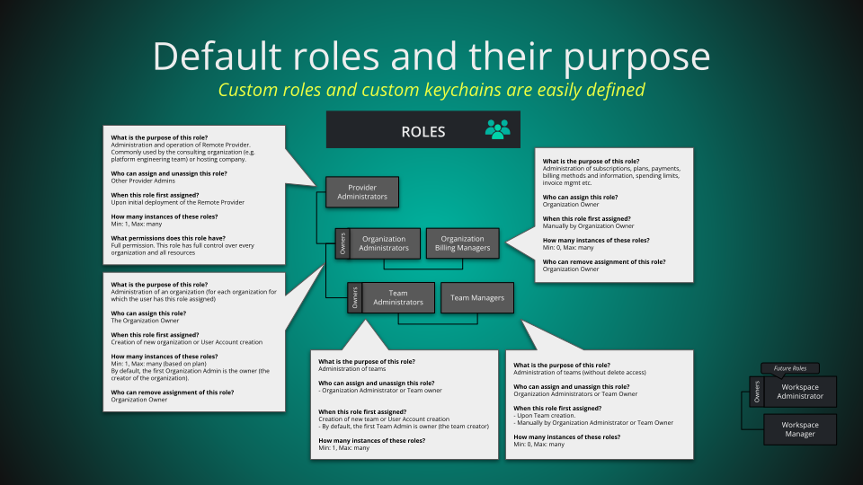
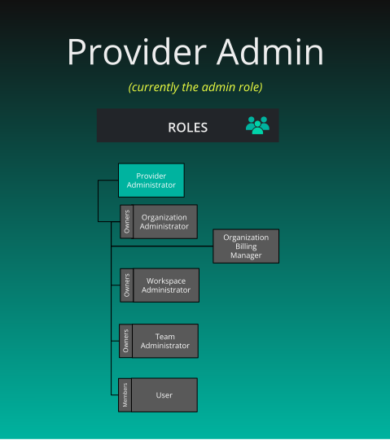
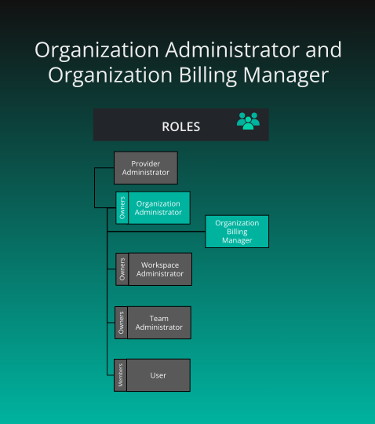
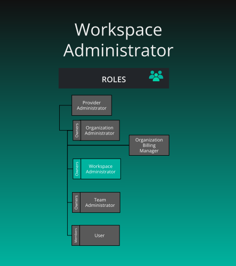

# Roles

> Roles map permissions to users. Roles contain any number of keychains, which contain any number of keys (permissions). Assign roles to users to grant permissions.


Roles map permissions to users. Roles contain any number of keychains, which contain any number of keys (permissions). Assign roles to users to grant permissions.



## Provider Admin Role

<div class="td-card-group card-group p-0 mb-4">
<div class="td-card card border me-4">
<div class="card-header">
      <a href='https://docs.layer5.io/cloud/reference/default-permissions/#Provider+Admin' target='_blank'>Provider Admin Role</a>
    </div>
<div class="card-body">
    <p class="card-text">
        <p>


<div class="md__image">
  
</div>
</p>
</p>
      </div>
  </div>

<div class="td-card card border me-4">
<div class="card-body">
    <p class="card-text">
        <p><strong>What is the purpose of this role?</strong></p>
<ul>
<li>Used for administration of Layer5 Cloud.</li>
<li>Used for debugging and monitoring.</li>
<li>Applicable to platform engineering team and on-prem users.</li>
</ul>
<p><strong>Who can assign this role?</strong></p>
<ul>
<li>Provider Admins only. Provider roles are deployment-wide and never appear in an organization or team assignment.</li>
</ul>
<p><strong>When this role is first assigned?</strong></p>
<ul>
<li>On boot-up of a deployment (using build args). It is not granted to ordinary sign-ups.</li>
</ul>
<p><strong>How many instances of these roles?</strong></p>
<ul>
<li>Any number. Layer5 Cloud does not guard the last Provider Admin. A Provider Admin can remove the role from every Provider Admin, themselves included. Confirm another Provider Admin exists first. Built-in roles are available on every plan.</li>
</ul>
<p><strong>Who can remove assignment of this role?</strong></p>
<ul>
<li>Provider Admins</li>
</ul>
<p><strong>What permissions does this role have?</strong></p>
<ul>
<li>Every key. Provider Admin passes every permission check, including in organizations the person is not a member of. Treat it as administration of the deployment, not of a single organization.</li>
</ul>
</p>
      </div>
  </div>

</div>


## Organization Roles

<div class="td-card-group card-group p-0 mb-4">
<div class="td-card card border me-4">
<div class="card-body">
    <p class="card-text">
        <p>


<div class="md__image">
  
</div>
</p>
</p>
      </div>
  </div>

</div>


<div class="td-card-group card-group p-0 mb-4">
<div class="td-card card border me-4">
<div class="card-header">
      
<h3 id="organization-administrator" class="heading-link">
  <a href='https://docs.layer5.io/cloud/reference/default-permissions/#Org+Admin' target='_blank'>Organization Administrator</a>
  <a href="#organization-administrator" class="heading-anchor" aria-label="Permalink to this heading">🔗</a>
</h3>

    </div>
<div class="card-body">
    <p class="card-text">
        <p><strong>What is the purpose of this role?</strong></p>
<ul>
<li>Administration of an organization</li>
</ul>
<p><strong>Who can assign this role?</strong></p>
<ul>
<li>An Organization Admin of that organization, a holder of Assign User Roles there, or a Provider Admin. The person must already be a member, unless the caller is a Provider Admin.</li>
</ul>
<p><strong>When this role is first assigned?</strong></p>
<ul>
<li>When an authorized administrator assigns it. Creating a user account does not assign Organization Admin. The creator of an organization is its owner and keeps administrator access through ownership, which is separate from this role.</li>
</ul>
<p><strong>How many instances of these roles?</strong></p>
<ul>
<li>Any number, on every plan. Layer5 Cloud does not stop you removing the last Organization Admin. The owner keeps administrator access through ownership. Anyone else can be left without it. Confirm a second administrator holds the role before you remove it from the first.</li>
</ul>
<p><strong>Who can remove assignment of this role?</strong></p>
<ul>
<li>The same people who can assign it. Submit the set of roles the member should keep. Roles you leave out are removed.</li>
</ul>
</p>
      </div>
  </div>

</div>


Layer5 Cloud has no Organization Billing Manager role. Organization-scoped roles are Organization Admin, User, Workspace Admin, Workspace Manager, Academy Admin, and Academy Learner. See the pages for [workspace roles](/pr-preview/pr-1353/cloud/concepts/identity-and-security/roles/workspace-roles/), the [user role](/pr-preview/pr-1353/cloud/concepts/identity-and-security/roles/user-role/), and [academy roles](/pr-preview/pr-1353/cloud/concepts/identity-and-security/roles/academy-roles/).


<div class="alert alert-primary" role="alert">
  <h4 class="alert-heading">Organization owners as entitlements</h4>
  
      <p>Owners are not roles. They are a fixed attribute of the organization.</p>
<p>The creator of an organization is its owner. Ownership cannot be transferred, and the owner cannot be removed. The owner can delete the organization. An Organization Admin who is not the owner cannot. A Provider Admin, or an Organization Admin or owner of the live parent, can also delete it.</p>
<p>The owner keeps administrator access through ownership even if the Organization Admin role is removed from them. Other members do not.</p>
<p>For more information, see <a href="/pr-preview/pr-1353/cloud/concepts/identity-and-security/organizations/">Organizations</a>.</p>

  
</div>


## Workspace Roles

<div class="td-card-group card-group p-0 mb-4">
<div class="td-card card border me-4">
<div class="card-body">
    <p class="card-text">
        <p>


<div class="md__image">
  
</div>
</p>
</p>
      </div>
  </div>

</div>


<div class="td-card-group card-group p-0 mb-4">
<div class="td-card card border me-4">
<div class="card-header">
      
<h3 id="workspace-administrator" class="heading-link">
  <a href='https://docs.layer5.io/cloud/reference/default-permissions/#Workspace+Admin' target='_blank'>Workspace Administrator</a>
  <a href="#workspace-administrator" class="heading-anchor" aria-label="Permalink to this heading">🔗</a>
</h3>

    </div>
<div class="card-body">
    <p class="card-text">
        <p><strong>What is the purpose of this role?</strong></p>
<ul>
<li>Managing workspaces, environments, teams, and lifecycle actions, and reviewing catalog requests, in each organization where the user holds this role. It is an organization-scoped role, not a role on a single workspace.</li>
</ul>
<p><strong>Who can assign this role?</strong></p>
<ul>
<li>An Organization Admin of that organization, a holder of Assign User Roles there, or a Provider Admin</li>
</ul>
<p><strong>When this role is first assigned?</strong></p>
<ul>
<li>When an authorized administrator assigns it. Creating a workspace does not by itself assign Workspace Admin.</li>
</ul>
<p><strong>How many instances of these roles?</strong></p>
<ul>
<li>Any number, on every plan</li>
</ul>
<p><strong>Who can remove assignment of this role?</strong></p>
<ul>
<li>The same people who can assign it. The list you submit replaces the roles held in that organization.</li>
</ul>
</p>
      </div>
  </div>

</div>


**Workspace Manager** is a separate organization role. It covers workspace, environment, team, and lifecycle management, plus the designs, environments, and connections inside the workspaces where the user holds the role. It does not include catalog curation. Organization Admins assign it, the same way they assign Workspace Admin.

There is no Workspace Owner role, and creating a workspace does not grant a role that only the creator can hold. Delete Workspace is a permission key, not a privilege reserved to a workspace owner. See [Roles and Permissions](/pr-preview/pr-1353/cloud/reference/default-permissions/).

## Team Roles

<div class="td-card-group card-group p-0 mb-4">
<div class="td-card card border me-4">
<div class="card-body">
    <p class="card-text">
        <p>


<div class="md__image">
  
</div>
</p>
</p>
      </div>
  </div>

</div>


<div class="td-card-group card-group p-0 mb-4">
<div class="td-card card border me-4">
<div class="card-header">
      
<h3 id="team-administrator" class="heading-link">
  <a href='https://docs.layer5.io/cloud/reference/default-permissions/#Team+Admin' target='_blank'>Team Administrator</a>
  <a href="#team-administrator" class="heading-anchor" aria-label="Permalink to this heading">🔗</a>
</h3>

    </div>
<div class="card-body">
    <p class="card-text">
        <p><strong>What is the purpose of this role?</strong></p>
<ul>
<li>Administration of teams</li>
</ul>
<p><strong>Who can assign and unassign this role?</strong></p>
<ul>
<li>Team Admin of that team, an Organization Admin or holder of Assign User Roles for a team mapped to the organization, or a Provider Admin. Teams accept only Team Admin.</li>
</ul>
<p><strong>When is this role first assigned?</strong></p>
<ul>
<li>A team created from the Teams page makes its creator a Team Admin as well as the owner. Creating a user account does not assign Team Admin. A team created through the API alone records an owner but no Team Admin until someone assigns it.</li>
</ul>
<p><strong>How many instances of these roles?</strong></p>
<p>Any number, on every plan. Layer5 Cloud does not stop you removing the last Team Admin.</p>
</p>
      </div>
  </div>

</div>


Layer5 Cloud has no Team Manager role. Team Admin is the only team-scoped role.


<div class="alert alert-primary" role="alert">
  <h4 class="alert-heading">Owners as entitlements, not roles</h4>
  
      <p>Team owner is not a role. The user who created the team is its owner. Ownership cannot be transferred, and the owner cannot leave the team.</p>
<p>Owner alone cannot delete the team, and Team Admin alone cannot delete it. Delete requires an Organization Admin or the organization owner, a Provider Admin, or the person who is both owner and Team Admin of the team.</p>
<p>Team Admin permissions apply across the organization the team is mapped into, not only inside the team.</p>
<p>For more information, see <a href="/pr-preview/pr-1353/cloud/concepts/identity-and-security/teams/">Teams</a>.</p>

  
</div>


## Example: The Orbital Labs Role Hierarchy

The following illustrates how Provider Admin, Org Admin, and Team Admin roles stack in practice across the Orbital Labs ecosystem. See [Meet Five and the Cast](/pr-preview/pr-1353/cloud/getting-started/meet-five/) for the full narrative.


<div class="td-card-group card-group p-0 mb-4">
<div class="td-card card border me-4">
<div class="card-header">
      <strong>Dr. Aiko Sato</strong>, Provider Admin
    </div>
<div class="card-body">
    <p class="card-text">
        <p><strong>Organization:</strong> Constellation Cloud<br>
<strong>Scope:</strong> All tenants (Orbital Labs, Stellar Dynamics, and others)</p>
<p>Dr. Aiko Sato holds the Provider Admin role at Constellation Cloud, the MSP that manages Orbital Labs as a tenant. Provider Admins can create, view, edit and delete every resource across all tenant organizations. Dr. Sato has seen every misconfigured RBAC policy known to humankind, which is why she documents each one.</p>
</p>
      </div>
  </div>

<div class="td-card card border me-4">
<div class="card-header">
      <strong>Maya Chen</strong>, Organization Administrator
    </div>
<div class="card-body">
    <p class="card-text">
        <p><strong>Organization:</strong> Orbital Labs<br>
<strong>Scope:</strong> Orbital Labs</p>
<p>Maya Chen holds the Org Admin role for Orbital Labs. She manages user accounts, workspace creation, and organization role assignments within Orbital Labs. She also holds Team Admin for the Development team. Organization Admin alone does not add or remove members of a team she does not own and does not administer.</p>
</p>
      </div>
  </div>

<div class="td-card card border me-4">
<div class="card-header">
      <strong>Zara Osei</strong>, Team Administrator
    </div>
<div class="card-body">
    <p class="card-text">
        <p><strong>Organization:</strong> Orbital Labs<br>
<strong>Team:</strong> Infrastructure<br>
<strong>Scope:</strong> The Team Admin keys apply across Orbital Labs, not only inside the Infrastructure team</p>
<p>Zara Osei holds the Team Admin role for Orbital Labs&rsquo; Infrastructure team. That role&rsquo;s keys apply in the organization the team is mapped into. She does not assign provider roles, and she does not create user accounts.</p>
</p>
      </div>
  </div>

</div>


<div class="alert alert-custom" style="border-color: #3772ff;" role="alert">
  <h4 class="alert-heading" style="color: #3772ff;">Info</h4>
  
      Role assignments are scoped. Dr. Aiko&rsquo;s Provider Admin role passes every check in every tenant. Maya&rsquo;s Org Admin role applies only within Orbital Labs. Zara&rsquo;s Team Admin role adds its keys across every organization the Infrastructure team is mapped into, not only inside that team.
  
</div>


## Other built-in roles

| Role | What it is for | Assigned by |
|---|---|---|
| Kanvas | Makes the Kanvas extension available when a Meshery Server connects. It holds no keychains. | Provider Admin, automatically at sign-up. Anonymous accounts receive it alongside Anonymous User. |
| Curator | Managing catalog content. In a default install it holds no keychains. Catalog curation keys come through Organization Admin and Workspace Admin. | Provider Admin |
| User | Viewing and editing users, plus learning paths and challenges | Organization Admin |
| Workspace Manager | Workspace, environment, team, and lifecycle management, plus designs, environments, and connections in the workspaces where the user holds the role. No catalog curation. | Organization Admin |
| Academy Admin | Academy, team, and workspace management | Organization Admin |
| Academy Learner | Academy content access | Organization Admin |
| Anonymous User | Using Kanvas without signing in | Applied automatically. It cannot be assigned and never appears in a role list. |

Provider roles are Provider Admin, Kanvas, and Curator. The organization role list shows every role except those three, custom roles included. The team role list shows Team Admin. Viewing the list requires View All Roles, which User, Team Admin, Workspace Admin, Organization Admin, and Provider Admin hold by default.

## Assign or change roles

Every assignment has a scope.

| Scope | Roles you can assign | Who assigns | The person must |
| --- | --- | --- | --- |
| Provider | Provider Admin, Kanvas, Curator | Provider Admin | Have an account |
| Organization | Every role except the provider roles and Anonymous User, custom roles included | Organization Admin of the organization, a holder of Assign User Roles, or Provider Admin | Be a live member, unless you are a Provider Admin |
| Team | Team Admin only | Team Admin of that team, Organization Admin or holder of Assign User Roles for a team mapped to the organization, or Provider Admin | Be a live member, unless you are a Provider Admin |

Open the member on the Users page and edit their roles. Confirm the organization in your session is the one you mean to change.

| Rule | Behavior |
| --- | --- |
| Replace, not append | The list you submit is the complete set for that scope. Roles you leave out are removed. An empty list removes every role in the scope and keeps the membership. |
| Membership required | The person must already be a member, unless you are a Provider Admin. An unauthorized or non-member row is skipped and reported, not applied. |
| Provider roles refused in org or team rows | A request that names Provider Admin, Kanvas, Curator, or Anonymous User in an organization or team row is refused with HTTP 403 for every caller, a Provider Admin included, and nothing in the request is applied. |
| Unknown role | A role name that does not exist is refused with HTTP 400 and nothing is applied. |
| All or nothing for refusals | One refused row stops the whole request before any write. If a write fails after screening, rows written earlier in the same request stay written. |

A role change can email the person only when you ask for it. A failed send is reported and does not undo the change. The welcome email option is honored only for Provider Admins.

Granting Team Admin to a person who is in the organization but not yet on the team also adds them to the team. Each team row writes only to its own team.

A request from anyone other than a Provider Admin that includes provider roles skips those rows and reports `<email> unauthorized to assign provider roles`. That message can also appear on an ordinary organization role change made by a non-Provider-Admin, because the provider portion is skipped. It does not mean the organization change failed.

To remove roles, assign the set the person should keep. Removing every role in a scope leaves the membership. To end access to an organization, remove the person from it. See [User Management](/pr-preview/pr-1353/cloud/concepts/identity-and-security/users/user-management/#removing-users-from-an-organization).

## Confirm a change

A role write answers with HTTP 200 and a JSON array of strings. An empty array means every row was applied. Each string is a row that was skipped or a step that failed, for example `<email> unauthorized to assign org roles` or `role assigned:role change notification failed`.

The Users page reports success whenever the answer is 200, so it does not display the strings. After a role change, check the member's roles in the Users table. The audit trail records `<actor> assigned roles: [<names>] to <person>` or `<actor> removed roles for <person>`.

## Custom roles

The Roles page offers creating a role (a name, a description, and a set of keychains), editing it, and deleting it. The interface gates each action on Create Custom Roles, Update Custom Roles, or Delete Custom Roles.

The server is stricter. It accepts a new role, or a change to an existing role, only from a Provider Admin and refuses everyone else with HTTP 403. Those keys belong to the Provider Management keychain, which only Provider Admin holds by default. Holding the matching key through another role is not enough.

- **Hosted Layer5 Cloud.** An organization cannot create a custom role itself. Layer5 operates the Provider Admin role.
- **Self-hosted Layer5 Cloud.** The operator's Provider Admins create custom roles for their deployment.

A custom role is a name (at most 50 characters), a description, and a set of keychains. The server does not reject an empty name up front, and it accepts a duplicate name. It resolves a role by name when you assign it, so two roles with the same name make assignment ambiguous. A custom role is assigned at organization scope. Teams accept only Team Admin.

Creating a role is two steps: the role is saved, then each keychain is attached. Confirm the keychains afterward. The role appears in every organization on the deployment.

## Changing a role changes it everywhere

Roles and keychains are defined once for the whole deployment. Adding a keychain to a role, or removing one, changes that role for every user who holds it in every organization. This applies to built-in roles as well as custom ones.

Only a Provider Admin can include a keychain in a role or remove it. The Assign Keychains to Roles key belongs to the Provider Management keychain, and the server also confirms that the caller holds the Provider Admin role for the whole deployment. Organization Admins and Team Admins cannot attach or detach keychains, whatever keys their roles hold. To change what people in one organization can do, change which roles they hold in that organization.

The interface refuses to edit Provider Admin, Kanvas, and Curator. The server does not distinguish them from other roles, so do not rely on the interface when you automate. Renaming a role changes the name that assignment looks up. Existing holders keep the role.

Layer5 Cloud has no way to delete a role. The delete control on the Roles page is disabled. To retire a role, remove it from every member who holds it and stop assigning it.

## Why checks test keys, not role names

Layer5 Cloud never asks whether the user has a particular role name. It asks whether the user holds the key the action requires, in the organization of the request. A custom role that holds the same keys as a built-in role passes the same checks.

A refused action returns HTTP 403 with a JSON body:

```json
{
  "error": "You do not hold the permission this action requires in this organization",
  "code": "<error code>"
}
```

A 403 means the user is signed in but none of their roles in the organization in context holds the required key. See [Roles and Permissions](/pr-preview/pr-1353/cloud/reference/default-permissions/).

