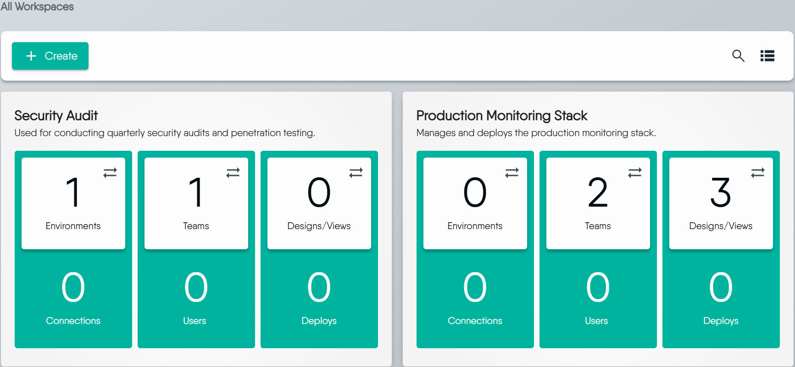
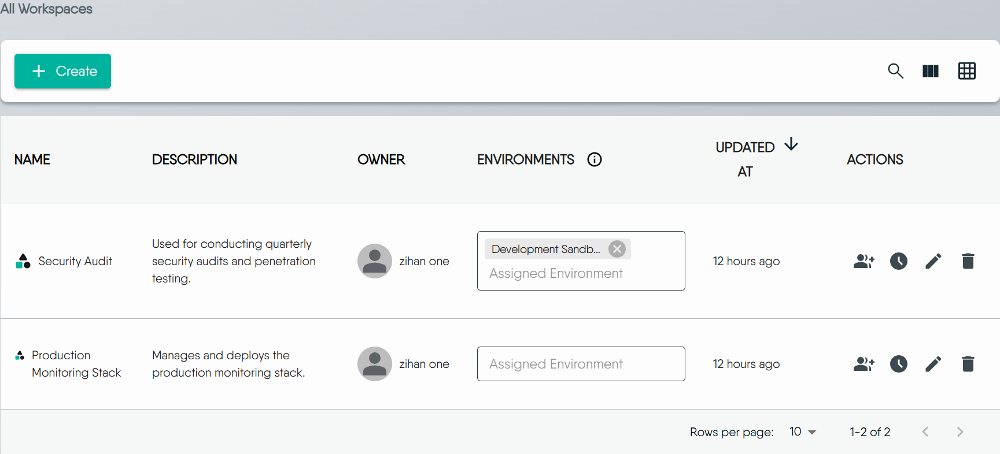
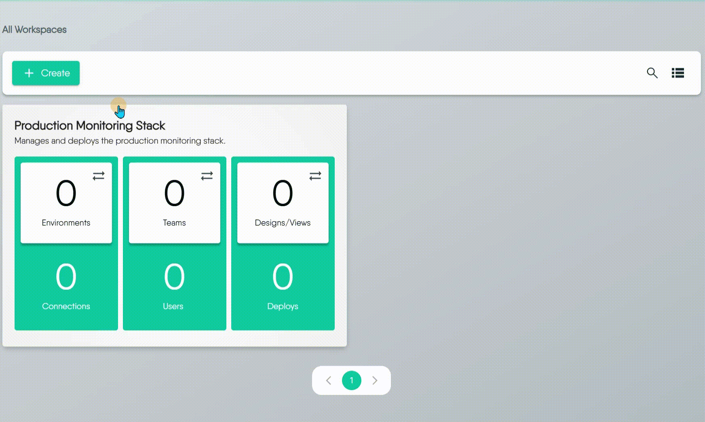
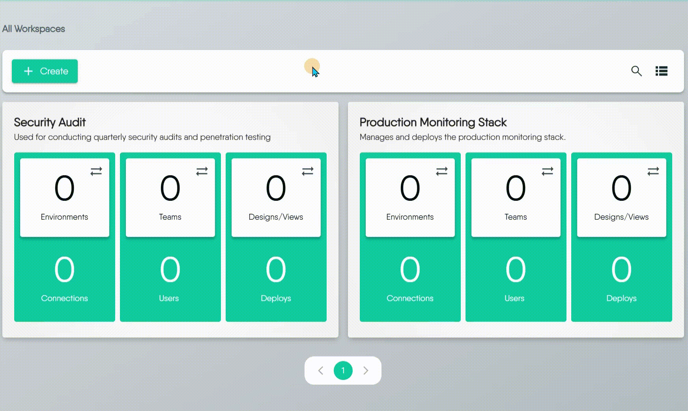
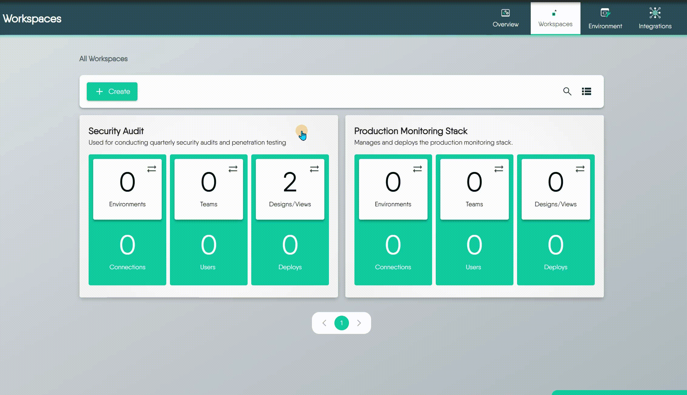
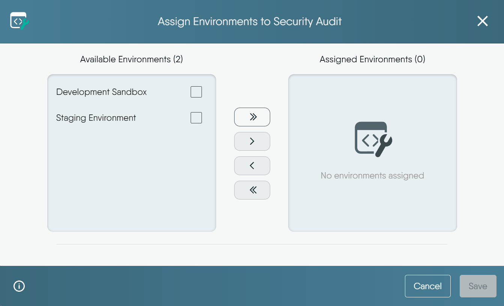
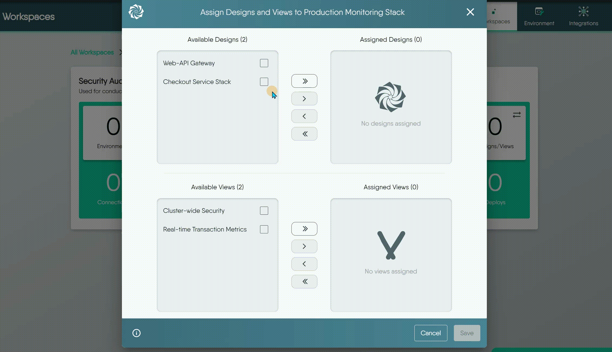
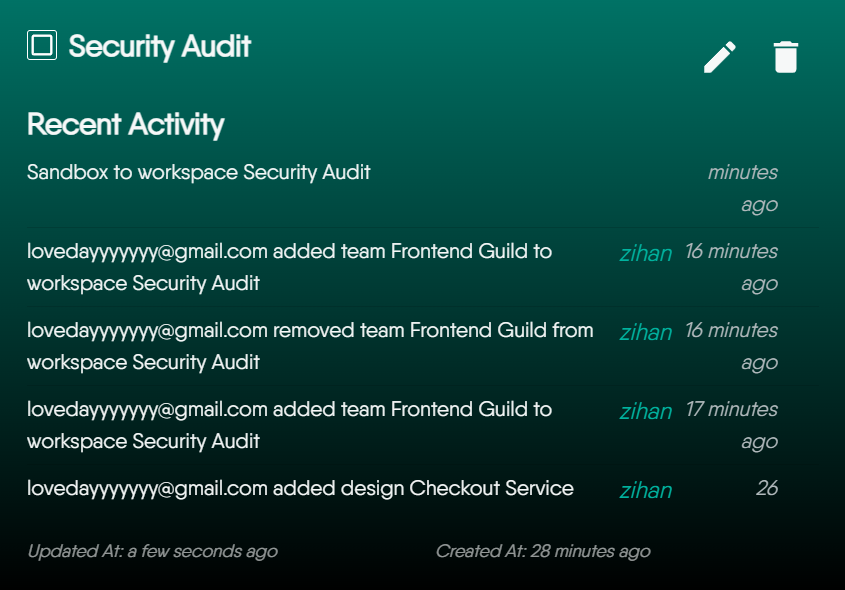

# Managing Workspaces

> Learn how to create, edit, delete, and configure your Workspaces.

This guide walks you through the practical steps of managing your Workspaces. Here, you'll learn how to create, edit, and delete Workspaces, as well as how to manage access by assigning teams and resources like Environments, Designs, and Views to them.

If you're new to the concept of Workspaces, we recommend starting with the [Workspaces Overview](/pr-preview/pr-1354/cloud/concepts/spaces/workspaces/) to understand what a Workspace is and how it relates to key components like Environments, Designs, and Teams.

  <h4 class="alert-heading" style="color: #3772ff;">A Note on Permissions</h4>
  
      Every action described in this guide is governed by roles and permissions. To see a detailed breakdown of what your assigned role allows you to do, please refer to the <a href="/pr-preview/pr-1354/cloud/reference/default-permissions/">Default Permissions</a> documentation.
  

### View Workspaces

The [Workspaces page](https://cloud.layer5.io/spaces/workspaces) is where you can see all of the workspaces within the currently selected organization.

> To suit different workflows, you can switch between two distinct layouts: a visual [grid view](#grid-view) and a detailed [table view](#table-view).

#### Grid View
The grid view offers a card-based layout, perfect for quickly identifying workspaces at a glance. Each card displays essential information, and you can flip it to reveal management options like editing or deleting and get audit history.

#### Table View
The table view provides a dense, list-based format that is ideal for managing a large number of workspaces. This view allows for sorting and gives you more control over the specific details you see.

To customize the information displayed, click the **View Columns** icon and select the attributes you want to see, such as Owner ID or Created Date.

  <h4 class="alert-heading" style="color: #3772ff;">Consistent Actions Across Views</h4>
  
      Both the grid and table views provide the same set of management capabilities. You can choose the layout that best fits your needs without losing any functionality.
  

### Create a Workspace

Creating a new workspace allows you to manage resources, and define team access.

  <h4 class="alert-heading" style="color: #3772ff;">Permissions Required</h4>
  
      Creating a workspace requires the <strong>Create Workspace</strong> key in the organization that will own it. Organization Admin and Workspace Admin hold it by default. A custom role can hold it too. See <a href="/pr-preview/pr-1354/cloud/reference/default-permissions/">Default Permissions</a>.
  

To create a workspace:

1. Click the **+ Create** button to open the creation Dialog.
2. From the dropdown menu, select the **Organization** that will own the new workspace. The chosen Organization **cannot be** changed after the workspace is created. Please select carefully.
3. Enter a descriptive **Name** and an optional **Description**, then click **Save**. Name and description are each limited to 255 characters. A longer value fails with `Unable to create workspace`. Names do not have to be unique.
4. Your new workspace will now appear on the page. It has no teams and no environments. The workspace stays in the organization you chose.

### Edit a Workspace

You can modify a workspace's name and description at any time after it has been created. An update changes only the fields you send. The organization never changes. A workspace that is not in one of your organizations answers `workspace not found`.

- **From the Grid View:** Flip the workspace card, then click the **pencil icon**.
- **From the Table View:** Click the **pencil icon** in the row of the workspace you wish to modify.

### Delete a Workspace

You can delete a single workspace or multiple workspaces at once.

- **To delete a single workspace:**

    - From the **Grid View**, flip the workspace card, then click the **trash can icon**.
    - From the **Table View**, click the **trash can icon** in the row of the workspace you wish to delete.

- **To delete multiple workspaces (Grid View only):**

  1. Select the checkboxes on the cards of the workspaces you want to delete.
  2. Click the **Delete** button that appears at the top of the page.

  <h4 class="alert-heading" style="color: #3772ff;">Deletion Restrictions</h4>
  
      An organization must keep at least one workspace. Layer5 Cloud refuses to delete the last one with <code>cannot delete workspace: at least one workspace must exist for the organization</code>. The refusal arrives as HTTP 500. The check holds under concurrent requests, so two simultaneous deletes cannot empty an organization. Create the replacement workspace first, then delete the other.
  

#### Workspace Deletion Behavior

<h4 class="alert-heading">What Happens When a Workspace is Deleted?</h4>

    Deleting a workspace ends every team, environment, design, and view assignment it holds. It does not delete those resources. Designs and views remain, with no workspace, until you assign them to another one.

When a Workspace is deleted:

- The workspace record is removed. Proceed with caution: the assignment list is not restored.
- Teams, environments, connections, designs, and views all remain.
- Designs and views that were in the workspace have no workspace afterwards. Move them to another workspace first if you want them to keep a home.
- Team members lose the read-only connection access that flowed through the deleted workspace.

### Assign Teams to a Workspace
Assigning a team grants its members **read-only access to the connections, and their credentials, in every environment linked to the workspace.** It does not grant access to private designs or views, and it does not decide who can see the workspace: every organization member can already list every workspace.

The team and the workspace must belong to the same organization. A team from another organization is refused with HTTP 403. Assigning a team that is already assigned changes nothing. Removing the team ends the connection access at once.

To give someone access to a private design, share the design with that person. See [Sharing Designs](/pr-preview/pr-1354/kanvas/designer/sharing/) and [Sharing a Workspace](/pr-preview/pr-1354/cloud/guides/tutorials/sharing-a-workspace/).

You can open the team management Dialog from either the grid or table view.

- **From the Grid View:** Click the **Teams** tile.
- **From the Table View:** Click the **Teams icon** in the workspace row. A list of currently assigned teams will appear. From there, click the **Assign Team** button to open the assignment Dialog.

Inside the assignment Dialog, you will see two lists: **Available Teams** on the left and **Assigned Teams** on the right.

1. Select one or more teams from either list.
2. Use the arrow buttons to move the selected teams between the lists:
      - **>** Assigns a selected team.
      - **<** Unassigns a selected team.
      - **>>** Assigns all available teams.
      - **<<** Unassigns all assigned teams.
3. Click **Save** to apply your changes.

  <h4 class="alert-heading" style="color: #3772ff;">Team and Workspace Relationships</h4>
  
      You can assign multiple teams to a single workspace, and a single team can also be a member of multiple workspaces. This provides flexible access control across your projects. For more restrictions, see <a href="/pr-preview/pr-1354/cloud/concepts/spaces/workspaces/">Workspaces documentation</a>.
  

### Link Environments to a Workspace
When you link an [Environment](/pr-preview/pr-1354/cloud/concepts/spaces/environments/) to a Workspace, its connections become readable by every member of the workspace's teams. The access is read-only. The environment and the workspace must belong to the same organization; a cross-organization attachment is refused with HTTP 403.

Some environments are provisioned by Layer5 Cloud itself to hold organization configuration such as the mail server or sign-in providers. Layer5 Cloud refuses to attach one to a workspace: `this environment is provisioned by the platform and cannot be added to a workspace`. Attaching an environment that is already attached returns the existing attachment. Detaching one that was never attached answers `no such environment assignment`.

The process of linking environments is almost the same as assigning teams.

Opening the **Environments** tile is also how you see which Environments a Workspace currently draws on: the dialog's assigned list is that Workspace's Environments.

  <h4 class="alert-heading" style="color: #3772ff;">Many-to-Many Relationship</h4>
  
      An Environment can be linked to multiple Workspaces, and a Workspace can have multiple Environments. This allows you to share common environments across different projects.
  

  <h4 class="alert-heading" style="color: #3772ff;">Managing the Environments Themselves</h4>
  
      Creating an Environment, editing it, and choosing which Connections belong to it are done on the Environments page rather than here. See <a href="/pr-preview/pr-1354/cloud/guides/workspaces/managing-environments/">Managing Environments</a>.
  

### Move Designs and Views Between Workspaces

Unlike Environments, a Design or View belongs to **at most one Workspace**. Placing it in a workspace moves it: Layer5 Cloud removes every earlier workspace assignment, then adds the new one. There is no copy. Removing it leaves the design or view with no workspace. The resource and its owner are unaffected.

The permission is checked in the destination workspace's organization only. Layer5 Cloud does not check that you can open the workspace the design leaves. The unassigned list shows only designs you own. The workspace decides the organization the design is listed under. A private design stays private wherever it sits.

#### How to Move a Design or View

1. Click the **Designs/Views** tile on the Workspace card (or the equivalent icon in the table view) to open the management Dialog.
2. Inside the Dialog, select the Design(s) or View(s).
3. Use the arrow buttons to move the selected Design(s) or View(s) to the target workspace.
4. Click **Save**.

  <h4 class="alert-heading" style="color: #3772ff;">Exclusive Ownership</h4>
  
      A Design or View can only exist in one Workspace at a time. Moving it to a new Workspace will automatically remove it from its original location. For more detailed information, see <a href="/pr-preview/pr-1354/cloud/concepts/spaces/workspaces/">Workspaces documentation</a>.
  

### View Recent Activity

Meshery keeps a detailed audit log for each workspace, allowing you to track all significant events. This is useful for maintaining security and troubleshooting issues.

The activity log captures a variety of events, including:
- The creation, update, or deletion of the workspace.
- The assignment or unassignment of Teams, Environments, Designs, and Views.

Every entry carries the email address of the person who acted. Failed attempts are recorded as error events. Reading the log requires the View Workspace permission. The log is paged and searchable.

  <h4 class="alert-heading" style="color: #3772ff;">Putting It All Together: A Hands-on Guide</h4>
  
      To see how managing a Workspace fits into a complete, end-to-end workflow, follow the <a href="https://cloud.layer5.io/academy/learning-paths/mastering-meshery/introduction-to-meshery?chapter=using-workspaces-effectively">Using Workspaces Effectively</a> learning path.
  

### Common Workspace Usage Patterns

There isn't a single "best" way to organize your workspaces, as structure depends heavily on team dynamics and project needs. Instead, we recommend a flexible, multi-layered approach to maximize workspace effectiveness. Below are common usage patterns:  

**1. The Project Hub** 

Dedicate a shared workspace to each project. It becomes a central hub where your team can co-develop designs, share reusable components, and align with specific environments (e.g., staging or production). This keeps all your environments, history, and resources in one place

**2. Your Personal "My Drive"** 

Think of a workspace you keep for your own designs as a personal working area. You can use it for confidential designs or for trying ideas. Team assignment still does not open those designs to anyone else. Share a design when you are ready for someone else to open it.

**3. Template Library** 

Create a separate, access-controlled Workspace to serve as your organization's internal, private template library. This is for storing non-public, organization-specific, or sensitive patterns. 
> This practice complements the [public Catalog](/pr-preview/pr-1354/cloud/concepts/catalog/exploring-the-catalog/), which is used for sharing generic, non-sensitive designs with the community. A dedicated Organization Catalog feature is also planned for the future.

**4. The Team Space** 

You can also organize long-term workspaces around specific teams, such as a "Developer Hub" or "QA Workspace." This simplifies resource management and makes it easy to monitor team-wide activity.

**5. The Environment-Specific Space** 

For teams requiring strict separation between environments, give a production workspace only the production environment and the platform team. Members of other teams cannot read production connections through it. Moving a design into that workspace is the promotion. There is no separate approval step. See [Promoting a Design from Staging to Prod](/pr-preview/pr-1354/cloud/guides/tutorials/promoting-a-design/).

### FAQ

#### 1. When a design is transferred from one Workspace to the next, is design ownership affected? Who has access? What if the Workspaces are in different orgs?

  - **Ownership**: A Design's ownership is permanent. The user who created it stays its owner after any move. Ownership never transfers.
  - **Access**: Workspace membership grants no design access. Only the owner, provider administrators, and users the design was shared with can open a private design.
  - **Cross-Organization Transfers**: Moving a design into a workspace in another organization lists the design under that organization. The permission checked is Assign Designs to Workspaces in the destination organization.

#### 2. What can other users of a Workspace do with my design? Can they delete my design?

Workspace membership grants no design access. People you shared the design with can read, edit, and clone it. Only the owner or a provider administrator can delete it.

#### 3. Can Workspaces contain private, public, and published designs?

Yes. A Workspace can simultaneously contain Designs that are private, public, and published.

#### 4. How will I know if another user made changes to my design? Will I be notified? Is there an edit history or audit trail?

Currently, it is **not possible** to receive direct notifications or see a collaborative audit trail of changes made by other users. While a Version History feature exists for Designs, it currently only tracks changes made by you, not changes from other collaborators.

#### 5. If I share my private design with a user in a different org, can they share my design with other users?

Sharing onward depends on that person's own Share Design permission, not on the grant. A collaborator who holds Share Design can share the design onward. A grant is for one person. A team grant is not honored, so grant each person. See [Sharing Designs](/pr-preview/pr-1354/kanvas/designer/sharing/).

> [learn more about sharing designs](/pr-preview/pr-1354/kanvas/designer/sharing/).

#### 6. Does a workspace have space limitations or file count limitations?

Layer5 Cloud enforces no space or file-count limit on workspaces, and no plan check on workspace actions.

#### 7. How can I make my design publicly available, but read-only to other users?

To make a Design available to everyone but in a read-only state, you should **[Publish](/pr-preview/pr-1354/kanvas/designer/publishing-designs/)** it. A **Published** design can be viewed and cloned by any user, but the original cannot be edited by others.

#### 8. How do I share a private design with a specific team for collaboration?

Assigning a team to the workspace does not open the design. Share it with each person:

1. Open the design and click **Share**.
2. Search for the person and add them. The dialog finds individual users only. There is no view-only or comment-only level: a person who can open the design can edit it.
3. Confirm the person appears under **People with Access**.

A private design stays private. To remove someone, open **Share** and remove them from **People with Access**. See [Sharing a Workspace](/pr-preview/pr-1354/cloud/guides/tutorials/sharing-a-workspace/).

