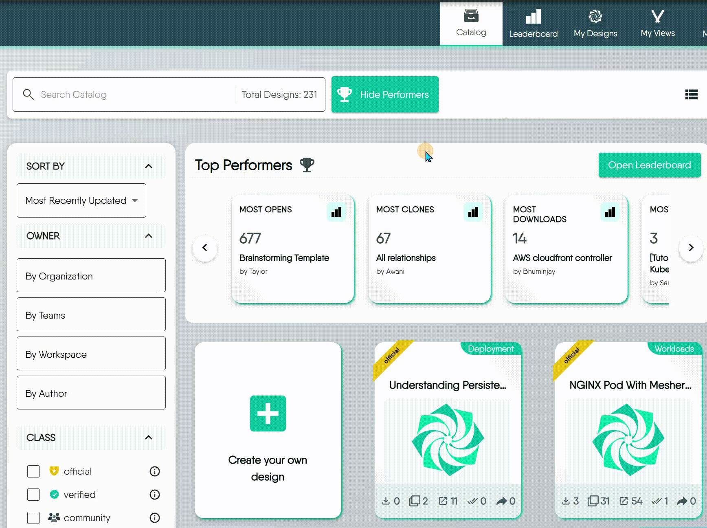
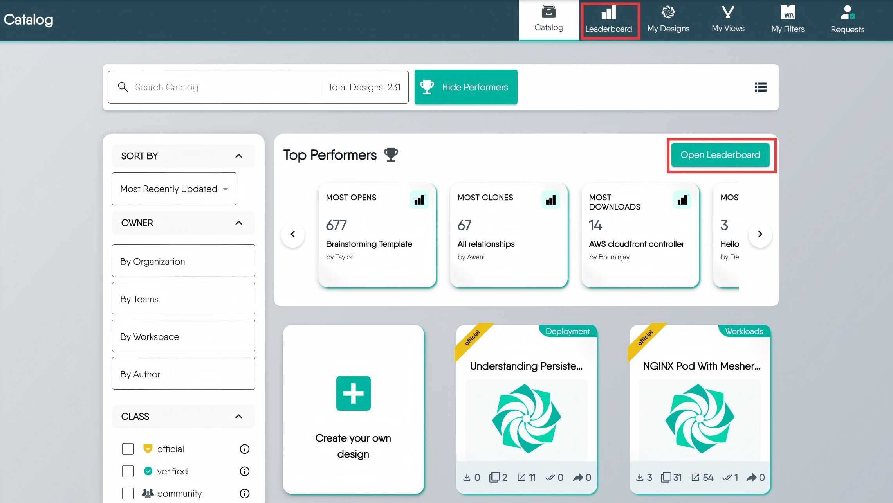
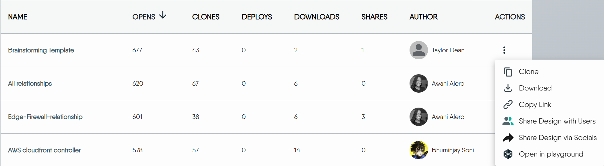

# Leaderboard

> The Leaderboard is a visual representation of Designs, ranked based on key Metrics such as Opens, Downloads, Deployments, Clones, and Shares.

Leaderboard provides a clear and engaging way to view and compare the performance of different Designs, highlighting the most popular and actively used ones within the Cloud.

  <h4 class="alert-heading" style="color: #3772ff;">Understanding Metrics</h4>
  
      Metrics are quantifiable measures used to track and assess the status, progress, and performance of various activities and user interactions with Designs. Learn more about <a href="/pr-preview/pr-1356/cloud/concepts/catalog/metrics/">Metrics</a>
  

### How to Access the Leaderboard

The leaderboard is the catalog sorted by one of the usage counters. It is not a separate score. By default it sorts by Opens, highest first, ten rows per page. The dashboard also shows the leaderboard as a widget.

You can reach the full Leaderboard from the Catalog page: in **Top Performers**, click **Open Leaderboard**.

Viewing the leaderboard needs the View Designs permission. Without it, the page shows a permission-denied message instead of the table.

### Using the Leaderboard Page

The Leaderboard page offers several ways to explore and interact with:

- **Search for Designs:** Click the **Search** icon to find designs by name. Search matches names only.
- **Sort by Different Metrics:** Click a metric column such as `Opens`, `Clones`, or `Downloads` to re-rank the list. The sort order is kept in the page address.
- **Filter:** Narrow by Type and by Class. Each filter takes one value at a time.
- **Customize Your View:** Click the **View Columns** icon to show or hide specific metric columns.
- **Take Actions:** On a row you can clone, download, copy its link, share it, or open it in the Playground.

