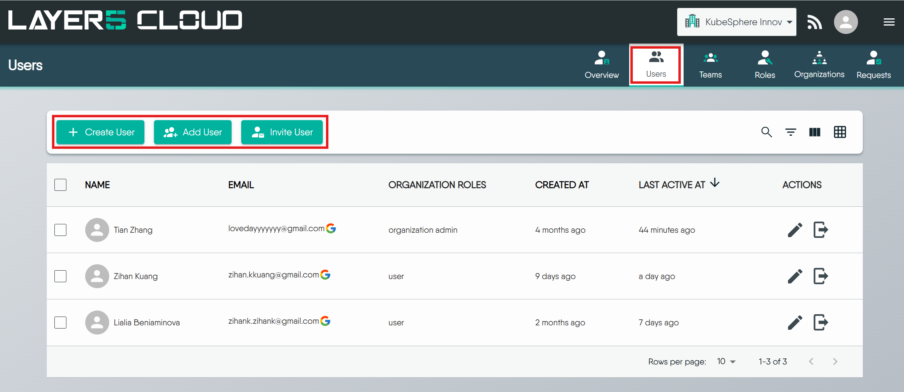
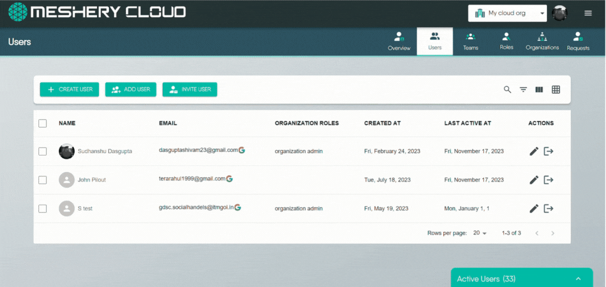
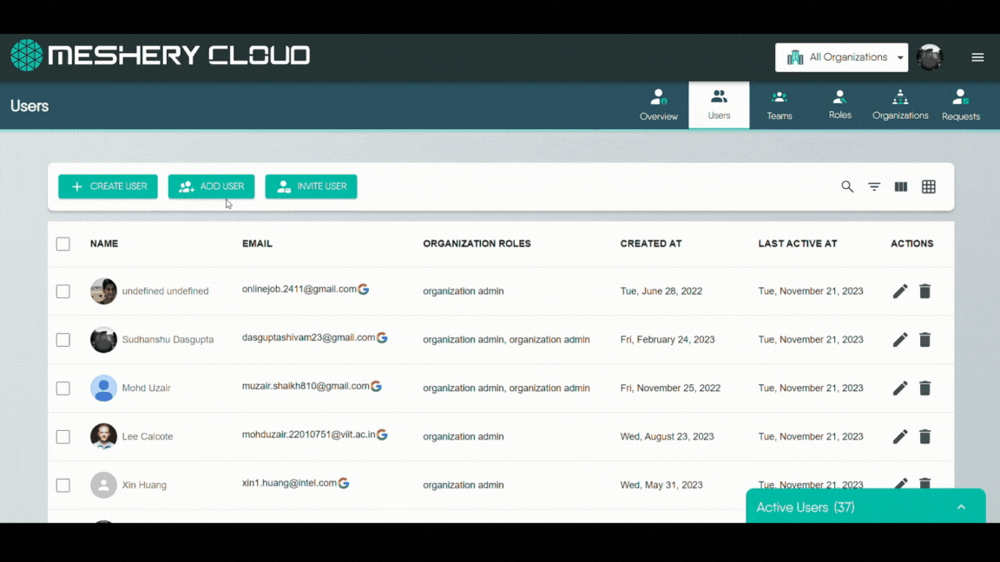
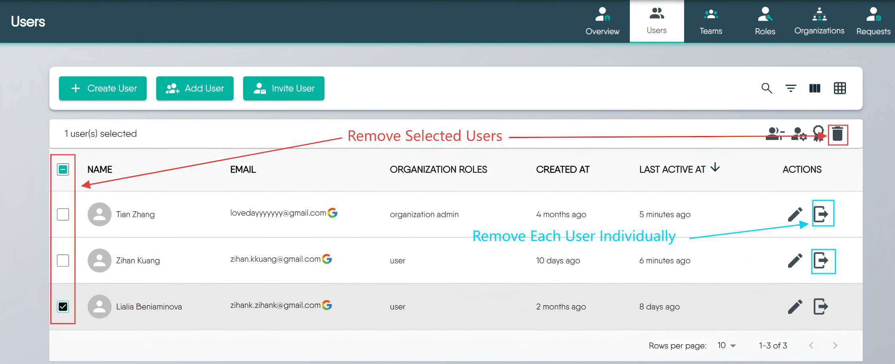

# User Management

> Learn how to create, add, invite, and manage users within Layer5 Cloud.

The Users page lists an organization's members and carries the actions that put people into the organization, change what they can do, and take them out. To bring people in by invitation link, use [User Invitations](/pr-preview/pr-1362/cloud/concepts/identity-and-security/users/user-invitations/). For what an account is, read [Users](/pr-preview/pr-1362/cloud/concepts/identity-and-security/users/).

Each action needs a permission in the current organization. The server also checks your role for some actions, so holding the permission through another role is not always enough.

| Action | Permission | Also required |
| --- | --- | --- |
| Open the Users page | View All Users | None |
| Create a user | Create User | Organization Admin and Provider Admin hold it by default. |
| Add an existing user | Add User to Organization | You are an Organization Admin or owner of the organization, a Provider Admin, or an Organization Admin or owner of its parent organization. |
| Remove a user | Remove User from Organization | You are an Organization Admin of the organization or a Provider Admin. |
| Edit a member's profile | Update User Profile | The member belongs to an organization you share. Only a Provider Admin can change their email address. |
| Change roles | Assign User Roles or Assign Roles to Organization members | You are an Organization Admin, a Provider Admin, or a holder of the permission. The target is a member. |
| Delete an account | Delete User | Provider Admin, and the all-organizations scope. See [Delete an account](#delete-an-account). |

Provider roles are deployment-wide. Only a Provider Admin can grant or clear them. Add User to Organization adds an existing account. It does not create one.

The Users page shows people with a live membership in the selected organization, 10 to a page by default and at most 100. A Provider Admin can switch the scope to every organization. The default list is active accounts only. Pending and deactivated accounts stay hidden until you apply a filter. The default order is most recent sign-in first. Search is a case-insensitive substring match on email, first name, and last name. You can filter by role and by deleted or not deleted. Last active is the time of the most recent sign-in, not a live connection.

## Create User Account

Use this to create an account for a person who has not registered. You supply a first name, last name, and email address, all required.

Layer5 Cloud creates the account with the email address already verified and sends an **Account Setup** email. The link is valid for 720 hours (30 days) and opens a page where the person sets a password. The account's status is Pending until they sign in.

  <h4 class="alert-heading" style="color: #EBC017;">Creating a user does not add them to an organization</h4>
  
      The create form offers organization and role fields, but the account is created without them. The new user belongs to no organization and holds no roles until you add them. After creating the account, add the user to the organization and assign roles.
  

If the setup email cannot be sent, the request fails with `Failed to send "Account Setup" email`. The address must be a valid email.

  <h4 class="alert-heading" style="color: #3772ff;">Permission Required for User Creation</h4>
  
      Create User is held by Organization Admin and Provider Admin by default. Team Admins do not create user accounts. See <a href="/pr-preview/pr-1362/cloud/concepts/identity-and-security/roles/">Roles</a>.
  

## Add / Remove Existing User

This section explains how to add existing Layer5 Cloud users to one of your organizations or remove them.

  

<a href="https://cloud.layer5.io/catalog/content/design/066b0ef3-7956-4c3b-a5cc-1d276ac13ec6" target="_blank" rel="noopener noreferrer">
  Open Design
</a>

### Adding a User to an Organization

If someone already has a Layer5 Cloud account but is not part of your organization, you can add them. Search for the person, then choose the organization, and optionally the teams and organization roles. The search covers every active, non-anonymous account on the deployment, not only your organization, and an empty search returns nothing.

1. Go to the Users tab in the Identity section.
2. Click the **Add User** button.
3. Select the organization to which you want to add the user.
4. Select the user from the list of available users.
5. Roles and teams, if you choose them, run as separate steps after the membership is created.

Adding makes the person a member with **no role**. If a role or team step fails, the membership stays and the failure is reported. Adding someone who is already a member changes nothing. Layer5 Cloud sets no seat limit on adding people. Billing counts members separately. See [Billing and seats](#billing-and-seats).

### Removing Users from an Organization

You can remove users from an organization one by one or several at once. Removal takes away their membership and access inside that organization. It does not delete their Layer5 Cloud account. Removal acts on the organization currently selected in your session. Check the organization switcher first. Bulk removal issues one removal per person, in order.

#### Method 1: Individual User Removal (One by One)
   * **Locate the User:** Find the specific user you wish to remove from the list.
   * **Use Row Action:** Click the "Remove User" icon.
   * **Confirm:** When prompted, confirm your decision to remove the user from the organization.

#### Method 2: Bulk User Removal (Multiple Users at Once)
   * **Select Users:** Use the checkboxes next to each user's name to select all the users you intend to remove.
   * **Use Bulk Action:** Click the "Delete" button.
   * **Confirm:** When prompted, confirm that you want to remove all the selected users from the organization.

#### What Removal Ends

Removing a member ends every access-bearing relationship they hold **inside that organization**, as a single operation:

* **Their organization membership**, together with the organization [roles](/pr-preview/pr-1362/cloud/concepts/identity-and-security/roles/organization-roles/) attached to it.
* **Their membership in that organization's [teams](/pr-preview/pr-1362/cloud/concepts/identity-and-security/teams/)**, together with the team [roles](/pr-preview/pr-1362/cloud/concepts/identity-and-security/roles/team-roles/) attached to those memberships.

Both matter, because permissions reach a user through the roles carried on those memberships. A [keychain](/pr-preview/pr-1362/cloud/concepts/identity-and-security/keychains/) granted by a team role is revoked by the removal just as an organization role's keychain is, so a removed member is left holding no [keys](/pr-preview/pr-1362/cloud/concepts/identity-and-security/keys/) in the organization by either route. Both removal methods above behave identically in this respect; removing several members at once applies the same operation to each one.

Removal does **not** affect:

* The person's Layer5 Cloud user account, which continues to exist.
* Their membership in any other organization.
* Designs, environments, and other resources they created, which remain in the organization.
* The audit trail, which records who removed whom.

  <h4 class="alert-heading" style="color: #EBC017;">Shared teams lose the member everywhere</h4>
  
      A team can be mapped to more than one organization. Removing a member from one organization ends their membership in every team mapped to it, including a team they use through another organization they still belong to. Add them back to that team afterward.
  

| Situation | Result |
| --- | --- |
| The person is the organization's owner | Refused with `Organization owner cannot be removed`. Ownership cannot be transferred, so the owner stays a member for the life of the organization. Promote another member to Organization Admin if you need a second administrator. |
| An owner tries to remove themselves | Refused. Owners cannot leave. Delete the organization instead. |
| An administrator removes themselves, and is not the owner | Allowed. |
| The person was never a member | `no organization membership to remove`. |
| The same removal is repeated | Succeeds and changes nothing. |
| One person in a bulk selection is refused | Only that row fails. The result names each refused person, and the others are removed. |

Removal is not reversible from the Users tab. To restore someone's access, add them to the organization again and reassign their organization roles and team memberships. Neither returns on its own.

  <h4 class="alert-heading" style="color: #EBC017;">Team Access Is Not Itemized in the Confirmation</h4>
  
      The confirmation shown after a removal reports only that the member was removed from the organization. It does not list the team memberships that ended with it. Review the member&rsquo;s teams before removing them if you need a record of what their removal revoked.
  

  <h4 class="alert-heading" style="color: #3772ff;">Organization Owners Cannot Be Removed</h4>
  
      An attempt to remove the organization&rsquo;s owner is rejected with <code>Organization owner cannot be removed</code>. Ownership cannot be transferred. The owner stays a member for the life of the organization. Promote another member to Organization Admin if you need a second administrator. See <a href="/pr-preview/pr-1362/cloud/concepts/identity-and-security/roles/organization-roles/">Organization Roles</a>.
  

## Invite User via Email

The direct invite on the Users page brings in one person who has no account. It is separate from an [invitation link](/pr-preview/pr-1362/cloud/concepts/identity-and-security/users/user-invitations/). It needs Invite User to Organization.

* **How to Invite:**
    1.  Click the "Invite User" button.
    2.  Enter an email address, and optionally a first name, last name, organization roles, and teams.
    3.  Layer5 Cloud creates a Pending account, adds it to the organization and the listed teams, and sends an email with a sign-up link already filled in with the name, email, and organization.
* **What happens immediately:** Membership begins before the person acts. There is no quota, expiry, acceptance step, or invitation record to disable. The email is always sent.
* **Roles:** Applied right after the email is sent. A role you may not grant is skipped with an `unauthorized to assign` message.
* **Existing account:** Refused with `User with email '<email>' already exists`. Add that person as an existing user instead.

  <h4 class="alert-heading" style="color: #3772ff;">Permissions for Role Assignment</h4>
  
      An Organization Admin can assign organization roles to members. Provider roles can only be assigned by Provider Admins, and a request that lists a provider role inside an organization or team row is refused for every caller, a Provider Admin included. See <a href="/pr-preview/pr-1362/cloud/concepts/identity-and-security/roles/">Roles</a>.
  

## Edit a profile

**Needs:** Update User Profile in an organization you share with the person.

Organization Admins can edit the profile of members of their organizations. Provider Admins can edit anyone. Edits to another person's profile are refused with `user is not authorized to administer this account` when you share no organization with them, and the message is the same whether the account exists or not.

A Provider Admin can change the email address. An Organization Admin who submits a different email is refused with `user is not authorized to change the e-mail address of this account`. Changing an email address marks the new address unverified and sends a verification message. The person signs in with the new address once it is verified.

Granting badges is covered in [Recognizing User and Contributor Milestones](/pr-preview/pr-1362/cloud/guides/tutorials/assigning-user-badges/).

## Change a member's roles {#change-a-members-roles}

**Needs:** Assign User Roles or Assign Roles to Organization members, and the role check in the permissions table.

To make someone an administrator, give them Organization Admin. To take administration away, remove it.

- The roles you submit replace the roles the member holds in that scope. An empty list removes every role in the scope. Removing roles never ends the membership.
- Provider roles cannot be granted inside an organization or a team. A request that lists one is refused with HTTP 403 for every caller, and no part of the request is applied.
- Team scope accepts only Team Admin. See [Teams](/pr-preview/pr-1362/cloud/concepts/identity-and-security/teams/).
- A request is checked before anything is written. If one row is refused, none of the rows are applied.
- Layer5 Cloud does not stop you removing the last administrator. An organization's owner keeps administrator access through ownership. Confirm another administrator exists before you remove the role.

## Delete an account

Deleting an account removes a person from Layer5 Cloud entirely, in every organization. It is a Provider Admin capability. Organization Admins remove members from their own organization instead. They cannot delete accounts.

  <h4 class="alert-heading" style="color: #EBC017;">Account deletion from an organization's Users page does nothing</h4>
  
      The Users page shows the delete action to holders of Delete User, but a request issued from a single organization&rsquo;s page reports success without deleting anything. Deletion takes effect only when a Provider Admin runs it with the all-organizations scope. Use removal to end someone&rsquo;s access to your organization.
  

When the account owns organizations or teams, each passes to its longest-standing Organization Admin (Team Admin for a team), or else its longest-standing member, and one with nobody else in it is deleted. An organization that is the parent of another live organization is not deleted this way. Account deletion is refused, rarely, when the account holds credentials designated to an organization it does not own that has no live owner or Organization Admin to receive them. Promote another administrator or release the credentials first. See [Account Deletion](/pr-preview/pr-1362/cloud/concepts/identity-and-security/users/#account-deletion).

## Billing and seats

Removing a member stops them counting toward billing, and adding one starts it. A subscription's billable user count is the number of distinct members with a live organization membership and an active account, excluding members whose only role is Academy Learner, and never below the plan's minimum. A member added with no role is not counted. The count adjusts the subscription quantity. It does not block anyone from joining.

## Events

Adding, creating, removing, editing, and role changes each write an audit event that names the person who acted and the person affected, for example `<actor> removed <person> from organization`.

