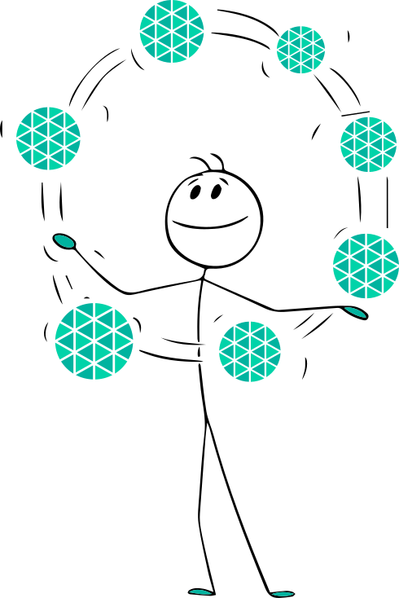

# Users

> Each user account represents an individual collaborator. Individual user accounts exist beyond the bounds of organizations.

## User Accounts

Anyone who uses Layer5 Cloud signs into a user account. Your user account is your identity on Layer5 Cloud and has a username and profile. For example, see Five's profile.

      <strong>Five</strong>, Platform Engineer
    

    

        

<strong>Organization:</strong> Orbital Labs 
<strong>Role:</strong> User (Platform Engineer) 
<strong>Plan:</strong> Team

Curious, enthusiastic, and reliably the first to discover that a feature works differently than the docs say it does.

<a href="/pr-preview/pr-1364/cloud/getting-started/meet-five/">See full cast →</a>

      

  

      <strong>Maya Chen</strong>, Org Admin
    

    

        

<strong>Organization:</strong> Orbital Labs 
<strong>Role:</strong> Org Admin + Development Team Admin 
<strong>Plan:</strong> Team

Voice of reason. Has a calendar block called &ldquo;Preventing Five from touching prod&rdquo; that recurs every Friday at 4:45 PM.

<a href="/pr-preview/pr-1364/cloud/getting-started/meet-five/">See full cast →</a>

      

  

Your user account can own resources such as designs, connections, credentials, and API tokens. Any time you take an action on Layer5 Cloud, such as creating a design or changing a member's roles, the action is attributed to your user account and written as an audit event that names that account.

A user account carries a profile: first and last name, email address, avatar, tagline, country, region, and social links. The username shown on the profile is the account's identifier. It cannot be edited by the person or by an administrator. A person who needs a different sign-in address changes their email address instead, and the new address must be verified before it becomes active.

Layer5 Cloud enforces no limit on the number of users, seats, or organizations when people are created, added, or invited. Seats are a billing concept: a subscription's billable user count is derived from the organization's active members, and the count adjusts the subscription quantity without blocking anyone from joining. Members whose only role is Academy Learner are excluded from that count. A member added with no role is not counted. The count never falls below the plan's minimum.

  <h4 class="alert-heading" style="color: #3772ff;">Info</h4>
  
      For plan names, see <a href="https://layer5.io/pricing">Layer5 subscription plans</a>.
  

Teams allow you to organize users into groups and assign access to workspaces, or to assign roles with associated keychains and keys. A person added to an organization or a team without a role is a member who holds no role. Membership and roles are separate.

  <h4 class="alert-heading" style="color: #3772ff;">Info</h4>
  
      Team Admin assigns the Team Admin role inside that team. It does not create user accounts. Organization Admin and Provider Admin hold Create User by default. See <a href="/pr-preview/pr-1364/cloud/concepts/identity-and-security/teams/">Teams</a> and <a href="/pr-preview/pr-1364/cloud/concepts/identity-and-security/roles/">Roles</a>.
  

Organizations may have any number of teams, and teams may have any number of users. User accounts are owned by the person, not by an organization.

Users of one organization may be granted access to resources (for example workspaces and designs) of another organization through a resource-access mapping. Roles and permissions are organization-scoped: the permissions a user has in one organization do not apply in another.

  <h4 class="alert-heading" style="color: #3772ff;">Info</h4>
  
      Creating user accounts requires Create User, which Organization Admin and Provider Admin hold by default. Team Admins manage membership of their own team. They do not create user accounts. See <a href="/pr-preview/pr-1364/cloud/concepts/identity-and-security/users/user-management/">User Management</a>.
  

## Account Linking

You can link your Layer5 account to supported social sign-in providers after signing up, and you can unlink previously added providers at any time. Layer5 Cloud can also link providers automatically during sign-in when the provider returns a verified email address that already belongs to your account. This is how it works:

1. You create an account with the email address `alice@example.com` and a password.
2. When signing in later, click to sign in with a social sign-in provider such as GitHub or Google that returns the same **verified** email address `alice@example.com`.
3. Layer5 Cloud recognizes that the verified email address already belongs to your existing account and automatically links that provider. You are not prompted to re-enter your password for this linking step.
4. After the link is created, you can sign in with either your password or any linked social sign-in provider.

If a provider that is already linked to your account later reports a different verified email address, Layer5 Cloud still signs you in to the same account. The email already stored on your Layer5 account is not silently replaced or automatically updated.

**Rules and Limitations**

1. You cannot link the same social sign-in to multiple Layer5 accounts
2. The provider a person used to create the account cannot be unlinked
3. If you delete your account, any linked OAuth providers (for example, GitHub) are removed with the sign-in identity
4. Re-registering with the same email creates a new account and does not re-link the OAuth provider or restore the deleted account
5. Automatic linking depends on the provider returning a verified email address. When GitHub or Google reports an address it has not verified, Layer5 Cloud does not record that address on the account
6. If a linked provider later reports a different verified email address, Layer5 Cloud preserves the email already stored on your account, signs you in to the same account, and records an audit entry
7. Each active email address belongs to one account. Layer5 Cloud refuses a second active account for an address that already belongs to one
8. You may unlink a social sign-in provider other than the one used to create the account

When a person signs in with GitHub or Google through an organization's custom domain, Layer5 Cloud resolves the provider's verified email address itself: it creates an account when none has that address, signs in when the provider is already attached, or attaches the provider without a prompt when an account has the same verified address but not this provider.

## Account Deletion

A person deletes their own account from their profile. Only a Provider Admin deletes another person's account. Organization Admins remove members from their organization instead. Deletion is permanent, and Layer5 Cloud offers no recovery.

### What deletion removes and what it keeps

| Item | After deletion |
| --- | --- |
| Organization memberships and organization roles | Ended in every organization. Each membership is kept as an ended record, so organization history shows when access ended. |
| Team memberships and team roles | Ended in every team, kept as ended records |
| Provider-wide roles | Removed |
| Sign-in identity, password, and linked GitHub and Google sign-in | Removed |
| The account record | Marked deleted and set to `inactive`. Its public profile is no longer served. |
| Sessions and API tokens | Stop working. Every API token is revoked. The person is signed out. |
| The account's email address | Released, so it can be used to sign up again |
| Organizations and teams the person owns | Handed on: each passes to its longest-standing Organization Admin (Team Admin for a team), or else its longest-standing member. One with nobody else in it is deleted, unless the organization is the parent of another live organization. |
| Credentials designated to an organization | Handed to the organization's owner, or else its longest-standing Organization Admin. For an organization the person owned, that is its new owner. |
| Designs and other resources the person authored | Remain. Deployed designs are not taken down. |
| Content published to the catalog | Remains public |
| Audit events | Remain, including an entry for the deletion |

"Longest-standing" means the membership that was created first. Members whose own accounts are deleted, and anonymous accounts, are never chosen. The new owner keeps the roles they already had. Ownership does not change anyone's roles. An organization that is the parent of another live organization is never deleted this way. If such an organization has nobody else in it, it keeps the deleted account as its owner of record and the audit trail records why. The account is still deleted.

### When deletion is refused

Because owned organizations are handed on first, a refusal is rare. Layer5 Cloud refuses to delete an account that holds a credential designated to an organization it does not own, when that organization has no live owner or Organization Admin to receive it, because the credential would be orphaned. The refusal names the organization and changes nothing. The same rule applies when a Provider Admin deletes someone else's account. To proceed, promote another member of that organization to Organization Admin, or release the credentials, then retry.

### Registering again with the same email address

Deleting an account releases its email address. Registering again with it, by email and password or with GitHub or Google, on Layer5 Cloud or on an organization's custom domain, creates a new, separate account with a new account ID. The new account inherits nothing from the deleted one: no profile, preferences, organization or team memberships, roles, ownership, linked sign-in providers, or access to its resources. It gets its own personal organization, or, on a custom domain whose organization offers an open invitation, the placement that invitation gives any new account. An account is identified by its account ID, not by its email address, so the deleted account stays deleted and its audit records keep naming it. To regain access to an organization, ask one of its administrators to add the new account and assign its roles again.

## Account status

Every account has one status. The status decides whether the account appears in member lists, counts toward billing, and can sign in.

| Status | Meaning |
| --- | --- |
| `active` | A working account. Only active accounts appear in member lists by default, in the public user directory, and in the billable user count. |
| `pending` | An account that has been created or invited but has not yet signed in, or a password registration whose email address is not yet verified. Pending accounts are hidden from member lists until an administrator applies a filter. |
| `inactive` | A deleted account. It cannot sign in, its public profile is no longer served, and API requests made with its tokens fail. |
| `anonymous` | An anonymous account. It never appears in member lists, user search, or the active users list, and it sees only the public portion of other users' profiles. |

## What others can see

Every account has a public profile. Display name, avatar, tagline, country, region, social links, join date, badges, and public activity are visible to anyone, including people who are not signed in. Email address, role names, teams, and organizations are hidden from signed-out and anonymous viewers and visible to signed-in viewers.

The public user directory lists active accounts by display name and avatar only, and can be searched without signing in. It never shows email addresses. An account without a first or last name appears as "Meshery User" followed by the first eight characters of its identifier.

Badges are public claims about a person. No one can grant a badge to their own account, a Provider Admin included. See [Recognizing User and Contributor Milestones](/pr-preview/pr-1364/cloud/guides/tutorials/assigning-user-badges/).

**Active users** are accounts that signed in within the last 24 hours. The list does not reflect a live connection. The **Last Active** time on the Users page is the most recent sign-in.

## How people join an organization

| Path | Starting point | Result |
| --- | --- | --- |
| Create a user | The person has no account | Layer5 Cloud creates a pending account and emails a link to set a password. The new account belongs to no organization until someone adds it. See [Create a user](/pr-preview/pr-1364/cloud/concepts/identity-and-security/users/user-management/#create-user-account). |
| Add an existing user | The person already has an account | The account becomes a member with no role. Roles and teams are separate steps. See [User Management](/pr-preview/pr-1364/cloud/concepts/identity-and-security/users/user-management/). |
| Invite | The person has an email address, a link, or an address in an allowed domain | The person joins when they accept, with the roles and teams the invitation lists. See [User Invitations](/pr-preview/pr-1364/cloud/concepts/identity-and-security/users/user-invitations/). |

## Removal from an organization

Removing a person from an organization ends their access to that organization only. Their membership, their organization roles, and their membership in the organization's teams end. Their account, their memberships in other organizations, the resources they created, and the audit trail remain. An organization's owner cannot be removed. Ownership cannot be transferred. See [User Management](/pr-preview/pr-1364/cloud/concepts/identity-and-security/users/user-management/#what-removal-ends).

Removal ends membership. Account deletion, above, ends the account itself in every organization at once.

