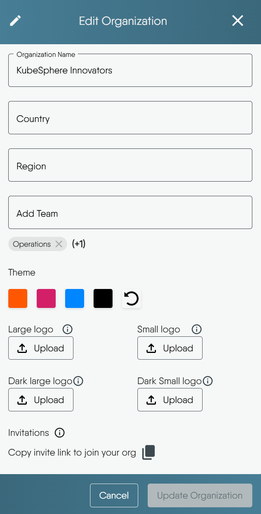

# Organization Management

> Create, edit, invite members to, and delete your Organizations within Layer5 Cloud.

This guide covers creating new organizations, editing their details, inviting members, and deleting organizations when necessary.

  <h4 class="alert-heading" style="color: #3772ff;">Permissions Required</h4>
  
      Operations described on this page for managing your Organization typically require Organization Administrator or similar administrative roles. To understand the specific roles needed for each action, please refer to the <a href="https://docs.layer5.io/cloud/reference/default-permissions/">Default Permissions reference</a>.
  

## Creating an Organization

An Organization provides a way to structure your teams, users, and resource access for different projects or initiatives.

### How to create an Organization

1.  Go to the Organizations section, click the **Add Organization** button
2.  The "Create New Organization" modal will appear:
    -   Organization Name: Enter a name for your new Organization. This is a required field. The form keeps Create disabled until you enter a name. Layer5 Cloud does not require the name to be unique.
    -   Country (Optional): Select the country for your Organization.
    -   Region (Optional): Choose the time zone for your Organization.
    -   Add Organization Members (Optional): You can begin adding **existing** Layer5 Cloud users to your new Organization in this field.

What creation does: you become the owner, you and any users you picked are added as members, and Layer5 Cloud creates a default workspace named **My Workspace**, owned by you. Ownership cannot be transferred. A new organization does not carry a domain. A Provider Admin assigns one afterward. Creating a child inside a parent also makes the creator a member and an Organization Admin of the child.

  <h4 class="alert-heading" style="color: #3772ff;">Unable to Create More Organizations?</h4>
  
      If the &ldquo;Add Organization&rdquo; button is disabled, your role lacks <strong>Create Organization</strong>. Organization Admin and Provider Admin hold it by default.
  

## Child Organizations

An Organization can have child Organizations of its own, to any depth. A child is created from the **Child organizations** section of the Organizations page, and an Organization Administrator or Owner of the parent can edit the child's settings and membership, or delete it, without joining the child. Anything inside the child still requires membership in the child. Deleting an Organization that still has children is refused until the children are deleted. See [Child Organizations](child-organizations/) for details.

## Editing Your Organization

You can update your Organization's name, location, associated teams, branding, and identity providers, as well as access its invitation link, by editing its details.

### How to Edit Your Organization

1.  Select the Organization you want to modify and click its **"Edit"** button.
2.  The "Edit Organization" modal will open:
    -   Add Team: Associate existing Teams with this Organization.
    -   Theme: Customize your Organization's visual theme by selecting from the available color swatches.
    -   Logos: Upload specific logo versions for various display contexts by clicking the respective **"Upload"** buttons.
    -   Invitations: Access a shareable link to invite users to your Organization.
    -   Identity Providers: Configure which OAuth applications power your Organization's sign-in (see [Configuring Identity Providers](#configuring-identity-providers-bring-your-own-credentials) below).
    -   Email: Send your Organization's email through your own mail server, from your own domain (see [Configuring Your Own Mail Server](#configuring-your-own-mail-server) below).

### Configuring Identity Providers (Bring-Your-Own Credentials)

The **Identity Providers** tab controls which OAuth applications power sign-in for your Organization. This is most useful when your Organization uses a custom domain and you want your own brand, not Layer5's, shown on the Google, GitHub, or OIDC consent screen.

By default, your Organization uses Layer5's shared OAuth applications. To override them, add your own provider. There is no separate "enable" step:

-   Use **Add Google**, **Add GitHub**, or **Add OIDC** to register a provider. Each walkthrough displays the exact redirect URI to add to your OAuth application. Saving your first provider switches the Organization to its own identity providers automatically.
-   Use **Edit** to rotate a provider's credentials, or **Remove** to delete a single provider. Removing your last provider reverts the Organization to Layer5's defaults.
-   Use **Delete All Identity Providers** to remove every configured provider at once. This deletes the Environment that Layer5 Cloud provisioned to hold them, and the Organization reverts to Layer5's default identity providers.

Every removal asks you to confirm and explains the consequences before it proceeds.

  <h4 class="alert-heading" style="color: #3772ff;">Who can configure this</h4>
  
      Organization Administrators and Owners can add, rotate, and remove their Organization&rsquo;s identity providers themselves. Provider Administrators can additionally manage the Identity Providers configuration (and the configuration of other aspects) of <strong>any</strong> Organization - whether or not they are members of it.
  

Switching identity providers does not affect existing user accounts or login history. Users who signed in through a provider you later remove may need to re-authenticate.

### Configuring Your Own Mail Server

The **Email** tab lets your Organization send application mail such as invitations and notifications through **its own SMTP server**, from **its own domain**, instead of through Layer5's shared mail server. Nothing about the message then points to a shared provider.

Setting it up has three steps: register the server and its credentials, prove control of the sending domain by publishing a DNS TXT record, and pass a connection test. Completing them changes nothing on its own - mail keeps leaving through Layer5's shared server until an administrator clicks **Turn on**, which is what switches routing over. The tab reports delivery health afterwards, and a fallback setting decides what happens to a message your server does not accept.

The full walkthrough, including a worked example for Google Workspace, Microsoft 365, Amazon SES, SendGrid and Postmark, and a troubleshooting table for every failure the tab reports, is in [Bring Your Own Mail Server](bring-your-own-mail-server/).

  <h4 class="alert-heading" style="color: #3772ff;">Who can configure this</h4>
  
      Organization Administrators and Owners can configure, test, turn on, turn off, and remove their Organization&rsquo;s mail server, under the same gate as the Identity Providers tab.
  

## Using the Open Organization Invitation Link

To invite multiple users to your organization at once, or to allow open sign-ups (for example, for a public community), you can use the "Open Organization Invitation Link." This is a shareable link that lets users join directly.

### When to Use This Link
* Bulk Onboarding: To quickly onboard many users without sending individual emails.
* Public Sign-ups: To let people sign up openly, for instance, by posting the link on a community page or another public resource.
* Cross-Organizational Collaboration: To make it easy for collaborators from other organizations or external partners to join.

  <h4 class="alert-heading" style="color: #3772ff;">Inviting users to specific teams</h4>
  
      Layer5 Cloud has no team invite link. To place people into teams, list the teams on an organization invitation. See <a href="/pr-preview/pr-1367/cloud/concepts/identity-and-security/teams/">Teams</a> and <a href="/pr-preview/pr-1367/cloud/concepts/identity-and-security/users/user-invitations/">User Invitations</a>.
  

### How it Works

-  For New Users (without an existing Layer5 Cloud account):
    * When a new user clicks the invitation link, they will be directed to the sign-up page.
    * After creating their account, they will be automatically added to the organization associated with the invite link.

-  For Existing Users (with a Layer5 Cloud account):
    * An existing user who signs in through the organization's address joins with their current account, if they are not already a member. Acceptance adds the organization, team, and role grants the invitation carries. It never removes anything.
    * If acceptance fails, Layer5 Cloud logs the failure and the sign-in still succeeds.

The organization record publishes the open invitation's id, and the id is also its invitation code. Treat an open invitation as a shareable link, not a secret. You designate it in either of two places: the **Open Org Invitation** setting of the organization, or the open-signup option on the invitation itself. When both are set, the organization's setting wins as long as it names a live invitation of that organization. Writing the organization setting needs Organization Admin in the organization or in its parent. Setting `isDefault` on the invitation needs Manage Invitations.

## Deleting Your Organization

Deleting an organization retires it and every membership in it. The operation has no undo. The organization's owner, a Provider Admin, or an Organization Admin or owner of the live parent can delete it. An Organization Admin who is not the owner cannot.

  <h4 class="alert-heading" style="color: #EBC017;">Deletion is Permanent and Unrecoverable</h4>
  
      Once an Organization is deleted, <strong>this action cannot be undone</strong>. There is no restore operation.
  

### Consequences of Deletion

Deleting is a soft delete. It does the following:

* The organization is marked deleted and no longer appears in any list or switcher.
* Every user membership in the organization ends. User accounts are not deleted.
* Every mapping between the organization and its teams ends. The teams themselves are not removed.
* The organization's domain stops routing. The deleted organization still holds the domain, so no other organization can use it. Clear the domain before you delete if the address needs to be reused.

The request does not delete the organization's workspaces, environments, or designs. Nothing reaches them through the organization afterwards.

Layer5 Cloud refuses the deletion when the organization still has child organizations (HTTP 409, nothing is changed) or when it is the last live organization the caller owns (HTTP 403, `you can't delete your last organization`). The last-organization check does not apply when a parent's administrator deletes a child.

### When NOT to Delete
Avoid deleting an Organization if:
* You might need the Organization or its data later.
* Critical resources within it have not been backed up or migrated.
* Other users or services still depend on it.
* You only need to modify memberships or restructure parts of it.
* You are unsure about the full extent of its data or dependencies.

### When Deletion May Be Appropriate

* The Organization was for a temporary project or test and is no longer needed.
* It was created in error or is now redundant due to consolidation.
* Permanent removal of all its data is required for compliance or data lifecycle management.
* You are certain all its resources are obsolete or migrated, and no dependencies remain.

### How to Delete Your Organization

1.  Select the Organization you want to delete and click its **"Delete"** button.
2.  A confirmation modal will appear, requiring you to verify this action.
3. Click the "Delete" button to permanently remove the Organization. To abort the deletion, click "Cancel".

## Branding

Branding applies to the signed-in experience and, on an organization with its own domain, to the sign-in, sign-up, and error pages.

- **Theme colors.** Every color must be a hex value (`#rgb`, `#rgba`, `#rrggbb`, or `#rrggbbaa`). Layer5 Cloud rejects any other value with a 400 error that names the color. Resetting the theme also clears the logos.
- **Logos.** Four slots: desktop, mobile, dark desktop, and dark mobile. Each image can be at most 500 KB. A larger file fails the update with `image size exceeds the maximum limit`.
- **Links.** Terms of Service and Privacy Policy accept an `http` or `https` URL, a `mailto:` or `tel:` link, or a root-relative path. Support entries accept the same forms plus plain text without a colon. LinkedIn, X, and YouTube accept an absolute `http` or `https` URL. Layer5 Cloud silently drops a value it considers unsafe, including `javascript:` and `data:` links, instead of rejecting the update. Clearing every link restores the defaults.
- **Feature carousel.** Whether sign-in pages show the feature carousel. On by default.

#### On your own domain, nothing falls back to the provider

On an organization with its own domain, a branding field you leave empty is hidden. It is never filled with the provider's value. People who sign up or sign in on your domain see only what you set:

- **Pages.** The page title, description, social card, and favicon carry your organization's name, description, and logos, or nothing. The error page lists only your support entries, and leaves out the contact sentence when you have none. Provider content, such as the playground, videos, help center, and badges widgets on the dashboard, is not shown.
- **Email.** The header shows your logo, or your organization's name when you have not uploaded one. The footer carries only your links. Every link in the message (verification, recovery, invitation, account, and design links) points at your domain.
- **Sender.** Mail is sent under your organization's name. The sending address stays the shared mail server's until you [bring your own mail server](bring-your-own-mail-server/); sending from your domain needs your own server, and SPF and DMARC pass only when the required DNS records and sender authentication are configured correctly.
- **Child organizations.** A child organization, such as the one a `child_organization` invitation creates, starts with the branding the invitation selects — the inviting organization's (the default), the provider's, or none — copied at creation; later changes to the source organization's branding do not update it. Separately, when mail is sent for a child organization that has no domain of its own, the nearest ancestor organization that has a domain supplies the name and links the message carries and the host its links point at, along with its theme when the child has not set one of its own. A child organization that set its own theme keeps it.

Fill in every branding field you want people to see: theme colors, all four logos, Terms of Service and Privacy Policy, support entries, and social profiles. A field you leave empty does not appear.

## Domain

Only a Provider Admin can set a domain to a new value. Any other caller receives a 403 error that says a domain requires a Provider Admin. Clearing the field removes the assignment and is open to the organization's administrators. Keeping the stored value is also open to those administrators.

Layer5 Cloud checks a changed domain when you save: 3 to 253 characters, dot-separated labels of 1 to 63 ASCII letters, digits, or hyphens, a label not starting or ending with a hyphen, a hostname rather than an email address, not starting with `http`, `https`, or `www`, not one of the provider's reserved hosts, and unique across organizations including deleted ones. Internationalized names are written in Punycode (`xn--`). The check is syntactic. Layer5 Cloud does not look the name up in DNS. Lookups are cached for five minutes, and every organization create, update, and delete clears the affected entry on the server that handled the change.

## Teams in the organization

Adding a team maps the team into the organization. Removing a team ends that mapping only. The team itself is not deleted. Adding a team requires an Organization Admin or owner of the organization, or a Provider Admin. Removing a team also admits someone who is both Team Admin and team owner of that team. Removing a team that does not belong to the organization returns a 404 error.

## Managing members

Adding a member attaches an existing Layer5 Cloud account. It does not create an account. Adding someone who is already a member changes nothing. The caller must be an Organization Admin or owner of the organization, a Provider Admin, or an Organization Admin or owner of its parent. Removal ends the person's organization membership and their membership in every team of that organization. Their account stays. The owner cannot be removed (`Organization owner cannot be removed`). Removing someone with no membership returns `no organization membership to remove`. Repeating a removal is harmless. See [User Management](/pr-preview/pr-1367/cloud/concepts/identity-and-security/users/user-management/).

Assigning or removing an organization role requires an Organization Admin of that organization, a Provider Admin, or Assign User Roles in it. The target must be a member, except when a Provider Admin makes the change. A row the caller may not change is skipped and reported as `unauthorized to assign org roles`, and the rest of the request still applies. Only a Provider Admin can assign provider roles.

## Switching Between Organizations

Your current organization decides which resources you see, where new resources land, and which permissions apply. The switcher lists only the organizations you are a member of. Members who hold View All Organizations, a Provider Admin by default, can also select All Organizations. If you need an organization you are not in, ask its administrator or use an invitation link. See [Navigating Organizations](navigating-organizations/) for the same behavior in more detail.

Layer5 Cloud decides the organization for each request from these sources, first match wins:

1. **Domain.** If the address you reached maps to an organization, you work in that organization or in one of the organizations beneath it, as described in [On a custom domain](#on-a-custom-domain). The domain does not outrank every selection you make: a saved preference or session selection inside that organization's tree can apply, and one outside it is ignored on that domain. An explicit `X-Current-Orgid` header is decided separately, as that section describes.
2. **`X-Current-Orgid` request header.** API clients set it per request.
3. **Saved preference.** The organization you last selected is stored in your user preferences.
4. **Browser session.** The organization saved in the session cookie.

On the deployment's own address, Layer5 Cloud ignores a header, preference, or session value that names an organization you do not belong to, and runs the request with no organization scope. On a custom domain, a preference or session value that names an organization you do not belong to is ignored and resolution continues instead, as described in [On a custom domain](#on-a-custom-domain); an explicit header naming an organization you do not belong to still runs with no organization scope. Holders of View All Organizations are exempt and can name any organization. There is no query-string source.

### On a custom domain {#on-a-custom-domain}

An organization's custom domain sets two things separately. The **domain's organization** supplies the branding, sign-in pages, and links in email. The organization you **work in** is resolved on that domain in this order:

1. An organization in the domain organization's tree that you select, through your saved preference or the browser session. It counts only if you are a member, or if you hold **View All Organizations**, in which case you may select any organization in the tree.
2. Otherwise, your membership closest to the domain's organization. Members of the domain's organization itself work in it. If you belong to several organizations at the same level, the one you joined first applies, every time.
3. Otherwise, the domain's organization.

A selection that names an organization outside the domain's tree is ignored on that domain, and resolution continues to the next step. The same applies to a saved preference or session selection that names an organization you do not belong to: on a custom domain it is ignored and resolution continues, rather than leaving the request with no organization scope — that no-scope outcome applies to an explicit header, as described next, and to selections on the deployment's own address. An explicit `X-Current-Orgid` header is the exception: on a custom domain it is decided by membership in the same way as on the deployment's own address, so it can name an organization outside the tree that you belong to, and one you do not belong to runs with no organization scope rather than falling back to the domain's organization. The deployment's own address keeps the order above.

| Area | Behavior |
|---|---|
| Designs, workspaces, environments, connections | Only the selected organization's resources appear. |
| New resources | Created in the selected organization. Resources do not follow you between organizations. |
| Roles and permissions | Scoped to the organization. Administrative rights in one organization grant nothing in another. |
| Team memberships | The memberships and permissions of the selected organization apply. |

## Limits today

These actions do not exist in Layer5 Cloud today:

- Transfer ownership. The creator stays the owner.
- Leave an organization on your own. An administrator removes a member.
- Restore a deleted organization.
- Move a child organization to a different parent.

